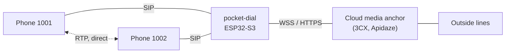
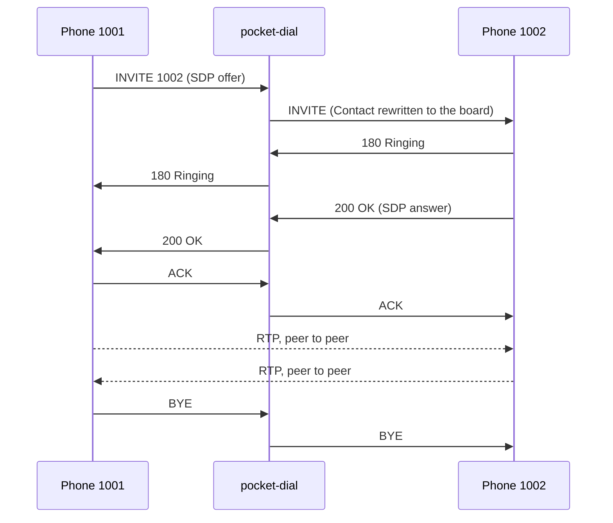
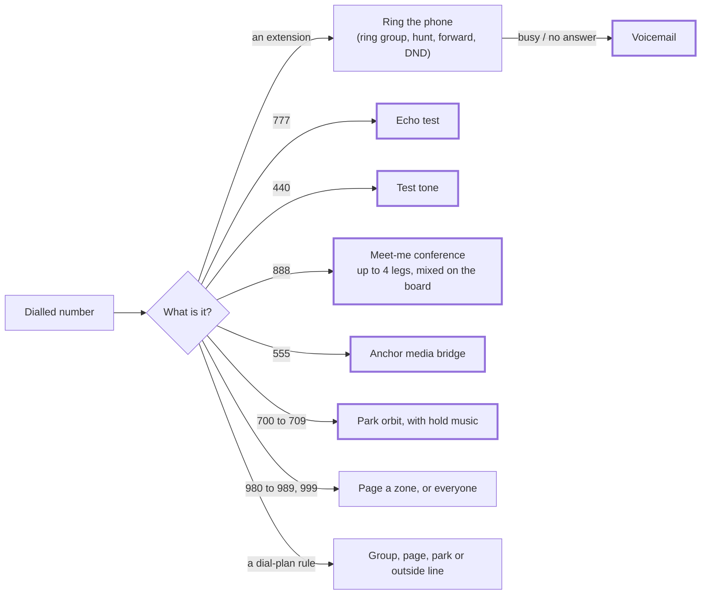
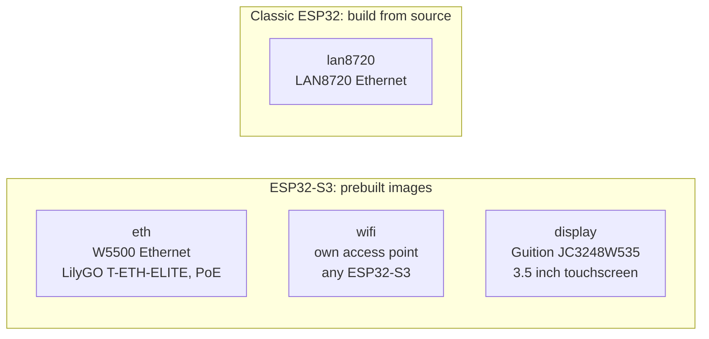
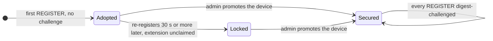

# pocket-dial

A SIP PBX on one ESP32-S3. No router, no server, no cloud.

Point SIP phones at a small board and they can call each other, transfer, park, page and forward, the way they would on a rack-mounted PBX. The same C++17 engine builds as a desktop binary for Linux, macOS and Windows, which is how most of it is tested.

**[Flash a board from your browser](https://glomargadaffi.github.io/pocket-dial/flasher/)** · [Project site](https://glomargadaffi.github.io/pocket-dial/) · [Releases](https://github.com/GlomarGadaffi/pocket-dial/releases) · [Setup guide](docs/SETUP_GUIDE.md)

## How it works

The board does signalling. The phones do audio. An ordinary extension-to-extension call streams RTP straight from phone to phone, so the board never carries it. That is what lets a microcontroller run a PBX.



The engine is a back-to-back call broker, not an RFC 3261 proxy: it ends each call leg and starts the next one itself, and keeps itself in the dialog by rewriting `Contact`. SDP passes through with only the codecs it won't carry removed, so two phones that both speak G.722 get wideband. [ARCHITECTURE.md](docs/ARCHITECTURE.md) has the full picture.



## When the board does touch the audio

Some features need a party that can play, record or mix sound. For those the board answers the call itself and terminates the media, PCMU only.



Heavy outlines mark the legs where the board terminates the media. Everything else stays peer to peer.

## Features

| Area | What you get |
|---|---|
| Calls | Extension to extension with PCMU, PCMA or G.722; hold and resume; UPDATE (RFC 3311); session timers (RFC 4028) |
| Transfer | Blind, and attended with REFER + `Replaces` (RFC 3891) |
| Park and pickup | Orbits `700`–`709`; `*8` picks up your group, `**<ext>` one extension |
| Groups | Ring-all or hunt; unanswered legs are cancelled properly |
| Paging | Zones `980`–`989`, `999` for everyone, with auto-answer headers |
| Per extension | Forward always, on busy or on no answer; do-not-disturb; star codes from the handset |
| Lamps | BLF through the `dialog` event package (RFC 4235) |
| Board-terminated | Echo `777`, tone `440`, conference `888`, voicemail, hold music |
| Routing | Ordered dial plan, up to 16 rules, first match wins |
| Outside lines | Cloud media anchors (3CX, Apidaze). The direct carrier SIP trunk is shelved ([ADR-002](docs/ADR-002-PROGRAMMABLE-MEDIA-ANCHOR.md)) |
| Admin | Web dashboard, HTTP API, phone provisioning, OTA updates, outbound email |

Not all of this has run on hardware yet. [FEATURE_ROADMAP.md](docs/FEATURE_ROADMAP.md) says which features are bench-proven and which have only passed the host tests.

## Quick start

### On a board

Use the [browser flasher](https://glomargadaffi.github.io/pocket-dial/flasher/) (Chrome, Edge or Opera on a desktop, over USB). It picks the image for your board and can seed Wi-Fi, a WPA2 passphrase for the access point and the registrar mode before first boot. For the command line, see [FLASHING.md](docs/FLASHING.md).

Or build with ESP-IDF:

```bash
idf.py set-target esp32s3
idf.py -D SIP_TRANSPORT=eth build
idf.py -p /dev/ttyUSB0 -D SIP_TRANSPORT=eth flash monitor
```

### On a PC or a Raspberry Pi

```bash
# Linux / macOS
curl -fsSL https://raw.githubusercontent.com/GlomarGadaffi/pocket-dial/main/install.sh | sh
```

```powershell
# Windows (PowerShell)
irm https://raw.githubusercontent.com/GlomarGadaffi/pocket-dial/main/install.ps1 | iex
```

Or from source:

```bash
cmake -B build -S . -DCMAKE_BUILD_TYPE=Release
cmake --build build --config Release
./build/SipServer --ip 127.0.0.1 --port 5060 --web 8080
```

Open `http://127.0.0.1:8080`, register two softphones at `sip:127.0.0.1:5060` as `1001` and `1002`, then dial `777` for an echo test or `999` to page every phone. On a board the dashboard is on port 80.

## Hardware



| Image | Good for |
|---|---|
| `eth` | An office closet. The best-tested path. |
| `wifi` | A bag, a field site, a demo. No cables, no router. |
| `display` | A wallboard that shows what the PBX is doing. |
| `lan8720` | Older boards you already own. |

Pin maps, wiring and parts lists: [HARDWARE.md](docs/HARDWARE.md). Which phones work, and how well: [PHONE_COMPATIBILITY.md](docs/PHONE_COMPATIBILITY.md).

## Read this before you plug it in

pocket-dial is built for a flat, trusted local network. Out of the box:

- The `wifi` image's access point is **open**. WPA2 is one setting away and encrypts the dashboard, the signalling and the call audio at once.
- The registrar starts in **Learn** mode (below). No phone needs a password to join.
- The dashboard ships with the login `admin` / `admin` and refuses to do anything until you replace it. On a fresh board the real control is who gets to the dashboard first.
- There is no flash encryption and no Secure Boot. Whoever holds the board holds its secrets.



That is **Learn** mode, trust on first use. Switch the registrar to **Secure** and every REGISTER is digest-challenged; an extension with no stored secret cannot register at all.

**Do not expose UDP 5060 or the dashboard to the Internet.** Not with a port forward, not "just for a minute". [THREAT_MODEL.md](docs/THREAT_MODEL.md) lists what is defended, what is not, and why.

## Releases

**v1.6.0** (2026-10-20) is current: 114 pull requests since v1.5.1, built to be left running, on two boards. The flasher offers it and every earlier tag; images and checksums are on the [releases page](https://github.com/GlomarGadaffi/pocket-dial/releases). `main` moves ahead of the newest tag between releases; the [changelog](CHANGELOG.md) says what changed and what is still a known gap.

## Repository layout

```text
src/        the PBX engine (SIP, media, HTTP, helpers), shared by every target
main/       ESP-IDF entry points per board, drivers, display UI
main.cpp    desktop entry point
tests/      host unit and scenario tests, interop suite, test tools
tools/      bench, soak, OTA and CI helpers
docs/       guides, design notes, and the GitHub Pages site (index.html, flasher/)
```

## Documentation

- [Setup guide](docs/SETUP_GUIDE.md) · [Flashing](docs/FLASHING.md) · [Hardware](docs/HARDWARE.md) · [Phone compatibility](docs/PHONE_COMPATIBILITY.md)
- [Architecture](docs/ARCHITECTURE.md) · [HTTP API](docs/API.md) · [Provisioning](docs/PROVISIONING.md) · [OTA](docs/OTA.md)
- [Threat model](docs/THREAT_MODEL.md) · [Feature roadmap](docs/FEATURE_ROADMAP.md) · [Troubleshooting](docs/TROUBLESHOOTING.md)

## Contributing

Build and run the desktop binary, test on real phones and boards, and open an issue with logs and a way to reproduce. [CONTRIBUTING.md](docs/CONTRIBUTING.md) and [CONTRIBUTING_FIRMWARE.md](CONTRIBUTING_FIRMWARE.md) cover the rest.

## License

Apache License 2.0. pocket-dial began as a fork of [BarGabriel/SipServer](https://github.com/BarGabriel/SipServer), used under the MIT License; that license is kept in [LICENSE-MIT](LICENSE-MIT) and the attribution in [NOTICE](NOTICE).
