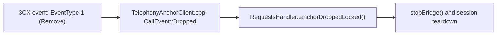
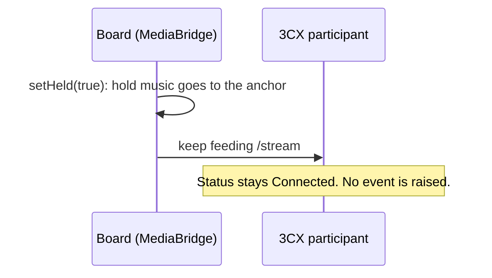

# 3CX Call Control API and WebSocket Events

Reference for the anchor leg, the non-SIP side of the B2BUA where `TelephonyAnchorClient` talks to 3CX. The claims were checked against 3CX's published documentation and reference implementation on 2026-09-18, and the action list, EventType enum and configuration page again on 2026-10-12.

The Call Control API has no hold, no resume, no mute and no park, and no `Held` participant status. Hold is a SIP dialog state with no counterpart on this leg, so the board cannot signal it downstream. It can only *disguise* it.

## 1. Endpoint surface

The Call Control endpoints:

```
GET  /callcontrol                                            all DNs + participants + devices
     /callcontrol/ws                                         WebSocket (events + requests)
     /callcontrol/{dn}
     /callcontrol/{dn}/devices
     /callcontrol/{dn}/devices/{deviceid}
POST /callcontrol/{dn}/devices/{deviceid}/makecall
POST /callcontrol/{dn}/makecall
     /callcontrol/{dn}/participants
     /callcontrol/{dn}/participants/{id}
     /callcontrol/{dn}/participants/{id}/stream               PCM audio
POST /callcontrol/{dn}/participants/{id}/{action}             the control verbs
```

## 2. The participant actions

`{action}` takes one of the values in this table. The published endpoint page lists these seven, and the table covers all of them.

| action | what it does | constraint that matters |
|---|---|---|
| `drop` | drop participation in the call | no parameters |
| `answer` | answer | **only** for participants supporting `direct_control` (uaCSTA) or RoutePoint participants |
| `divert` | replace a **ringing** participant with a new destination | **fails if the participant is already connected** |
| `routeto` | add alternative routes for an existing participant | works on connected *or* ringing; participant keeps its own participation until delivery succeeds |
| `transferto` | transfer | **only** for a connected (talking) participant |
| `attach_participant_data` | attach data to the participant connection, where other PBX components can observe it | none stated |
| `attach_party_data` | attach data to the other party's connection, where PBX components and call-flow services can observe it | none stated |

The reference client's action type lists the first six of these. It has no `attach_party_data`.

### Where hold appears in the published pages

Inside `transferto`'s description:

> *"The other party **will be put on hold** for the time of transfer attempt.
> The participant will be replaced on success, or will be **returned to the
> call if transfer fails**."*

So 3CX does hold internally, but it does not expose hold as a primitive. The only reachable path to it is to start a transfer and not complete it.

This is a workaround, not a design. It changes call state, depends on failure-path behaviour, and `transferto` is valid only on a connected participant. It is noted here so that nobody has to rediscover it. Treat disguising the hold locally as the supported approach, and this as a curiosity.

## 3. Participant statuses

From 3CX's reference client, `cc-component-lib/src/constants.ts`:

```
PARTICIPANT_STATUS_CONNECTED = "Connected"
PARTICIPANT_STATUS_DIALING   = "Dialing"
PARTICIPANT_STATUS_RINGING   = "Ringing"
```

There are three states: no held, no parked and no muted. A participant that the PBX is holding on our behalf still reads `Connected`.

## 4. WebSocket: `/callcontrol/ws`

The WebSocket is not a replacement for the REST calls. It is a bidirectional channel that can carry requests, and it is the only source of real-time events. 3CX explicitly supports using it purely as an event channel while continuing to use HTTP for actions. It also warns that WebSocket messages have a size limit, so it suits small event payloads rather than bulk data.

### Application to server (`WebSocketRequest`)

| field | meaning |
|---|---|
| `RequestID` | app-generated, used to match the response |
| `Path` | same paths as HTTP, e.g. `/callcontrol`, `/callcontrol/{dn}`, `/callcontrol/{dn}/participants/{id}` |
| `RequestData` | required for actions (`makecall`, `divert`, …), optional for GETs |

### Server to application (`WebSocketResponse`)

`RequestID`, `Path`, `StatusCode` (an HTTP status) and `Response` (the body; its shape depends on the path).

### Events (`ExternalCallFlowAppHookEvent`)

```
ExternalCallFlowAppHookEvent {
    EventType  = <enum>
    Entity     = the path the event concerns, e.g. /callcontrol/{dn}/participants
    AttachedData = WebSocketResponse
}
```

| EventType | name | meaning |
|---|---|---|
| `0` | Upsert | entity added **or updated** |
| `1` | **Remove** | **entity has been removed** |
| `2` | DTMFstring | DTMF from the remote party |
| `3` | PromptPlaybackFinished | named in the reference server's `types.ts` only, not in the published table; this project defines it as `TEL_EV_PROMPT_DONE` and never dispatches it |
| `4` | Response | response to a request sent over the WebSocket |

DTMF events only arrive for calls belonging to the application itself (between the application DN and its remote party).

The published page is inconsistent about the enum. Its struct example sets `EventType=0`, and the prose then says `EventType=5 (ENUM)`, but its enum table lists only `0, 1, 2, 4`. The reference server's `types.ts` declares the enum as `Upset`, `Remove`, `DTMFstring` and `PromptPlaybackFinished`, which numbers them 0 to 3 and has no 4. Neither source defines 5, so do not write a `case 5:`. The event parser in this project dispatches only 0, 1 and 2.

### Why this matters to us

There is no "held" event and no "held" status. A participant that our board has put on hold therefore produces no downstream state change at all. An `EventType=1 Remove` on a participant entity means 3CX has genuinely removed that participant. It is not a hold, a pause or a transient.

The Remove event becomes an `AnchorClient::CallEvent::Dropped` in `TelephonyAnchorClient.cpp`. `RequestsHandler::anchorDroppedLocked()` handles that event. It calls `stopBridge()` and tears the session down.



When diagnosing a call that vanished, **the WebSocket event log is the authority**, not the SIP side.

## 5. Consequences for this project

1. **Hold on an anchored leg can only ever be a local disguise.** Keep the participant `Connected` and keep feeding `/stream`, so the PBX never observes anything unusual. `MediaBridge::setHeld()` does exactly this by routing hold music to the anchor. There is nothing to signal and nothing to negotiate.
2. **`divert` is not a hold fallback.** It is documented to fail on a connected participant.
3. **A missing bridge is not the same as a missing dialog.** `answerAnchorReinvite()` answers a 481 when no `MediaBridge` matches the Call-ID, treating media state as proof of dialog existence. A held call legitimately has no active media and a perfectly live dialog. See #333 for the hold/resume issue.
4. **`answer` will not work on an ordinary participant.** It requires `direct_control`/uaCSTA or a RoutePoint.
5. **Events are the only way to learn a participant went away**, and they arrive solely on the WebSocket. Anything that drops that socket loses the ability to notice a dropped call.

The hold path from item 1, as the board and the PBX each see it:



## 6. Configuration REST API

`https://www.3cx.com/docs/configuration-rest-api/` is a separate API for provisioning and configuration, such as extensions, trunks and settings. It is not call control. It has no hold, resume, park or mute verbs. Its only match for those words is "shared parking spaces", which is configuration rather than a call-state verb. Do not look there for a call-state primitive.

## Sources and method

| source | used for |
|---|---|
| `https://www.3cx.com/docs/call-control-api/` | WebSocket model, `ExternalCallFlowAppHookEvent`, EventType enum |
| `https://www.3cx.com/docs/call-control-api-endpoints/` | endpoint paths, action table, the `transferto` hold sentence |
| `https://www.3cx.com/docs/configuration-rest-api/` | confirming the absence of call-state verbs |
| `https://github.com/3cx/call-control-examples` | `PARTICIPANT_CONTROL_*` and `PARTICIPANT_STATUS_*` constants, `EventType` in `server/src/types.ts` |

"The API has no hold" is a claim about an absence, and absences are easy to get wrong. The method was:

- All three pages were fetched raw and stripped to text locally, not summarized. A summarizing fetch truncated them, which would have made the absence unprovable.
- `hold|unhold|resume|park|mute` was searched across all three pages. There are two matches: the `transferto` sentence quoted above, and "shared parking spaces" on the configuration page.
- The same terms were searched across the source files in 3CX's reference repo. There are no matches.

An absence found by two independent routes, the official docs and the vendor's own client, is about as strong as this gets without a live PBX to interrogate. If a future 3CX version adds a hold verb, this file is wrong and should be re-verified the same way rather than trusted.
