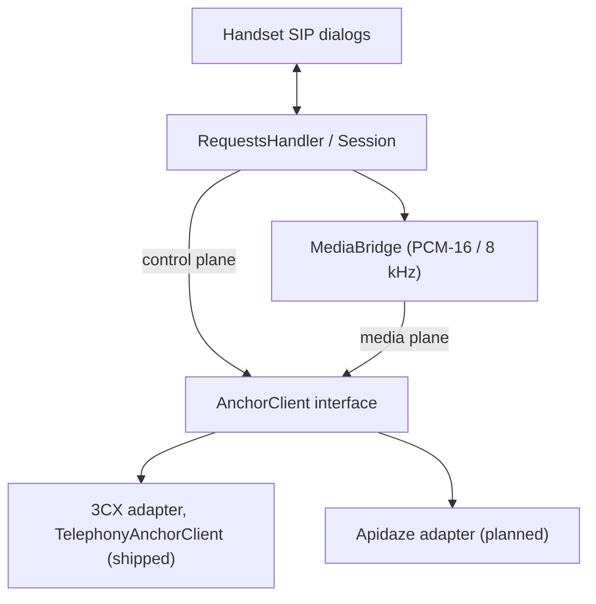

# ADR-002: Programmable Media Anchor Interface for PSTN Interconnect

Outside-line (PSTN) calls go through cloud media anchors behind one interface. The direct carrier SIP trunk is shelved.

## Status

Accepted (Part of #920, Epic #381)

## Context

The initial outside-line design kept two distinct paths:

1. **ITSP SIP Trunks (`SipTrunk`)**: Direct SIP signaling (RFC 3261) and RTP media relay over UDP to carrier Session Border Controllers (SBCs).
2. **Media Anchors (`TelephonyAnchorClient`)**: Asynchronous cloud B2BUA call control and bidirectional audio streaming, implemented against the 3CX Call Control API.

Field deployments and soak testing revealed these limits of direct ITSP SIP trunks on resource-constrained embedded nodes:

- **Residential NAT / CGNAT / SIP ALG drop modes**: Carrier-facing SIP over UDP suffers silent INVITE drops whenever SDP bodies exceed MTU or encounter stateful middleboxes or SIP ALGs (#618, #919).
- **Embedded task and memory exhaustion**: Running dual B2BUA SIP transactions, digest authentication, registration state machines, and dual raw RTP relay buffers on ESP32-S3 consumes over 12 KB of critical internal DRAM and multiple FreeRTOS task stacks.
- **Carrier interop and PSTN compliance complexity**: In-dialog variations across Tier-1 carriers (#874, #873) and E911 dispatch obligations create a large firmware maintenance burden.

The decision shelves ITSP SIP trunks behind Milestone 11. Outside-line PSTN interconnect uses cloud media anchors and programmable telephony paths instead.

## Decision

We define a standardized, decoupled **Programmable Media Anchor Interface** that isolates the PBX engine from specific cloud provider implementations.

The 3CX adapter (`TelephonyAnchorClient`) is shipped. The Apidaze adapter is planned, and `ApidazeAnchorClient` is a host-test scaffold.

### 1. Provider control plane contract (`AnchorClient`)

The control plane manages outside-line call lifecycles through the asynchronous `AnchorClient` interface in `src/SIP/AnchorClient.hpp`. Its call methods are:

- `makeCall(destination, ownLegOut)`: starts an outbound PSTN call. On success, `ownLegOut` receives the participant id of the leg the PBX controls.
- `answerCall(participantId)`: accepts an inbound PSTN call that the external system is delivering.
- `dropCall(participantId)`: hangs up a call.

The listener installed with `setEventCallback` receives `CallEvent` values. DTMF digits reported by the provider arrive as `Dtmf` events. The interface has no method that mutes a call or sends DTMF digits. Those are not part of the contract today.

### 2. Provider media plane contract

The media plane connects to Pocket-dial's internal `MediaBridge`, which already synthesizes and mixes 8 kHz, 16-bit signed linear PCM audio. Outbound audio goes through `writeAudio`, and inbound audio arrives through the callback registered with `registerAudioRxCallback`.

The AudioSocket binary framing protocol is the planned design for the Apidaze adapter:

- **3-byte framing header**:
  - `uint8_t  type`:
    - `0x01` (`UUID`): Initial 16-byte call identifier handshake.
    - `0x10` (`Audio`): Linear signed 16-bit PCM @ 8000 Hz, mono (320 bytes = 20ms).
    - `0x00` (`Hangup`): Remote disconnect notification.
    - `0xFF` (`Error`): Provider or bridge error.
  - `uint16_t length`: Big-endian payload size (e.g. 320 for 20ms audio frame).
  - **Payload**: Raw 16-bit PCM samples or binary UUID.
- Connection transport: Outbound TCP or TLS/WebSocket client initiated by the PBX node to the cloud provider's edge relay, bypassing all residential NAT/CGNAT ingress barriers.

The shipped 3CX adapter (`TelephonyAnchorClient`) does not use this framing. It streams PCM16 audio over HTTPS, with a chunked POST carrying outbound audio and a GET stream carrying inbound audio. Each outbound write carries an HTTP chunk-size line instead of the 3-byte header. Call events arrive over a WebSocket, and call control is REST.

### 3. Apidaze CPAAS mapping (Issue #920)

Apidaze (VoIP Innovations) is the reference secondary anchor beside 3CX. Everything in this section is planned design.

`ApidazeAnchorClient` is a host-test scaffold. It implements the `AnchorClient` interface and the AudioSocket frame encoder, and its contract is tested in `tests/AudioSocket_test.cpp`. It makes no REST calls and does no socket I/O.

- **Signaling and call control**:
  - `POST /{api_key}/calls`: Dispatches outbound PSTN calls, authenticated by API key and secret.
  - `DELETE /{api_key}/calls/{uuid}`: Hangs up the call.
  - `POST /{api_key}/calls/{uuid}/message`: Dispatches DTMF (`{"type":"dtmf_event","data":"X"}`) and control signals into the active audio socket.
- **Media**: Outbound AudioSocket connection streaming bidirectional PCM16 audio.
- **Inbound DID routing**: A webhook triggers an external script that directs the call to the board's secure socket stream.

### 4. Compile-out and resource invariants (#731)

When compiling production constrained builds or anchor-only profiles:

- `POCKETDIAL_HAS_ANCHOR = 1`
- `POCKETDIAL_HAS_TRUNK = 0`
- `POCKETDIAL_MAX_TRUNK_CALLS = 0`

`SipTrunk.cpp` is wrapped and completely compiled out. Zero `SipTrunk` symbols are emitted into the firmware image, and the internal DRAM task stack slots for trunk RTP receivers are freed.

No build measurement of the RAM or flash savings is recorded in this repository. To measure the flash saving, build with `-D SIP_CONSTRAINED=1 -D SIP_OUTSIDE_LINE=anchor` and run `idf.py size-components`.

### 5. Emergency (E911) policy

- All programmable media anchor providers must register emergency caller service profiles.
- If an anchor provider does not support Kari's Law / RAY BAUM'S Act compliant emergency routing, the PBX enforces local dispatch notification and fallback routing per Rule 5.

## Consequences

### Positive

- **Guaranteed middlebox traversal**: No UDP packet loss, no SIP ALG tampering, no residential router NAT timeouts. Outbound TLS/WSS connections remain resilient.
- **Zero carrier signaling drift**: Dialplan logic, carrier-specific headers, and re-INVITE handling are delegated to the cloud CPAAS platform.
- **Significant RAM and CPU savings**: Firmware eliminates dual SIP UAS/UAC transaction tracking for PSTN legs.

### Trade-offs and mitigations

- **Requires outbound cloud connectivity**: The node requires active internet connectivity to communicate with the cloud anchor. Mitigation: local extension-to-extension calls, intercom, paging, and local voicemail operate 100% autonomously without cloud connectivity.
- **Provider API dependency**: Requires configured API credentials with 3CX or Apidaze. Mitigation: the modular provider adapter pattern allows adding alternative CPAAS providers like Telnyx or Asterisk AudioSocket without modifying PBX core.
