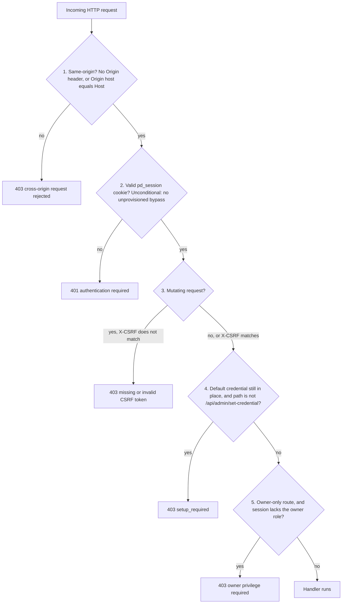

# Pocket-Dial Firmware: Systematic HTTP API Test Plan

This document defines the systematic test suite and validation plan for the HTTP REST API of the **pocket-dial ESP32 firmware**.

This plan ensures that all management endpoints function correctly under standard workloads, handle malformed parameters safely, validate boundaries, reject malicious cross-origin requests, and refuse mutations that cannot prove they came from the device's own dashboard.

Source of truth for every route and every gate: [`API.md`](API.md) and `src/Helpers/HttpServer.cpp`. `HttpServer::handleClient()` (line 812) dispatches the routes, and `HttpServer::requireAdmin()` (line 4591) is the gate. Where this plan and the code disagree, the code is right and the plan needs fixing.


## 0. Before You Test Anything: the shipped-default credential

Almost every surprise in this suite comes from one distinction, and it is **not** the old
"provisioned vs unprovisioned" split, which does not exist in the firmware.

The device ships with a well-known default login, `admin`/`admin`
(`AdminAuth::kDefaultUsername`/`kDefaultPassword`). There is no window in which the API is
open to anyone: the session gate is unconditional from the very first boot, and the default
credential is what makes that possible (`HttpServer::requireAdmin()`). Until an operator
replaces it, **every** admin-gated route except the one that replaces it is refused.

| | **Default credential** (`needsSetup:true`) | **Setup complete** (`needsSetup:false`) |
|---|---|---|
| TCP listener | Always listening | Always listening |
| Ungated routes | Work | Work |
| `pd_session` cookie | Required on every gated endpoint | Required on every gated endpoint |
| `X-CSRF` header | Required on every **mutating** gated endpoint | Required on every **mutating** gated endpoint |
| Any other gated route, even a `GET` | **`403 {"error":"setup_required"}`** | Works |
| `POST /api/admin/set-credential` | Works (the sole exemption) | Works |

Read the state with one ungated request:

```bash
curl -s http://192.168.4.1/api/admin/status
# -> {"provisioned":false,"needsSetup":true,"authenticated":false,"role":"","ownerProvisioned":false,"sessionRemainingSec":0}
```

### 0.1 The listener is never dark

There is no transport gate. The HTTP socket accepts connections at all times, and no DTMF code or `POST /api/admin/keepalive` call opens it. `grep -rn 4887 src/` returns nothing, `grantAdminHttpGraceWindow` does not exist, and `tests/AdminHttpGate_test.cpp` pins the socket as unconditionally accepting (`AdminHttpGate.Boot_Provisioned_StillListensImmediately`, `AdminHttpGate.SetCredential_DoesNotAffectReachability`). A test that expects *connection refused* anywhere would be testing a mechanism that does not exist.

The admin credential is likewise **not** a PIN, and `POST /api/admin/set-pin` does not exist. A separate numeric **DTMF PIN** does exist, for the phone-keypad `*PIN#code` admin menu only. It has no default and is set through `dtmfPin=` on `POST /api/admin/set-credential`.

### 0.2 Ungated routes, the only things a test can hit with no headers at all

From the dispatch in `HttpServer::handleClient()`:

| Route | Why it is ungated |
|---|---|
| `GET /`, `GET /index.html` | The dashboard shell; the login form has to render |
| `GET /api/status` | Read-only metrics snapshot |
| `GET /api/wifi/scan` | Onboarding needs it before a session exists |
| `GET /api/admin/status` | Tells the page whether to show the login form |
| `GET /api/ota/status` | Partition labels + pending flag; no secrets |
| `GET /config/<mac>.cfg` | A booting phone has no cookie. The 12-lowercase-hex MAC is the only credential. A MAC-keyed file is served only for an adopted MAC, or under zero-touch assignment (section 3.16) |
| `POST /api/admin/login`, `POST /api/admin/logout` | Same-origin checked, but no session/CSRF, there is nothing to bind a token to |

Everything else goes through `requireAdmin()`.

### 0.3 What this means for `tests/http/test_api.sh`

The smoke suite runs its Admin Auth block **first**, and that ordering is load-bearing. The comment block at the top of `test_api.sh` says why: every other suite needs the `$SESSION`/`$CSRF` that block establishes, and needs setup to already be complete, because `requireAdmin()` refuses everything otherwise. To count the cases from the script:

```bash
grep -o 'TC-[A-Z]*-[0-9][0-9]' tests/http/test_api.sh | sort -u | wc -l
```

The Admin Auth block runs in this order:

1. `TC-AUTH-01` asserts `needsSetup:true` before login.
2. `TC-AUTH-02`: a mutating call with no session is `401`.
3. `TC-AUTH-03`: cross-origin login is `403`.
4. `TC-AUTH-04`: login with `admin`/`admin` returns a cookie **and** a CSRF token.
5. `TC-AUTH-05`: a mutating call while `needsSetup` is still true is `403 setup_required`.
6. `TC-AUTH-06`: cross-origin `set-credential` is `403`.
7. `TC-AUTH-07` completes setup as `admin`/`realpassword123`, **reusing the same session**.
8. `TC-AUTH-08`: status reports `provisioned:true, needsSetup:false`.
9. `TC-AUTH-09`: the cookie **alone**, without `X-CSRF`, is still `403`.

The Auth Mechanics suite (`TC-AUTH-10` and `TC-AUTH-11`) runs last. `TC-AUTH-10` logs out. The factory-reset cases (`TC-FR-01` to `TC-FR-03`) run between the two, and only when `SERVER_PID` is set, because they perform a real reset. `TC-AUTH-11` deliberately trips the brute-force lockout, and runs only when `ALLOW_DESTRUCTIVE=1` is set (by `--allow-destructive`, or implicitly by `SERVER_PID`).

**Warning:** A run of `test_api.sh` leaves the target provisioned as `admin`/`realpassword123` (`TC-AUTH-07`). With `ALLOW_DESTRUCTIVE=1`, the run also ends with the admin account locked out for at least 60 s (`TC-AUTH-11`). Any manual testing after a run must use that password and must wait out the `429`. Run it against a scratch board or the host build.


## 1. The Admin Gate

Every gated route calls one function, `HttpServer::requireAdmin(sock, req, needCsrf, minRole)`. It applies four checks **in this order**. Routes that need the owner role get a fifth check. The first check to fail is the response you get.



The gate returns several different `403` responses: cross-origin, CSRF, forced setup and owner privilege. Asserting on the status code alone cannot tell them apart, so a test that only checks `403` can pass for the wrong reason. **Assert on the JSON body.**

Note the ordering of layers 3 and 4: a mutating call on a default-credential device with no CSRF token returns the **CSRF** error, not `setup_required`. A gated `GET` on the same device returns `setup_required`, because there is no CSRF check on a `GET` to fail first.

Layer 5 applies only to owner-only routes. It answers `403 {"error":"owner privilege required"}` when the session does not satisfy the owner role. While no owner credential has ever been set, a sysop session also satisfies this check.

### 1.1 Why the Origin check is not enough on its own

The same-origin check deliberately **allows** a request with no `Origin` header, because
that is what `curl`, native clients, and this repository's own smoke suite send. That
gap (a same-site page riding the victim's cookie) is closed by a per-session CSRF token:

* A 128-bit token is minted with the session at login (`AdminAuth::kCsrfTokenHex`).
* It is returned in the login response body as `"csrf"` and rendered into the dashboard
  document. It is **never** a cookie, a browser would attach a cookie to a cross-site
  request on its own, so only a value our own page had to read and echo back proves
  where the request came from.
* Checked centrally in `requireAdmin()`, so no route can forget it.

### 1.2 Safe-origin matrix (layer 1 only)

1. Direct request (`curl`, address-bar navigation): no `Origin` header. **Allow.**
2. Same-origin request (the dashboard): `Origin: http://192.168.4.1` matches
   `Host: 192.168.4.1`. **Allow.**
3. Cross-origin request: `Origin: http://malicious.com` vs `Host: 192.168.4.1`.
   **Reject `403`**, `{"error":"cross-origin request rejected"}`.

**Warning:** `Access-Control-Allow-Origin` (CORS) headers are intentionally omitted. Wildcard CORS would bypass CSRF safety bounds.

### 1.3 CSRF exemptions, and why

| Endpoint | Why no token |
|---|---|
| `POST /api/admin/login` | No session exists yet, so there is nothing to bind a token to. |
| `POST /api/admin/logout` | A forced logout is a nuisance, not a compromise; `SameSite=Strict` already blocks it, and requiring a token would strand a user on a stale page. |
| All `GET` endpoints | Reads are not state changes. The gated ones are still same-origin checked, session-gated, and subject to layer 4. |

There is **no** "unprovisioned device is exempt" row. `POST /api/admin/set-credential`
is exempt from layer **4**, not from layers 1-3: it still requires a session and a CSRF
token, obtained by first logging in with the default credential.


## 2. The Login Preamble Every Test Needs

Capture the cookie **and** the token in one step, then complete setup if the device has not
had it done. This is the same pattern [OTA.md §3.2](OTA.md) and
[TROUBLESHOOTING.md](TROUBLESHOOTING.md#403-on-an-api-call-that-used-to-work) use; keep them
in step.

```bash
DEVICE=http://192.168.4.1          # or http://pocketdial.local
JAR=cookies.txt
USER=admin
PASS=admin                         # a factory-fresh target; use the real one otherwise

# Log in: the cookie proves who you are, the token proves the request came from
# something that was told the token rather than from a page riding your cookie.
LOGIN=$(curl -s -c "$JAR" \
     -H "Origin: $DEVICE" \
     -X POST --data "username=$USER&password=$PASS" \
     "$DEVICE/api/admin/login")
# -> {"status":"ok","authenticated":true,"needsSetup":true,"csrf":"3f2a...e91c"}

CSRF=$(printf '%s' "$LOGIN" | sed -n 's/.*"csrf":"\([0-9a-f]*\)".*/\1/p')
[ -n "$CSRF" ] || { echo "login failed: $LOGIN" >&2; exit 1; }

# If needsSetup is true, complete setup NOW — every case below returns
# 403 setup_required otherwise. The session survives the change, so the same
# $JAR/$CSRF keep working and no second login is needed.
case "$LOGIN" in *'"needsSetup":true'*)
  curl -s -b "$JAR" -H "Origin: $DEVICE" -H "X-CSRF: $CSRF" \
       -X POST --data "username=admin&password=realpassword123" \
       "$DEVICE/api/admin/set-credential"
  # -> {"status":"ok","provisioned":true,"needsSetup":false}
esac
```

Every mutating request below then carries three things, the cookie, the `Origin`, and
the token:

```bash
curl -s -b "$JAR" \
     -H "Origin: $DEVICE" \
     -H "X-CSRF: $CSRF" \
     -X POST --data "extension=101" \
     "$DEVICE/api/kill"
```

Drop the `-H "X-CSRF: $CSRF"` and you get `403 {"error":"missing or invalid CSRF token"}`,
the single most common failure when running a pre-existing script against current firmware.

`POST /api/admin/login` against a device that has never been set up does **not** return `409`. It authenticates the shipped default and returns `200` with `"needsSetup":true`. A wrong credential returns `401 {"error":"invalid username or password"}` (`HttpServer::sendApiAdminLogin()`).


## 3. Endpoint Specifications & JSON Schemas

### 3.1 GET `/` or `/index.html`
Serves the web dashboard. Ungated. Once logged in, the page also carries the
session's CSRF token, which is how the dashboard's own `fetch()` calls satisfy layer 3.
* Request: `GET /`
* Response: `200 OK`
* Content-Type: `text/html; charset=utf-8`

The top bar exposes Dial Plan (F2), Groups (F3), Call Log (F4) and SIP Trace (F8) as
modals alongside Refresh / WiFi / Admin / Interconnect / Help. Anything those modals write
goes through the ordinary gated routes below, there is no privileged path from the page.

### 3.2 GET `/api/status`
Fetches a read-only snapshot of the registrar, call sessions, and system metrics. Ungated: it needs no session, but some fields are withheld from an unauthenticated caller (below).
* Request: `GET /api/status`
* Response: `200 OK`, `application/json`
* **Schema** (abridged, authenticated caller; see `HttpServer::sendApiStatus`):
  ```json
  {
    "ip": "192.168.4.1",
    "port": 5060,
    "httpPort": 80,
    "uptime": 345,
    "packetsProcessed": 104,
    "packetsDropped": 0,
    "clients":  [ { "number": "101", "address": "192.168.4.20:5061" } ],
    "sessions": [ { "caller": "101", "callee": "102", "state": "Connected", "duration": "02:15" } ],
    "dnd":      [ "103" ],
    "forwards": [ { "extension": "101", "always": "", "busy": "102", "noanswer": "" } ],
    "groups":   [ { "extension": "600", "mode": "ringall", "members": "101,102" } ],
    "dialplan": [ { "pattern": "9XXXXXXXXXX", "action": "trunk", "target": "", "stripDigits": 1 } ],
    "parkedCalls": [ { "orbit": "701", "parkedExt": "102", "parker": "101", "secondsParked": 12 } ]
  }
  ```

Without a session, the response keeps the counts but not the identities. An unauthenticated caller gets `clientCount`, `sessionCount`, `oldestSessionSec` and `parkedCount`, plus `rosterVisible: false`, and empty `clients`, `sessions` and `parkedCalls` arrays. `dnd`, `forwards`, `groups` and `dialplan` are returned to every caller (#207, #539).

### 3.3 GET `/api/cdr`
Read-only Call Detail Records ring. **Read-gated** (#207): it takes the session cookie and no CSRF token. Without a session a test must expect `401`.

### 3.4 POST `/api/kill`
Administratively disconnects a registered extension and terminates its calls.
* Content-Type: `application/x-www-form-urlencoded`
* Parameters: `extension=XXXX`
* Headers: `Cookie: pd_session=…` **and** `X-CSRF: <token>`
* Response (Success): `200 OK` `{"status":"ok","disconnected":"101"}`
* Missing parameter: `400` `{"error":"missing extension parameter"}`
* No session: `401` `{"error":"authentication required"}`
* Session but no/wrong token: `403` `{"error":"missing or invalid CSRF token"}`
* Cross-origin: `403` `{"error":"cross-origin request rejected"}`
* Default credential still in place: `403` `{"error":"setup_required"}`

### 3.5 GET `/api/wifi/scan`
Triggers an active Wi-Fi channel scan and returns visible networks. Ungated.
* Response (Wi-Fi build): `200 OK` `{"networks":[{"ssid":"Office_WiFi","rssi":-65,"encryption":"WPA2"}]}`
* Response (no Wi-Fi radio in this build): `200 OK` `{"networks":[], "note":"WiFi is not available on this build -- this board has no WiFi radio in its current Ethernet-transport configuration"}`

### 3.6 POST `/api/wifi/connect`
Configures network credentials, saves them to NVS, and restarts in Station mode.
* Parameters: `ssid=SSID_NAME&password=WIFI_PASSWORD`
* Headers: cookie **and** `X-CSRF`
* Response (Wi-Fi build): `200 OK` `{"status":"ok","message":"WiFi credentials saved. Rebooting to Station Mode..."}`
* Missing SSID: `400` `{"error":"missing ssid parameter"}`
* Response (no Wi-Fi radio in this build): `501` `{"error":"WiFi is not available on this build -- this board has no WiFi radio in its current Ethernet-transport configuration"}`

### 3.7 POST `/api/wifi/mode_ap`
Sets operational mode back to Standalone AP and reboots. Cookie **and** `X-CSRF`.
* Response (Wi-Fi build): `200 OK` `{"status":"ok","message":"Operational mode set to Standalone AP. Rebooting..."}`
* Response (no Wi-Fi radio in this build): `501` `{"error":"WiFi is not available on this build -- this board has no WiFi radio in its current Ethernet-transport configuration"}`

A no-Wi-Fi build is not only the desktop build. The `eth` and `lan8720` transports do not define `POCKETDIAL_HAS_WIFI` (`main/CMakeLists.txt:240-242`), so on a wired board `/api/wifi/connect` and `/api/wifi/mode_ap` take their `#else` branch and answer `501` (#167). A hardware test matrix must branch on transport, not on host versus device.

`/api/factory-reset` answers `200` on every build and reboots on every ESP build. Only its Wi-Fi NVS key erase is still gated by transport (#189).

### 3.8 POST `/api/configuring`
Pauses the captive-portal auto-switch-to-Standalone decay while a user is mid-setup. It takes the full `requireAdmin()` gate with `needCsrf = true` (the `POST /api/configuring` branch of `HttpServer::handleClient()`, `HttpServer.cpp:1526`), like every other mutating route. It is not exempt on a fresh device, so the portal must log in with the default credential first.

### 3.9 GET `/api/pcap`, `/api/diagnostics/pcap`, `/api/trace`
Diagnostic capture ring: the first two as a Wireshark-readable `.pcap`, the third as JSON
for the dashboard's live tracer. All three are `GET` routes. They go through `requireAdmin()` like everything else, so they take same-origin plus a session, and no CSRF token, and they are still subject to layer 4. TC-SEC-06 pins this. A capture ring is signalling metadata (who called whom, and from which address), so a page that can reach the device without a session must not be able to read it.

### 3.10 GET `/api/ap-security`
Reports the SoftAP security setting and its passphrase. Gated.

```json
{ "secure": false, "psk": "DD9T4GZKQ4AHY5KGRZP8" }
```

* `secure`, `true` when the standalone SoftAP comes up `WIFI_AUTH_WPA2_PSK`. **Defaults
  to `false`**; the shipped posture is an open AP. Enabling WPA2 forces every associated
  phone to be re-paired, so it is an explicit operator action.
* `psk`, generated from the hardware CSPRNG on first access and stored in NVS. 20
  characters from an alphabet with no ambiguous glyphs (no `0`/`O`, `1`/`I`/`L`, `U`).

Returning the passphrase in clear to an authenticated admin is deliberate: on the
headless `eth`/`wifi` builds this response is one of the few ways to learn it.

### 3.11 POST `/api/ap-security`
Form-encoded; all parameters optional, omitted ones unchanged. Cookie **and** `X-CSRF`.

| Param | Values | Effect |
|---|---|---|
| `secure` | `1`/`true`/`0`/`false` | Enable or disable WPA2 on the standalone SoftAP. |
| `psk` | 8–63 printable ASCII | Set the passphrase explicitly. `400` if out of range, leaving the stored value untouched. |
| `regenerate` | `1`/`true` | Replace the passphrase with a freshly generated one. |

Responds with the same body as the `GET`. **The radio is not restarted**, doing so would
drop the client that just made the request, losing the response and the passphrase it
still has to display, and would tear down live calls. The change lands at the next AP
bringup, so a test must reboot (or re-bring-up the AP) before asserting on the radio.

### 3.12 GET `/api/registrar`
Reports the SIP registrar admission mode and the adopted-extension roster. Gated.

```json
{
  "attached": true,
  "mode": "learn",
  "devices": [
    { "mac": "805ec079c37f", "extension": "1001", "state": "secured", "online": true,  "locked": true,  "shared": false },
    { "mac": "805ec079c380", "extension": "1002", "state": "learned",  "online": false, "locked": true,  "shared": false },
    { "mac": "805ec079c381", "extension": "1003", "state": "learned",  "online": true,  "locked": false, "shared": true  },
    { "mac": "805ec079c382", "extension": "1004", "state": "learned",  "online": true,  "locked": false, "shared": false }
  ]
}
```

* `attached`, `false` when the SIP engine has not been bound to the dashboard yet. On a `wifi`, `eth` or `lan8720` device this is not merely a transient. Such a board runs **no SIP task at all** until a credential has been committed (`main/esp_main.cpp:511-543`, `main/esp_main_eth.cpp:800-828`, `main/esp_main_eth_lan8720.cpp:557-585`), so `attached` stays `false` for as long as setup is outstanding. The boot gate reboots if no credential arrives within its bounded wait. The `display` build has no such gate: its SIP task is created from its Wi-Fi boot paths (`main/esp_main_display.cpp:908` and `951`). A test that asserts `mode == "learn"` on a fresh boot will flake against this, so assert on `attached` first.
* `mode`, `learn` or `secure`. **`learn` is the default**; `open` is retired (#500).
* `state`, `learned` (adopted on first contact, not yet enforced) or `secured`
  (MAC-locked and digest-enforced for its extension).
* `online`, volatile registration state; never persisted.
* `locked`, `shared` (#882), JSON booleans on every row, the registrar's stored Learn flags.
  `locked`: Learn bound the extension to this MAC. `shared`: this MAC registered a second
  extension while unlocked (a NAT router, or a phone moved by hand); the row never locks and
  is the one to forget. Both `false` on a `learned` row is plain TOFU. A `secured` row
  reports the flags it had when secured and is enforced by its `state` regardless. Assert on
  the key and its JSON type, so that a missing key does not pass as `false`.

### 3.13 POST `/api/registrar`
Sets the admission mode. Cookie **and** `X-CSRF`.

| Param | Values | Effect |
|---|---|---|
| `mode` | `learn` \| `secure` | Required. `open` is retired (#500) and answers `400`. |
| `confirm` | `LOCKOUT` | Only consulted when switching to `secure`. |

`learn` is the default: trust-on-first-use, where an unknown device is adopted on its first `REGISTER`, and only a secured extension is locked to its MAC. `open`, which accepted every `REGISTER` and `INVITE` with no credential, is retired (#500), and `mode=open` answers `400`. `secure` digest-challenges every `REGISTER` **and** every `INVITE`. The INVITE check runs in `RequestsHandler::onInvite()`, which calls `Registrar::admitSecure()` (`src/SIP/RequestsHandler.cpp:2212`, challenge block at `2409-2426`). In `learn` mode, an INVITE from a secured extension gets the same challenge (#505).

Switching to `secure` while **no** extension is yet `secured` is refused with `409`:

```json
{ "error": "no extensions are secured yet; switching to secure now would reject every phone. Adopt them in learn mode first, or resend with confirm=LOCKOUT to override." }
```

Resend with `confirm=LOCKOUT` to override, the same shape as `/api/factory-reset`'s
`confirm=ERASE`. Responds with the same body as the `GET`.

A factory reset (`POST /api/factory-reset`) writes `mode=learn` back. `DeviceConfig::clearAll()` calls `writeRegistrarMode(learn)` (`src/Helpers/DeviceConfig.cpp:979`), which stores `reg_mode` in the `pbxcfg` namespace. The comment at `DeviceConfig.cpp:99-100` shows that `eraseRegistrarMode()` no longer exists (#397). If that write fails, the reset reports the failure, because an old `secure` mode can remain. Restoring `mode=learn` in the same run is still good hygiene. [API.md](API.md)'s factory-reset section states the same. This path has not been exercised on hardware.

### 3.14 POST `/api/registrar/device`
Secures or forgets one adopted device. Cookie **and** `X-CSRF`.

| Param | Values | Effect |
|---|---|---|
| `action` | `secure` \| `forget` | Required. |
| `target` | 12-hex MAC, or an extension | Required. An extension resolves to the one device that holds it. |

`secure` promotes a `learned` device to `secured`. `forget` drops the adoption record. In `learn` mode the phone is re-adopted on its next registration, which is how you re-home
an extension to different hardware. `404` if no adopted device matches; `409` and no change
if more than one device holds the extension given (#820: send the MAC). Responds with the
same body as the `GET`.

The MAC lock is **not** a cryptographic boundary. It is learned from the ARP table, and ARP and MAC addresses are spoofable on a hostile L2. Test it as defence in depth, not as authentication.

### 3.15 POST `/api/dialplan`
Upserts or deletes one first-match-wins dial-plan rule (`HttpServer::sendApiDialPlan`).
Cookie **and** `X-CSRF`.

| Param | Values | Effect |
|---|---|---|
| `pattern` | letters, digits, `#`, `*` | Required, the rule key. Editing an existing pattern keeps its position; a new one is appended. |
| `action` | `group` \| `page` \| `park` \| `trunk` | Omitted **and** `target` omitted ⇒ delete. Naming an action always means upsert. |
| `target` | letters, digits, `#`, `*` | The group/zone/orbit extension, or, for `trunk`, the digits prepended after stripping. |
| `stripDigits` | integer | `trunk` only: leading digits removed before prepending `target`. |

Cases worth pinning:

* **A `trunk` rule may carry an EMPTY `target`**, that is how you express "strip N digits
  and prepend nothing", and it is otherwise inexpressible. Any other action with an empty
  target is `400 {"error":"only a trunk rule may have an empty target (it means prepend nothing)"}`.
* **Deleting therefore requires an empty `action` *and* an empty `target`.** Sending
  `action=trunk&target=` is an upsert, not a delete.
* Reserved patterns `777`, `999`, `440`, `555` are refused `400`.
* `page` targets must be `980`–`989`; `park` targets must be a park orbit (`700`–`709`).

**Reaching an outbound trunk requires such a rule.** There is no hardcoded `9` prefix and no "unknown destination falls through to the trunk" behaviour. With an empty dial plan, every outside number is answered `404` without leaving the box. Outbound goes over the AnchorClient (HTTP/OAuth2 + call-control WebSocket + chunked-HTTPS PCM16), **not** a SIP trunk: nothing in the tree ever sends a `REGISTER`, so the device never registers to an ITSP. `POCKETDIAL_MAX_ANCHOR_CALLS` is `4`, the effective limit is `min(provider, 4)`, and the default loopback provider declares 1. So a stock board allows one concurrent outside call, and a real trunk four. No E.164 normalization exists anywhere.

### 3.16 GET `/config/<mac>.cfg`
Zero-touch provisioning. Ungated by design: a booting phone has no session cookie, and the MAC is the credential. The route serves several vendor paths, and the rules below apply per path.

* The MAC in the path must be **12 lowercase hex characters**.
* MAC-keyed files (the Yealink, Grandstream, Polycom phone, Cisco SPA MAC and Snom paths) are served for a MAC already in the Learn-mode adopted-device registry. An unknown MAC can also be assigned the next free extension, but only when all of these hold: an assignment window is open (opened with `POST /api/zero-touch`), the TCP peer's ARP entry names that MAC, and the registrar is in `learn` mode. Otherwise the answer is a `404`.
* The Polycom master file (`000000000000.cfg`) is served directly, with no registry lookup.
* The Cisco SPA model-keyed path (`spa<model>.cfg`) uses ARP to find the requesting host's MAC. If that MAC has an adopted extension, the route serves its config. Otherwise it serves a bootstrap file whose `Profile_Rule` points at `/config/spa$MA.cfg`.
* On a fresh board this route is a `404` for every MAC until a phone registers once: the default `learn` mode adopts it on that first REGISTER, and the assignment window is closed by default. A test that expects a `200` must first let a phone (or a test fixture) be adopted, or open the assignment window.
* **The Yealink key set has never been confirmed against a physical handset.** Treat a
  `200` as "the route served bytes", not as "a phone would accept them".

### 3.17 GET `/setup/email`
Standalone SMTP-configuration page (#159), its own document, not part of the `/` dashboard SPA (see `index_html.h`'s `PD_HTML_8`). It is an ungated shell, the same class as `/`: it renders no configuration on its own and fetches everything from the gated `GET /api/email` client-side. It always answers `200`.

### 3.18 GET/POST `/api/email`, POST `/api/email/test`
The SMTP client's config surface. `GET` redacts both secrets (`hasPassword`/`hasGsaKey`
booleans, never the values, the #207 class, see `API.md`). `POST`'s `pass`/`gsaKey`/
`caPem` keep the stored value when submitted empty. `POST /api/email/test` sends a real
message through `SmtpClient::sendAndWait()` and always answers `200` with the real
outcome in `ok`/`resultCode`/`smtpReplyCode`/`error`, a failed send is an expected,
common result to report inline, not a `5xx`. Full schemas, param tables and `curl`
examples: [`API.md`](API.md)'s `/setup/email`/`/api/email`/`/api/email/test` sections.

* **TC-EMAIL-01** GET unauthenticated → `401`.
* **TC-EMAIL-02** POST unauthenticated → `401`.
* **TC-EMAIL-03** POST cross-origin (with a session cookie, no `X-CSRF`) → `403`.
* **TC-EMAIL-04** POST with `mode`/`auth` set to a value outside the fixed enum → `400`.
* **TC-EMAIL-05** POST with an out-of-range `port` → `400`.
* **TC-EMAIL-06** Save a password, then GET → the response body must not contain the literal password anywhere, and `hasPassword:true`.
* **TC-EMAIL-07** Save a password, then POST again with `pass=` (empty) and a changed `host` → the password is unchanged. This is verified in-process via `EmailConfigStore::load()`, since the HTTP layer never echoes it, so there is no other way to assert it from outside.
* **TC-EMAIL-08** POST with `mode` omitting `port` → the stored port matches the mode's default (465/587/25).
* **TC-EMAIL-09** Test-send with no host configured → `200 {"ok":false,...}`, never a `5xx`.
* **TC-EMAIL-10** Full round trip against a scripted fake SMTP server (loopback, plain mode) → `200 {"ok":true,"smtpReplyCode":250}`, and the fake server actually received the configured `RCPT TO`.

All ten are implemented as host gtest (`tests/EmailHttp_test.cpp`), not as `test_api.sh` shell cases. The host suite gives byte-level assertions that `curl`-based cases cannot make, such as the TC-EMAIL-06 check that the password never appears in the response body. Extending `test_api.sh` to match, and a live-bench pass (real Gmail App Password or Workspace service-account delivery, see `API.md`'s bench-unverified note), are open follow-ups.


## 4. Security Response Headers (assert on every response)

`HttpServer::sendResponseWithHeader()` emits these centrally. The constant is `kSecurityHeaders` (`src/Helpers/HttpServer.cpp:1845`). A single missing header is a global regression, and it is cheap to assert once per suite. There is no exempt path. The captive-portal `302` from `sendRedirect()` goes through `sendResponseWithHeader()` (`HttpServer.cpp:7750`), so **assert the headers on the `302` too**. A missing header there is a regression:

| Header | Value |
|---|---|
| `Content-Security-Policy` | `default-src 'none'; script-src 'unsafe-inline'; style-src 'unsafe-inline'; img-src data:; connect-src 'self'; form-action 'self'; frame-ancestors 'none'; base-uri 'none'` |
| `X-Frame-Options` | `DENY` |
| `X-Content-Type-Options` | `nosniff` |
| `Cache-Control` | `no-store` |
| `Referrer-Policy` | `same-origin` |

```bash
curl -sD - -o /dev/null "$DEVICE/api/status" | grep -iE \
  'content-security-policy|x-frame-options|x-content-type-options|cache-control|referrer-policy'
```

There is deliberately **no** `Strict-Transport-Security`, and asserting its absence is
worth a case: the dashboard is plain HTTP on a LAN appliance, and pinning HSTS would make
the device permanently unreachable over `http://` with no way for a user to override it.


## 5. Systematic Test Matrix

Execute the following against a running device. Every case marked **(A)** requires the §2
login preamble (including setup completion) to have run first.

### Happy Path Tests
* TC-HP-01 (Get Dashboard): GET `/` → `200 OK`, with a body that contains `<html` (or `<HTML`), the marker that `test_api.sh` checks for. The page is assembled from `CGA_INDEX_HTML_PARTS` in `src/Helpers/index_html.h`.
* TC-HP-02 (Get System Status): GET `/api/status` with no headers → `200 OK` and a valid JSON object. Without a session, `clients`, `sessions` and `parkedCalls` are empty and `rosterVisible` is `false`. Log in first to assert on the roster and the active sessions.
* TC-HP-03 (Kill Active Extension) (A): POST `/api/kill` with `extension=101`, cookie
  and `X-CSRF` → `200 OK`, `{"status":"ok","disconnected":"101"}`. Sessions involving
  `101` are immediately swept.
* TC-HP-04 (Scan WiFi): GET `/api/wifi/scan` → on a Wi-Fi build, switches to `APSTA`
  then `200 OK` with SSIDs; on `eth`/`lan8720`/host, `200 OK` with an empty list.
* TC-HP-05 (Call log): GET `/api/cdr` with **no** headers → `401`; with the session
  cookie → `200 OK`. Regression case for #207.

### Forced-Setup Tests (gate layer 4)
* TC-SET-01 (Fresh device reports itself): GET `/api/admin/status` on a never-set-up
  target → `200`, `{"provisioned":false,"needsSetup":true,…}`. No headers.
* TC-SET-02 (Default credential authenticates): POST `/api/admin/login` with
  `username=admin&password=admin` → `200`, a `pd_session` cookie, and a body containing both
  `"csrf"` and `"needsSetup":true`. **Not** `409`.
* TC-SET-03 (Everything else is refused): With that session and its token, POST
  `/api/kill` → `403 {"error":"setup_required"}`. Repeat with a gated **GET**
  (`/api/registrar`) → also `403 setup_required`, proving layer 4 applies to reads too.
* TC-SET-04 (The one exemption works): POST `/api/admin/set-credential` with
  `username=admin&password=realpassword123`, same cookie and token → `200`,
  `{"status":"ok","provisioned":true,"needsSetup":false}`. The **same** session must still
  work afterwards, `setLoginCredential()` does not invalidate the session it was called
  through.
* TC-SET-05 (Validation): `password=short` → `400 {"error":"invalid username or password"}`;
  `username=` alone → `400 {"error":"username and password must both be provided together"}`;
  an empty body → `400 {"error":"nothing to change"}`. A rejected call must leave the
  stored credential unchanged.
* TC-SET-06 (DTMF PIN is separate): POST `/api/admin/set-credential` with
  `dtmfPin=1234` alone → `200`. A 3-digit or non-numeric PIN → `400 {"error":"DTMF PIN must
  be 4-16 digits"}`. `dtmfPin=6012` (any PIN starting `11`, `60`, `69`, `72`, `73` or `80`) →
  `400 {"error":"DTMF PIN must not start with 60: the *60 feature code would fire before the
  PIN completes"}` naming the colliding code (Issue #994), and the PIN stays unset. Setting it
  must not alter the login credential, and not setting it must leave the `*PIN#code` menu
  unreachable.

### Edge Case & Boundary Validation Tests
* TC-ED-01 (Payload Too Large): POST a body larger than 16 KB (16,384 bytes) to
  `/api/wifi/connect` → `413 Payload Too Large`,
  `{"error":"request body exceeds 16 KB limit"}`, connection closes. Note
  `/api/ota/upload` is **exempt**, it is streamed, not buffered, so a multi-MB image
  must not return `413`.
* TC-ED-02 (Missing Kill Parameter) (A): POST `/api/kill` with an empty body, cookie
  and valid token → `400 Bad Request`, `{"error":"missing extension parameter"}`.
  The `400` proves the gate was passed *before* validation, order matters.
* TC-ED-03 (Missing Connect Parameters) (A): POST `/api/wifi/connect` with
  `password=12345678` → `400 Bad Request`, `{"error":"missing ssid parameter"}`.
* TC-ED-04 (URL-Encoded Values Parsing) (A): POST `/api/wifi/connect` with
  `ssid=Office+AP%21&password=pass`. Verify the stored credential decodes to `Office AP!`.
* TC-ED-05 (AP passphrase bounds) (A): POST `/api/ap-security` with a 7-character
  `psk` → `400`, and a follow-up `GET /api/ap-security` still returns the **previous**
  passphrase. A rejected write must not clear the stored value.
* TC-ED-06 (Registrar lockout guard) (A): With no extension in state `secured`, POST
  `/api/registrar` with `mode=secure` → `409` and the quoted body above. Repeat with
  `mode=secure&confirm=LOCKOUT` → `200` and `"mode":"secure"`. **Restore `mode=learn`
  explicitly afterwards.** Every later SIP case is otherwise digest-challenged. A factory reset also writes `learn` back (§3.13), but restoring it here keeps this case independent of that.
* TC-ED-07 (Registrar unknown device) (A): POST `/api/registrar/device` with
  `action=secure&target=ffffffffffff` → `404`.
* TC-ED-08 (Dial-plan empty trunk target) (A): POST `/api/dialplan` with
  `pattern=9XXXXXXXXXX&action=trunk&target=&stripDigits=1` → `200` (a legal "strip 1, prepend
  nothing" rule). The same with `action=group&target=` → `400`. Then POST
  `pattern=9XXXXXXXXXX` alone (no `action`, no `target`) → the rule is **deleted**.

The examples must use legal tokens. `pbx::isDialTokenSafe` (`src/SIP/DialPlan.hpp:186`) admits only alphanumerics, `#` and `*`. A `.` is rejected with `400 "pattern may contain only letters, digits, '#' and '*'"`. The only accepted group modes are `ringall` and `hunt` (`HttpServer.cpp:3823-3824`). Use `X` per digit, or a trailing `*` for "rest of the string".
* TC-ED-09 (Reserved dial-plan patterns) (A): `pattern=777` → `400 {"error":"cannot use
  a reserved extension as a dial-plan pattern"}`. Same for `999`, `440`, `555`.
* TC-ED-10 (Provisioning config 404s for an unadopted MAC): GET `/config/805ec079c37f.cfg`
  on a board where that MAC never registered, with no assignment window open → `404` (§3.16). Uppercase or
  short MACs must also `404`, not `500`.

### Same-Origin Tests (gate layer 1)
* TC-SEC-01 (Direct Request. No Origin Header) (A): POST `/api/kill` via `curl` with no
  `Origin`, cookie and token → `200 OK`. Without the cookie → `401`, the missing `Origin`
  is still allowed, it is the session that stops you.
* TC-SEC-02 (Same-Origin Request) (A): POST `/api/kill` with `Host: 192.168.4.1`,
  `Origin: http://192.168.4.1`, cookie and token → `200 OK`.
* TC-SEC-03 (Cross-Origin Block): POST `/api/kill` with `Host: 192.168.4.1` and
  `Origin: http://malicious-website.com` → `403 Forbidden`,
  `{"error":"cross-origin request rejected"}`. Assert the **body**, see TC-SEC-05.

### Session & CSRF Tests (gate layers 2 and 3)
* TC-SEC-04 (No session): POST `/api/kill` with no cookie → `401 Unauthorized`,
  `{"error":"authentication required"}`. This holds on a factory-fresh device too, there
  is no unprovisioned bypass to regression-test.
* TC-SEC-05 (Cookie without token) (A): POST `/api/kill` with a valid `pd_session`
  cookie but **no** `X-CSRF` header → `403 Forbidden`,
  `{"error":"missing or invalid CSRF token"}`. Repeat with a token that is valid-looking
  but belongs to no session, same result. This case, TC-SEC-03 and TC-SET-03 all return
  `403`; the assertion **must** be on the JSON body.
* TC-SEC-06 (Diagnostics are gated) (A): GET `/api/pcap`, `/api/diagnostics/pcap` and
  `/api/trace` with no cookie → `401` on all three. Then with a cookie and **no** token →
  `200` on all three, because they are `GET`s and take no CSRF token. Regression case for
  the diagnostics gate.
* TC-SEC-07 (`/api/configuring` is gated) (A): POST `/api/configuring` with no cookie →
  `401`; with a cookie but no `X-CSRF` → `403` (it is a mutating route, `needCsrf = true`).
  On a device still on the default credential it is `403 setup_required`, so a captive-portal test must log in first.
* TC-SEC-08 (Logout needs no token) (A): POST `/api/admin/logout` with only the cookie →
  succeeds. A subsequent `/api/kill` with the same cookie → `401`.
* TC-SEC-09 (Headers present): Assert the five headers of §4 on at least one `GET`,
  one `POST` success, and one error response, and assert `Strict-Transport-Security` is
  **absent**.
* TC-SEC-10 (Session slide): `GET /api/admin/status` **does** slide the session expiry. `sendApiAdminStatus()` (`HttpServer.cpp:5583`) calls `isAuthed()` (`HttpServer.cpp:4655`), which calls `AdminAuth::validateSession()` (`src/Helpers/AdminAuth.cpp:1749`). That pushes `expiresAtMs` forward. Polling `/api/admin/status` therefore keeps the session alive, and a dashboard that polls it for a countdown never sees the session expire. Assert that two reads 2 s apart both return `sessionRemainingSec` near 1800.

### Login Rate-Limiting Tests
* TC-RL-01 (Per-client lockout): From one client, POST `/api/admin/login` with a wrong
  password. Attempts 1–4 return `401 Unauthorized`,
  `{"error":"invalid username or password"}`. The **5th** attempt
  (`AdminAuth::kMaxFailedAttempts`) engages the lockout inside `verifyCredential()` and the
  handler's post-verify re-check turns that same response into `429 Too Many Requests`,
  `{"error":"too many failed attempts; try again later"}`, the 5th wrong password is a
  `429`, not a `401` (`sendApiAdminLogin()`, `HttpServer.cpp:5716`). Every attempt after it, **including one
  with the correct password**, is `429` until the cooldown expires. Cooldown starts at 60 s
  (`kLockoutMs`).
* TC-RL-02 (Exponential backoff): Repeat TC-RL-01 after the cooldown expires. Each
  consecutive lockout doubles the wait, `kLockoutMs << min(trips-1, kMaxLockoutShift)`,
  capped by `kMaxLockoutShift = 4` at 16 minutes per client. Only a **correct** login
  resets the trip count.
* TC-RL-03 (Aggregate backstop): Across *different* clients, accumulate
  `kMaxFailedAttemptsGlobal = 20` failures. A fresh client with an empty bucket of its
  own is then locked out too, this is what stops an attacker who rotates source
  addresses from buying an unbounded guess rate. A correct login clears the aggregate state
  as well.
* TC-RL-04 (Shared bucket with the DTMF PIN): `AdminAuth::verifyDtmfPin()` accounts
  against the unkeyed `""` bucket (`AdminAuth.hpp:236-238`). A suite that exercises both
  surfaces must expect them to lock each other out.

**Do not hammer `/api/admin/login` in a load test.** The lockout is keyed per client (on the peer address) and per principal, with exponential backoff. It also has an aggregate backstop per principal across all clients (`kMaxFailedAttemptsGlobal = 20`, [THREAT_MODEL.md](THREAT_MODEL.md) D-3), and a single address can trip that backstop by itself. A brute-force loop therefore locks the admin out for every client, including you at the correct password, for up to 16 minutes, and each further round doubles the wait. Budget wall-clock time for TC-RL-02 and TC-RL-03, or run them last.

**To get unstuck: reboot.** The attempt buckets and the aggregate counters live in `AuthState`, a function-local static. Only the credential hashes are persisted to NVS. Power-cycling the device (or restarting the host `SipServer` process) clears every lockout without touching the credential. A factory reset is not needed.

### Concurrent Stress Tests
* TC-ST-01 (Rapid Dashboard Status Polling):
  * Action: Fire 50 requests per second against `/api/status` for 60 seconds while an
    active SIP call is running on Core 1.
  * Expected:
    * All HTTP status requests return successfully.
    * No connection stalls occur.
    * Crucially: SIP call audio remains smooth, and no signalling UDP packets are
      dropped on Core 1 (verifying that snapshotting prevents thread blocking).
  * Note: `/api/status` is a `GET` and ungated, so this runs without a session. Do
    **not** substitute a mutating endpoint here, see TC-RL-01.


## 6. Host Test Suite

The gtest suite that backs all of the above is in `tests/*.cpp`. Do not quote a count from this page. Measure it instead. `tests/tools/check_test_count.py` reads the JSON reports that gtest writes when `GTEST_OUTPUT=json:<dir>/` is set, prints how many tests actually ran, and fails if that is below the floor. The floor is `tests/EXPECTED_MIN_TESTS` plus the per-PR files in `tests/min_tests.d/`. [`CONTRIBUTING_FIRMWARE.md`](../CONTRIBUTING_FIRMWARE.md) §5 explains the platform-specific gap between the static count and the run count.

The same three commands CI runs, from a WSL shell:

```bash
unset IDF_PATH                                        # see below
cmake -B build -S . -DCMAKE_BUILD_TYPE=Release
cmake --build build --config Release
ctest --test-dir build/tests --output-on-failure
```

To print the count that actually ran, set `GTEST_OUTPUT` on the `ctest` step and pass the report directory to the checker:

```bash
mkdir -p build/gtest-json
GTEST_OUTPUT="json:$PWD/build/gtest-json/" ctest --test-dir build/tests --output-on-failure
python3 tests/tools/check_test_count.py "$PWD/build/gtest-json"
```

The checker exits `0` when the count meets the floor, `1` when it is below, and `2` when there is no usable input.

`IDF_PATH` must be unset because the root `CMakeLists.txt` branches on it: with the
variable defined it includes `$ENV{IDF_PATH}/tools/cmake/project.cmake` and configures an
ESP-IDF cross-build, and the host tests are never generated. The `--test-dir build/tests`
is not optional either, testing is enabled only inside the `tests/` subdirectory, so the
CTest set lives there and not at the build root.

The suite runs from WSL or natively on Windows (since #1140; the Windows test binary binds
loopback only, #1136, so it should not raise firewall prompts). With a multi-config
generator such as Visual Studio, pass the configuration to ctest:
`ctest --test-dir build/tests -C Release --output-on-failure`.

### 6.1 What the host suite does **not** cover

Read this before quoting a pass count:

* **`RtpSender.cpp` and `RtpReceiver.cpp` compile to host stubs.** Every green media test
  exercises a stub, not real RTP. On-device RTP has never been exercised by a test.
* **OTA has never been executed anywhere**, not on hardware, not in CI.
* The interop suites (`tests/interop/`, pjsua/SIPp) run against the **desktop** binary on
  loopback, not against a board.
* The only real-handset evidence in the project is narrow: a Yealink T29 registered to the bench board, and outbound PSTN verified end to end, one call rang through to carrier voicemail (answered at 21.2 s) and one was answered by a person with two-way audio. Everything else in this plan is host-only.

### 6.2 The `AdminHttpGate_test` trap

The listener is unconditional, so a refused connection is never the symptom to look for. The header comment of `tests/AdminHttpGate_test.cpp` covers the same point.

The trap: **any case that touches a gated route must call `loginAndCompleteSetup()` first** (`tests/AdminHttpGate_test.cpp:466`). A case that only logs in with the default credential gets `403 {"error":"setup_required"}` from every route under test, which looks nothing like the thing being tested. The helper exists so that this never has to be rediscovered. It logs in with the shipped default credential, then immediately completes setup with a real one. `requireAdmin()` refuses every other admin-gated route (including the ones under test here) while `needsInitialSetup()` is true. `setLoginCredential()` does not invalidate the session it was called through, so the same cookie and csrf pair keeps working afterward.

Remember to `AdminAuth::clearCredential()` at the end of a case that sets one, the
credential is a process-wide static on host, so a leftover one leaks into the next test.


## 7. Two-Role Privilege Model + Config Export/Import (Issues #173, #186)

Covered by three gtest files rather than `test_api.sh` shell cases. They exercise the same real-`HttpServer`-over-a-socket pattern as `AdminHttpGate_test.cpp`,
plus (for the crypto) independently-published test vectors. All three run in the
normal `ctest` pass; see §6.

* **`tests/AdminAuthCrypto_test.cpp`**, `AdminAuth::pbkdf2Sha256`/`aesGcmSeal`/
  `aesGcmOpen` against RFC 7914 §11's PBKDF2-HMAC-SHA256 vectors and the McGrew-Viega
  GCM spec's Appendix B Test Cases 13/14 (the 256-bit, all-zero-key/IV cases), plus a
  round-trip, a per-byte ciphertext-tamper sweep, wrong-AAD, wrong-key, and truncated-
  ciphertext rejection. No `HttpServer` involved, pure function tests, no port block.
* **`tests/TwoRoleAuth_test.cpp`** (ports from `18130`; the file header claims `18130`-`18149`, which overlaps `ConfigExportImport_test.cpp`'s `18140`-`18159`, and `CONTRIBUTING_FIRMWARE.md` §5 lists `18130`-`18139`), `AdminAuth::authenticate()`
  resolving `Role::Sysop`/`Role::Owner`/`Role::None`; the username-collision guard in
  both directions; the no-owner-yet fallback opening and then closing once an owner is
  created; lockout keyed by `(client, principal)` including the per-principal
  aggregate backstop, and the regression pin that an HTTP-login spray must not engage
  the DTMF PIN's separate lockout bucket (or the reverse); and, driven through a real
  `HttpServer`, owner-vs-sysop gating on all **four** owner-gated actions (factory
  reset, config-export-with-secrets, OTA upload, and the DTMF-PIN field of
  `set-credential`).
* **`tests/ConfigExportImport_test.cpp`** (ports `18140`-`18159`), plaintext
  export/import round-trip through live `RequestsHandler`/`DeviceConfig` accessors;
  replace-not-merge (an entry present on the device but absent from the imported blob
  is removed); the AES-256-GCM-gated round-trip for the Wi-Fi password and the SoftAP
  PSK; importing with `secretsEnc` present but no `password` (plaintext half still
  applies, gated half reported `skipped`, existing secret left untouched); the
  rejection paths, wrong password (`422`), a single tampered ciphertext byte (`422`,
  indistinguishable from a wrong password), malformed JSON (`400`), a missing
  `plaintext` object (`400`), an unsupported `exportVer` (`400`), an excessive PBKDF2
  iteration count (`400`, a DoS guard), an out-of-range
  `wifiMode` that would otherwise silently wrap into a valid value via integer
  narrowing, and a missing `confirm=REPLACE` (`400`); and that
  the admin credential's hash (and the operators' real passwords) never appear
  anywhere in an export, plaintext or decrypted-gated. The MAC-binding restore (#483)
  is covered end to end: a Learned, a locked and a Secured binding, Secure mode and a
  telephony slot reproduced on a fresh handler; a plaintext import adopting none;
  REPLACE dropping rows the file lacks; one refused row (service name, uppercase or
  short MAC, tab in the extension, Secured without a stored secret, duplicate MAC, bad
  state or flags, wrong shape, one row past capacity) leaving the table as it was with
  the row and reason class reported, and, with a valid digest-secret list beside it, the
  stored secrets and the registrar mode left alone too (the two lists stand or fall
  together; the rest of the sealed block is not rolled back); a Secured row left without a secret never letting `secure` apply; the warning
  that a phone with another MAC is refused a restored locked or Secured row; refused rows
  listed in row order; an empty list clearing, and a file with no list
  leaving the table alone; a sysop import with a password getting `403`; a table the NVS
  writer refuses being reported rather than claimed; the lock and shared flags and the
  first-claim order of rows for one extension surviving a round trip; and a full table
  of `POCKETDIAL_MAX_CLIENTS` Secured bindings exporting under a stated size and
  restoring.

**What this suite deliberately does not restore** (see `HttpServer.cpp`'s
`sendApiConfigExport()` comment): a telephony-trunk slot's client secret is never
exported (`TelephonyApiConfig::SlotView` masks it with no reversing accessor, on
purpose: a second board holding the first one's secret would fight it for the control
WebSocket, #396), and the slot's provider type is kept as it is on the board. The
import names both under `skipped` rather than dropping them silently. Per-extension
digest secrets and the MAC bindings are restored, from a password-encrypted file only.
