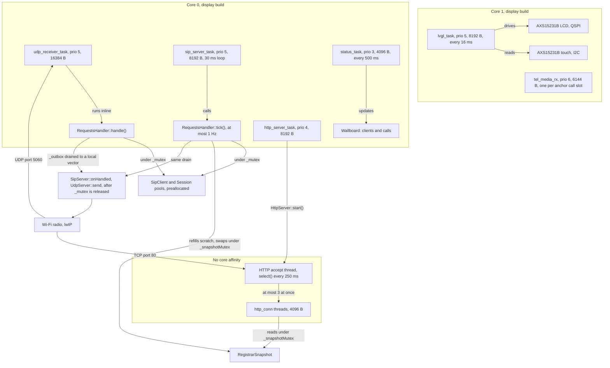
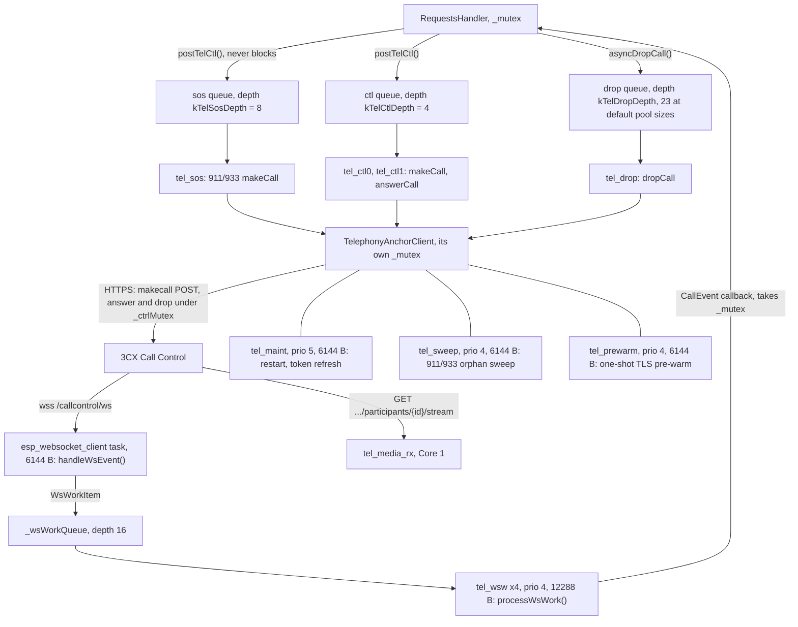
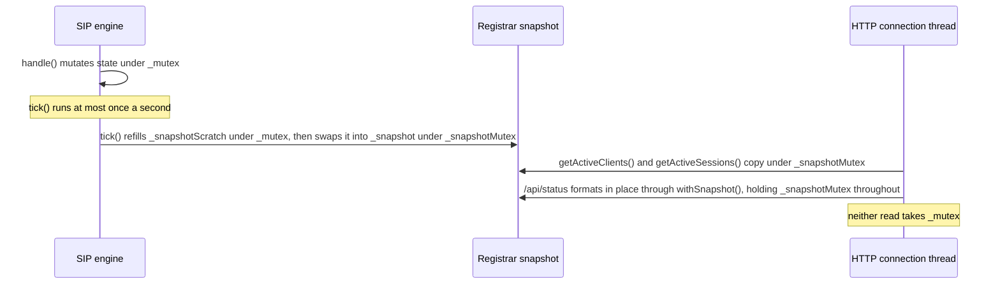
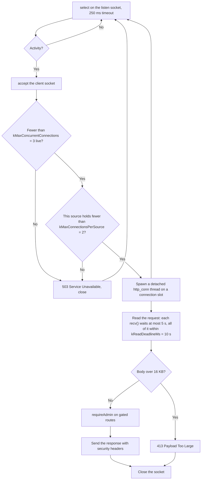

# Pocket-Dial Firmware Architecture

This document describes how the **pocket-dial** ESP32 firmware is put together: its task layout across the two cores, how the SIP engine and HTTP server are built, and the concurrency and security controls they rely on. Source references give a file and line in the current tree; each names its symbol, so search for the symbol if a line has moved.

## 1. System Topology & Component Overview

**pocket-dial** is a dual-core SIP registrar and back-to-back call broker designed to run on resource-constrained ESP32 and ESP32-S3 microcontrollers. It supports multiple networking interfaces (Wi-Fi SoftAP/Station and SPI/RMII wired Ethernet) and drives smart displays (e.g., JC3248W535) using the LVGL graphics library.

The firmware architecture is divided into three core logical layers:

1. Network Hardware & Driver Layer: controls physical media (Wi-Fi radio, W5500 SPI Ethernet MAC/PHY, LAN8720 RMII PHY) and registers low-level event handlers.
2. Signaling & State Engine Layer (`RequestsHandler`): A lightweight SIP registrar and session controller managing client registration leases, active SIP sessions, and intercom broadcasting/paging features. It implements a deliberately partial subset of RFC 3261: no §16 proxy behaviour (§1.1), but all four §17 transaction machines; §1.2 states which messages they cover, which they deliberately leave out, and where timing and coverage fall short (1 Hz sweep, pool exhaustion).
3. User Interface & Query Layer: consists of a custom select-based, thread-dispatching `HttpServer` serving the web dashboard, an mDNS service responder, and a high-frequency LVGL-based GUI display task.

The diagram below shows the **display (JC3248W535) build**, where LVGL runs on Core 1 and
the SIP, UDP and status tasks run on Core 0. On the headless builds (`eth`, `lan8720` and
headless Wi-Fi) there is no `lvgl_task` and both the SIP task and `udp_receiver_task` move
to Core 1 instead. The two are **always co-located** on the same core (`handle()` runs
inline on the receiver task; the receiver's core is `POCKETDIAL_UDP_RX_CORE`, default 1,
overridden to 0 for the display build in `main/CMakeLists.txt:257`), so no build splits
them. The HTTP accept loop is a separate, unpinned thread (§4), not `http_server_task` itself.



The 3CX anchor adds its own tasks, created only for a real (non-Loopback) anchor. The SIP engine never makes an HTTPS call itself: it posts a job to one of three bounded queues and returns, and the WebSocket's events come back through the `tel_wsw` workers:



The lane workers `tel_ctl0`, `tel_ctl1`, `tel_drop` and `tel_sos` are 12288 B, priority 5, with a PSRAM stack where one is free. They are created in the order sos, drop, ctl, so when boot memory runs short a 911/933 and a drop get their workers before ordinary call setup does. A lane with no worker posts its jobs to `tel_ctl` instead.

### 1.1 Protocol Role: Back-to-Back Call Broker, Not a Proxy

**`RequestsHandler` is not an RFC 3261 §16 proxy, and the distinction decides where the audio goes.** A proxy forwards a request onward along a route set. This engine terminates each call leg and originates the next one itself.

The clearest evidence is in what the outbound path never writes:

- **No `Record-Route` on the handset path.** `RequestsHandler` never writes the header, so a call relayed between phones or originated by the PBX carries none. The box stays reachable for in-dialog traffic by rewriting `Contact` to point at itself on each leg (`CallForker::buildInviteFork`, `CallForker.cpp:29`), a user agent's mechanism, not a proxy's route set. `SipTrunk` is the one place that acts on the header. It builds its own route set from the trunk's 2xx (`routeSetOf`, `SipTrunk.cpp:172-191`) and echoes an inbound INVITE's `Record-Route` into its dialog-forming responses (`SipTrunk.cpp:509-520`). `SipMessage` also counts `Record-Route` entries for size bounds (`SipMessage.cpp:983-986`).
- **No `Via` stacking.** Requests the PBX *originates* carry exactly one `Via`, its own, bearing its own branch (`buildInboundInviteFork`, `buildInboundCancelTo` and `ackInboundFinal` in `RequestsHandler.cpp`; `BlfSubscriptions.cpp:171`; `ParkOrbit.cpp:212` and `:278`; `RegisterBeeper.cpp:99`). The ordinary extension-to-extension INVITE (`CallForker::buildInviteFork`, `CallForker.cpp:18-59`) is not rewritten in that respect. It is a copy of the caller's message with the Request-URI, `To` and `Contact` replaced, `Authorization` and `Proxy-Authorization` removed, and the SDP filtered to supported codecs (intercom forks also get auto-answer headers). Its `Via` is the caller's own, so the callee receives it with none of ours pushed on top. Responses are generated as a UAS (the request's `Via` echoed back with `received=` / `rport` filled in per §18.2.1, via `sipwire::viaWithReceived`) and are never forwarded upstream by popping a `Via` off a stack.
- **`Max-Forwards` is never enforced.** Inbound requests are syntax-checked: the value must be at most three digits and at most 255 (`SipMessage.cpp:993-995`). It is never decremented, and no path refuses a request because the count reached zero. The outbound value is the literal `Max-Forwards: 70`. The §16.6 loop protection a proxy owes the network is therefore absent by construction.
- **`Route` is counted, never honoured or stripped.** `SipMessage` counts `Route` entries to bound message size (`SipMessage.cpp:978-981`) and refuses an excess. A `Route` a phone puts on a request otherwise rides along inside the relayed copy.

What the engine *is* instead is a forked UAC coupled to a UAS, what `docs/FEATURE_ROADMAP.md` §1.1 calls a **back-to-back call broker**. Two distinct leg shapes share that label, and the difference surfaces in every header a debugger looks at:

- **Legs the PBX originates** (the inbound-trunk fork, park ring-back, register beep, BLF `NOTIFY`) are a fresh UAC: its own `Via` and branch, its own `From`-tag, and a `CSeq` space restarting at 1, while reusing the caller's `Call-ID` (`buildInboundInviteFork`).
- **Ordinary extension-to-extension legs** are the copy described above, so `From` (tag included), `CSeq` and `Via` all reach the callee as the caller wrote them, apart from the SDP codec filter. Keeping the caller's `Via` is what lets the return path work without a second rewrite: the callee's `180` already bears the `Via` the caller expects, so `onRinging` hands it back through `endHandle` (`RequestsHandler.cpp:6494`). Only a `180` forwarded reliably (RFC 3262) has its body, `RSeq` and `Contact` changed first. The ordinary `200` is relayed with **only its `Contact`** rewritten (`onOk`, `RequestsHandler.cpp:7521-7522`). A `2xx` to a re-INVITE or UPDATE on a relayed dialog also has its `Contact` replaced (`RequestsHandler.cpp:7374`). The wider `Contact`/`To`/codec rewrite at `RequestsHandler.cpp:7426-7441` is the **broadcast** branch, taken for the `999` intercom, ring-all and hunt forks (`setBroadcast(true)`, `CallForker.cpp:91` and `:338`).

On both shapes the caller's `Call-ID` spans both legs. That is deliberate: it is the `_sessions` key, which is how a mid-dialog request arriving from *either* leg resolves to the one session via `getSession(data->getCallID())`. Two legs are the exception. The blind-transfer leg to the target has its **own** Call-ID, linked to the kept A–B session by `setPeerCallID` (`RequestsHandler.cpp:8307` and `:8320`). The SIP-trunk carrier leg's Call-ID is minted by `SipTrunk` (`SipTrunk.cpp:659`).

Unlike a textbook B2BUA, it does not insert itself into the media path. SDP is relayed with only unsupported codecs filtered out, so an ordinary extension-to-extension call streams RTP directly phone-to-phone and the board never handles a media packet. The exceptions (`440`, `888`, `555` and outside lines) are listed in the README under "When the board does touch the audio". That list also covers a parked call with hold music. The park path answers the parked leg `sendonly` from the hold-music port (`ParkOrbit.cpp:64-84`), and `HoldMusic` then transmits to it every 20 ms. Park with no clip loaded (the default) still answers `a=inactive` and sources nothing.

Three more media paths are not in the README list:

- The dashboard's MoH preview (`startMohPreview`, `RequestsHandler.cpp:4321`) rings an extension only to play the clip at it.
- The far side of an **outbound** anchor call that a handset puts on hold. `MediaBridge::setHeld()` feeds it from `HoldMusic` as a per-call tap, decoded to PCM16 and written to the anchor (#218). A hold on an **inbound** anchored call is also answered on the anchor path (#445; fix #449).
- **Voicemail** deposit and retrieval (`796`). Each leg is a board-terminated `RtpReceiver`/`RtpSender` pair (`VoicemailLeg.hpp:9-16`). The deposit is answered by `answerVoicemailDeposit` (`RequestsHandler.cpp:3591`).

### 1.2 Transaction-Layer Scope

`TransactionLayer` implements the full RFC 3261 §17 transaction layer: four
transaction types across two pools (`TransactionLayer.hpp:14-37`). The
**client pool** covers requests this PBX sends and retransmits until
answered; the **server pool** covers responses this PBX authors, kept so a
retransmitted request gets the same answer back and (for INVITE)
retransmitted until it is ACKed. `classify()` is the single router that
decides which of the four a message earns, and it is method- and
authorship-aware rather than blanket: every INVITE **response** this PBX
itself authored becomes an `InviteServer` transaction, `BYE`/`CANCEL`/
`REFER`/`UPDATE` responses it authored become `NonInviteServer`, as does a
2xx to a `PRACK` it authored (#172). Every INVITE **request** it sends
becomes `InviteClient`, and every other request it sends (`BYE`, `CANCEL`,
`NOTIFY`, `REFER`, `INFO`, `MESSAGE`, `SUBSCRIBE`, `UPDATE`) becomes
`NonInviteClient`. `ACK`, `OPTIONS` and `REGISTER` are excluded, as covered
below (`TransactionLayer.cpp:74-131`).

Implemented:

| Mechanism | Where |
| :--- | :--- |
| §17.1.1 INVITE client transaction (Timer A retransmit from `T1` = 500 ms, doubling uncapped; Timer B gives up at 64×T1 = 32 s; a final response then absorbs duplicates under RFC 3261 Timer D — 32 s — for 3xx-6xx or RFC 6026 §8.4 Timer M — 64×T1 — for a 2xx) | `TransactionLayer.cpp:10-13` (constants), `sweep()`/`sweepOne()` (`:569`, `:675`), `matchAndAdvance` (`:406-423`) |
| §17.1.2 Non-INVITE client transaction (Timer E, T1 doubling capped at `T2` = 4 s; Timer F at 32 s; Timer K at `T4` = 5 s) for every non-INVITE request the PBX sends other than `ACK`/`OPTIONS`/`REGISTER` | `TransactionLayer.cpp:122-130` |
| §17.2.1 INVITE server transaction — Timer G/H for a non-2xx final (absorbed afterward under Timer I, `T4`, once ACKed), plus §13.3.1.4 retransmission of a **2xx until ACKed** (RFC 6026 §7.1 Timer L once it is) — for an INVITE response this PBX authored | `TransactionLayer.cpp:85`, `:329-369`, `:474-492` |
| §17.2.2 Non-INVITE server transaction (Timer J response cache, no retransmit schedule) for an authored `BYE`/`CANCEL`/`REFER`/`UPDATE` response | `TransactionLayer.cpp:93-96`, `:369`; sizing rationale in `PoolConfig.hpp:445-470` |
| §17.2.3 duplicate-request suppression: a retransmitted request matching a tracked server transaction is answered from the stored response and the handler is **not** re-run | `TransactionLayer::absorbRetransmittedRequest`, called from `handle()` at `RequestsHandler.cpp:1096` |
| §17.1.1.3 ACK for a non-2xx final to a PBX-originated INVITE | `ackInboundFinal`, `RegisterBeeper::handleInviteFailure` |
| §18.2.1 `received=` and RFC 3581 `rport` on every response this PBX builds | `sipwire::viaWithReceived` |
| §12.2 To-tag detection routing a re-INVITE onto the hold/resume path | `RequestsHandler::onInvite`, `RequestsHandler.cpp:2224-2228` |
| §11.2 capability discovery (`Allow` / `Supported` / `Accept` / `Allow-Events`) | `addCapabilityHeaders()`, called from four sites: `onRegister`'s 200 OK (`RequestsHandler.cpp:1603`), `onOptions`'s 200 OK (`:1736`), `sendLocalMediaAnswer` (`:11561`), which answers the anchored and page re-INVITEs and UPDATEs (`answerAnchorReinvite` and `answerPageReinvite`, reached from `onReinvite()` and `onUpdate()`), and `buildOkWithSdp()` (`:12463`) for the PBX-authored 2xx it builds: the 888 conference leg (`onConferenceInvite`), both voicemail legs (`answerVoicemailDeposit`, `answerVoicemailRetrieval`) and the 555 anchor handset leg (`originateAnchorCall`). **Not** on the 440 tone 200, the 777 echo 200 or the SIP-trunk handset 200, which are built elsewhere. |

Limitations and deliberate exclusions, worth knowing before debugging a retransmission:

- **Only responses this PBX itself authors get a server transaction.** An ordinary extension-to-extension call has its 200 OK **relayed** from the callee phone with only its `Contact` rewritten (`authoredHere()`, `TransactionLayer.cpp:55-64`); that phone is the real UAS and is already retransmitting its own 200 under its own transaction layer, so retransmitting it here too would just double the packets on the wire on a loss. This is also why the server pool (`POCKETDIAL_MAX_SERVER_TRANSACTIONS`) is sized so much smaller than the client pool (`POCKETDIAL_MAX_TRANSACTIONS`) — only virtual extensions, anchor/bridge legs and PBX-minted failure responses ever claim one (`PoolConfig.hpp:445-470`).
- **A retransmitted INVITE for a session already `Invited`/`Connected`/`Held` can still be silently dropped.** This happens only in the cases the layer does not cover: an ordinary relayed dialog (no server transaction ever opens for it, per the point above); a PBX-authored provisional such as a ring-group/hunt-group fan-out's own 180 (`CallForker.cpp:89`, `:354`), whose `InviteServer` slot is freed the moment the (relayed) final response goes out rather than waiting around to answer a retransmission (`TransactionLayer.cpp:186-220`); and an authored dialog that has already reached the `Accepted` state, where a retransmission is deliberately **not** answered from the absorb cache (`TransactionLayer.cpp:507-531`) because the automatic 2xx-retransmit timer is expected to be the reliability mechanism there instead. All three reach the "Task 2A" guard in `onInvite()` (`RequestsHandler.cpp:2214`).
- **A 2xx to an INVITE that is never ACKed is not followed up with a BYE.** §13.3.1.4 says the UAS SHOULD tear the dialog down once it gives up retransmitting; this layer instead logs the give-up and frees the slot, leaving the dialog itself untouched — a TU-level decision tracked as a follow-up on #199 (`TransactionLayer.cpp:584-594`).
- **Both pools are fixed-size and degrade rather than block.** When every slot is busy, claiming one fails and the message is still sent once, just with no retransmit/absorb coverage for it — the same as a message sent with no transaction tracking at all (`TransactionLayer.cpp:265-270` client, `:315-321` server).
- **A message too large to fit `POCKETDIAL_TX_MSG_BYTES`** (1500 bytes, the Ethernet MTU) is stored truncated and is never retransmitted. It is logged at claim time so the gap is visible rather than silent (`TransactionLayer.cpp:150-166`).
- **`INFO` is deliberately excluded** from the non-INVITE server set even though a duplicated DTMF digit from a retransmitted `INFO` is a real bug: a 32 s Timer J slot per keypress would dominate the server pool on its own. Tracked separately (`PoolConfig.hpp:459-464`).
- **`OPTIONS` keepalives, outbound `REGISTER`, `ACK`, and relayed responses stay outside this layer by design**, not by gap: loss of an `OPTIONS` probe **is** the liveness signal it exists to produce, `REGISTER` already runs its own §10.2 refresh/retry schedule in `SipRegistrationClient`, and an `ACK` is never a transaction of its own under §17.1.1.3 (`TransactionLayer.hpp:39-63`).
- **Timer granularity is coarser than the RFC's millisecond figures.** `sweep()` is driven from `RequestsHandler::tick()`, which self-throttles to 1 Hz, so a `T1` = 500 ms first retransmit actually lands around 1 s later. The coarse tick is conservative under §17 — fewer retransmits on the wire, never more (`TransactionLayer.hpp:64-71`).

The practical upshot: INVITE — client and server, including the
2xx-retransmit-until-ACK half a UAS owes under §13.3.1.4 — and the four
non-INVITE methods where re-running the handler on a duplicate does real
damage (`BYE`, `CANCEL`, `REFER`, `UPDATE`) get RFC-conformant retry and
duplicate suppression, so a single dropped UDP datagram carrying a
PBX-originated `BYE` **is** retried by this engine, the same as a
PBX-originated INVITE. What is left uncovered above is either an
intentional scope boundary (a relayed response, an `OPTIONS` ping,
`REGISTER`, `ACK`) or a specific, logged degrade path (pool exhaustion, an
oversized message, an unACKed 2xx) — not a missing layer.

**A callee that never answers the forwarded `CANCEL`.** A session in the Cancel state whose callee sends no final answer to the relayed `CANCEL` is ended after 32 s (the Timer F figure), and the caller then gets its `487`. The bound is armed once, by the caller's first `CANCEL`; neither a retransmitted `CANCEL` nor the callee's own `200` to the `CANCEL` (`CSeq` `n CANCEL`) disarms it. A ringing 911/933 is excluded. On a board the caller's `487` arrived about 34 s after the `CANCEL` (1.5 s CANCEL delay plus the 32 s bound) (#1049, v1.6.0).

## 2. Core Task Topology & Affinity Splits

To limit render frame drops and network packet loss, **pocket-dial** pins its real-time SIP, UDP-receive and media tasks away from the LVGL render loop where it can. The split is not strict: `tel_media_rx` shares Core 1 with LVGL, and the HTTP threads and several workers are unpinned (see the note after the task tables).

The system assigns FreeRTOS tasks to specific cores using `xTaskCreatePinnedToCore`:

### Core Affinity Allocation Table

| Task Name | Priority | Core Target (Display) | Core Target (Headless ETH) | Stack Size | Description |
| :--- | :---: | :---: | :---: | :---: | :--- |
| `lvgl_task` | 5 | **Core 1** | *N/A* | 8192 Bytes | Runs the LVGL render loop (`lv_timer_handler()`) every 16 ms (~60 Hz, `esp_main_display.cpp:338-354`). |
| `sip_server_task` (`sip_server` on eth/lan8720) | 5 | **Core 0** | **Core 1** | 8192 Bytes | Ticks the SIP state engine (`RequestsHandler::tick()`, which self-throttles to 1 Hz) and sweeps expired leases. The headless Wi-Fi build also puts it on Core 1 (`esp_main.cpp:543`). |
| `udp_receiver_task` | 5 | **Core 0** | **Core 1** | 16384 Bytes | Listens on UDP port 5060, parses incoming packet headers, and dispatches them to the handler. The stack is 16 KB. `RequestsHandler::handle()` runs inline on this task, and the string-heavy message building, the register-beep UAC and the `440` SDP path together overflowed an 8 KB stack (a stack-overflow panic). The task is created at `UdpServer.cpp:151-175`; the core is `POCKETDIAL_UDP_RX_CORE`. |
| `http_server_task` (`http_dashboard` on eth and lan8720; absent in the display build's captive-portal branch, from `esp_main_display.cpp:956`) | 4 | **Core 0** | **Core 0** | 8192 Bytes | Starts the HTTP server, whose accept loop runs on its **own unpinned `std::thread`** (spawned in `start()`, `HttpServer.cpp:405`; loop `acceptLoop`, `:451`), then idles in a 1 s OTA-confirm loop. Connection threads are separate (§4). |
| `status_task` | 3 | **Core 0** | *N/A* | 4096 Bytes | Rebuilds the on-screen wallboard (registered clients, active calls) every 500 ms. There is no battery ADC code; `ui_set_battery()` is a no-op (`main/ui/ui.cpp:992-995`). |

Tasks the table above does not cover (name, stack, priority, core), from the `xTaskCreatePinnedToCore` / `xTaskCreate` calls in the tree:

| Task | Stack / prio / core | Purpose |
| :--- | :--- | :--- |
| `rtp_media_tx` | 3072 / 6 / Core 0 | Per-leg RTP send (`RtpSender.cpp:358-366`; stack size `RtpTaskSlots.hpp:31`) |
| `rtp_media_rx` | 6144 / 6 / Core 0 | Per-leg RTP receive (`RtpReceiver.cpp:618-626`; stack size `RtpTaskSlots.hpp:32`) |
| `conf_mix_tick` | 3072 / 6 / Core 0 | The single `888` mix clock (`ConferenceRoom.cpp:308-310`) |
| `moh_tx` | 6144 / 5 / Core 0 | Music-on-hold pacer (`HoldMusic.cpp:517-518`) |
| `tel_media_rx` | 6144 / 6 / **Core 1** | Anchor-provider media receive (`TelephonyAnchorClient.cpp:3760-3762`) |
| `flash_writer`, `cdr_archive`, `vm_archive` | 6144 / 1 / Core 0 | NVS writer, SD CDR archive, voicemail archive writers. `flash_writer` (#991, `FlashWriter.cpp`, plain internal stack) is the one task that writes NVS for the CDR ring and for the device table, the forwards and the DID table (#986), so none of those writes holds `_mutex` across a flash write. That covers a call teardown, a REGISTER adoption, a `*72` or `*73` change, a DID mapping change and a config import's DID replace. Each source keeps its own depth-1 queue; one pass takes at most one unit from each. `cdr_archive` stays separate: its SD card writes can take seconds. `vm_archive` also counts each voicemail mailbox's stored messages once at boot (#756), through its own job slot and with no new task, so the MWI lamps relight after a reboot. |
| `log_drain` | 3072 / 1 / Core 0 | Log queue drain + syslog tee, headless builds only |
| `dns_task` / `decay_task` | 4096 / 5 / Core 0; 3072 / 3 / Core 0 | Captive-portal DNS; captive-portal decay (display build) |
| `http_conn` (pthread) | 4096 / – / unpinned | One per HTTP connection, at most 3 at once (§4) |
| `tel_*`, `trunk_dns`, `smtp_worker`, `restart_task`, `ota_reboot`, `heap_probe` | various / unpinned | One-shot or background workers created with no core affinity |

**Task isolation.** On the smart-display target (JC3248W535), **Core 1** carries `lvgl_task`, and the SIP, UDP-receive, status and media tasks are pinned to **Core 0**. Core 1 is not exclusive to LVGL. `tel_media_rx` is pinned there, and the HTTP accept and connection threads and several workers have no core affinity at all, so the scheduler may place them on either core.

On headless builds, the high-priority SIP task and `udp_receiver_task` move to **Core 1**, leaving **Core 0** to the media tasks, `http_server_task` and background work.

## 3. Concurrency Architecture & Contention Mitigation

Frequent HTTP polling of the dashboard can cause lock contention severe enough to drop UDP packets. The code uses three patterns to limit that contention.

### A. Snapshotted Registrar Query Model (Issue #48)

If the `HttpServer` read the active client and session collections under the central `_mutex`, a dashboard request would block the real-time SIP signaling loop while it generated JSON.

A double-buffered snapshot decouples the HTTP control plane from the UDP signaling plane:

1. State mutation (real-time path): the SIP engine processes packets and ticks on a dedicated thread, taking `_mutex` only for internal state changes.
2. Snapshot refresh: `RequestsHandler::tick()` runs at most once a second. Under `_mutex` it refills a scratch copy of the `RegistrarSnapshot` (`_snapshotScratch`) with plain STL vectors of the clients, sessions, CDR, DND, call-forward, ring-group, dial-rule and parked-call tables. It then swaps those tables into `_snapshot` under the short-lived `_snapshotMutex` (`RequestsHandler.cpp:11179-11256`). The devices, page zones and voicemail tables are not rebuilt on each tick. They are mirrored when they change, by `applyDeviceChange` and `refreshPbxConfigSnapshot`.
3. HTTP read: `getActiveClients()` and `getActiveSessions()` copy `_snapshot.clients` and `_snapshot.sessions` under `_snapshotMutex` (`RequestsHandler.cpp:9325-9334`). `/api/status` formats its tables in place through `withSnapshot()` (#410), which holds `_snapshotMutex` for the whole of the formatting, so the callback must not block. Neither path takes the SIP engine's `_mutex`.



### B. Out-of-Lock Socket Syscalls (Issue #51)

Blocking socket calls such as `sendto`, made while holding the registrar lock, cause large latency spikes.

`RequestsHandler::handle` uses an outbox pattern:

* Responses and call-forwarding invites generated while handling a request are queued in `_outbox`, a `std::vector<std::pair<sockaddr_in, std::shared_ptr<SipMessage>>>`. Before the lock is released, the queue is moved into a local vector. `drainOutboxInto()` does this (`RequestsHandler.cpp:12338`), and the per-packet and per-tick paths use a persistent scratch vector through `drainPassLocked()` (`RequestsHandler.cpp:1319`).
* The central `_mutex` is released immediately after the state machine logic completes.
* Once the lock is released, `flushPass()` hands the local copy to `SipServer::onHandled` (`RequestsHandler.cpp:1341`; `SipServer.cpp:171`), which sends each message with `UdpServer::send` (`UdpServer.cpp:269`). This keeps registrar lock hold times at microsecond scale.

### C. Static Memory Pools (Issue #53)

Dynamic heap allocations (`new`, `malloc`, `make_shared`) within the hot UDP signaling path are a major cause of memory fragmentation and non-deterministic jitter on embedded targets.

The signaling engine pre-allocates its pools:

* During initialization, `RequestsHandler` fills vectors of `SipClient` and `Session` smart pointers in the constructor. Their sizes are `POCKETDIAL_MAX_CLIENTS` (default 32) for `_clientPool` and `POCKETDIAL_MAX_SESSIONS` (default 8) for `_sessionPool`.
* In steady-state operation, `allocateClient` and `allocateSession` search these pre-allocated pools to recycle unused objects, without touching the runtime heap. The SIP message pool and the virtual-peer pool are fixed-size too, and neither has a heap fallback (#409). When either is drained, the allocation is refused (`acquirePooledMessage`, `SipMessagePool.cpp:72-79`; `allocateVirtualPeer`, `RequestsHandler.cpp:12952-12958`) and the refusal is counted as `msgPoolRefusals` or `vpeerPoolRefusals` on `/api/status`. The caller then drops the message, or answers `503` or abandons the feature (#412).
* If the client pool is exhausted under heavy load, `allocateClient` reuses the first expired client registration lease it finds (`RequestsHandler.cpp:11401-11411`; not necessarily the oldest). If there is no expired lease, it returns `nullptr`, and the caller answers `503 Service Unavailable`. This protects the core heap from out-of-memory (OOM) silent panics.

## 4. Select-Based HTTP Server Thread Dispatch Model

To prevent slow-client TCP connections from stalling the main HTTP accept thread, the `HttpServer` employs a select-monitored, multi-threaded worker dispatch model.



### Accept Loop Implementation

1. The main HTTP accept loop runs on its own `std::thread` (`_acceptThread`, spawned at `HttpServer.cpp:405`, loop `acceptLoop` at `:451`) and uses `select()` on the listening socket with a `250ms` timeout to periodically yield execution and verify if the server is still running.
2. Upon activity, `accept()` is called to retrieve the client socket.
3. **At most 3 connections are served at once** (`kMaxConcurrentConnections`, `HttpServer.hpp:101`); a fourth gets `503` and is closed (`HttpServer.cpp:592-625`).
4. Otherwise the server dispatches client processing to a detached `std::thread` (the spawn is wrapped in `try`/`catch`), instantly freeing the accept thread to monitor subsequent connections. Connection threads are named `http_conn` and get a **4096-byte** stack via `esp_pthread_set_cfg` (`kHttpConnStackBytes`, `HttpServer.hpp:72`, applied at `HttpServer.cpp:498-500`), not the 8192-byte pthread default.

### The Admission Gate (`requireAdmin`)

Every non-public endpoint passes through one function rather than open-coding its own
checks, in this order:

1. **Same-origin.** `Origin` host vs `Host`. A request with **no** `Origin` header is
   admitted by design, because `curl`, native clients and the CI smoke suite do not send
   one. That is exactly why step 3 exists: the origin check is a browser-only control and
   cannot stand alone.
2. **Session.** A valid `pd_session` cookie, **always**. There is no
   "unprovisioned, admit everyone" bypass: the device ships with a default login credential
   precisely so this check can be unconditional from the first boot (`HttpServer.cpp:4603-4614`,
   `docs/THREAT_MODEL.md` S-1).
3. **CSRF.** For mutating requests, a matching `X-CSRF` token bound to that session. It is
   rendered into the dashboard document and returned by login, never set as a cookie: the
   browser attaches a cookie to a same-site request on its own, so only a value our own
   script has to read and echo back proves the request came from our page.
4. **Forced initial setup.** Until the default credential is replaced, every admin route
   except the one that replaces it answers `403 setup_required` (`HttpServer.cpp:4628-4636`).
5. **Role.** Owner-only actions require an owner session. These are factory reset (`/api/factory-reset`), the OTA upload, the config export with secrets (`/api/config/export`), the coredump download `GET /api/coredump` (`HttpServer.cpp:1312`), `POST /api/admin/set-owner-credential` (`:1693`), `POST /api/media-tx` (`:1737`), and setting a DTMF PIN, which `sendApiAdminSetCredential` checks (`:5688`). A sysop session is admitted only while no owner credential has ever been set (`HttpServer.cpp:4645-4650`, #173). `POST /api/ota/reboot` is sysop-level (`HttpServer.cpp:1723`).

**Why it is centralised.** Open-coding the checks at each route lets one route drift. Routes such as `POST /api/configuring`, `/api/pcap`, `/api/trace` and `/api/diagnostics/pcap` must stay gated, and the raw SIP bytes the capture routes serve include `Authorization` digests. A single gate makes "forgot to gate this route" a structural impossibility rather than a review question.

Responses carry CSP, `X-Frame-Options`, `X-Content-Type-Options`, `Cache-Control: no-store`
and `Referrer-Policy: same-origin` from one place, `buildResponseHead()`
(`HttpServer.cpp:2002`, called by `sendResponseWithHeader` at `HttpServer.cpp:1894`), for the same reason.
There is deliberately no HSTS. This is plain HTTP on a LAN appliance, and pinning it would
make the device permanently unreachable over `http://`.

### Worker Protection & Robustness (Issue #23)

* Slowloris protection (#529): everything read before a request is dispatched (headers plus the buffered body) must arrive within 10 s of the accept (`HttpServer::kReadDeadlineMs`); each `recv()` waits at most 5 s and never past that deadline, and a request not in by then is dropped and counted (`httpReadDeadlineDrops`). One source address may hold at most 2 of the 3 connection slots (`kMaxConnectionsPerSource`); a third is refused `503` and counted (`httpPerSourceRefusals`). Authenticated OTA/MoH uploads leave this path after the auth check and keep their own budgets.
* Heap stack safety: Rather than allocating a raw stack-local character buffer, the worker reads into a 4 KB buffer that is not on its stack. Connection threads run on a 4096-byte stack (§ Accept Loop above; the 8192-byte `CONFIG_PTHREAD_TASK_STACK_SIZE_DEFAULT` in `sdkconfig.defaults` applies to other pthreads), so a 4 KB stack-local buffer would consume the whole thread's stack before any handler ran. The buffer is the connection slot's (#410, #328): `HttpServer::kReadBufBytes`, one per slot, allocated once in the constructor from PSRAM (internal RAM only if PSRAM is full, counted in `memory.psramFallbacks`). The stack itself stays in internal RAM, because the handlers write NVS. A build without PSRAM (`esp32_constrained`) keeps a per-request heap buffer instead of holding three slots' worth of internal RAM from boot.
* Buffer overflow cap: The worker parses the `Content-Length` header and enforces a maximum payload limit of **16 KB** (16,384 bytes). If a client attempts to upload a larger body (e.g., in a malicious POST flood to `/api/wifi/connect`), the worker immediately responds with `413 Payload Too Large` and aborts the connection, securing the target's RAM.

## 5. Security & Network Protections

### Same-Origin Policy & CSRF Prevention (Issue #28 / #38)

Because the device serves as a local captive portal or open access point, malicious scripts running in background browser tabs on connected clients could attempt to trigger administrative side-effects (such as disconnecting users or reconfiguring Wi-Fi).

To prevent cross-site request forgery (CSRF), the server checks the `Origin` header in `HttpServer::isSameOrigin` (`HttpServer.cpp:4485`). `requireAdmin` runs this check first on every gated route, through `requireSameOrigin`. The public login and logout routes call `requireSameOrigin` directly (`HttpServer.cpp:1705` and `:1712`).

* If a request carries an `Origin` header (browsers send one on cross-site requests), the server extracts the host from it. This covers every gated route, not only the state-changing POSTs such as `/api/kill`, `/api/wifi/connect` and `/api/wifi/mode_ap`.
* The server compares the `Origin` host string directly with the `Host` header sent by the client.
* If they do not match, the request is immediately rejected with `403 Forbidden` (`{"error":"cross-origin request rejected"}`).
* No wildcard `Access-Control-Allow-Origin: *` headers are ever returned on API routes, preventing cross-origin browser reads of active registration profiles.

### UDP Receive Memory: IPv4 Reassembly and Per-Socket Caps (Issues #496, #509)

IPv4 reassembly is on (`CONFIG_LWIP_IP4_REASSEMBLY=y`), so a SIP message over 1,472 B is reassembled rather than dropped by lwIP. lwIP holds received datagrams **before** any of this firmware's code runs, so the token bucket below cannot bound that memory. It is bounded in two stages:

* **In flight:** an incomplete datagram is freed after `IP_REASS_MAXAGE` = 3 s, and `LWIP_IP_REASS_MAX_PBUFS` = 10 caps the fragments held at once (~16 KB, global).
* **Completed:** a finished datagram sits in its socket's recvmbox until read. The mailbox caps only the *count* (`CONFIG_LWIP_UDP_RECVMBOX_SIZE`: 32, or 6 on the constrained profile). `CONFIG_LWIP_SO_RCVBUF=y` plus a per-socket `SO_RCVBUF` (`src/Helpers/UdpRcvBuf.hpp`) caps the queued payload bytes:
  * SIP: 32 KB, or 16 KB on the constrained profile.
  * Each RTP receive leg: 8 KB. The captive-portal DNS server (SoftAP builds): 4 KB.
  * Sockets that are only ever sent on (`RtpSender`, `HoldMusic`, the connected Syslog socket): 0.
  * lwIP's default cap is `INT_MAX`, so the `setsockopt` is what bounds it. A failure is logged at boot or call start as `SO_RCVBUF(...) failed ... UNBOUNDED` (Syslog's is silent: it cannot log). `UdpRcvBuf.hpp` refuses to compile reassembly without `SO_RCVBUF`.
* **The IPv4 input guard (#509 review).** `SO_RCVBUF` counts the IP payload *after* `ip4_input()` trims the pbuf, but what a received pbuf pins is the driver's buffer: a `malloc` of the frame as received, wrapped as a `PBUF_REF` custom pbuf that `pbuf_realloc` cannot shrink. `ip_reass()` chains fragments without copying. Without a guard, ten 1,514 B frames each padded around ~72 B of IP payload passed a 32 KB cap while pinning ~15 KB per datagram (~500 KB per socket). `LWIP_HOOK_IP4_INPUT` (`main/pd_lwip_hooks.c`; decision in `src/Helpers/Ip4InputGuard.h`; wired through `ESP_IDF_LWIP_HOOK_FILENAME` in the top-level `CMakeLists.txt`) runs before the trim and:
  * **drops** a frame longer than max(IP length, 46) + 4 B, because Ethernet pads to 46 B of payload and never further;
  * **drops** a non-final fragment carrying under 256 B of payload. Senders fragment at the path MTU, so this is the cheapest overhead multiplier against the byte cap. It is rare legitimately, though a router re-fragmenting onto a smaller MTU can produce one, and that datagram is lost and counted;
  * passes everything else untouched, with no copy. Both Ethernet drivers (W5500, ESP32 EMAC) and IDF's dynamic Wi-Fi RX buffers allocate the frame's own length, so once padding is refused, what a pbuf pins tracks what `SO_RCVBUF` counts.

  Drops since boot are in `/api/status` `ip4Guard` (`padded`, `tinyFragments`), and the first of each kind is logged once. `tools/check_lwip_ip4_hook.cmake` fails every ESP build unless lwIP's `ip4.c` object references `pd_ip4_input_hook`, i.e. unless the hook really is compiled into `ip4_input()`.

Worst-case lwIP-held RAM, per socket, while its reader is stalled. On Ethernet a queued fragment pins its frame plus ~50 B of pbuf and heap overhead. A non-final fragment is at least 290 B on the wire, so what is pinned is at most ~1.33x what `SO_RCVBUF` counts:

| Socket | `main` (no reassembly) | Reassembly, caps, no guard | With caps + guard |
|---|---|---|---|
| SIP, 32-entry mailbox (S3 eth/wifi, ESP32 lan8720) | ~50 KB | ~500 KB (padded fragments) | **~42 KB** (32 KB cap x 1.33) |
| SIP, constrained (6-entry mailbox, no PSRAM) | ~9.4 KB | ~94 KB | **~21 KB** |
| RTP receive leg (up to 14: 4 anchor, 2 voicemail, 4 trunk, 4 conference) | ~50 KB each (~9.4 KB constrained) | ~500 KB each | **~11 KB** each (~9.4 KB constrained) |
| `RtpSender` / `HoldMusic` / Syslog (never read) | ~50 KB each, for the socket's life | 0-length datagrams only | **~3.5 KB** each (32 empty datagrams of ~110 B; see below) |
| Reassembly in flight (global) | 0 | ~16 KB | **~15 KB** (10 frames) |

* `SO_RCVBUF` = 0 still admits a **0-length** datagram, because lwIP compares `recv_avail + len > recv_bufsize`. On Ethernet each one pins only its own minimum frame, hence ~3.5 KB for a full mailbox. On Wi-Fi each pins a driver RX buffer, which any small datagram can already do on `main` (#78). Connecting those sockets to their peer would close this gap and is a follow-up.
* The constrained profile's SIP socket can hold ~11 KB more than on `main`. That is the price of accepting one maximum-size reassembled datagram, so that #468 counts it instead of it vanishing.
* `SO_RCVBUF` refusals themselves are not counted: lwIP frees the datagram in `recv_udp` with no hook. The guard's counts cover the hostile shapes.

### Per-Source-IP Token Bucket Rate Limiting (Issue #38)

To protect the registrar from UDP flood denial-of-service (DoS) attacks, the `RequestsHandler` integrates a thread-safe token bucket rate limiter:

* Sustained/burst thresholds: UDP packets are evaluated using a per-source IP token bucket with a default burst depth of **40 packets** and a sustained replenishment rate of **20 packets per second**.
* Where it runs: **after** parsing, not before. `SipServer::onNewMessage` fully parses the datagram (`SipServer.cpp:140`) and `handle()` rejects a structurally invalid message (`RequestsHandler.cpp:897`) before the rate check (`RequestsHandler.cpp:911-915`). The check does run before the central `_mutex`, under its own `_rateMutex`, so a flood never contends with call processing. If an IP exceeds its burst threshold, the packet is discarded and counted under the rate reason, which feeds `packetsDropped` on `/api/status` (`DropProbe`). The 40/20 figures are inline literals (`RequestsHandler.cpp:11451`, `:11460`).
* Bounded table: at most **256** buckets; a new source IP arriving when the table is full is dropped outright (`RequestsHandler.cpp:11445-11448`).
* Eviction cycle: To prevent memory leak accumulation from transient spoofed IPs, buckets idle for 60 s are evicted from `tick()` (`RequestsHandler.cpp:11134-11145`).
* **Warning:** subnet (CIDR) filtering is not implemented, so do not plan a deployment around it. The macro `-DPOCKETDIAL_ALLOW_CIDR` does not exist anywhere in the tree. The matching runtime state exists but is inert: `_allowNet` and `_allowMask` (`src/SIP/RequestsHandler.hpp:3101-3102`) are initialised to `0` and no code path assigns them. There is no setter, no constructor argument, no HTTP route and no NVS key. `RequestsHandler::ipAllowed()` (`RequestsHandler.cpp:11430-11434`) therefore takes its `if (_allowMask == 0) return true;` early exit on every packet, so every source IP is allowed. The token bucket above is real and does run. The subnet filter is scaffolding that was never wired up, so segment isolation has to come from the network: a VLAN, a firewall, or simply not routing the board's link.

## 6. Origins

pocket-dial began as a fork of [BarGabriel/SipServer](https://github.com/BarGabriel/SipServer), an MIT-licensed SIP server. That credit is kept in [NOTICE](../NOTICE) and the original licence text in [LICENSE-MIT](../LICENSE-MIT) (Copyright (c) 2022 BarGabriel). Everything added or changed since the fork is Apache 2.0 ([LICENSE](../LICENSE)); [CHANGELOG.md](../CHANGELOG.md) records the relicensing of the project from MIT to Apache 2.0.

What the upstream project was: at its default branch (`master`, last pushed 2024-05-31) it holds 25 files and 33 commits, all under `src/SIP`, `src/Helpers`, `main.cpp`, `CMakeLists.txt` and the usual README, LICENSE and `.gitignore`. The upstream names that matter here are `SipServer`, `RequestsHandler`, `Session`, `SipClient`, `SipMessage`, `SipMessageFactory`, `SipSdpMessage`, `UdpServer` and `IDGen`.

What survives: 24 of those 25 upstream paths still exist in this tree; only `src/SIP/SipMessageHeaders.h` is gone. Comparing git blob hashes, exactly one of the 24 is byte-identical to upstream, the vendored `src/Helpers/cxxopts.hpp`. The other 23 have been rewritten. For scale, upstream `src/SIP/RequestsHandler.cpp` is 8,953 bytes and the current file is 663,338 bytes. The file names carry over; the contents mostly do not, so read this section as lineage, not as a claim about how many lines are upstream's.

What was added since: the current tree has 215 C/C++ source and header files under `src/` and `main/`. Named subsystems with no counterpart in the upstream file list include the registrar (`Registrar`), the SIP transaction layer (`TransactionLayer`), call forking (`CallForker`), parking (`ParkOrbit`), conferencing (`ConferenceRoom`, `MixBus`), voicemail (`VoicemailLeg`, `VoicemailMenu`), SIP trunks (`SipTrunk`, `TrunkResolver`), the telephony anchor clients (`AnchorClient`, `TelephonyAnchorClient`, `ApidazeAnchorClient`), plug-and-play provisioning (`PnpResponder`), OTA update (`OtaUpdater`), admin authentication (`AdminAuth`), and the ESP32 firmware entry points under `main/` (`esp_main*.cpp`). Upstream has no `main/` directory, no `web/` directory and no `tests/` directory.

How the history is recorded: this repository was created on 2026-04-12 and is not a GitHub-marked fork (the API reports `fork: false`). Upstream's 33 commits are not in this repository's history. Its oldest commit reachable in a shallow clone is `c96dc048` (2026-08-28), a merge whose tree already holds 202 files, so the days of work before it are one undifferentiated commit as far as `git log` here can tell. The first tag is `v1.0.0` (`53ea00c6`, 2026-05-29). As of 2026-10-20 GitHub reports 781 commits on `main` and 506 merged pull requests, 245 of those commits dated on or before 2026-08-28. Counts move; the commands below reproduce them.

Reproduce:

```
git log --diff-filter=A --format='%h %ad %s' --date=short -- LICENSE-MIT NOTICE
gh api 'repos/BarGabriel/SipServer/git/trees/HEAD?recursive=1' --jq '.tree[]|select(.type=="blob")|"\(.sha) \(.path)"'
git hash-object <path>          # compare against the upstream blob sha
gh api 'repos/GlomarGadaffi/pocket-dial/commits?per_page=1' -i       # Link rel="last" = commit count
gh api 'search/issues?q=repo:GlomarGadaffi/pocket-dial+is:pr+is:merged&per_page=1' --jq .total_count
```
