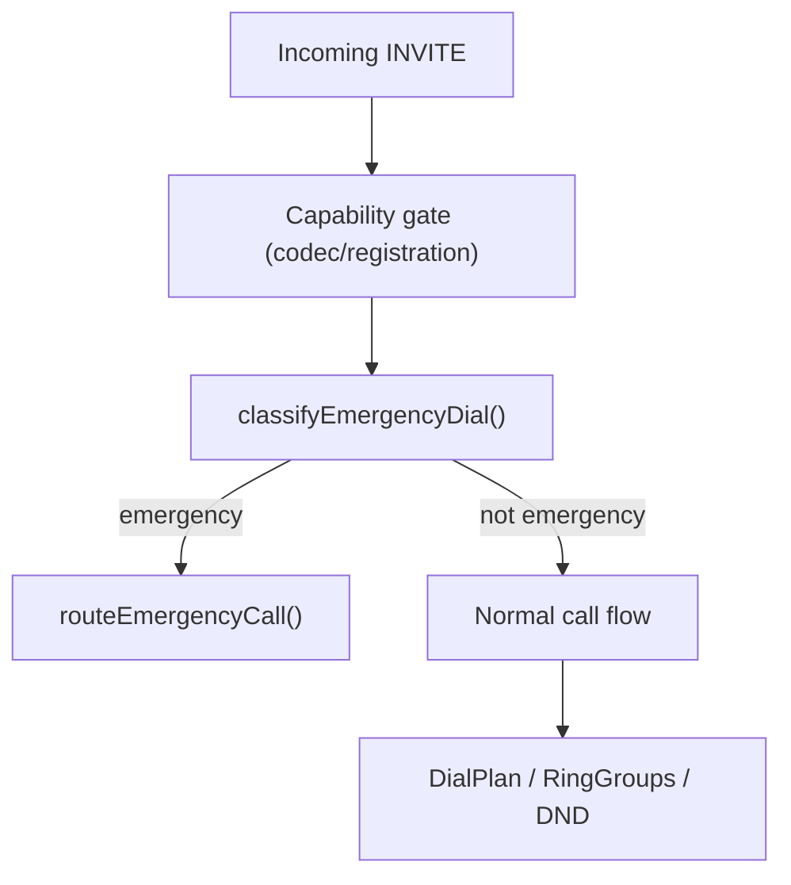

# Legal and regulatory audit: E911 compliance under programmable media anchors

This audit assesses Pocket-dial's emergency calling against FCC rules for 911 dialing, on-site notification, dispatchable location and PSAP callback. The statuses are a self-assessment pending legal review.

## Summary

The audit covers three rule sets:

1. Kari's Law (47 U.S.C. § 623, codified at 47 CFR § 9.16).
2. RAY BAUM'S Act section 506 (codified at 47 CFR Part 9).
3. FCC interconnected VoIP rules (47 CFR Part 9).

The design routes outside calls through cloud media anchors (3CX, Apidaze, and CPaaS platforms, per [ADR-002](ADR-002-PROGRAMMABLE-MEDIA-ANCHOR.md)). This document describes how emergency call signalling, on-site notification, dispatchable location and PSAP callback obligations are met under that design.

## 1. Statutory and regulatory framework

The rule wording in this section is paraphrased from summaries of the rules. Verbatim eCFR text was not retrieved, so none of the citations has been checked against the regulation text. Treat the wording and citations as unverified until legal review.

### 1.1 Kari's Law (multi-line telephone systems, MLTS)

Kari's Law applies to any MLTS manufactured, imported, sold, leased, or installed after February 16, 2020. It sets two requirements:

1. **Direct dialing (47 CFR § 9.16(b)(1)):** The MLTS must be configured so that any user can dial 911 directly from any station without dialing an outside-line access code, trunk prefix (such as '9'), or any other prefix.
2. **On-site notification (47 CFR § 9.16(b)(2)):** The MLTS must initiate contemporaneous notification to a central location at the facility where the system is installed (for example, a front desk, security office, or administrative staff) or an off-site location designated by the system operator. The notification must indicate that a 911 call has been made, provide a valid callback number, and convey the caller's location to the extent technically feasible. The notification **must not delay the 911 call itself**.

### 1.2 RAY BAUM'S Act section 506 (dispatchable location)

RAY BAUM'S Act requires all 911 calls from MLTS and interconnected VoIP systems to provide a dispatchable location to the PSAP.

- **Definition:** A dispatchable location is the validated street address of the calling party, plus any additional information, such as suite, room, floor, or building wing, needed to locate the caller in a reasonable amount of time.
- **Fixed endpoints (desk phones):** Automated dispatchable location must be delivered with each call.
- **Non-fixed endpoints (softphones, wireless SIP phones):** Must provide automated dispatchable location where technically feasible, or allow customer-provided or updated manual location entry.

## 2. Pocket-dial architecture and compliance assessment

### 2.1 Direct dialing and dial-plan isolation (compliant)

- **Direct 911 execution:** Evaluated in `src/SIP/EmergencyCall.hpp` (`pbx::classifyEmergencyDial`). Exact string matching detects `911` and `933` (carrier E911 test service).
- **Trunk prefix tolerance (`9911`):** Users who reflexively dial `9-9-11` out of habit are protected. The PBX strips the single leading `9` and routes `911` immediately (FCC 19-76 compliance).
- **Pre-dialplan priority bypass:** Emergency classification runs strictly before operator-configured dial plans (`DialPlan.hpp`), ring groups, speed dials, and policy locks. An operator rule such as `9*` (strip 1 digit) cannot intercept or rewrite `911` into `11`.
- **Policy gate bypass:** The call bypasses Do-Not-Disturb (DND), call forwarding (CFNA/CFU), and administrative PIN authentication.

The decision path for an incoming INVITE is:

### 2.2 On-site notification (compliant)

- **Zero-delay invariant:** Implemented in `src/SIP/EmergencyNotifier.hpp`.
  - The emergency call leg is allocated and enqueued in the SIP outbox first.
  - `EmergencyNotifier::notify()` runs only after `originateAnchorCall()` has successfully claimed the leg.
  - No notification error (pool exhaustion, unregistered notification extensions) can block, delay, or fail the emergency call leg.
- **Contemporaneous dispatch:** The emergency INVITE and notification messages share the same dispatch batch (`RequestsHandler::drainOutbox()`), so the notification leaves at the same time as the call.
- **Notification on call failure:** If an emergency call fails (for example, no outside line is reachable), `EmergencyNotifier::notify()` runs immediately with failure attribution so on-site staff can take manual action.

### 2.3 RAY BAUM'S Act under cloud media anchors (architecture mapping)

On a traditional SIP trunk, the local PBX would have to attach location itself, as SIP `Geolocation` headers or `PIDF-LO` XML bodies. Under the cloud media anchor architecture (ADR-002, 3CX and Apidaze), that work is delegated:

1. **Delegation to interconnected VoIP edge:** The cloud media anchor provider (Apidaze, 3CX, VoIP Innovations) acts as the interconnected VoIP carrier, with direct integration into the National Emergency Service Routing Proxy (ESRP) network.
2. **Civic address registration:** Every outbound DID or CLI provisioned on the cloud media anchor must have an associated, MSAG-validated (Master Street Address Guide) address stored in the provider's E911 registry.
3. **Fixed MLTS deployments:** For single-site deployments where Pocket-dial controls extensions at a known physical facility, assigning the facility's registered DID to the outside anchor leg satisfies the dispatchable location mandate.
4. **Multi-station and room-level granularity:** In facilities that need room or floor granularity under RAY BAUM'S Act, either:
   - assign individual sub-account DIDs or location IDs to specific station profiles, or
   - use cloud anchor APIs that support per-call location parameter overrides (for example, Apidaze custom SIP headers or REST parameters).

### 2.4 PSAP callback window (compliant)

- **30-minute protective window (`src/SIP/EmergencyCall.hpp`):** `pbx::kEmergencyCallbackWindow` defines a 30-minute window.
  - When an extension dials 911 or 933, its station mark is recorded in fixed internal memory.
  - Any incoming call delivering to that extension during the next 30 minutes is automatically promoted to an emergency session (`Session::isEmergency() = true`).
  - This prevents an incoming 911 callback from being deflected to voicemail, rejected by DND, or preempted by call waiting.

### 2.5 Outage and failover

- **Provider readiness check (`telephonyProviderPlacesRealCalls()`):** Evaluated in `src/SIP/TelephonyProvider.hpp`. Simulated providers (such as `LoopbackAnchorClient`) explicitly report `false` and are barred from receiving 911 routing.
- **Network outage signalling:** If the cloud media anchor is disconnected or the WAN is down, the PBX immediately returns SIP `503 Emergency Call Not Routable` with a Warning header and raises the on-site notification. The PBX has no fallback route for 911 or 933 (see `DEMARCATION.md`); any cellular fallback is the handset's own.

## 3. Compliance summary and operator checklist

Each status in the table is the project's self-assessment, pending legal review. The table is not a legal opinion.

| Regulatory requirement | Statute / rule | Firmware mechanism | Self-assessed status |
|---|---|---|---|
| Direct 911 dialing (no prefix) | 47 CFR § 9.16(b)(1) | `pbx::classifyEmergencyDial` | Compliant |
| Single-prefix tolerance (`9911`) | FCC 19-76 | Leading '9' strip in `classifyEmergencyDial` | Compliant |
| Dial plan and policy bypass | 47 CFR § 9.16(b)(1) | Pre-dialplan routing in `onInvite()` | Compliant |
| On-site notification | 47 CFR § 9.16(b)(2) | `EmergencyNotifier` | Compliant, with operator configuration |
| Notification zero-delay guarantee | 47 CFR § 9.16(b)(2) | Outbox ordering and best-effort notification | Compliant |
| PSAP callback protection | 47 CFR § 9.16 | `EmergencyCallbacks` 30-minute window | Compliant |
| Dispatchable location | 47 CFR Part 9 | Cloud media anchor DID MSAG registration | Compliant, with operator configuration |
| 933 carrier test calling | Industry standard | Dedicated `kEmergencyTestNumber` path | Compliant |

### Operator configuration checklist

For enterprise operators deploying Pocket-dial with cloud media anchors:

1. **Register the E911 address:** Ensure all outside-line DIDs configured in the Apidaze or 3CX portal have a verified, active civic street address.
2. **Designate the on-site notification target:** Set `notifyExts` to the extensions that should be alerted when 911 is dialed, such as the front desk, security console, or an administrative ring group. Use the E911 fields in the web UI, or `PUT /api/e911-config`, which requires administrator access. The value is a list of extensions separated by spaces or commas. **Warning:** an empty `notifyExts` turns SIP notification off.
3. **Verify with a 933 test:** Dial `933` from a provisioned handset. Confirm that the carrier's automated service reads back the expected callback number and address. **Warning:** never dial a live `911` for testing.
