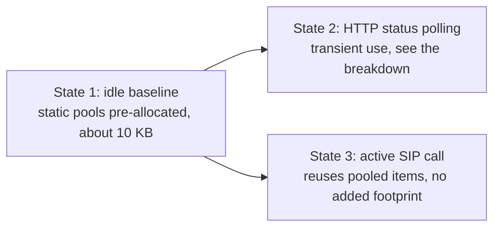

# Pocket-Dial Firmware: Performance Benchmarks and Methodology

This document covers the performance benchmark plan, the resource models, and the live-board measurement methods for the post-refactor pocket-dial ESP32 firmware. The firmware ships on three primary hardware targets, so each budget is stated per target rather than for a single board.

## Status of the figures

Every number in sections 1 to 4 is modelled, not measured. These are desk estimates written on 2026-06-01 at commit `8be61da`, before any board was connected. They are projections, not benchmarks, despite the column headers. Section 5 is a test plan that was never executed as written.

Real measurements exist from two runs, both recorded in `tests/load/STRESS_FINDINGS.md`. That file is no longer tracked in this repository: commit `327f180` removed it from tracking. The figures cannot be checked from this tree, so treat them as unverifiable until the log is restored or the runs are repeated. The main run is on the display build: a live JC3248W535 (Target B) at commit `b04ecac` on 2026-06-04. The other is a host-build multi-source-IP run for Issue #79. They contradict this document in two places and falsify one of its PASS verdicts outright. Each affected table has a correction note. Where the two disagree, the measurement wins.

On the display build, SIP and HTTP run on Core 0 while `lvgl_task` is pinned to Core 1. That is the opposite of the core map in section 2. The display measurements therefore describe the display build only. Targets A and C have never been profiled.

The projections were written at commit `8be61da` and have not been re-modelled or re-measured since. The real measurements were never folded back into them. Treat the tables as budgets someone once proposed. They are useful for sizing arguments and for seeing what the design intended. They are not evidence about how the firmware behaves.

## 1. Theoretical Resource Models (ESP32 Targets)

We model the memory and latency footprints on the three primary production targets:

1. **Target A: headless ESP32-WROOM-32E.** Dual-core, 240MHz Xtensa D0WDQ6, 520 KB internal SRAM, no PSRAM.
2. **Target B: ESP32-S3 smart display (JC3248W535).** Dual-core, 240MHz Xtensa LX7, 512 KB SRAM, 8 MB external PSRAM, running LVGL graphics.
3. **Target C: ESP32-W5500 Ethernet gateway.** Headless gateway using wired SPI Ethernet, dual-core, 520 KB internal SRAM.

## 2. Task Stack Allocations and Watermark Estimates

In FreeRTOS, the stack high-water mark is the minimum amount of free stack space, in bytes, that has remained unused since the task was created. If this value approaches zero, a stack overflow is imminent, which triggers an immediate CPU panic.

The table below sets each task's stack allocation beside its projected watermark. The allocations come from code. The watermark columns are projections. Apart from the HTTP connection thread row, the rows have never been measured, and the section 5 Phase 1 `vTaskList` procedure was not run.

### Stack Allocations vs. Projected Watermark Estimates

**Warning:** the HTTP connection thread row below was falsified on hardware. On a live S3 display board in STA mode, the HTTP server accepted TCP connections and then reset them without responding. The stress-test log attributes this to `sendApiStatus` overflowing the ~3 KB default pthread stack on the device. Moving the 4 KB read buffer to the heap did not keep the thread under the default, because the read buffer was not the only thing on that stack. The projected "1,450 bytes peak / 1,622 free / PASS" never held on hardware.

The real fix was to stop relying on the ~3 KB default. `CONFIG_PTHREAD_TASK_STACK_SIZE_DEFAULT=8192` ([sdkconfig.defaults:108](../sdkconfig.defaults#L108)) sets the default for `std::thread` tasks, and HTTP connection threads get an explicit 4,096 B stack instead (see the subsection below). Binding `INADDR_ANY` was part of the same fix (commit `b04ecac`, 2026-06-04).

| Task Name | Core | Allocated Stack (Bytes) | Projected Peak Stack Usage (Bytes) | Projected High-Water Mark (Free Bytes) | Technical Risk Analysis & Design Details |
| :--- | :---: | :---: | :---: | :---: | :--- |
| **`sip_server_task`** | Core 1 | 8,192 | 3,840 | 4,352 | Handles the 1Hz ticking engine, keeps alive, and sweeps expired clients. Low risk of recursion or heavy frames. |
| **`udp_receiver_task`**| Core 1 | **16,384** | 4,200 | *(projection stale)* | **High-activity path.** Processes and parses incoming SIP string structures inline. The old 8 KB stack caused a stack-overflow panic on this task, so the allocation was raised to 16,384 (`UdpServer.cpp:169`). The peak and high-water projections were computed against the old allocation and have not been re-derived. |
| **`http_server_task`** | Core 0 | 8,192 | 2,800 | 5,392 | Executes the non-blocking accept loop using `select()`. Light and secure as handling is delegated. |
| **HTTP connection thread** (`http_conn`) | Core 0 | **4,096** (explicit) | 1,450 | *(projection stale)* | Each active HTTP connection runs in a detached `std::thread`. The accept thread sets the 4,096 B stack explicitly before it creates them. The projections were made for the old ~3,072 B default and have not been re-derived. The PASS verdict recorded for this row was falsified on hardware (see the warning above). |

### HTTP connection thread stack and read buffer

A stack-local 4 KB buffer cannot fit on a 4 KB thread stack, so the read buffer lives in the connection slot instead. The current arrangement is:

- **Stack.** On ESP-IDF builds, the accept thread calls `esp_pthread_set_cfg` with `stack_size` set to `kHttpConnStackBytes` (4,096) and the thread name `http_conn` before it creates each connection thread ([HttpServer.cpp:497-500](../src/Helpers/HttpServer.cpp#L497-L500); the constant is at [HttpServer.hpp:72](../src/Helpers/HttpServer.hpp#L72)). The accept thread itself runs on the 8,192 B default ([HttpServer.cpp:470](../src/Helpers/HttpServer.cpp#L470)), as do the other `std::thread` tasks.
- **Read buffer.** Each connection slot owns one 4,096 B receive buffer (`kReadBufBytes`, [HttpServer.hpp:132](../src/Helpers/HttpServer.hpp#L132)). The constructor allocates these once, from PSRAM where the board has it ([HttpServer.cpp:246-269](../src/Helpers/HttpServer.cpp#L246-L269)). A build without PSRAM (`esp32_constrained`) keeps a per-request heap buffer instead, which `handleClient` uses when a slot has no buffer.
- **Measured high-water mark.** `/api/status` reports the connection-thread high-water mark as `stackHwm_http_conn`. Some routes have measured down to about 470 bytes free of the 4,096 B stack ([BENCH_PROBE.md](BENCH_PROBE.md), #405).

## 3. Heap Memory Footprint Estimates

The ESP32 has a unified SRAM map, but internal memory is divided into Instruction RAM (IRAM) and Data RAM (DRAM). Free heap memory is DRAM available to the user.

We estimate heap consumption across three operating states.

### Heap Consumption Models per Target State

Only one heap figure has been recorded on hardware: about 200 KB free on the S3 display build. It is quoted in the stress-test log while discussing the lwIP mailbox sizes (see the status section). It is a single observation under unstated conditions. Against the 120 KB projected for that target below, it suggests the estimate was conservative, but it does not replace the table. The State 1, 2 and 3 deltas, the fragmentation grades, and Targets A and C have never been measured. The section 5 Phase 2 `heap_caps_*` procedure was not run.

The pool sizes written below as literal 32 and 8 are compile-time settings, `POCKETDIAL_MAX_CLIENTS` and `POCKETDIAL_MAX_SESSIONS` ([`src/SIP/PoolConfig.hpp`](../src/SIP/PoolConfig.hpp)). They default to those values. A build that raises them changes every number in this section.



| Target Board | State 1: Idle Baseline (No Clients Registered) | State 2: HTTP status Polling (Dashboard Active) | State 3: Active SIP Call (2 Registered, 1 Call) | Heap Fragmentation Hazard Level |
| :--- | :---: | :---: | :---: | :---: |
| **Headless ESP32-WROOM** | 280 KB Free | 274 KB Free *(Transient)* | 279 KB Free | **Low** (Steady-state dynamic allocations eliminated via pooling) |
| **ESP32-S3 Smart Display** | 120 KB Free *(Graphics RAM consumed)* | 114 KB Free *(Transient)* | 119 KB Free | **Medium** (LVGL UI rendering and SIP engine share internal DRAM) |
| **ESP32-W5500 Ethernet** | 260 KB Free *(Ethernet buffers occupied)* | 254 KB Free *(Transient)* | 259 KB Free | **Low** (Stable socket handling outside signaling loop) |

The State 2 column was modelled for per-request allocation. The breakdown below says what the current code allocates.

### Breakdown of State Calculations

1. **State 1 (idle baseline).** Static pools are created in `RequestsHandler::RequestsHandler`:
   - `_clientPool`: 32 × `std::shared_ptr<SipClient>`, modelled at about 4.1 KB.
   - `_sessionPool`: 8 × `std::shared_ptr<Session>`, modelled at about 2.2 KB.
   - Total pool footprint: about 6.3 KB, plus basic vector overhead and static strings.
   - Total static overhead is a flat about 10 KB, which gives known bounds.
2. **State 2 (active HTTP status polling).** Handled inside `HttpServer::sendApiStatus`.
   - The response body is written into a status buffer leased for the request. The buffers are allocated once, in the constructor. The handler's own comment says it makes no heap allocation per request (#410, [HttpServer.cpp:2386](../src/Helpers/HttpServer.cpp#L2386)).
   - The read buffer is the connection slot's buffer (see section 2). Only builds without PSRAM take a per-request 4 KB heap buffer.
   - The modelled transient dip in the table above assumed a per-request 4 KB read buffer and a 1 to 2 KB JSON string. On PSRAM builds the current code makes neither allocation per request, so the row describes allocations the code no longer makes. It has not been re-modelled.
3. **State 3 (active SIP call).** Reuses already allocated pool items from `_clientPool` and `_sessionPool`. Zero additional dynamic memory is allocated for clients or sessions. Minimal transient allocations (under 1 KB) occur in lwIP buffers and `SipMessage` parsing, and return free memory immediately to State 1 levels. This prevents the severe fragmentation failures identified in Issue #53.

## 4. HTTP API Request Latencies

We model request latencies from the network and storage activity each HTTP endpoint needs.

Measured latencies exist for two of these endpoints, and both are far worse than projected, by about 20 to 600 times. The measurements come from the stress-test log (see the status section). They used the S3 display build, one live board, and a single source paced at about 10 requests per second, after commit `b04ecac` (2026-06-04).

| Endpoint | Projected here | **Actually measured** | Ratio |
|---|---|---|---|
| `GET /api/status` | 3–8 ms | **150 ms** | ~20–50× slower |
| `GET /` (dashboard) | 10–25 ms | **~6 s** (84 KB, one-time) | ~250–600× slower |
| `GET /api/cdr` | *not modelled* | 17 ms | — |

`GET /api/status` matters most. The projection below assumed under 8 ms, because the endpoint reads the pre-built `_snapshot`. The snapshot design is real. It bypasses the signalling mutex and does not block on active UDP processing or lock the core SIP engine. It does not set the on-device response time, though. Do not quote the under-8 ms figure as a characteristic of this firmware.

The `GET /` figure is likely optimistic now. It was measured at 84 KB. The dashboard has since gained the Dial Plan, Groups, Call Log and SIP Trace modals (`fbad51b`, 2026-09-13), and it has not been re-measured.

The SIP path was fast in the same run, roughly in line with expectations: REGISTER p50 8.6 ms, p95 25.8 ms, max 121 ms (20/20 OK), and a `777` echo call p50 13.3 ms, p95 19.9 ms (5/5 OK). This document models no SIP latency, so nothing here contradicts those figures. The stress-test log uses them to conclude that "the SIP engine itself is healthy" while the HTTP plane was not.

No endpoint has ever been measured under the conditions of the "10 Clients Poll" column.

| HTTP Endpoint | HTTP Method | Expected Latency (Normal Load) | Expected Latency (10 Clients Poll) | Processing Bottleneck & Hardware Activity |
| :--- | :---: | :---: | :---: | :--- |
| **`GET /`** | GET | 10–25 ms | 15–40 ms | Reading static index HTML from flash or embedded header (`CGA_INDEX_HTML`). |
| **`GET /api/status`** | GET | 3–8 ms | 10–25 ms | Low latency due to reading pre-built snapshot under `_snapshotMutex`. Completely bypasses SIP `_mutex`. |
| **`POST /api/kill`** | POST | 5–12 ms | 12–30 ms | Erases elements from the active client map and triggers a snapshot rebuild during the next `tick()`. |
| **`GET /api/wifi/scan`** | GET | 1,500–2,800 ms | 1,500–3,000 ms | **High Latency.** Switch to `APSTA` mode and block while the Wi-Fi transceiver scans all channels. |
| **`POST /api/wifi/connect`** | POST | 15–35 ms | 20–50 ms | Writes SSID & password to NVS flash, returns response, and triggers restart after 1 second. |
| **`POST /api/wifi/mode_ap`** | POST | 10–25 ms | 15–45 ms | Writes AP Standalone configuration to NVS, returns response, and restarts. |

The `GET /api/status` row in the table above is superseded by the measurement earlier in this section.

## 5. Live-Board Measurement Methodology (Test Plan)

This test plan was never executed as written. No Phase 1 `vTaskList` watermark run, no Phase 2 `heap_caps_*` baseline, stress or call sweep, and no Phase 3 `curl -w` latency capture was performed against these procedures. The plan remains usable, so it is kept. Nothing in sections 1 to 4 was validated by it.

The harness that was run instead is [`tests/load/sip_stress.py`](../tests/load/sip_stress.py). It measures SIP register and call latency, and it samples `GET /api/status` for server-side counters. It does not measure stacks or heap. Its output went to `tests/load/STRESS_FINDINGS.md`, which is no longer tracked (see the status section). The highest-value unexecuted work is Phase 1. No task on any board has a measured high-water mark. The pthread default was the one stack limit tested on hardware, and the model was wrong about it.

To validate these estimates on physical hardware, the QA and testing team must execute the following step-by-step measurement protocols on live boards.

### Phase 1: Task Stack Watermark Testing

To measure the actual stack high-water mark on a running ESP32:

1. Compile the firmware with `CONFIG_FREERTOS_USE_TRACE_FACILITY=y` and `CONFIG_FREERTOS_USE_STATS_FORMATTING_FUNCTIONS=y` enabled in `sdkconfig` via `idf.py menuconfig`.
2. Add a diagnostic task or high-frequency timer in your main program that prints task diagnostics every 5 seconds:
   ```cpp
   void diagnostic_task(void *pvParameters) {
       char buffer[512];
       while (1) {
           vTaskList(buffer);
           printf("Task Name\tState\tPrio\tStack\tNum\tCore\n");
           printf("%s\n", buffer);
           vTaskDelay(pdMS_TO_TICKS(5000));
       }
   }
   ```
3. Look at the `Stack` column in the output. The number returned represents the **minimum free stack space remaining (high-water mark)** in 32-bit words (or bytes, depending on compiler configuration). Ensure no task falls below **1,024 bytes** during active call processing or rapid dashboard reloading.

### Phase 2: Heap Footprint & Fragmentation Monitoring

To monitor heap stability and detect dynamic leaks:

1. Periodically query the native ESP-IDF heap caps APIs during different execution phases:
   * Total Free Heap: `heap_caps_get_free_size(MALLOC_CAP_INTERNAL | MALLOC_CAP_8BIT)`
   * Minimum Free Heap Ever (System Watermark): `heap_caps_get_minimum_free_size(MALLOC_CAP_INTERNAL | MALLOC_CAP_8BIT)`
   * Largest Free Block (Fragmentation Indicator): `heap_caps_get_largest_free_block(MALLOC_CAP_INTERNAL | MALLOC_CAP_8BIT)`
2. Setup State Test Steps:
   * Step A (Baseline): Boot the device. Wait 10 seconds. Query the values.
   * Step B (Stress Polling): Initiate 10 concurrent requests polling `/api/status` using a tool like Apache Bench (`ab`):
     ```bash
     ab -n 500 -c 10 http://192.168.4.1/api/status
     ```
     During execution, observe the Largest Free Block. If it drops continuously and does not recover back to the Baseline size post-test, a memory leak or severe fragmentation is present.
   * Step C (Call Stress): Register 10 SIP client extensions (e.g., using MicroSIP or softphone simulators). Initiate multiple simultaneous intercom calls and group paging broadcasts (extension `999`). Check the Baseline heap before, during, and after the call. The post-call heap size must match the pre-call heap size exactly, verifying that the Static Pool recycler successfully cleaned up the session slots.

### Phase 3: HTTP API Latency Measurement

To record the exact network response times:

1. Save the following curl format file as `curl-format.txt`:
   ```text
       time_namelookup:  %{time_namelookup}s\n
          time_connect:  %{time_connect}s\n
       time_appconnect:  %{time_appconnect}s\n
      time_pretransfer:  %{time_pretransfer}s\n
         time_redirect:  %{time_redirect}s\n
    time_starttransfer:  %{time_starttransfer}s\n
                       ----------\n
            time_total:  %{time_total}s\n
   ```
2. Execute curl queries against the running device over Wi-Fi/Ethernet:
   ```bash
   curl -w "@curl-format.txt" -o /dev/null -s http://192.168.4.1/api/status
   ```
3. Record `time_total` (total round-trip duration). Repeat this under load (e.g., while actively making SIP calls) to confirm the snapshotting architecture prevents network-layer latency spikes.
