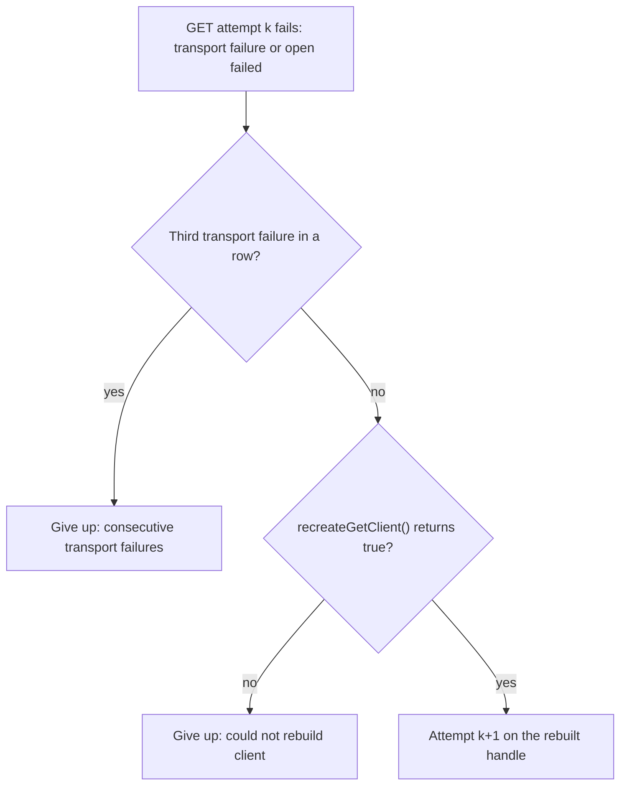
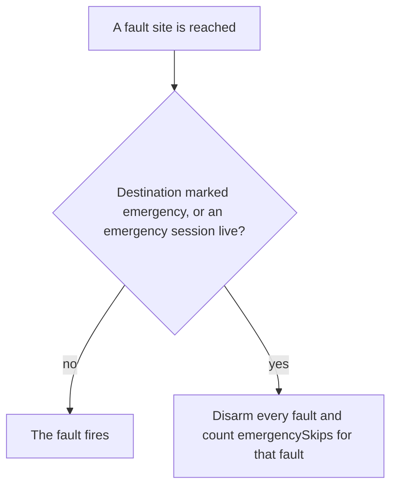

# Bench probe image (`POCKETDIAL_ANCHOR_BENCH_PROBE`)

This is issue #384, harness hook H1: a bench-only firmware image that injects one-shot
faults into the 3CX anchor client and holds a controlled amount of internal DRAM. A rig
scenario uses it to drive the paths behind #349, #279, #336, #518, #379 and the pressure
runs for #350/#370 on purpose, instead of waiting for them.

**Warning:** never ship the probe image, and never leave it on a rig. Every run that
flashes it ends by putting a release image back. CHECK-IN (#428) verifies that the board
reports a release stamp again, but that check is the operator's job.

A second, unrelated bench option, `POCKETDIAL_HTTP_DRAM_ACCOUNT` (#410, #328), is described
at the end: [HTTP DRAM accounting](#http-dram-accounting-pocketdial_http_dram_account).

## Building it

```
idf.py -D SIP_TRANSPORT=eth -D POCKETDIAL_ANCHOR_BENCH_PROBE=1 set-target esp32s3
idf.py -D SIP_TRANSPORT=eth -D POCKETDIAL_ANCHOR_BENCH_PROBE=1 build
```

- Configure prints a `CMake Warning` naming the probe image.
- Configure **fails** unless `SIP_TRANSPORT=eth` and `SIP_CONSTRAINED` is unset.
- The version stamp ends in `-probe` (`<describe>-probe`, or `<describe>-probe-dirty`;
  the short-hash form when the describe would not fit 31 characters). So
  `tools/ci/check_app_version.py --repo` and `tools/soak/run_soak.py` can never accept
  a probe image as this checkout's release candidate.
- Use a separate build directory (`-B build-probe`): the option stays in that
  directory's `CMakeCache.txt`.
- For #350 pressure runs, add `-DSDKCONFIG_DEFAULTS="sdkconfig.defaults;sdkconfig.defaults.heap_debug"`
  (COMPREHENSIVE poisoning) to both commands.

A release build carries none of it: every probe line in `src/` and `main/` sits under
`#if defined(POCKETDIAL_ANCHOR_BENCH_PROBE) && defined(ESP_PLATFORM)`, and
`src/SIP/BenchProbe.cpp` compiles to nothing without it. Two checks hold that:

- `tools/ci/check_no_bench_probe.py <build-dir>` fails if the app image contains
  `BENCHFAULT` or `/api/bench/fault`, if the cache has the option on, or if the
  stamp carries `-probe`. The ESP build matrix in `ci.yml` and every `release.yml` build run it.
- `tests/tools/test_bench_probe_release.py` checks the source on any host: probe
  lines only under the guard, the CMake refusals present, no workflow passing the option.

## The API

Only on the probe image. Owner-gated like `/api/coredump` (a session cookie from
`POST /api/admin/login`; never put a credential in a URL or a log). A `POST` is
CSRF-checked (the session's `X-CSRF` header). Bodies are form-encoded.

| Request | Effect |
|---|---|
| `GET /api/bench/fault` | the counters (below) |
| `POST fault=<name>` | arm that fault, one-shot |
| `POST fault=<name>&value=<n>` | arm a fault that takes a value |
| `POST fault=disarm` | disarm every fault |
| `POST ballast=<bytes>[&deadman=<s>]` | hold DRAM until free internal heap is at most `<bytes>` |
| `POST ballast=release` | release the ballast now |

Answers: `200` with the counters; `400` for an unknown fault or a bad value; `409`
while an emergency call is live, or when a ballast is already held; `503` when the
dead-man timer cannot be created.

## Faults

Each is **one-shot**: arming it once makes it fire once, and each firing logs one
line `BENCHFAULT <name> fired` and bumps its `fired` counter. `fired` is the
scenario's "path exercised" counter: a run whose fault shows `fired: 0` is `INVALID`.

| Name | Value | Where it fires | Effect | Serves |
|---|---|---|---|---|
| `makecall_read_fail` | none | `makeCall()`, after a POST that reached 3CX succeeded | the response is dropped: `success=false`, `status=-1`, no body, `requestSent=true`. This is what an unread response leaves, so the #349 reconcile path runs. | #349 |
| `get_status` | 400-599 | the next outbound call's GET stream (the leg `makeCall()` claimed) | every real answer on that stream reads as `<value>`; a real 200 is closed unread (its body is the live audio and would never drain). Transport failures stay real. | #518, #379 |
| `get_max_attempts` | 1-240 | the same GET stream | its attempt budget becomes `<value>`, so a refusal give-up and MediaNeverOpened fit a short call | #518, #379 |
| `post_stream_fail` | none | the next `writeAudio()` on any live POST stream | `shutdown()` of that stream's socket: that write and every later one fails until the bridge gives up | #279 |
| `token_age` | none | the anchor's next tick, if it holds a token | the token's obtained-at stamp moves back one lifetime, so `tokenExpiringSoon()` is true | #336 |
| `ws_upsert` | 1-3, the case | the anchor's next tick at which the case can happen ([below](#ws_upsert-888)) | one synthetic WS upsert goes through `handleWsEvent()`, the function a 3CX frame takes, to reach one #888 witness branch on purpose | #888 |
| `get_sock_shutdown` | none | the outbound call's GET stream (the leg `makeCall()` claimed), the first time `open()` succeeds and its socket is published ([below](#get_sock_shutdown-370-350)) | `shutdown(SHUT_RDWR)` of that socket before the response headers are read, so the read finds no response: a real `GET stream transport failure`, then the rx loop rebuilds its handle and pays a fresh handshake | #370, #350 |

Notes:

- `makecall_read_fail` acts in `makeCall()` on what `httpPostBody()` returned, not inside
  `httpPostBody()`. That function does not know the destination, so it cannot apply
  the emergency rule. `makeCall()` receives the same values either way.
- Do not hold ballast while `makecall_read_fail` is armed: if the reconcile list GET
  then fails too, the call is the #349 ORPHAN variant (a live billable leg on 3CX),
  which the approval excludes.
- `get_status`, `get_max_attempts` and `get_sock_shutdown` apply only to an outbound leg that
  `makeCall()` claimed. An inbound call, including a PSAP callback, is never the forced one.
- After a `get_status` 200 is closed, the next attempt reconnects and pays a TLS
  handshake. Size `get_max_attempts` for a short call: about 20-40 attempts.
- **`ws_drop` is not implemented.** `esp_websocket_client` (1.8.0) has no documented
  way to drop the transport and keep the library's own reconnect, which is the
  DISCONNECTED/ERROR path #336 needs. `esp_websocket_client_stop()` and `_close()`
  end the client, cannot run from its event handler, and expose no socket. Variant A
  of `x336_ws_reauth` needs another way to cut the WS (for example, at the network). That run is
  written down [below](#x336_ws_reauth-336-run-by-hand).

An application-level fault is weaker evidence for #350 than a real network fault. That bug lives in
mbedTLS's failed-read state after an allocation failure (`esp-aes: Failed to allocate memory`, read error
`-0x0084`), which a ballast or a real network fault can reach; a `shutdown()` fails the read a different way. So
every fault above except `get_sock_shutdown` is **not** evidence for #350. desmo ruled on 2026-10-19 that
`get_sock_shutdown` may count as the arm for #370 and #350, with this caveat: #350 should be closed only with a
valid arm that also shows the rebuild surviving pressure.

### `ws_upsert` (#888)

`POST fault=ws_upsert&value=<case>` arms one injection. On the anchor's next 1 Hz tick at which the case
can happen (`TelephonyAnchorClient::benchWsUpsert()`, on the SIP task, where `token_age` runs), the probe
builds the frame `{"event":{"event_type":0,"entity":"/callcontrol/<dn>/participants/<id>","attached_data":{}}}`
with `<dn>` the anchor's source DN, and hands it to `handleWsEvent()` as a text frame. The JSON parse, the DN
check, `parseParticipantEntity()` and the classification are the real ones, not a copy. The participant id is
the probe's own, `pdb-u<case>-<n>` (`n` counts injections since boot), so a witness line says which upsert made
it (`part=pdb-u2-3`). The witness line is the first sighting of that id, so it is the line that gets logged.

| Case | Waits for | The upsert | Branch it reaches | Witness line it makes |
|---|---|---|---|---|
| 1 | no outbound slot, no makeCall pending | an unknown participant, no call | the work item is **not queued** | `Upset dropped, work item not queued: nin=0 pending=0 active=0 part=pdb-u1-<n> seen=1 (#888)` |
| 2 | an unanswered outbound leg in flight (`nin >= 1`): the makecall response has named the leg | an unknown participant while that leg rings | **absorbed**: mapped to the in-flight leg | `Upset absorbed while an outbound is in flight: nin=1 pending=0 active=1 part=pdb-u2-<n> own=<leg> seen=1 (#888)` |
| 3 | no outbound slot, no makeCall pending | a participant registered as our own leg | the **own-leg** drop (#379) | `Upset dropped as own leg with no outbound slot: nin=0 pending=0 active=0 part=pdb-u3-<n> seen=1 (#888)` |

- **A case that cannot happen yet waits, still armed.** It is never forced: a case 2 armed with no call in
  flight fires when a call is, and a case 1 or 3 armed during an outbound call fires after it. `fired` counts
  injections, so a case that never became possible shows `fired` unchanged and the scenario calls it `INVALID`.
- **Case 1 and the enqueue.** The work queue has no failure a probe can drive without also starving the
  workers (they drain it at once). So `enqueueWsWork()` refuses a work item whose participant is a `pdb-u` id
  and whose control leg is that participant itself, which is what an unknown participant with no call maps
  to, and answers false after freeing the item: the same `delete item; return false` a full queue takes. The
  `xQueueSend` failure itself is not exercised. The same rule means a synthetic participant is never queued as
  an inbound call, the one thing that would ring the route DN's phones, even if the call in case 2 ends between
  the tick's check and the classification (the upsert then reads "not queued" and the case is `INVALID`, not a
  ring). Case 2's item is queued, mapped to the in-flight leg: the worker runs its status check on that leg
  (one extra participant-list GET on the real call), as it does for any upsert.
- **Case 3 and the own-leg table.** The id is noted in `_ownLegs` (#379) before the injection and released
  after it, with the next WS event number, as 3CX's Remove does. It occupies one of the table's 8 entries
  for those microseconds and may displace the oldest real one, so it waits for an idle anchor.
- **Counters.** `faults.ws_upsert.fired` (injections), `.emergencySkips`, and the top-level `refusedArms` and
  `emergencyDisarms`, as for every fault. Logs: `BENCHFAULT ws_upsert armed (value <case>)`, then on the tick
  `BENCHFAULT ws_upsert fired` and `BENCHFAULT ws_upsert case <case>: injecting part=<id>`, then the witness
  line. If the 256-line per-boot witness cap was already reached there is no witness line (`witness cap
  reached`), and the case reads `INVALID`.
- **Refusal (rule 5, the same policy as every fault).** Arming while an emergency is live is answered `409`,
  counted in `refusedArms` and logged `BENCHFAULT ws_upsert arm refused: emergency call live`. A fire site
  reached while an emergency is live, or for an emergency destination, injects nothing, disarms every fault,
  counts `emergencySkips` and logs `BENCHFAULT ws_upsert refused: emergency call, every fault disarmed`.
  An emergency that begins while it is armed disarms it at once (`every fault disarmed: emergency call`).
  The harness also refuses 911, 933, 113 and 1001 as the far end, and any emergency number in any form,
  before it arms or dials.
- **One ring (case 2).** The scenario `x888_ws_upsert` places **one** call to the designated far end, arms
  before the INVITE, and CANCELs 0.5 s after the `BENCHFAULT ws_upsert fired` line (or at 10 s if it never
  comes), so the far end rings once and briefly. Its call cap is 1. Cases 1 and 3 place no call. It counts
  the witness line of each case by the exact text above and the case's part id; a case with 0 lines is
  `INVALID`, never `PASS`. Far end only: no owner extension, no test UA, no service number.

### `get_sock_shutdown` (#370, #350)

This is part of #370 and #350. It shuts down the socket the rx task has just published for its GET stream, so the
read of the response headers right after it finds no response. That is the failure behind both issues, made on
demand: the loop logs `GET stream transport failure`, rebuilds its handle (`recreateGetClient()`), and the next
open pays a fresh TLS handshake. Nothing else the probe has does that: `get_status` leaves a transport failure
real, and the ballast reaches one only by chance.

`POST fault=get_sock_shutdown` arms it (no value). Arm it **before the INVITE**: `makeCall()` claims the outbound
leg it is about to dial for the GET faults, if `get_sock_shutdown`, `get_status` or `get_max_attempts` is armed at
that moment, and the leg's rx loop takes the claim once. So the fault is never aimed at an inbound call, a PSAP
callback or a 911/933.

- **Where.** `runRxLoop()`, in the retry loop, right after `open()` succeeded and the socket was published to
  `slot->getFd` under `getMutex`, and before `esp_http_client_fetch_headers()`. It acts on the first attempt that
  has a published socket; an attempt whose `open()` failed has none, and the fault waits, still armed. The rx task
  shuts down its own socket, the way `post_stream_fail` shuts down the POST stream's socket from the thread that
  writes to it. It does so under `getMutex`, the lock `stopMediaStreams()` holds for its own `shutdown()`:
  `closePostClient()` can close this handle from another task, and a shutdown outside the lock could hit a
  descriptor that was closed and reused. That is the same call under the same lock as `stopMediaStreams()` makes.
- **Why there and not later.** Once a 200 has opened the stream, a failed read ends the audio loop with a `break`
  and never reaches the rebuild. The rebuild is in the open and header-read retry loop only. The intended window is
  an unanswered ring, where every real answer is a 404 on a kept connection and the first open is the first
  handshake. `get_status=404` and `get_max_attempts=8` keep that loop and the ring short, as in
  `x370_pressure_rebuild`.
- **`fired` means a shutdown was issued.** `fire()` runs only once `getSockShutdownDue()` says there is a claimed
  leg and a published socket, so a fault that finds no socket stays armed and `fired` stays 0 (`INVALID`). It says
  nothing about the rebuild: that is read from the log, as for `x370_pressure_rebuild` above.
- **Rule 5.** As every fault: no claim for an emergency destination, no arming (`409`) while an emergency is live,
  and a site reached during one fires nothing and disarms every fault.

The log of a good run, in this order (tags `BenchProbe`, then `TelephonyAnchor`):

| Line | Meaning |
|---|---|
| `BENCHFAULT get_sock_shutdown armed (value 0)` | the arm, from the HTTP route |
| `BENCHFAULT get_sock_shutdown fired` | `fire()`; counted in `faults.get_sock_shutdown.fired` |
| `BENCHFAULT get_sock_shutdown applied: shutdown(SHUT_RDWR) on the published GET socket, rc=0` | the call was made; `rc` is what it returned: `0` is a shutdown, `-1` means none happened |
| `GET stream transport failure (no HTTP response, status=-1), attempt k/N` | the header read found nothing (`status=0` is the same failure) |
| `GET stream not ready (HTTP 404), attempt k+1/N` | the rebuilt handle's fresh handshake was answered (a 404 because `get_status=404` is armed) |

The last two are the `x370_pressure_rebuild` witness: a failure at attempt k and an attempt line at k+1 of the same
N. Verdicts, with that scenario's other conditions (no panic line, no coredump, uptime and reset reason unchanged,
one anchored leg, no second rx task, no `ORPHANED` line, one drop, a CANCEL answered 200):

- **#370.** `PASS` when `fired` is 1, the `applied` line shows with `rc=0`, the witness shows and none of the `FAIL`
  conditions holds. `FAIL` on a panic, a coredump or a reboot, a second rx task on the leg, an `ORPHANED` line, or a
  CANCEL not answered 200. `INVALID` when `fired` is 0 (armed after the INVITE, or no open ever succeeded), when the
  `applied` line shows `rc=-1` (no shutdown happened, so a transport failure after it has another cause), when the
  failure has no next attempt (the CANCEL came first, or a syslog line was lost), or when the only line is `could not
  rebuild client` (no handshake was made). A `PASS` shows that the rebuilt handle's first handshake survived at that run's
  free heap, on the path #370 recorded: a successful open, no response parsed, a fresh handshake. #370 stays open
  until a valid run exists. The 2026-10-03 closure rule also wants a named scenario whose script computes the
  verdict: `x370_get_sock_shutdown` ([TEST_HARNESS.md](TEST_HARNESS.md)) arms this fault beside `get_status=404` and
  `get_max_attempts=8` before the INVITE, holds no ballast, and computes the rules above. It counts the witness only
  from the `applied` line on, so a transport failure before the shutdown is not credited to it, and it calls more than
  one `applied` line `INVALID`.
- **#350.** Weaker, as above. A run without ballast shows the rebuild path ran and survived at the board's normal
  free heap. It does not show that it survives pressure, and a shutdown does not make mbedTLS fail the way an
  allocation failure did. `x370_get_sock_shutdown` is that no-ballast run. To close #350 the run is repeated with a
  ballast held from before the INVITE (arm the fault first, then `POST ballast=<bytes>&deadman=<s>`) at a target high
  enough that the first open still works: at the 8192 floor the 2026-10-10 run answered 503 before any GET handshake,
  so the fault could not fire (`fired` 0, `INVALID`). The scenario's run holds a ballast, after its three arms, when
  its config has `ballast_bytes` and `ballast_deadman_s` (checked like `x370_pressure_rebuild`'s), but no scenario is
  registered with one: the target is not known. Take it from the no-ballast run's `freeHeapInternal` reading, then
  register a variant. The ballast also puts `makeCall()`'s POST under pressure, so the #349 ORPHAN variant is
  possible: each such run needs desmo's OK, and the board's HTTP may not answer until the ballast is released.

### `x336_ws_reauth` (#336), run by hand

Not a registered scenario, and not run yet. `ws_drop` does not exist and the harness has no step that cuts the
rig's network, so `tests/load` does not define `x336_ws_reauth` (`tests/tools/test_anchor_scenarios.py` asserts
that). This is the procedure for the operator, with the probe image on **one** board, checked out under #428.
No call, no dial, no SIP is sent. Do not point two boards at the same route point: they fight for the control
WebSocket, and a second grant revokes the first board's token.

What it exercises, all in `TelephonyAnchorClient` and decided in `TelephonyAnchorLogic.hpp`:

- **A** (#343): a control-WebSocket drop while the token reads as expiring restarts the anchor once, however many
  ERROR events follow (`wsRestartDecision`, 60 s floor).
- **B**: a restart whose `start()` cannot fetch a token retries, 15 s after the first failure and then 30, 60,
  120, 240 and every 300 s (`startRetryDelayUs`), until it can. Before this the anchor stayed down until a reboot.
- **C**: a drop while the WS header was built from a token other than the one held restarts it too. See below:
  a cut cannot force this one.

Steps for A and B:

1. Baseline: a `-probe` stamp, `GET /api/bench/fault` with nothing armed, `/api/status` with the anchor
   connected, syslog being captured.
2. Cut the board's path to the tenant on the rig network. The WebSocket and the token endpoint are the same host,
   so both go. Note the time.
3. `POST fault=token_age`. The next tick logs `BENCHFAULT token_age fired`: the token now reads as expiring, and
   the background refresh is due. With the path cut it fails, at most once a minute (`token_fetch_failed`).
4. The WS notices: a blackholed socket takes up to about 40 s (20 s ping interval, 20 s pong timeout). Then
   `Control channel: Websocket disconnected`, and an ERROR event every 5 s. Expect exactly one `WS
   disconnected/errored with an expiring token — requesting anchor restart to refresh it`
   (`ws_restart_stale_token`).
5. The restart runs with the path still cut: `Failed to retrieve OAuth token`, then `anchor restart: start()
   failed (1 in a row) -- retrying in 15 s`. Keep the path cut until `(2 in a row) -- retrying in 30 s` has
   shown, or B was not exercised.
6. Restore the path. Within the retry interval: `Retrieved access token`, `Control channel: Websocket connected`,
   `anchor restart: complete, socket pool reclaimed`, and `/api/status` shows the anchor connected.
7. Wait 10 minutes: no further `requesting anchor restart` line and no further `anchor restart:` line.
8. `POST fault=disarm`, read `/api/bench/fault` back (`token_age` `fired: 1`), CHECK-IN with a release image.

`PASS`: one `ws_restart_stale_token` line, two or more `start() failed` lines, then the recovery lines of step 6
in that order, the anchor connected, and a quiet 10 minutes. `FAIL`: the anchor still down 6 minutes after the
restore (the retry did not run); a second `requesting anchor restart` line inside a minute of the first; or a
restart that completes and then a `Websocket disconnected` loop with no `connected` (a 401 loop). `INVALID`: no
`BENCHFAULT token_age fired`, no WS drop seen, or the path restored before the restart's `start()` ran (A is shown,
B is not).

C (a header behind a fresh token) needs a token refresh to succeed while the socket is not connected. A full cut
cannot do that on purpose: the refresh cannot succeed while the path is cut, and when it can (a minute later) the
WS has usually reconnected on its still valid token, so `set_headers` lands. The window is the time between the
restore and the WS reconnect (the 5 s reconnect timer plus the handshake), and the refresh's own 60 s floor must
expire inside it, so restore 55-58 s after the last `token_fetch_failed` line. If a run gets there the lines are
`WebSocket Authorization header not confirmed (<error>, socket down): the next WS drop restarts the anchor` after
`Retrieved access token`, then `WS disconnected/errored with a stale Authorization header (token gen N, header gen
M); requesting anchor restart to refresh it`, then the recovery lines of step 6. A run that never shows them says
nothing about C: `INVALID`, not `PASS`. Two things it settles when it does:

- The first line names what `esp_websocket_client_set_headers` returned for a client that is not connected. The
  comments in `connectWs()` and `fetchToken()` say it is an error; the #343 comment says it silently does
  nothing. The library source was not read for this change, so the code counts the header as landed only when the
  call returned `ESP_OK` **and** the socket is up. `ESP_OK, socket down` in that line is the second reading, and
  the guard is what makes C work under it. A refresh that lands with the socket down, **no** such line, and then
  a 401 loop would mean the socket was reported up when it was not: file it.
- `ws_restart_stale_token` counts only the expiring-token line. C has its own line and no harness counter yet.

Revoking the board's token from off the board (a second grant for the same client) would test the header the other
way round. It needs the tenant OAuth client credentials on the bench host, which the #384 approval does not cover.

## Ballast

`ballast=<bytes>` takes `heap_caps_malloc(MALLOC_CAP_INTERNAL | MALLOC_CAP_DMA)`
blocks (4 KB, halving on fragmentation down to 64 B, at most 256 blocks) until
`heap_caps_get_free_size(MALLOC_CAP_INTERNAL)` is at most `<bytes>`.

- The floor is 8192: a lower target is refused.
- The dead-man (`deadman`, 1-600 s, default 120) releases the ballast by itself, on
  an `esp_timer`, with the SIP tick as a backstop. There is no ballast without a dead-man.
- A second arm while one is held is refused; release it first.
- The counters report what was actually held and the free heap after: fragmentation
  can stop short of the target.
- Ballast can starve unrelated tasks. That is the point, and why the dead-man exists.
- `ballast=release` never answers `409`: `HttpServer.cpp` leaves the verdict `Ok` for it, and releasing with
  nothing held is a no-op (`BenchProbe.cpp` `releaseLocked()`). The `409` is only for an arm (an emergency is
  live, or one is already held).

### `x370_pressure_rebuild` (#370)

This is part of #370 and harness only. It runs one ring with the ballast held at the 8192 floor, so the rx task's
rebuild of the GET handle after a transport failure (`recreateGetClient()`, `TelephonyAnchorClient.cpp:4137`, called
at `:4277`), and the TLS handshake after it, run under pressure. The scenario arms `get_status=404`,
`get_max_attempts=8`, holds `ballast=8192&deadman=35`, places **one** call to the designated far end, CANCELs it 2 s
after the first GET transport failure (or at 10 s if there is none), and releases the ballast the moment the call
returns.

The line numbers in this section are from commit `87d2874` (`src/SIP/TelephonyAnchorClient.cpp`). `grep -n` on a
quoted log line finds its current location.

- **`get_status` does not force the rebuild.** It rewrites only a parsed HTTP answer, and a parsed answer keeps the
  handle (`:4197-4245`); `overrideGetStatus()` (`src/SIP/BenchProbeLogic.hpp`) leaves a transport failure (status
  <= 0) real. The rebuild runs only after a real `GET stream transport failure` (`:4253`) or `GET stream open failed`
  (`:4264`) line. The ballast is the only thing this scenario arms that can cause one, and only by chance
  (`get_sock_shutdown`, [above](#get_sock_shutdown-370-350), causes one on purpose, and `x370_get_sock_shutdown`
  arms it). In a
  call that is not answered every GET answer is a 404 on a kept connection, so the one handshake under pressure is
  the first open (`startRxIfNeeded()` in
  `makeCall()`, `:603` and its retry at `:614`, before `Successfully initiated call` at `:685`). That is why the
  ballast is held **before the INVITE**. `get_status=404` and the small `get_max_attempts` only keep the loop in
  its "not ready" retries for a short call; a 403 would trip the #902 fail-fast and end it with a 503.
- **The witness is derived; the rebuild has no success line.** `:4277-4281` log only a failure (`:4279`, "could not
  rebuild client"). Every loop iteration that does not end it logs exactly one attempt line (`:4202`, `:4253`,
  `:4264`) and cannot `continue` past one, and the only way from a failure at attempt k to the next iteration is
  for `recreateGetClient()` to have returned true. So the scenario counts, from the syslog:

  | Witness | Lines |
  |---|---|
  | transport failure (the path counter `get_transport_fail`; 0 is `INVALID`) | `GET stream transport failure (no HTTP response, status=-1), attempt k/N` or `GET stream open failed (...), attempt k/N` |
  | rebuilt | such a line at k, then any attempt line at k+1 of the same N |
  | fresh handshake answered | the k+1 line is `GET stream not ready (HTTP ...), attempt k+1/N`, a parsed answer |
  | `recreateGetClient()` returned false | `GET stream: could not rebuild client after transport failure`: a handle that would not init, or a teardown racing the loop (`:4146`); the log cannot tell which, and no handshake ran, so it is not a witness |
  | third in a row | `GET stream: 3 consecutive transport failures`: gives up without a rebuild (`:4270-4276`) |

  A failure with no next attempt (a lost UDP line, or the CANCEL came first) and a "could not rebuild" line with
  no rebuild beside it are `INVALID`, never `PASS`; the counts stay in the summary. `test_anchor_x370_pressure_rebuild.py`
  pins every one of these lines, the `3`, and the absence of a `continue` in the loop to the source, and fails if a
  success line is added, so the witness can then be made direct. The line would go right after the
  `if (!recreateGetClient()) {... break;}` block at `:4277-4281` (no `else`: the `if` breaks).
- **Verdicts.** The run is `PASS` when both faults fired, there is exactly one anchored leg, a rebuild witness shows
  (a failure followed by the next attempt), the board answers `/api/status` after the release with a later uptime and
  the same reset reason, and there is no panic line, no coredump, no `ORPHANED` line and one drop. It is `FAIL` when
  any of the last five checks in that list fails, on a second rx task on the leg (#370's shape), or on a CANCEL not
  answered 200. It is `INVALID` for no transport failure (the ballast did not bite), a failure with no next attempt,
  a lone "could not rebuild" line, no leg (the far end never rang; with the ballast held across `makeCall()`'s POST
  that can be the pressure itself), the ballast not taking (`held` false), a `409`, or the dead-man releasing it
  first.
- **Pressure rules.** The board's HTTP may not answer while the ballast is held. The run makes no HTTP request
  between the hold and the release (`CANCEL` timing reads the syslog), starts no status logger (a second poller
  is load on the thing measured), releases first thing after the call and again in a `finally`
  (`probe_finish()` releases before it disarms, repeating a release the board did not answer), and sets the
  dead-man to 35 s, past the longest call, as the backstop.
- **One ring.** The same far-end rules as every probe scenario, and its own never-dial list (911, 933, 113, 1001)
  on top of `is_never_dial()`, checked before the first arm, the ballast and the INVITE. `calls` is 1, the call
  cap 30 s.
- **Needs an OK.** Holding the ballast across `makeCall()` puts its POST and the reconcile list read under
  pressure: the #349 ORPHAN variant (a live billable leg on 3CX) is possible, which the approval excludes (see
  `makecall_read_fail` above). An `ORPHANED` line is a `FAIL` with a note to check the route point. If the ballast
  makes the POST fail instead, the run is `INVALID` (no leg); raise `ballast_bytes` to ease it.

The failure path of the GET loop, as the witness rows read it:



## Rule 5: 911 and 933 come first

- **No arming during an emergency.** Nothing arms, and no ballast is taken, while
  any 911/933 session (or PSAP callback window session) is live. The answer is `409`.
- **No firing for an emergency.** A fault never fires for a destination that
  `pbx::classifyEmergencyDial()` marks emergency, or while any emergency session is
  live. Reaching a fault site in either case disarms **every** fault and counts an
  `emergencySkips` for that fault.
- **Everything stops at once.** An emergency stops the probe immediately, from any
  of three sources:
  - `Session::setEmergency(true)`, which covers every caller;
  - a 911/933 `makeCall()`, at its first line before any I/O;
  - the once-a-second session level.

  Stopping disarms every fault, drops the GET claim, releases the ballast
  (`released.emergency`) and undoes a `token_age` that no token fetch has replaced.
  Undoing it keeps `ensureToken()` from refetching ahead of the 911.
- **A fill in progress gives way.** A ballast fill checks the emergency gate before
  every block, and gives everything back if an emergency appears mid-fill.

The fire decision for a fault site:



None of this has been exercised with a real emergency call, and it must not be.
The host tests pin the decisions (`tests/BenchProbeLogic_test.cpp`).

## Counters

```json
{"image":"anchor-bench-probe","emergencyLive":false,"refusedArms":0,"emergencyDisarms":0,
 "faults":{"makecall_read_fail":{"armed":false,"value":0,"fired":1,"emergencySkips":0}, "...": {}},
 "ballast":{"held":true,"bytes":204800,"blocks":50,"target":65536,"deadmanS":120,
            "released":{"api":0,"deadman":0,"emergency":0},"refusedEmergency":0},
 "freeInternal":65410}
```

The counters live in RAM and reset at boot. The body goes through one static 1024-byte buffer
(`HttpServer.cpp`, `sendApiBenchFault`): 756 bytes with the seven faults idle, 995 by the widest-counter estimate
that `BenchProbeLogic_test.cpp` pins. An eighth fault needs the buffer raised.

## Not verified

Written and host-tested without a board: no rig, no 3CX, no phone. The ESP glue
(`src/SIP/BenchProbe.cpp` and the `#if` blocks) has only been compiled. Every
scenario's first run is also the first run of the probe on hardware.

`ws_upsert` and `x888_ws_upsert` (#888) are the least tested: the probe arm (`benchWsUpsert()`, the `enqueueWsWork()`
refusal, the `tick()` call) was syntax-checked with the release build's compile flags plus
`-DPOCKETDIAL_ANCHOR_BENCH_PROBE=1`, never linked into a probe image, and its stack use on the SIP task is
unmeasured. The scenario has run only against the fake board in `tests/tools/test_anchor_scenarios.py`
(`X888Test`), whose `ws_upsert` is a model of this section, not the firmware.

`x370_pressure_rebuild` (#370) has run only against that fake board too (`X370Test`), whose GET loop logs the
failure lines the knobs ask for. Not known until a board runs it: whether a ballast at 8192 makes the GET open
fail at all (the mbedTLS buffers may be in PSRAM), whether `makeCall()`'s POST survives it, whether the board's
HTTP answers the release, and whether 35 s is a long enough backstop. The rebuild witness is derived from the
log, not read from a line of its own.

`x370_get_sock_shutdown` (#370, #350) has host tests only: its judge on sample logs
(`tests/tools/test_anchor_x370_get_sock_shutdown.py`) and a fake board (`X370SockShutdownTest`) whose GET loop logs
the lines this section says the probe image logs. It has never run on a board.

`get_sock_shutdown` (#370, #350) was written without a build: its pure decisions have host tests
(`BenchProbeLogic_test.cpp`) and its source wiring is pinned (`tests/tools/test_bench_get_sock_shutdown.py`), but the
ESP glue (the block in `runRxLoop()` and the two edits in `BenchProbe.cpp`) has not been compiled, linked or run.
Not known until a board runs it: whether the header read fails at once after the local `shutdown()` or only after
the client's 2 s timeout (so the transport failure line may follow `fired` by about 2 s), whether it reads `status=-1`
or `0` (both count), and what 3CX or the call does about the half-closed connection.

## HTTP DRAM accounting (`POCKETDIAL_HTTP_DRAM_ACCOUNT`)

This is a bench-only reading, not a fix (issues #410 and #328). Under HTTP load alone,
`.244`'s `minFreeHeapInternal` fell from 31567 B to 475 B (#947), and nothing said which part of the
HTTP path held the bytes. This build option adds one field to `GET /api/status`,
`httpDramAccount`, that does. Release behaviour is unchanged: the option defaults to `0`
(`src/SIP/PoolConfig.hpp`), every line it adds sits under `#if POCKETDIAL_HTTP_DRAM_ACCOUNT`
in `src/Helpers/HttpServer.cpp`, and with it off the field is absent
(`HttpStatusAlloc.TheStatusKeyListIsPinned...` pins the key list of the response).

### Building it

Take the board's usual release build line and add the option; use a separate build directory,
because the cache keeps it:

```
idf.py -B build-acct -D SIP_TRANSPORT=<the board's transport> [-D PD_ETH_BOARD=<board>] \
       -D POCKETDIAL_HTTP_DRAM_ACCOUNT=1 set-target <esp32s3 | esp32>
idf.py -B build-acct -D SIP_TRANSPORT=<the board's transport> [-D PD_ETH_BOARD=<board>] \
       -D POCKETDIAL_HTTP_DRAM_ACCOUNT=1 build
```

- Not tied to a transport or to `SIP_CONSTRAINED`, unlike the anchor probe above. Configure
  prints a `CMake Warning` naming the image.
- The version stamp is **not** changed, so `tools/ci/check_app_version.py` and the soak runner
  would accept this image as a release candidate. The field is how you tell: a release image has
  no `httpDramAccount`. Flash a release image back when the run is over.
- The host equivalent is `-DCMAKE_CXX_FLAGS=-DPOCKETDIAL_HTTP_DRAM_ACCOUNT=1`.
- For the lwIP pool counters (`memp` below) add the overlay, the way the constrained profile
  adds its own, and start from a **fresh** build directory (a directory that already has an
  `sdkconfig` keeps its old values and the overlay is not applied):

  ```
  idf.py -B build-acct -D SIP_TRANSPORT=<...> -D POCKETDIAL_HTTP_DRAM_ACCOUNT=1 \
         -DSDKCONFIG_DEFAULTS="sdkconfig.defaults;sdkconfig.defaults.accounting" set-target esp32s3
  ```

  `sdkconfig.defaults.accounting` is one line, `CONFIG_LWIP_STATS=y`. lwIP only keeps per-pool
  counts when `MEMP_STATS` is 1, its default is `(MEMP_MEM_MALLOC == 0)` and IDF builds with
  `MEMP_MEM_MALLOC=1`, and IDF's Kconfig has no switch for it, so the top-level `CMakeLists.txt`
  (for lwIP) and `main/CMakeLists.txt` (for `HttpServer.cpp`, which must agree on the struct
  layout) add `MEMP_STATS=1` themselves, under the same option and only when `CONFIG_LWIP_STATS`
  is on. Without the overlay the image still builds, `memp` reads `null`, a `CMake Warning` says
  so, and every other probe is unaffected. A release image lists neither the overlay nor the
  define: its sdkconfig and its lwIP objects are not touched by this option.

### What it reports

`httpDramAccount` is the last key of the `/api/status` object. `now` is what is held at the
moment of the read, `hwm` the most that consumer has held since boot, `atPeak` what it held at
the moment the **total** last set a new high. Everything is bytes except `conns`.

| Consumer | What is counted, and where |
|---|---|
| `taskStack` | `HttpServer::kHttpConnStackBytes` (4096) for every connection thread from just before `std::thread` is created until its lambda ends (`acceptLoop()`). |
| `reqBuf` | The 4096 B read buffer of `handleClient()`, while that request is in flight, if it is in internal RAM. A connection slot's buffer in PSRAM (#410: the normal case on a PSRAM board) counts 0; a slot that spilled into internal RAM, or the per-request heap buffer a slot without one falls back to, counts 4096. |
| `reqRaw` | The `std::string raw` copy of the request, by capacity, after each `append` (a small string lives inside the object and counts 0). |
| `reqParsed` | The heap capacity of the parsed `HttpRequest` strings. `body` is a second copy of the request body. |
| `respBody` | A response body built on the heap, from the moment `sendResponseWithHeader()` has it until the send is done. Not counted: a body inside a leased buffer (`/api/status`, `/metrics`, the registrar roster: allocated once at boot), a flash literal, or a block in PSRAM. |
| `total` | Every row above added up, as `now` and as `hwm`. **`total.hwm` is the most the HTTP path ever held at once.** The rows' own `hwm` values peak at different instants and do not add up to it. |
| `respBodyMax` | The largest single body counted in `respBody`. |
| `conns` | Connection threads: `now` and the most ever alive at once. The board does not report this anywhere else (#947). |
| `spawnFailures` | `connection thread spawn failed` events, which are otherwise written only to stderr. Non-zero means the heap floor was reached. |

Counts are blocks the code asked for, by capacity; allocator overhead per block is not in them.
A body, string or buffer is counted only if it is in internal RAM at the moment of counting
(`esp_ptr_internal()`); the thread stacks are assumed internal (the `esp_pthread` default) and
the code does not check. The filter exists on the device only: on the host every body outside
the leased buffers counts, flash literals included, so a host number says nothing about DRAM.
On the device a body formatted into a stack buffer is internal and counts, and those bytes are
also inside `taskStack`, so `total` can read a few hundred bytes high.

`respBody` is taken where a finished body is handed to `sendResponseWithHeader()`, not where the
roughly thirty `std::ostringstream` response builders allocate. It is a lower bound for what the
builders held.

### The probes: the share the rows above cannot see

The consumers above are holds the code makes. The rest of the drop is elastic and held by the
heap, the task layer and lwIP, so these members are **readings**: each `{"n","last","min","max"}`
is a gauge of the values sampled (n of them), not a hold that was added up. They sit inside the
`httpDramAccount` object after `spawnFailures`; `/api/status` gains no top-level key.

| Member | What it reads | Device or host |
|---|---|---|
| `heap.free`, `heap.largest` | `heap_caps_get_free_size()` and `heap_caps_get_largest_free_block()`, both `MALLOC_CAP_INTERNAL \| MALLOC_CAP_8BIT`, sampled by the accept thread 50 times a second, when a connection thread has been created, when one ends and at every `/api/status` read (beside the route's other heap figures). `largest.min` is the fragmentation floor that the point reading `largestFreeBlockInternal` cannot show. `free.min` is never below `minFreeHeapInternal`, which IDF tracks continuously. | device; host `n` is 0 |
| `connCreate` | Internal bytes the heap lost across creating one connection thread: free before minus free after `std::thread`, in the accept thread. That is the stack **plus** the TCB, the pthread and `std::thread` state: `taskStack` counts only `kHttpConnStackBytes`. Allocations other tasks make in that instant are included, so `min` is the best estimate; `min - 4096` is what `taskStack` misses per connection. | device |
| `tasks` | `uxTaskGetNumberOfTasks()`, sampled with the heap. | device |
| `tcp.pcbs`, `tcp.httpPcbs` | Active TCP control blocks, all and on the HTTP port. | device |
| `tcp.queuedBytes`, `tcp.httpQueuedBytes` | The bytes written to sockets and not yet acknowledged: the sum over pcbs of `TCP_SND_BUF - snd_buf`, all and on the HTTP port. A send **copies** the response into heap pbufs and keeps them until the peer acknowledges, whatever the source buffer's region. Read on the lwIP thread (`tcpip_api_call`) by the accept thread, 50 times a second. Needs no lwIP statistics. | device |
| `tcp.queuedBufs` | The pbufs in those queues (`snd_queuelen`). | device |
| `memp` | An array, one row per lwIP pool ever drawn from: its `name`, `used` now, `max` (lwIP's own high-water, unlike the gauges), `err` (draws that failed), element `size`, and `bytesNow`/`bytesMax` as used or max times size (the pools' maxima peak at different instants). **`null` unless the image was built with the overlay** (see Building it). | device |

Notes on reading them:

- `tcp.*` gauges hold the value **at a sampling instant**, every 20 ms, so `max` is a lower bound for
  the true peak of the queues. A page load keeps the queues full for far longer than that; a short
  burst can be missed.
- The samples are taken on the **accept thread** (8 KB stack), never on a connection thread: some routes
  are down to about 470 B of the `http_conn` thread's 4096 B stack (#405) and the lwIP call needs more
  than that. The accept loop's `select()` wait is 20 ms instead of 250 ms in this image to give the
  sampling rate; a status read shows what was sampled at most 20 ms before.
- Not in `memp`: `PBUF_RAM`, i.e. every TCP send segment, which `MEM_LIBC_MALLOC` takes straight from
  the heap (and there is no `lwip_stats.mem` either). That is why `tcp.queuedBytes` exists.
- Not read: the receive side. A pcb's receive window is advertised space, not held memory; data
  waiting for the application sits in the netconn's mailbox, which no pcb field sizes.
- Cost: 50 times a second the accept thread does a `tcpip_api_call` (a message to the lwIP thread
  and a wait) and walks the heap. It is a bench image: `/api/status` is also about 2.5 KB longer,
  which a no-PSRAM profile's 16 KB buffer may not take with an office-sized roster (then a counted
  500, never a truncated body).
- Per-task attribution: `connCreate` and the existing `stackHwm_http_conn` cover the HTTP threads.
  The `tel_*` tasks are created at boot, before any load, so their stacks are in `F0` and not in the
  drop; `tasks.max - tasks.min` says whether anything else was created during the run (more than the
  HTTP threads would mean yes). FreeRTOS keeps no per-task heap figure, so a task that allocates from
  the heap while running cannot be attributed here.

### Reading it on `.244`

`minFreeHeapInternal` and every `hwm` are since boot and only ever fall, so compare windows, not
instants:

1. Reboot, wait for the phones to register, and let the board go idle. Read `/api/status` once
   and write down `freeHeapInternal` (`F0`), `minFreeHeapInternal` (`M0`) and `httpDramAccount`.
   The request that reads it is itself in flight, so `conns.now` is at least 1. `reqBuf.now` is 4096 only if its
   read buffer is in internal RAM (see the `reqBuf` row).
2. Run the #961/#947 harness (idle, then dashboard), or `for i in $(seq 4); do curl ... & done`.
3. Read `/api/status` again: `minFreeHeapInternal` (`M1`) and `httpDramAccount`.
4. If `M1 < M0` the run set a new low-water mark, and `F0 - M1` is how far internal DRAM fell
   from where it stood. Set it against `total.hwm`:
   - `total.hwm` close to `F0 - M1`: the counted consumers are the drop. `atPeak` says which of
     them held it.
   - `total.hwm` well short: the difference is in the list below, and `spawnFailures` says whether
     the floor was hit.
5. Per consumer: `taskStack.hwm / 4096` is the peak connection threads, and each live connection
   costs at least `4096` (the stack), plus `4096` for a read buffer that is in internal RAM
   (`reqBuf` row), before any request text. With read buffers in internal RAM and the old cap of 4
   (before #981), that was 4 x `4096 + 4096` = 32768 B, more than the 31567 B low-water mark at the
   first read in #947. At the cap of 3 it is 3 x 8192 = 24576 B. That is arithmetic from the code, a
   candidate to confirm or reject with the reading, not a finding.

### The lwIP share, and choosing a fix

With the read buffer in PSRAM (#974), the `.244` bench read `reqBuf` 0 and an accounted peak of 16930 B.
The drop under load was 38.4 KB, so about 21.5 KB was unaccounted. The readings in this section predate #981,
which lowered the connection cap from 4 to 3. The probes above exist to name that share. This section is the
**candidate** and what to read to confirm it. The candidate figures below are arithmetic from the code and the
config, not readings.

**Candidate.** A socket send copies the response into heap pbufs and holds them until the peer
acknowledges (`tcp_write` with `TCP_WRITE_FLAG_COPY`). Each connection can queue up to
`CONFIG_LWIP_TCP_SND_BUF_DEFAULT` = 5760 B, four 1440 B segments, each with about 80 B of pbuf,
header room and `tcp_seg` around it: about 1.06 B of heap per queued byte, 6.1 KB for a full queue.
The dashboard document is sent in place from flash but still goes through that queue at the pace
the peer acknowledges, so the dashboard load can hold three full queues at once for the whole load:
3 x 6.1 = about 18 KB at the peak. At the old cap of 4 the same arithmetic gave 4 x 6.1 = about 24 KB,
close to the unaccounted share. Each connection also costs what `connCreate` reads beyond its 4096 B stack
(the TCB and pthread state) and about 0.7 KB of
`tcp_pcb`, `netconn`, mailbox and semaphore (the `memp` rows size the pools).

**Read after the harness run**, in one `/api/status`: `tcp.httpQueuedBytes.max`, `tcp.queuedBufs.max`,
`memp` (`TCP_SEG`, `PBUF_REF/ROM`, `NETCONN`, `TCP_PCB` `bytesMax`), `connCreate.min`, `heap.largest.min`,
`conns.hwm`, `httpPerSourceRefusals` and the busy refusals in the log.

**Proposals.** None is applied, and the defaults are unchanged. The connection cap is already 3, with 2
connections per source address (`kMaxConcurrentConnections` and `kMaxConnectionsPerSource` in
`src/Helpers/HttpServer.hpp`, #981). A fourth concurrent request gets a 503. Only the send buffer is still open:

| Option | Expected saving at the three-connection peak | Costs | Pick it when the bench shows |
|---|---|---|---|
| Smaller send buffer: `CONFIG_LWIP_TCP_SND_BUF_DEFAULT` 5760 to 2880 (the constrained profile's value), with `CONFIG_LWIP_TCP_WND_DEFAULT` left alone | Up to 3 x (5760 - 2880) x 1.06 = 9.2 KB, but only what was queued: about 1.06 x (`httpQueuedBytes.max` - min(`httpQueuedBytes.max`, 8640)) | Throughput of large downloads (two segments in flight; the document and `/api/coredump`, not the polled JSON); no concurrency lost | `tcp.httpQueuedBytes.max` near 3 x 5760 = 17280, which is all three queues full: the queues are the eater |
| Neither | none | | `tcp.httpQueuedBytes.max` is small (under about 8 KB) while the unaccounted share is still large: the queues are not it. Read `heap.largest.min` and `tasks` next and look at the response builders' transients (`std::ostringstream` plus `str()`, see below); do not change the send buffer on this evidence |

### What it cannot see

- The task control block, the `esp_pthread` entry and the `std::thread` state of every connection,
  one by one. Together they are `connCreate.min - 4096` per connection.
- Stacks and TCBs of finished threads. A FreeRTOS task frees them when the idle task reaps it,
  after `taskStack.now` has already dropped, so under load internal DRAM can stay low while the
  counters read zero.
- lwIP: the pools and the TCP send queues are read by `memp` and `tcp` (above). Not read: data
  waiting in a netconn's receive mailbox, the mailboxes and semaphores themselves (FreeRTOS
  objects, not lwIP pools) and `PBUF_RAM` other than the TCP send queues.
- The Ethernet driver's TX/RX buffers and the SPI DMA bounce buffer #328 is about.
- Transients inside a request: `parseRequest()`'s per-header `line`/`hName`/`hVal`, `getFormParam()`
  and `jsonEscape()` strings, the OTA/MoH branch's `otaReq`, and the `std::ostringstream` stream
  buffer a route fills before it hands over the body (a route that ends in `json.str()` holds
  that buffer and the `str()` copy at the same moment, so about twice its `respBody`).
- The 4096 B `std::vector<uint8_t>` chunk `streamBody()` holds during an OTA or MoH upload. It
  exists only while one is running, not on the dashboard path.
- Per-block allocator overhead, including `CONFIG_HEAP_POISONING_LIGHT`'s.
- The leased `/api/status` buffers: standing from boot, so already out of the numbers above. On
  a no-PSRAM profile they are internal DRAM (2 x 16384); `memory.psramFallbacks` says if a PSRAM
  board had to take them from internal.
- Everything that is not HTTP (SIP, RTP, TLS, the display), which draws on the same heap.

### Not verified

Host-tested (`HttpDramAccount_test.cpp`, built with the option on and off), and
`HttpServer.cpp` was compiled on its own with the ESP32-S3 toolchain (esp-15.2.0, flags of an
existing `eth` build tree): with the option off the object is byte-identical to `origin/main`'s;
with it on, code grows by 2653 B and `.bss` by 84 B, and `-fstack-usage` gives `handleClient()`
448 -> 496 B and `sendResponseWithHeader()` 240 -> 256 B. Not done: the classic-ESP32 / `lan8720` and
`SIP_CONSTRAINED` profiles, any run on a board, and the first reading on `.244`.

The probes (this section's second half) add to that:

- Host-tested: the gauge, the TCP queue arithmetic, the `memp` row and where the JSON lands
  (`HttpDramAccount_test.cpp`, six tests, built with the option on and off). The device readers
  (`heap_caps`, `tcp_active_pcbs` through `tcpip_api_call`, `lwip_stats.memp`) cannot run on the host.
- With the option off nothing changes: `HttpServer.cpp` compiled for the ESP32-S3 is identical to
  `origin/main`'s once the DWARF is stripped (the full objects differ only in line tables, which the
  guarded code shifts), `-fstack-usage` frames are the same, and the generated `sdkconfig` of a
  fresh `idf.py reconfigure` is identical to `origin/main`'s.
- With the option on and the overlay, `sdkconfig` differs from the option-off one by the single line
  `CONFIG_LWIP_STATS=y`; `MEMP_STATS=1` reaches lwIP's and `main`'s compile commands and, without
  the overlay, neither (the configure prints the warning). lwIP's `memp.c` and `stats.c` compile with
  `MEMP_STATS=1` under `MEMP_MEM_MALLOC`, and fail with `'MEMP_STATS' redefined` if it is set
  without `LWIP_STATS`, which is why the CMake sets it only when `CONFIG_LWIP_STATS` is on.
- A full option-on ESP32-S3 `eth` image builds and links (`SipServer.bin` 2302448 B in a 6 MB app
  slot, 63% free).
- Not done: any run on a board, so no `memp`, `tcp` or `connCreate` value has been read; every number
  in the fix table above is arithmetic. The accept loop's 20 ms `select()` and the `tcpip_api_call`
  every 20 ms have not been timed.
