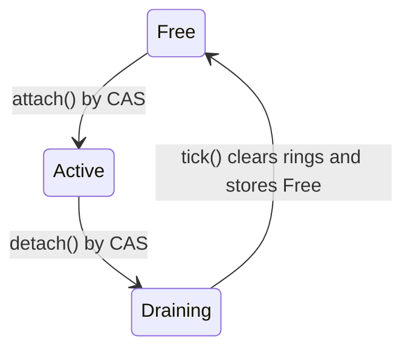

# pocket-dial: Conference Mix Bus

The summing junction for N-way audio on the ESP32-S3. This document covers the mix, the one
operation that turns pocket-dial's anchored-media path into an N-way conference bridge: the
design, the scalar reference that ships, the concurrency model, and the PIE vector kernels,
with notes on which instructions are confirmed and which still need toolchain verification.

## 0. Context and goals

### Starting point

pocket-dial routes phone↔phone calls as **peer-to-peer RTP**. The board is not in the media
path for those calls. `MediaBridge` anchors media only for a call routed through an
`AnchorClient` implementation (see `src/SIP/MediaBridge.cpp`). Reading that path
(`src/SIP/MediaBridge.cpp`, `RtpReceiver::mulawDecodeBuffer`, `RtpSender::ulawEncodeBuffer`,
`AnchorClient::writeAudio(const int16_t*)`) shows the key fact:

**Linear int16 PCM is already the internal currency at the anchor boundary.** µ-law lives
only at the LAN/handset rim; the anchor (`writeAudio` / `feedRx`) speaks linear. The PCM
fabric is built; what's missing is the summing junction.

Without the bus, each participant's audio reaches exactly one handset (`MediaBridge::feedRx`
writes into its own `_playoutBuffer`). That is a **star of 1:1 anchored legs with no summing**.
The `999` all-page is a *fan-out* (same payload → many); a real conference is a *mix*.

### Goal

Add a single `MixBus` that owns the mix tick. Each call attaches a **port** (two `PlayoutBuffer`
rings: leg→bus and bus→leg). Every active port hears the saturated sum of all *other* ports.
`MediaBridge` becomes a thin transport endcap, and an ordinary 1:1 call falls out as the
**N=2 case**, so the mixer subsumes the point-to-point path and the special-case 1:1 logic can
be retired.

### Status

The bus shipped as `MixBus` plus `ConferenceRoom` on extension `888` (issue #75; see §7). The
board is in the media path for `440`, `555`, `888`, an outbound trunk call, and a park orbit
with music on hold loaded. Two parts of the goal did not happen. Ordinary calls are still
peer-to-peer and never touch `MixBus`, so the 1:1 special case is not retired. The anchor leg
is still outside the bus: in BUS mode `MediaBridge` holds exactly one port, and `feedRx()`
returns `false` (`MediaBridge.cpp:410-413`).

### Non-goals
Transcoding (still G.711 at the rim, linear within), and per-codec edges beyond what
`MediaBridge` already does. Wideband (16 kHz) and Opus legs drop onto the same bus as linear
ports; the bus does not care which codec produced a frame.

## 1. The summing junction (the math)

An N−1 mix: each leg hears everyone *but itself*. The minus-self is not optional; loop a
talker's own audio back and you have built a digital echo chamber with one-frame delay.

Two ways to compute it:

| Formulation | Cost | Where it fits |
|---|---|---|
| Sum-once-subtract: `M = Σ inᵢ` once, then `outₚ = M − inₚ` | `2N` ops | Large/variable N. Needs a **wide (int32) accumulator**. |
| Direct per-port: `outₚ = Σ_{q≠p} in_q` | `N(N−1)` ops | Small N (≤~6). Pure int16 saturating; **no accumulator, no minus-self**. |

### The invariant
**Never saturate the running mix.** Sum-once-subtract is only correct if `M` is held in int32
and saturated *exactly once*, at the final per-port output.

Worked counterexample (four legs at +30000, int16):
- Wrong: clip `M` to int16 first: `M = sat16(120000) = 32767`; a leg hears
  `32767 − 30000 = 2767` → nearly silent. Broken.
- Right: `M` in int32 = `120000`; leg hears `120000 − 30000 = 90000` → `sat16 = 32767`.
  Correct.

Headroom: max magnitude is `N × 32767`, which fits int32 for any sane N (overflow needs
>65536 legs). The direct per-port formulation sidesteps this entirely because it never forms
the all-inclusive sum. That is why it is the natural fit for the confirmed S3 int16
saturating ops (§6).

The self-test (`tests/MixBus_test.cpp`) asserts both the minus-self result and that the
loud port hears **32767, not 2767**.

## 2. Topology

The bus sits **between the decode and encode edges**. `MediaBridge` keeps owning the RTP
sockets and the rim companding; it just rewires its two callbacks at the bus.

The diagram shows the design. The anchor leg is drawn as a port, but it is not on the bus yet
(see §7).

```
        handset (µ-law RTP)                          anchor leg (linear)
            │  ▲                                          │  ▲
   decode   │  │  encode                                  │  │
  (mulaw→)  │  │ (→ulaw)                                   │  │  (already linear:
            ▼  │                                           ▼  │   feedRx / writeAudio)
        ┌───────────┐  inputFrame()        inputFrame()  ┌───────────┐
        │  port P   │ ───────────────┐  ┌─────────────── │  port Q   │
        │ in.ring   │                ▼  ▼                │ in.ring   │
        │ out.ring  │ ◀──┐      ┌──────────────┐    ┌──▶ │ out.ring  │
        └───────────┘    │      │   MixBus     │    │    └───────────┘
                         │      │  tick():     │    │
              outputFrame└──────│  Σ int32 →   │────┘outputFrame
                                │  −self → sat │
                                └──────────────┘
                                  one 20 ms clock
```

- **Handset ports** compand at the rim (µ-law ↔ linear), exactly as `MediaBridge` does.
- **Anchor-leg ports** are already linear (`feedRx`/`writeAudio` take `int16_t*`), so they
  need **no compand at all**.
- The bus sees only int16 frames. The codec edge sits outside the bus.

## 3. The mix tick is the master clock

The arithmetic is trivial. The timing is not.

Every leg arrives on its own RTP/jitter clock. The **per-port input ring absorbs that jitter**,
and a single periodic driver drains **exactly one frame per port in lockstep** each tick. The
driver is the `conf_mix_tick` task in `ConferenceRoom`, not the sender cadence (see §7). A leg
that is late contributes **zeros for that tick** and the tick moves on; it never blocks waiting
on a straggler.

```
RTP in (jittery) ─▶ [per-port input ring] ─▶ ┐
                                              ├─ mixTick() @ fixed 20 ms ─▶ [output rings] ─▶ encode/RTP out
RTP in (jittery) ─▶ [per-port input ring] ─▶ ┘
```

**Stabilising this loop and making it underrun-tolerant is ~80% of the work.** Treat the tick
cadence as inviolable; everything else slots around it.

## 4. Implementation: scalar reference

This is the correct, portable reference, `-Wall -Wextra` clean, and the always-on fallback. At
≤8 narrowband ports the mix is ~64k adds/s, a rounding error on a 240 MHz core. **Write it
scalar first; vectorise only when ports × sample-rate climbs.**

Files (all in `src/SIP/`): `MixBus.hpp`, `MixBus.cpp`, `mix_kernels.h`, `mix_kernels_scalar.cpp`.
The shipped `tick()`, copied from `src/SIP/MixBus.cpp`:

```cpp
void MixBus::tick()
{
    // Scratch is _frame/_out (members, issue #498): this runs on conf_mix_tick's 3 KB stack.
    unsigned char present[MAX_PORTS];

    // (1) Snapshot participation for THIS tick; pull one frame per active port;
    //     reclaim any Draining ports in-band (tick is the sole ring-clearer).
    for (int p = 0; p < MAX_PORTS; ++p)
    {
        State s = _ports[p].state.load(std::memory_order_acquire);

        if (s == State::Draining)
        {
            _ports[p].in.clear();
            _ports[p].out.clear();
            _ports[p].hang = 0;
            _ports[p].emergency.store(false, std::memory_order_relaxed);
            _ports[p].state.store(State::Free, std::memory_order_release); // clean + free
            present[p] = 0;
            continue;
        }

        present[p] = (s == State::Active) ? 1 : 0;
        // #170: take a frame only when a WHOLE one is buffered. A leg at another
        // ptime (30 ms PCMU = 240 samples) leaves an 80-sample residue; reading it
        // partially would consume those real samples and then zero the frame
        // below, losing them. Left in the ring, they lead the next tick's frame.
        // The ring only grows between this check and the read (single reader).
        if (present[p] && (_ports[p].in.getLength() < static_cast<size_t>(FRAME) ||
                           !_ports[p].in.read(_frame[p], FRAME)))
            std::memset(_frame[p], 0, sizeof _frame[p]);   // late leg -> silence this tick

        // #169: a gated-out port contributes a ZEROED frame, and stays present. Clearing
        // present[] instead would make mix_minus_self subtract audio mix_accumulate never
        // added, and would skip the out write so the leg underruns into comfort noise.
        // Rule 5: the only exemption is the port's emergency flag, passed as `bypass`.
        if (_vadGate && present[p])
        {
            const pd::vad::Verdict v = pd::vad::step(
                _ports[p].hang, _frame[p], FRAME, pd::vad::kOpenEnergy, pd::vad::kHangoverFrames,
                _ports[p].emergency.load(std::memory_order_relaxed));
            _ports[p].hang = v.hang;
            if (!v.participates) std::memset(_frame[p], 0, sizeof _frame[p]);
        }
    }

    // (2) Full mix in int32 — NEVER saturate here.            [PIE kernel A]
    mix_accumulate(_mix, _frame, present, MAX_PORTS, FRAME);

    // (3) Fan out: each active port hears (mix - self), saturated once. [PIE kernel B]
    for (int p = 0; p < MAX_PORTS; ++p)
    {
        if (!present[p]) continue;
        mix_minus_self(_out, _mix, _frame[p], FRAME);
        _ports[p].out.write(_out, FRAME);
    }
}
```

The two kernels behind fixed signatures (scalar body shown; PIE swap in §6):

```cpp
void mix_accumulate(int32_t* mix, const int16_t frame[][MIX_FRAME],
                    const unsigned char* present, int maxPorts, int frameLen) {
    std::memset(mix, 0, sizeof(int32_t) * frameLen);
    for (int p = 0; p < maxPorts; ++p)
        if (present[p])
            for (int i = 0; i < frameLen; ++i)
                mix[i] += frame[p][i];        // int16 promoted to int32 — no saturation
}

void mix_minus_self(int16_t* out, const int32_t* mix, const int16_t* self, int frameLen) {
    for (int i = 0; i < frameLen; ++i) {
        int32_t v = mix[i] - self[i];
        out[i] = (v > 32767) ? 32767 : (v < -32768) ? -32768 : (int16_t)v;
    }
}
```

## 5. Concurrency: attach/detach vs the tick

`attach`/`detach` run on SIP signaling threads; the tick runs on its own driver. The hot path
must be lock-free and a leg leaving must never corrupt or silence the others. This is the
**single-active-bridge discipline `MediaBridge` already keeps for one leg, generalised to N.**

### Per-port state machine



The rule: the tick is the *sole owner of ring teardown*. Reclamation (clear rings → return
to `Free`) happens only inside `tick()`, so no signaling thread ever frees ring state under a
concurrent tick read. This maintains the invariant **"a `Free` slot has empty rings,"** which
is why `attach()` need only flip the flag.

```cpp
int MixBus::attach() {                          // cold path
    for (int p = 0; p < MAX_PORTS; ++p) {
        State expected = State::Free;
        if (_ports[p].state.compare_exchange_strong(
                expected, State::Active,
                std::memory_order_acq_rel, std::memory_order_relaxed))
            return p;                            // rings guaranteed empty by prior reclaim
    }
    return -1;                                  // bus full
}

void MixBus::detach(int port) {                 // non-blocking; tick reclaims later
    if (port < 0 || port >= MAX_PORTS) return;
    State expected = State::Active;
    _ports[port].state.compare_exchange_strong(
        expected, State::Draining,
        std::memory_order_acq_rel, std::memory_order_relaxed);
}
```

- `attach` uses a **CAS** (`Free → Active`) so two signaling threads racing for the same slot
  resolve lock-free; the loser tries the next slot. (A coarse mutex around `attach`/`detach` is
  an acceptable simplification; those paths are cold.)
- `detach` only flips to `Draining` and returns. The next tick clears the rings and publishes
  `Free`. Until then `attach` won't reuse the slot.
- `inputFrame`/`outputFrame` gate on `State::Active`; `PlayoutBuffer` is itself internally
  synchronised for the ring read/write, so the only thing the state flag arbitrates is
  *participation*, not buffer safety.
- Ordering: publish-Active and publish-Free are `release`; all readers (`tick`, `inputFrame`,
  `outputFrame`) are `acquire`. The tick snapshots `present[]` at the top, so a port flipping
  mid-tick never tears a frame.

The host test in `tests/MixBus_test.cpp` checks that detaching a port and ticking once returns
the slot to `Free`, and that the slot re-attaches at the same index.

## 6. The PIE vector kernels (drop-in when N × Fs climbs)

Discipline first: the scalar path above is the default and is correct. These kernels are a
*transparent swap behind the same signatures*. Do not reach for them until profiling says the
mix loop matters, i.e. many legs, or you move the bus to 16 kHz to fold G.722 in natively.

The ESP32-S3 PIE instruction set is thinly documented. The kernel below uses
**only instructions confirmed real** (`ee.vld.128.ip`, `ee.vadds.s16`, `ee.vst.128.ip`; the
`vadds.s16` pattern is in esp-dsp's `dsps_add_s16_aes3.S` and the S3 TRM extended-instruction
chapter). The int32 path needs ops that are not yet confirmed to assemble, see §6b.

### 6a. Small conference (≤5-way): confirmed-ISA, no int32, no minus-self
Pick the **direct per-port** formulation. To give port P "everyone but itself," sum P's
up-to-four peers; never form the all-inclusive sum, so the over-saturation trap cannot occur.
`src/SIP/pie/mix_sum4_s16.S`:

```asm
mix_sum4_s16:                       # out[i] = sat16(a+b+c+d); args a2=out a3..a6=a..d a7=len
    entry   a1, 16
    srai    a7, a7, 3               # frameLen / 8  (128-bit chunks)
    loopnez a7, .Lend               # HW loop; skip if zero
    ee.vld.128.ip q0, a3, 16        # a[0..7]
    ee.vld.128.ip q1, a4, 16        # b[0..7]
    ee.vadds.s16  q0, q0, q1        # sat(a+b)
    ee.vld.128.ip q1, a5, 16        # c
    ee.vadds.s16  q0, q0, q1        # sat(a+b+c)
    ee.vld.128.ip q1, a6, 16        # d
    ee.vadds.s16  q0, q0, q1        # sat(a+b+c+d)
    ee.vst.128.ip q0, a2, 16        # store
.Lend:
    retw.n
```

- A **5-way** conference is one call: `mix_sum4_s16(out_P, peer1, peer2, peer3, peer4, FRAME)`.
  Zero-frame any unused slot (one static 16-byte-aligned zero buffer).
- For **>5-way**, chain: mix one group of four into a temp, then `vadds` the next group.
  Saturating sum is a valid mix; saturation is order-dependent at the clip boundary but
  perceptually identical (this is what most production mixers do).
- Alignment is a hard requirement: `ee.vld/vst.128` ignore the low 4 address bits. Buffers
  must be 16-byte aligned (`MixBus.hpp` declares the tick scratch, `_frame` and `_out`, as
  `alignas(16)` members) and `frameLen` a multiple of 8. FRAME=160 → 20 iterations, 320 B,
  both satisfied.
- **One function per `.S` file** (the S3 gotcha: multiple PIE functions in one file misbehave).

### 6b. Large/variable N: int32 sum-once-subtract (parity with scalar)
This matches the scalar reference bit-for-bit. The vector body needs **int32-lane and
narrowing ops that are not yet confirmed to assemble**.

Status, checked 2026-10-09 against the ESP32-S3 TRM v1.8 and a GNU as probe (issue #171):

- Confirmed: `ee.vadds.s32` and `ee.vsubs.s32` exist, saturate, and assemble. `ee.vsubs.s32` computes qy - qx, so operand order matters.
- Not found: widening int16 to int32 into QR registers. Widening exists only into QACC (`EE.LDQA.S16.128.IP`, `EE.MOV.S16.QACC`).
- Not found: a QR-to-QR saturating narrow from int32 to int16. `ee.srs.qacc` and `ee.srs.s16.qacc` do not assemble. The only saturating narrow to int16 is `EE.SRCMB.S16.QACC`, which reads QACC.
- For 16-bit data, QACC uses 40-bit segments (TRM section 1.3.3); the 20-bit segment is the 8-bit case. The safe-leg bound is about 16.7M legs. The real ceiling is int16 saturation on readback.
- There is no int32 readback from QACC (TRM section 1.5.3). Readback is `EE.SRCMB.S16.QACC` (saturates to int16) or the QACC_L/QACC_H store forms (packed 40-bit segments).
- Assembles: `ee.zero.qacc`, `ee.vmulas.s16.qacc`, `ee.srcmb.s16.qacc`, `ee.vadds.s16`, `ee.vld.128.ip`, `ee.vst.128.ip`.

**Status:** the vector kernel is not built and not linked. `POCKETDIAL_MIXBUS_PIE` is defined nowhere, and `src/SIP/pie/*.S` is in no CMake list. Keep the scalar `mix_accumulate` and `mix_minus_self` bodies, which are correct. The vector path needs its twin kernels, the CMake entries, and the macro before it can link.

**Open question before any build:** the scalar stand-in clips once, while `mix_sum4_s16.S` saturates per add, so mixed-sign input can differ on target. Test that before swapping.

### 6c. Next PIE target: VAD gating
When you want it to *sound* like a conference (not just be correct), gate the mix to ports
that are actually speaking. That drops the noise floor and the clip risk simultaneously, and
the per-frame energy test is **sum-of-squares**, a clean vector MAC (`ee.vmulas.s16.accx`),
which is the same kernel shape as a Goertzel/correlation detector.

**The scalar gate ships, default off (issue #169).** `MixBus(bool vadGate = false)`; the 888 room
passes `POCKETDIAL_CONF_VAD` (`PoolConfig.hpp`, default 0, no admin knob). When it is on, `tick()`
asks `pd::vad::step()` (`src/SIP/VadGate.hpp`, pure) per port per frame. Energy is sum-of-squares
in int64; the gate opens on the first loud frame and holds for `kHangoverFrames` (10 = 200 ms)
quiet frames. A gated port's frame is zeroed before the accumulate but the port stays present,
so it still hears the others and minus-self stays exact. `kOpenEnergy` and the hangover are
**unmeasured placeholders** pending the .244 idle-vs-speaking energy measurement. An all-quiet
room becomes digital silence.

`MixBus::setEmergency()` exempts a port (Rule 5). No call path sets it. The REFER/transfer routes
into 888 have not been audited for an emergency leg, so audit them before enabling
`POCKETDIAL_CONF_VAD`, which `PoolConfig.hpp` also pins to 0 at compile time. No PIE energy
kernel is built.

## 7. Integration with `MediaBridge`

This is the shipped integration (issue #75). `MediaBridge` has a BUS mode: `init()` takes an
optional `MixBus*`, and a non-null bus swaps both media callbacks at their far end.
`ConferenceRoom` (`src/SIP/ConferenceRoom.*`) owns one bus, up to `POCKETDIAL_CONF_LEGS` legs of
`{RtpReceiver, RtpSender, MediaBridge}`, and the single 20 ms tick driver. `RequestsHandler`
intercepts the virtual extension **`888`** in `onInvite()` (alongside `777`/`999`/`440`/park) and
joins the caller. The table compares the 1:1 path with BUS mode.

| `MediaBridge` without the bus | With the bus |
|---|---|
| RX cb: `mulawDecodeBuffer` → `_anchor->writeAudio` | RX cb: `mulawDecodeBuffer` → `bus.inputFrame(port, pcm, n)` |
| TX cb: `_playoutBuffer.read` → `ulawEncodeBuffer` | TX cb: `bus.outputFrame(port, pcm, n)` → `ulawEncodeBuffer` |
| `startBridge`: wire callbacks | `startBridge`: `port = bus.attach();` then wire |
| `stopBridge`: stop sockets | `stopBridge`: `bus.detach(port);` then stop sockets |
| `feedRx` writes the single playout buffer | BUS mode refuses it, see the caveat below |
| one mutex-guarded single bridge | N ports, one shared bus, one tick driver |

The single tick driver replaces nothing in `MediaBridge`. It is one new periodic task inside
`ConferenceRoom` (on Core 0 at `RtpSender`'s media priority on device, or a `std::thread` on the
host). It is deliberately **not** hung off the existing sender cadence: there are N senders and
one bus, so that would be N clocks racing to drain the same rings. `ConferenceRoom::tickOnce()`
lets the host suite step the clock instead of running the driver.

The anchor leg is still outside the bus. A bussed `MediaBridge` holds exactly one port, its
handset leg. `feedRx()` returns `false` in BUS mode rather than writing into a `_playoutBuffer`
that the sender no longer reads. Giving the anchor its own port, and a pump for its return
direction, is follow-up work. The local conference does not need it, because handset legs alone
are enough ports.

## 8. Traps (pre-flight checklist)

1. **Never saturate the running mix.** int32 accumulator, clip once at output. (§1; asserted in
   the self-test.)
2. **Lifetime/concurrency.** The `Free → Active → Draining → Free` state machine; tick is the
   sole ring-clearer. (§5.)
3. **New input-direction ring.** A 1:1 `MediaBridge` buffers only anchor→handset. The mixer also
   needs handset→bus buffering. Same `PlayoutBuffer`, second instance per port.
4. **Alignment.** 16-byte-align every frame buffer; `frameLen % 8 == 0`. Misaligned `ee.vld.128`
   reads the wrong window silently. (§6.)
5. **Frame cadence.** `FRAME` is the ptime this bus sends (160 samples, 20 ms at 8 kHz). A leg at
   another ptime is absorbed by its input ring. The tick reads only whole frames and leaves any
   residue for the next tick (#170). Mixed ptimes (G.723.1 = 30 ms, G.729 = 10 ms, Opus
   2.5–60 ms) are a jitter and latency question, not a compute one.
6. **Headroom vs. feel.** Naive clip is fine in practice (one or two talkers at once). Add VAD
   gating when you want conference-grade quiet. (§6c.)
7. **Vectorise last.** Scalar ships and is a rounding error at ≤8 narrowband legs. The PIE
   kernels are the easy 5%; the bus topology and master clock are the 95%.

## Appendix: files

```
docs/CONFERENCE_MIXER.md          this document
src/SIP/MixBus.hpp                the bus + per-port state machine
src/SIP/MixBus.cpp                attach/detach/tick (compiled, -Wall -Wextra clean)
src/SIP/mix_kernels.h             kernel signatures + POCKETDIAL_MIXBUS_PIE toggle
src/SIP/mix_kernels_scalar.cpp    correct scalar bodies (the default + fallback)
src/SIP/pie/mix_sum4_s16.S        confirmed-ISA saturating int16 sum — not on the live
                                  path: MixBus::tick() calls mix_accumulate/mix_minus_self
                                  unconditionally (MixBus.cpp:107,113). The only callers of
                                  mix_sum4_s16 in the tree are tests/MixBus_test.cpp:167,174
src/SIP/MediaBridge.hpp/.cpp      the transport endcap; BUS mode is described in §7
src/SIP/ConferenceRoom.hpp/.cpp   one bus, N legs, and the single tick driver; extension 888
tests/MixBus_test.cpp             verifies minus-self, no-over-saturation, reclaim (GoogleTest)
tests/ConferenceRoom_test.cpp     the §7 wiring: N legs through the real µ-law rim, a leg
                                  leaving, the tick driver, and the 888 dial intercept
```

The self-test runs as part of the normal host suite:
```bash
cmake -B build -S . -DCMAKE_BUILD_TYPE=Release
cmake --build build --config Release
ctest --test-dir build/tests -C Release --output-on-failure --tests-regex MixBus
```
