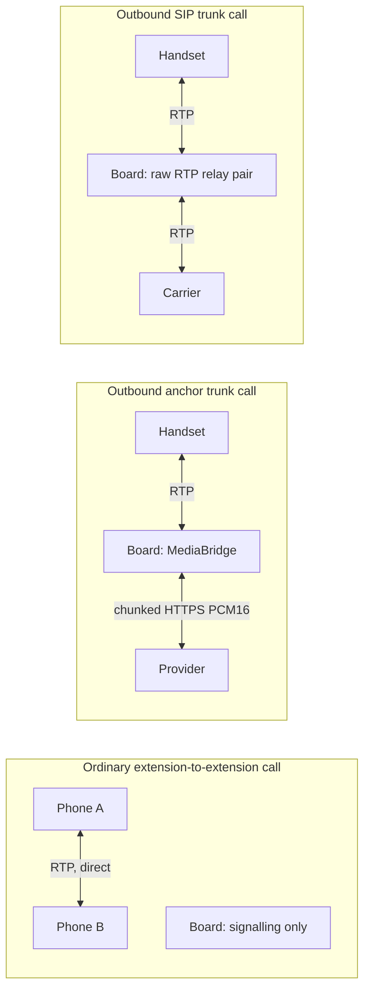

# pocket-dial: Technical Feature Roadmap

Status: living document. Last updated: 2026-10-12. Scope: engineering and product capability only.

This is a prioritized engineering roadmap for pocket-dial: what exists in the source tree, what has been observed on hardware, and what to build next. Every proposal is sized against the ESP32 and ESP32-S3 limits: static memory pools, no MMU or heap compaction, a single UDP listener, and a media path that is peer-to-peer except where it is explicitly not.

Related documents: [ARCHITECTURE.md](ARCHITECTURE.md), [SCALING.md](SCALING.md), [THREAT_MODEL.md](THREAT_MODEL.md), [PROVISIONING.md](PROVISIONING.md), [LEARN_MODE.md](LEARN_MODE.md), [OTA.md](OTA.md), [API.md](API.md), [../README.md](../README.md).

## The media boundary

pocket-dial does not touch RTP on an ordinary call. That fact still decides what is cheap and what is expensive here. It no longer describes the product as a whole, so stating it as a blanket rule misleads.

Three media paths are in use:



**The peer-to-peer half.** An extension-to-extension call is brokered and then gets out of the way: the two phones stream RTP directly to each other, and the MCU never sees a media packet. Hold and blind or attended transfer keep that property. The SDP is relayed, and only the codec list is narrowed, never the `c=` line.

Park is not peer-to-peer in every case. With a music-on-hold clip loaded, the board answers the parked leg `sendonly` from its own port and streams the clip to it (`src/SIP/ParkOrbit.cpp:66-85`). That puts the MCU in the media path, one way, for the duration of the park. With no clip loaded (the default), park answers `a=inactive` and sources nothing.

The `777` echo is in this half too, despite an in-code comment that calls it server-terminated. It is an SDP loopback: it answers with the caller's own body so the phone streams to itself (`src/SIP/RequestsHandler.cpp`, `onInvite`, the `777` branch). Nothing on the board carries that audio.

**The media-terminating half is shipped.** `440` (tone), `555` (anchor bridge), `888` (conference) and voicemail (deposit on no-answer or busy, retrieval on `796`; `src/SIP/VoicemailLeg.hpp`) put the board in the path. It sends and/or receives RTP for them. `888` decodes, mixes and re-encodes.

An outbound **anchor** trunk call crosses the board on **both** sides: RTP to and from the handset, and chunked-HTTPS PCM16 to and from the provider, with `MediaBridge` shuttling PCM16 between them. The board owns the handset-facing `RtpReceiver`/`RtpSender` pair for the life of that call (`src/SIP/MediaBridge.hpp:17-18`).

An outbound **SIP** trunk call (§1.3) crosses the board too, as a raw RTP relay pair with no PCM16 and no `MediaBridge` (the trunk relay in `src/SIP/RequestsHandler.cpp`, `trunkRelayForward`). These are deliberate, bounded, individually dialable exceptions, not a removal of the invariant for ordinary LAN calls.

The cheap/expensive axis still holds, and it is now measurable. Signalling features are bounded by the pre-allocated pools and cost a few hundred bytes. Media features cost a leg's worth of RTP tasks and rings apiece. That is why the conference is capped at 4 legs, the anchor trunk at four concurrent calls (one on the default loopback provider), the SIP trunk at two, and voicemail at two legs (see §1.3 and §1.5).

## 1. Current capabilities (shipped, in the tree today)

### 1.1 Call control and PBX features

| Capability | Notes | Where |
|-----------|-------|-------|
| Registrar + back-to-back call broker | `REGISTER`, `INVITE`, `ACK`, `BYE`, `CANCEL`, `OPTIONS`, provisional/final responses | `src/SIP/RequestsHandler.cpp` |
| **SIP digest auth (RFC 2617)** | Implemented and operable. The default is `learn` (#441), and `open` is retired (#500/#502). Learn challenges Secured devices. Secure mode challenges every extension (see §1.4). Bypasses found in review are fixed: #507 by #487 (an ARP miss no longer admits a Secured extension without digest), #560 by #562 (the relayed ACK and re-INVITE/UPDATE no longer carry the INVITE's credential), #525 by #570 (a reused nonce or `nc` is re-challenged) and #549 by #555. | `src/Helpers/SipDigest.*`, `src/SIP/Registrar.*` |
| Blind transfer (REFER) | Source-authorized against the dialog's own legs (#133). Moves the **transferee**: a new dialog to the target carries B's media, the transferor A is BYEd, and the A–B leg is kept. The old inverted topology (#197) is fixed by #211, and `tests/BlindTransfer_test.cpp` pins the corrected one. Unresolvable targets no longer destroy the call (#203). Remaining: the NOTIFY reports `200` as soon as the INVITE is queued, with no `100 Trying` progress. | `onRefer` |
| Attended transfer (REFER + Replaces, RFC 3891) | Splices B and C, BYEs A out of both, relays a later BYE across the bridge. The hardcoded `CSeq: 100` of #257 was removed by its own fix (#308, per-dialog floors). #402 replaced those floors with `nextServerCSeq()` (`src/SIP/Session.hpp`). Only REFER `?Replaces=` is handled; an INVITE carrying `Replaces` (BLF pickup) is not. | `onRefer`, `handleTransferOk` |
| Hold / resume | Re-INVITE relayed with its **SDP** untouched, so the SDP survives. `Contact` is rewritten on every relayed re-INVITE (#425; see the `Contact` comment in `onReinvite`). | `onReinvite`, `onOk` |
| RFC 3311 `UPDATE` | | `onUpdate` |
| RFC 4028 session timers | Advertises `Supported: timer` (#198). An initial INVITE with too small a `Session-Expires` gets `422` + `Min-SE` (#591), and PBX-authored 2xx answers name `refresher=uac` (#724). | `armSessionTimer`, `answerSessionTimer` |
| Ring / hunt groups | ring-all or sequential hunt | `CallForker` |
| Call park + retrieve | orbits `700`–`709` (`POCKETDIAL_PARK_SLOTS` = 10) | `ParkOrbit.*` |
| Call pickup | group `*8`, directed `**<ext>`; pickup groups reuse ring-group membership | `CallPickup.*` |
| Paging / intercom | zones `980`–`989`, plus `999` all-page, with auto-answer header injection and race-to-answer | `startPaging`, `startBroadcastFork` |
| Call forward | CFU / CFB / CFNA, per extension | `PbxFeatureConfig` |
| Per-extension DND | | `PbxFeatureConfig` |
| BLF / presence | `SUBSCRIBE`/`NOTIFY` for the **`dialog` event package** (RFC 4235), and for `message-summary` (RFC 3842, MWI) when `POCKETDIAL_MWI` is on, which is the default. `SIP_CONSTRAINED` builds compile MWI out. Any other package gets `489`. There is no `presence` package. | `BlfSubscriptions.cpp` (`kAllowEvents`, `onSubscribe`) |
| Outbound email (SMTP client) | Issue #159, phase 1: generic SMTP client over `esp_tls` (implicit TLS, STARTTLS or plain LAN relay; `AUTH PLAIN`, `LOGIN` or `XOAUTH2`; streaming DATA writer), configured at `/setup/email`. Gmail App Password and Google Workspace service-account paths (domain-wide delegation, RS256 JWT) are included. The client is standalone: its own "Send test message" (`POST /api/email/test`) is the only consumer. On-device voicemail exists (§1.2), but **nothing emails a voicemail yet** (`SmtpDialogue.hpp:90`: "a later consumer, not built"). | `src/Helpers/SmtpDialogue.*`, `SmtpClient.*`, `GoogleServiceAuth.*`, `EmailConfigStore.*` |
| DTMF star codes | `*60`, `*72`, `*73`, `*80`, `*69`, `*11`, plus the `*PIN#code` admin menu. Digits arrive over **SIP INFO** (RFC 6086) on any call except a voicemail leg, which the `isDtmfRelay` guard in `RequestsHandler::handle` keeps away from the star-code parser. Digits also arrive over **RFC 4733** telephone-event on a leg the board itself terminates: 888 conference and 555/anchor (`MediaBridge.cpp:110-115`), and the voicemail retrieval menu (`_vmMenus[slot].onDigit`). Not decoded on park legs or the SIP-trunk relay. RFC 4733 cannot work on an ordinary extension-to-extension call: that RTP is peer-to-peer and never reaches this board. | `DtmfFeatureCodes.cpp`, `RtpReceiver::dispatchDtmf` |
| Bounded dial plan | ordered `pattern → group\|page\|park\|trunk`, first match wins, cap `POCKETDIAL_MAX_DIAL_RULES` = 16 | `DialPlan.hpp` |
| **Emergency dialing (#166)** | `911`, `9911` and the `933` test number are intercepted **before** the dial plan and before registrar call-setup policy (`onInvite`, via `pbx::classifyEmergencyDial`), and a dial-plan rule that produces one takes the same path. `routeEmergencyCall()` offers the call only to the real anchor, and only when the boot-selected provider places real calls. It never goes to a SIP trunk, and the loopback simulator is never offered one (#521, #538). Everything else is answered `503 Emergency Call Not Routable`. Every attempt, routed or not, triggers the Kari's Law on-site notification (`EmergencyNotifier.*`, configured at `/api/e911-config`), and `/api/status` reports `emergencyRoute` as `anchor` or `none`. **No location is conveyed to the PSAP, an emergency call does not pre-empt a busy anchor slot, and a live 911/933 route has not been proved on hardware** (see §5). | `EmergencyCall.hpp`, `EmergencyNotifier.*` |
| Inbound DID → extension | route-DN match by **E.164 equivalence** (`pbx::e164SameNumber`, #165; `DidMapping::sameDid`), so `+15551234567` and `(555) 123-4567` are the same DID; cap 8; unmapped falls back to ring-all | `DidMapping.*`, `E164.*` |
| CDR ring + `GET /api/cdr` | 32-record ring persisted to NVS (namespace `cdrlog`, `CdrRing.cpp`), so it survives a reboot **while the serialized ring stays under NVS's 4,000-byte string cap**: it can reach 4,481 B, and the writer ignores the error, so history silently goes stale (#470, fix #476); on SD builds also appended to a per-day CSV archive `/sdcard/cdr/YYYY-MM-DD.csv` (#194, `CdrArchive.hpp`). Both are wiped by factory reset. `GET /api/cdr` (JSON, admin-gated) is the only read route; the archive has no download route. | `CdrRing.*`, `CdrArchive.*` |
| Virtual `777` echo | SDP loopback, **no media on the board**; since #304 the echoed answer also drops PCMA | `RequestsHandler.cpp`, `onInvite` (the `777` branch) |

### 1.2 Media: the part the board actually carries

| Capability | Notes | Where |
|-----------|-------|-------|
| `440` server-sourced tone | board **sends** RTP; `sendonly` SDP | `onMediaInvite` |
| **Music on hold (park, held anchor calls, preview)** | board **sends** RTP. One global clip cursor. The clip is read off the SD card into PSRAM **once at load**, so the card is out of the media path after that. G.711 µ-law 8 kHz mono only. There are two kinds of consumer. **Listeners** (a **parked** leg, and the dashboard **preview** call, `POST /api/moh/preview`) each get the identical 160-byte payload `sendto`'d per listener every 20 ms tick. There is no per-leg decode and no `MixBus`, and the cap is `POCKETDIAL_PARK_SLOTS`. **Taps** are the far side of an **outbound** anchor call that a handset puts on hold (#218). They sit in a separate table (`Tap _taps[POCKETDIAL_MAX_ANCHOR_CALLS]`, `HoldMusic.hpp`). Each tap is decoded from µ-law to PCM16 per call in `MediaBridge::feedMohTick` and written with `AnchorClient::writeAudio`, not `sendto`. Taps are wired for the outbound anchor (`destNum == kAnchorCallExt` in `onReinvite`). A hold on an **inbound** anchored call is answered too (#445, fixed by #449). The hold itself goes through `answerAnchorReinvite`, which calls `MediaBridge::setHeld()`. **Falls back to a silent `a=inactive` hold** when there is no clip, no usable RTP endpoint in the parked party's SDP, or MoH is not running. Park never fails because nobody uploaded a WAV. An ordinary peer-to-peer hold is still relayed untouched and hears nothing from the board (`onReinvite`). A SIP-trunk call refuses a hold re-INVITE with `488`. | `HoldMusic.*`, `ParkOrbit.cpp:66-85`, `MediaBridge::setHeld` |
| **Voicemail (on-device, #246)** | board **sends and receives** RTP. Deposit when a call goes unanswered or finds the extension busy (`answerVoicemailDeposit`, called from `divertRefusedCall` and `onBusy`); retrieval by dialing **`796`**, with RFC 4733 menu navigation. Each leg owns its own `RtpReceiver`/`RtpSender` pair (`VoicemailLeg.hpp`), with a cap of `POCKETDIAL_MAX_VOICEMAIL_LEGS` = 2. Messages are WAVs on the SD card (`/sdcard/vm`, `VoicemailArchive.*`), so voicemail exists **only on SD builds**. Managed with `POST /api/voicemail`. Deposits and listens move the mailbox's MWI counts (§1.1). There is no voicemail-to-email yet. | `VoicemailLeg.*`, `VoicemailArchive.*`, `VoicemailMenu.*` |
| `888` meet-me conference | board decodes, mixes (`MixBus`, N−1 minus-self summing) and re-encodes. **`POCKETDIAL_CONF_LEGS` = 4**, one global room, **no PIN**. The room is built at boot (#479), and its mix-tick driver starts on the first dial-in. **Exercised on `.244` (2026-09-27): that run panicked the board** (#498): `MixBus::tick` kept ~2.9 KB of frames on `conf_mix_tick`'s 3,072-byte stack. #499 moved the scratch into `MixBus` members (`MixBus.hpp:72-73`). The fix is merged but **not yet re-run on hardware**. The same run's first call left ~139 B of internal heap for the rest of uptime (#524), measured before #475 and #480 moved the jitter rings and the rx stacks to PSRAM. Re-measure on the next bench run. A quick re-dial got `486` (#513), fixed by #526 (host-tested). | `ConferenceRoom.*`, `MixBus.*` |
| `555` anchor media bridge | board bridges a leg to an `AnchorClient`. **Active on default firmware** via the `Loopback` reference client. | `onAnchorInvite`, `MediaBridge.*` |
| Codec policy | **Relayed peer-to-peer legs admit PCMU, PCMA _and G.722_** (`filterAudioCodecs(allowWideband=true)`). Legs the board terminates itself (777, 440, 888, 555, voicemail) refuse G.722 **and, since #304, PCMA**. They accept PCMU only, because `RtpReceiver` decodes PT 0 only. The board-terminated handlers gate their offers with `offersSupportedAudio(/*allowWideband=*/false, /*allowPcma=*/false)`. The board's own SDP offers PCMU (plus telephone-event). **Gaps:** the SIP-trunk path has no such gate, yet answers the handset PCMU-only. Park with MoH answers `makeSendonlySdp`, which is PCMU-only (`SipWireUtil.hpp`), whatever the parked phone offered (`ParkOrbit.cpp:66-81`). | `SipMessage::filterAudioCodecs`, `buildMediaSdp` |
| `enforceG711()` | **Deprecated, zero production callers** (tests only). It pinned `m=` to a literal `0 8 101`, inventing PT 101 with no `a=rtpmap`, which pjsip rejects outright. Any "this PBX is G.711-only" statement is stale. | `SipMessage::enforceG711` |
| SDP admission gate | every SDP-bearing message structurally checked before any decoder sees it; capability-negotiation attributes refused (T-7 / the UNISOC T612 RCE class) | `SipMessage::checkSdp` |

### 1.3 Outbound PSTN Interconnect & Media Anchors

**Strategic architecture (October 2026).** Carrier-facing ITSP SIP trunks (`SipTrunk` over UDP) are **shelved behind Milestone 11** because of NAT, CGNAT and SIP ALG traversal drop modes (#618, #919) and heavy embedded task stack and memory consumption. Outside-line PSTN interconnect now uses **cloud media anchors and programmable telephony** only (Milestone 6, Epic #381, [ADR-002](ADR-002-PROGRAMMABLE-MEDIA-ANCHOR.md)).

Outside-line calls leave through the **programmable media anchor interface**:

- **3CX Call Control Anchor:** HTTP/OAuth2 REST call control, WebSocket events, and chunked-HTTPS PCM16 audio (`TelephonyAnchorClient`).
- **Apidaze CPAAS Anchor (#920), host-test scaffold only:** `ApidazeAnchorClient` has the class, its default base URL and the AudioSocket framing include, but no REST call paths and no socket I/O. Nothing in `src/` or `main/` constructs it, and `TelephonyProviderType` offers only `Loopback` and `Telephony`. The intended design is REST call control (`POST /calls`, `DELETE /calls/{uuid}`) and bidirectional 8 kHz PCM16 over the standard **AudioSocket** binary framing (type `0x10`, 320-byte frames). None of that is implemented yet. The scaffold's contract test is `tests/AudioSocket_test.cpp`.
- **Compile-out (#731):** Constrained firmware compiles out legacy `SipTrunk` (`POCKETDIAL_HAS_TRUNK=0`, `POCKETDIAL_MAX_TRUNK_CALLS=0`), reclaiming ~12 KB internal RAM and ~35 KB flash image space. Host tests and unconstrained builds support `POCKETDIAL_HAS_ANCHOR=1`.

Points that are easy to get wrong:

- **The SIP trunk registers only when it has a password.** `SipTrunk` then REGISTERs at
  boot, refreshes before Expires and answers a `401`/`407` to the REGISTER with digest
  (#615); a `401`/`407` to its INVITE is answered with digest credentials once (#581). An
  IP-authenticated trunk does not register. Outbound calls over a registered trunk are still
  under investigation: the carrier does not answer the INVITE (#618). Server location is a
  plain A-record lookup (`TrunkResolver`): no SRV/NAPTR, UDP only.
- **A dial-plan rule with `action=trunk` is the only way out for an ordinary number.** No
  hardcoded `9` prefix, no unregistered-destination fallback: with an empty dial plan every
  outside number is answered `404` without leaving the box. **Emergency numbers are the
  exception**: they bypass the dial plan entirely (§1.1).
- **`POCKETDIAL_MAX_ANCHOR_CALLS` is 4** (`src/SIP/PoolConfig.hpp`). The effective ceiling
  is `min(provider, 4)` via `RequestsHandler::anchorCallLimit()`: `LoopbackAnchorClient`
  declares **1** (constant participant id), and `TelephonyAnchorClient` declares 4. So
  **default firmware still gets one concurrent anchor call**; a board driving a real 3CX
  trunk gets four, bounded by software ECDHE cost, not RAM.
- **E.164 exists for inbound DIDs only.** `pbx::e164Normalize`/`e164SameNumber` (#165,
  `src/SIP/E164.*`) are used by DID matching. Outbound, a rule's strip/prepend is still the
  whole of the number transformation. The SIP trunk prefixes `+` when it builds the
  Request-URI (`src/SIP/SipTrunk.cpp`, `pstnUri`), except for the emergency service numbers,
  which go out bare (#521). The comment in `pstnUri` says `E164.cpp` has already normalised
  the number. That is not so for outbound numbers.

Anchor credentials live in four slots (`TelephonyApiConfig::kSlots`), one active at a time,
edited through `/api/telephony-config`, see [API.md](API.md).

### 1.4 Security posture

| Control | State |
|---------|-------|
| **Admin login** | **Username + password** (`AdminAuth`), salted/iterated SHA-256, server-side sessions, per-session CSRF token on every mutating route, and brute-force lockout with exponential backoff plus an aggregate backstop. **The lockout is per client** since #530: `req.clientIp` is set on every buffered request, as it already was for the streaming OTA and MoH upload, and `sendApiAdminLogin` keys its lockout on it. The aggregate backstop is still shared by design, see [THREAT_MODEL.md](THREAT_MODEL.md) D-3. Ships as `admin`/`admin` with forced first-use setup: every admin route except `set-credential` answers `403 setup_required` until it is replaced. |
| **DTMF admin PIN** | A *separate*, independent numeric secret for the phone-keypad `*PIN#code` menu. **No default**, so that menu is disabled until explicitly configured. Unrelated to the web session. |
| **HTTP reachability** | **The dashboard is always reachable.** The listener opens at construction and stays open. The dark-by-default plane and the `*4887` reopen star-code were **removed** (`de1a36e`); `grantAdminHttpGraceWindow` no longer exists. |
| **Registrar admission** | Two modes: `learn` / `secure`; `open` is retired (#500/#502), and a stored retired value boots as Learn. Digest auth is real; Learn is TOFU + an ARP-learned MAC lock. **The shipped default is `learn`** (#441): a fresh board adopts an unknown MAC on its first REGISTER, and an unregistered INVITE caller gets `403` (`onInvite`). **Learn still admits an INVITE from a Learned (unsecured) extension without a challenge:** Secure challenges every INVITE, and Learn challenges only a device an admin has promoted to Secured (#512, `onInvite`). An INVITE must come from the address its caller registered from (#503). |
| **SoftAP WPA2** | Implemented, **opt-in, default off** (NVS `ap_secure`) so a firmware update never re-pairs a live fleet. Encrypts dashboard, SIP and RTP together. |
| Signalling hardening | per-source-IP token bucket, AOR whitelist, bounded parser, SDP admission gate. **The optional CIDR allowlist is not a shipped control**: `_allowNet` and `_allowMask` (`RequestsHandler.hpp`) are never assigned, so `ipAllowed()` returns true for every source (`RequestsHandler.cpp`). See [ARCHITECTURE.md](ARCHITECTURE.md) §Rate Limiting. |
| HTTP hardening | same-origin + CSRF, 16 KB body cap, `SO_RCVTIMEO`, no wildcard CORS, central security response headers (CSP, `X-Frame-Options: DENY`, `nosniff`, `no-store`), deliberately no HSTS |
| OTA | dual-slot `ota_0`/`ota_1`, streaming upload, image integrity and chip-ID checks (`422` on refusal), mark-valid-after-boot rollback. **Unsigned**, **owner**-gated (the upload route in `HttpServer.cpp`) — but a sysop satisfies Owner while no owner account exists (`AdminAuth::sessionSatisfiesRole`), which is the default on a fresh or upgraded board, and `POST /api/ota/reboot` is sysop-gated (the default role for `requireAdmin`). Mark-valid is a fixed timer after boot, not a health check (see §3.2 Watchdog). |

### 1.5 Platform

- **Tasks and status.** Core-pinned SIP, UDP-receive and media tasks. The HTTP accept and connection threads are unpinned (see [ARCHITECTURE.md](ARCHITECTURE.md) §2). An outbox pattern keeps socket syscalls outside the lock, and a double-buffered lock-free status snapshot serves reads.
- **Pools.** The hot path is built on pre-allocated pools. Neither the message pool nor the virtual-peer pool falls back to the heap any more. A drained pool refuses the work and counts the refusal in `/api/status` (#409). The path is **not yet allocation-free**: the hot-path heap audit (#284) is open. Compile-time pool sizes are the `POCKETDIAL_*` macros in `src/SIP/PoolConfig.hpp`: `MAX_CLIENTS` 32, `MAX_SESSIONS` 8, `MAX_DIAL_RULES` 16, `MAX_DID_MAPPINGS` 8, `CONF_LEGS` 4, `MAX_ANCHOR_CALLS` **4** (effective 1 on the default loopback provider), `MAX_TRUNK_CALLS` 2 and `MAX_VOICEMAIL_LEGS` 2. A drained message pool drops the message. The other pools answer `503` or abandon the feature.
- **Transports.** Wi-Fi SoftAP with captive portal, W5500 or LAN8720 wired Ethernet and PoE, and the Guition JC3248W535 touch display (LVGL 8.3).
- **Provisioning.** Zero-touch provisioning with **Yealink, Grandstream, Polycom and Cisco SPA** renderers (#177, `ProvisioningConfig.hpp`), routed by request path and User-Agent (`GET /config/<mac>.cfg`, `000000000000.cfg`, `cfg<mac>.xml`, `spa<MAC>.cfg`; #234). None has been confirmed against a physical handset yet (§2). Flash-time configuration comes through the `cfgseed` partition and the browser flasher.
- **Config backup and restore (#186).** `GET`/`POST /api/config/export` and `POST /api/config/import`. The readable part is sysop-level. The Wi-Fi password, AP PSK and anchor-slot metadata travel only in a password-encrypted (PBKDF2 + AES-GCM) `secretsEnc` block, which only the owner can export. Since #484 the per-extension digest HA1s travel only in that block (`sendApiConfigExport`), and an owner-level import restores them (#482).
- **NVS schema versioning (#181).** `schema_ver` and `DeviceConfig::ensureSchemaVersion()`, run before anything else reads NVS in every entry point.
- **Task watchdog (#185).** Set to panic (`sdkconfig.defaults`), with the SIP, UDP-receive, RTP and conference-mix tasks subscribed (#235). The rest are not (see §3.2). Heap and stack high-water marks are on `/api/status`.
- **Syslog (RFC 5424 over UDP, `/api/syslog`).** On the three headless builds. The saved host is loaded after `esp_netif_init()`, so it no longer boot-loops the board (#508, fixed by #511).
- **Diagnostics.** Live SIP tracer (`/api/trace`), Wireshark-readable capture (`/api/pcap`), and Prometheus-style `GET /metrics`.
- **Dashboard.** Patch-bay UI with toolbar modals for help (`F1`), dial plan (`F2`), ring groups and forwarding (`F3`), call log (`F4`), refresh (`F5`), **PBX Settings (`F6`)**, SIP trace (`F8`) and Wi-Fi (`F9`). It also has hold-music upload, preview and stop, plus Admin and Interconnect buttons (`src/Helpers/index_html.h`, with the key handler near line 2036).

## 2. What is actually *proved*: read this before trusting §1

§1 is "in the tree and works in test". This section is what has been observed on real
hardware, and it is deliberately short.

| Claim | Evidence |
|-------|----------|
| A real handset registers and calls out | **A Yealink T29 is registered to the bench board and outbound PSTN is verified end to end**: one call rang through to carrier voicemail (answered at 21.2 s) and one was answered by a person, **with two-way audio**. This is the **first real-handset evidence in the project.** |
| Everything else | Host-only: gtest, or `pjsua`/SIPp driven against the **desktop** binary over loopback. |
| On-device RTP | **No automated test exercises it.** The host build's `RtpSender`/`RtpReceiver` are stubs (a Linux-desktop socket path aside), so every green media test exercises a stub, not the ESP32 path. The one manual T29 trunk call above ran the handset leg through `RtpReceiver`/`RtpSender`/`MediaBridge`/`PlayoutBuffer` on a real board, which proves the **anchor-bridge** shape only ([RTP.md](RTP.md)). The `888` mixer **has** run on `.244` (2026-09-27); that run panicked the board (#498), and the fix (#499) is merged but not yet re-run on hardware (see §1.2). MoH has never been *verified* on hardware: the preview call's signalling was seen on the bench (`e20226d`, #206) but its audio was not recorded. `440`, voicemail and the SIP-trunk relay have never run on hardware. |
| OTA | **Proved once, on one board, by hand.** First end-to-end run 2026-09-26 on `.244` (ESP32-S3 Ethernet) with `tools/ota/remote_ota.sh` (#395): refusals (truncated and wrong-chip images, `422`, no reboot), a real `ota_0 → ota_1` that booted pending and marked itself valid, and a rollback probe that the bootloader rolled back ([OTA.md](OTA.md)). CI still never runs an OTA. |
| Zero-touch provisioning | Implemented: `GET /config/<mac>.cfg` only serves a MAC in the Learn-mode adopted-device registry (`sendProvisioningResponse`). Learn is the default (#441), so a phone that has registered once is served; a MAC never seen is still a 404. None of the four vendor renderers (Yealink, Grandstream, Polycom, Cisco SPA) has been confirmed against a physical handset. |

**This table is the roadmap's most load-bearing content.** The highest-value work in the
project right now is not a new feature; it is moving rows out of the bottom half of this
table. See §6.

## 3. Open backlog (grouped, prioritized)

Priority key: **P0** = build next (highest impact or unblocks others); **P1** = soon,
clear value, moderate effort; **P2** = strategic / higher effort / depends on a P0–P1.
Complexity is a t-shirt size for *signalling-side* work unless noted.

The shipped items (blind and attended transfer, hold and resume, DND, the dial plan, park,
BLF, paging zones, pickup) are in §1. What remains is below.

### 3.1 Telephony

| Pri | Feature | Rationale | Complexity | Constraints |
|-----|---------|-----------|------------|-------------|
| **P1** | **Outbound E.164 normalization** | Inbound DID matching already uses E.164 equivalence (#165, `E164.*`), but nothing normalizes an **outbound** number: a trunk rule's strip/prepend is the entire transformation, which works for one national dial habit and breaks on the next, and the SIP trunk just prefixes `+`. | **S** | Reuse `pbx::e164Normalize()`, which has no outbound caller yet. A bounded table, not a regex engine. |
| **P1** | **Session timers, active side** | The PBX honours a phone's `Session-Expires` but never requests one. (`422`/`Min-SE` on a too-small initial `Session-Expires` shipped in #591.) A phone that dies mid-call therefore leaves the session to the orphan sweep rather than a refresh failure. | **M** | Pure signalling; the passive half already parses `refresher=`. |
| **P2** | **Trunk failover** | The anchor call limit is 4, so a second concurrent outside call is **done** on a real provider. What remains is **failover between the four configured telephony slots**: there is none: one slot is active at a time and a dead provider is not detected or switched away from. | **M** | Signalling/orchestration, not media; the concurrency half was the media decision and it has been taken. |
| **P2** | **Conference rooms with PINs** | One global room, no PIN, cap 4. Multiple rooms means a room table and per-room `MixBus` instances. | **M–L (media)** | Memory-bound: the rings are ~50 KB per room. |
| **P2** | **MWI counts across reboots** | MWI itself ships (§1.1), and deposits, listens and deletes move its counts (§1.2). The counts live only in RAM (`BlfSubscriptions::_mwiBoxes`) and are not rebuilt from the SD voicemail store at boot. After a reboot, a mailbox's new-message count restarts at zero and undercounts until the mailbox is listened to. | **S–M** | SD builds only, since that is where voicemail exists. Seed the counts from the archive at boot. Rides the existing NOTIFY path, which already has Timer E/F retransmission. |
| **P2** | **100rel / PRACK** | Partly done (#172). `Require: 100rel` is honoured on the 777 echo only: its 180 carries `Require: 100rel` and `RSeq: 1`, a matching PRACK gets 200 and any other PRACK on the echo gets 481. Every other route still answers 420 naming 100rel, and neither `Supported: 100rel` nor `Allow: PRACK` is advertised. Step 3, optional and **off by default** (`RequestsHandler::setForward100rel`, in memory only, no admin route yet): a plain extension-to-extension call may carry `Require: 100rel`. The PBX drops 100rel from the Require and Supported of the leg to the callee, sends the caller the callee's 180 as a reliable one (its own `RSeq`, its own Contact) and answers the caller's PRACK itself. Ring and hunt groups, paging, call forward, dial rules, the special extensions, the trunk and all emergency traffic keep the 420. Not done: reliable provisionals on those routes, the `64*T1` retransmit timer, early media on such a call (a 180 with SDP loses its body), a persisted toggle. Matters only for interop with a UAS that requires it. | **M** | No known handset in the bench set needs it. The PBX pushes no Via of its own on relayed requests, so the callee's 180 reaches the PBX only if the callee answers it rather than the caller (RFC 3261 §18.2.2); otherwise the caller gets the callee's unreliable 180. |

### 3.2 Platform / reliability

| Pri | Feature | Rationale | Complexity | Notes |
|-----|---------|-----------|------------|-------|
| P0 (done) | **Config import / export (backup / restore)** | **Shipped (#186).** `GET /api/config/export` and `POST /api/config/import` (`confirm=REPLACE`), handled in `HttpServer.cpp`. The readable part is sysop-level; the Wi-Fi password, AP PSK and the anchor slots' `baseUrl`/`clientId`/`routeDn` travel only in a PBKDF2 + AES-GCM `secretsEnc` block, and exporting it is owner-only. The anchor slot **secret** is never exported (`sendApiConfigExport`), and the **SIP-trunk, SMTP, syslog and E911 config are not exported at all**. **Not restored:** MAC bindings and those unexported settings. The per-extension digest secrets travel only inside `secretsEnc`, and an owner-level import restores them (#482, #484). | N/A | Import parses, shape- and `exportVer`-checks and decrypts the whole blob before any setter runs. `schemaVer` is emitted on export but never read on import. |
| **P1** | **Watchdog / health & self-heal**: remaining half | **Mostly shipped.** The Task WDT panics on timeout (`CONFIG_ESP_TASK_WDT_PANIC=y` in `sdkconfig.defaults`, #185). The SIP task (every `main/esp_main*.cpp`), the UDP receiver, the RTP send and receive tasks, and the conference mix tick subscribe to it (#235). `/api/status` reports `minFreeHeap`, `resetReason` and per-task stack high-water marks. **Still open:** unsubscribed are the HTTP threads, `moh_tx` (a 20 ms media tick like `conf_mix_tick`, in `HoldMusic.cpp`), `log_drain`, `cdr_archive`/`cdr_persist`, the `tel_*` anchor tasks, `dns_task` and, on the display build, `lvgl_task`/`status_task`. The OTA `mark-valid` gate is a fixed timer after boot (`esp_main_eth.cpp`, around lines 523-533), not a health check. | **S** | Make mark-valid wait on a real health signal (SIP task ticking, heap floor). |
| P1 (done) | **Metrics endpoint** | **Shipped.** `GET /metrics` serves eight Prometheus text-format families, all `pocketdial_`-prefixed: `uptime_seconds`, `sip_registrations_active`, `sip_calls_active`, `packets_processed_total`, `packets_dropped_total`, `packets_dropped_invalid_total`, `packets_dropped_rate_total` (#430) and `sdp_rejected_total`. Reads only the relaxed atomics and the snapshot-mutex counts; it never touches `RequestsHandler::_mutex`, which is why `getConferenceLegs()` is deliberately *not* exported. **Ungated**, argued in-place: a stock scraper cannot drive the login/CSRF handshake. | N/A | The `GET /metrics` route and `sendApiMetrics` are in `HttpServer.cpp`. Listed in [THREAT_MODEL.md](THREAT_MODEL.md) §4 E-2's unauthenticated-read class. |
| P1 (done) | **Syslog (RFC 5424 over UDP)** | `_logQueue` already buffers under lock and flushes outside it; tee it for fleets with no serial console. `src/Helpers/Syslog.{hpp,cpp}` is a host-unit-tested RFC 5424 frame formatter, compiled into both the firmware (`main/CMakeLists.txt`) and the host build, and now wired: included by the three headless entry points in `main/` and by `HttpServer.cpp`, with a route (`/api/syslog`) and a destination in NVS (`syslog_host`). **Shipped in #209.** The tee lives on `LogQueue::setTee()` (which deliberately knows nothing about syslog, so a failing sink cannot take the log path down), the three headless ESP entry points register it at boot (`esp_main.cpp`, `esp_main_eth.cpp`, `esp_main_eth_lan8720.cpp`; the display build does not), and `GET`/`POST /api/syslog` configure the destination. Frames carry a real RFC 3339 timestamp from `timesync::rfc3339NowInto()`, which writes the RFC 5424 NILVALUE while the clock is unsynced. The 480-byte frame buffer is `static` under the module mutex rather than a stack local, because a stack buffer spiked the 2048-byte drain task. Off the `eth` build, frames carry the NILVALUE timestamp, because SNTP is started only by `esp_main_eth.cpp`. `Syslog::loadFromNvs()` runs after `esp_netif_init()`, which fixed a boot loop on a saved syslog host (#508, fixed by #511). | **S** | One UDP socket, bounded queue, drop-on-full; never block the RT path. |
| P2 (done) | **NVS schema versioning / migration** | **Shipped (#181).** `schema_ver` in NVS, `DeviceConfig::kSchemaVersion` (`DeviceConfig.hpp`), and `ensureSchemaVersion()` run first thing in every entry point: fresh installs are stamped, unstamped legacy boards adopted as v1, a downgrade is reported loudly and left untouched, and migrations run from a table. The export carries `schemaVer`. | N/A | The only migration row is #502's `migrateRetireOpenRegistrar` (`DeviceConfig.cpp`). #441's competing `migrateKeepPre397BoardOpen` is not in the tree. |
| **P2** | **Multi-AP / mesh / roaming** | Extends coverage past one SoftAP's ~16-station ceiling. Large, and it changes the trust boundary. | **L** | Keep one logical registrar; clients re-REGISTER on roam. |

### 3.3 Security (cross-ref [THREAT_MODEL.md](THREAT_MODEL.md))

| Pri | Item | State / rationale | Complexity |
|-----|------|-------------------|------------|
| P0 (done) | **Flip the registrar default** | Done. #441 (a fresh board boots Learn) and #502 (`open` retired; Learn is the floor). The INVITE half: caller address binding (#503) and the Secured-device challenge (#512) are merged; a Learned extension's INVITE is still unchallenged. | **S–M** |
| P0 (done) | WPA2 on the SoftAP | Shipped, opt-in, default off (NVS `ap_secure`). Encrypts dashboard, SIP *and* RTP in one change. | N/A |
| P0 (done) | SIP digest auth (RFC 2617) | Shipped and operable via `/api/registrar` + the `cfgseed` `regMode` field. See the P0 above for what is left. | N/A |
| P1 (done, #530) | **Per-IP brute-force tracking on login** | Done in #530: `req.clientIp` is set on every request. Residuals: the per-principal aggregate backstop still lets one address lock the admin out after 20 failures (THREAT_MODEL D-3), and web-login keys can evict the DTMF PIN's bucket (#561). | **S** |
| **P1** | **Sign the OTA image** | Images are unsigned; the only controls are the admin session and the local link. | **S** (interim gate) / **L** (real signing) |
| **P2** | **Secure Boot v2 + flash encryption + signed OTA** | Durable fix for the physical/supply-chain boundary; encrypts NVS at rest (Wi-Fi password, admin hash, **carrier API secrets**, which now exist and did not when this row was written). One-way eFuse burn, so it needs a secured factory flow. | **L** |
| **P2** | **Optional self-signed HTTPS for the dashboard** | Still not the primary control. Browser-warning UX is bad on a LAN appliance, TLS costs MCU RAM/CPU, and it protects only the dashboard. Documented add-on **on top of** WPA2. | **M** |
| **P2** | **SRTP** | App-layer media encryption. WPA2 already encrypts media at the link layer for far less. Low priority given how little media the board carries. | **L** |

### 3.4 Developer / ops experience

| Pri | Item | Rationale | Complexity |
|-----|------|-----------|------------|
| **P0** | **Exercise the untested paths on hardware** | Per §2: `440`, voicemail and the SIP-trunk relay have never run on hardware, MoH audio has never been verified, and no real handset has fetched its own provisioning file. `888` has run once and panicked (#498); its fix (#499) is merged and needs the re-run. OTA has now been run once (#395). Each is a bench session, not a feature. Doing them is how §1's claims stop being claims. | **S–M** (test) |
| **P1** | **Provisioning dashboard editor** | MAC→ext map, adoption window, capacity meter against `MAX_CLIENTS`, per-MAC token regen. The registrar roster is already surfaced; this is the editing half. | **M** |
| **P1** | **Confirm the Yealink key set against a handset** | The `.cfg` renderer has never been validated by a phone consuming it. A T29 is now on the bench, so this is finally testable. | **S** (test) |
| **P2** | **DHCP Option 66 true zero-touch** | Removes the typed URL. Requires forking the bundled `dhcpserver`; IDF-version-sensitive. | **M–L** |
| ~~P2~~ **DONE** | **Multi-vendor provisioning** (Grandstream / Polycom / Cisco SPA) | **Shipped (#177, routing #234)**, ahead of the Yealink confirmation this row said it should wait for. None of the four renderers has been confirmed against a physical handset; see the row above. | N/A |
| ~~P1~~ **DONE** | Live SIP tracer + PCAP export | Shipped: `/api/trace`, `/api/pcap`, `/api/diagnostics/pcap`, and a trace terminal in the dashboard. | N/A |
| ~~P1~~ **DONE** | Zero-touch provisioning MVP | Shipped, with the Open-mode caveat in §2. | N/A |

## 4. Suggested sequencing

```
Iteration A  ── Make the claims true (highest leverage, lowest novelty)
  P0  Bench-verify on-device RTP beyond the anchor bridge, and a real provisioning fetch
      (OTA: done once on hardware, #395) .............................. §2's bottom half
  P1  Confirm the Yealink .cfg against the T29 now on the bench
      └─ These are test sessions. They gate how much of §1 anyone should trust.

Iteration B  ── Close the default-posture gap
  P0  Registrar default: DONE, ships `learn` and `open` is retired (#441, #502)
  DONE Per-client login lockout (#530: clientIp is set on every request)
  P1  Sign the OTA image (or, interim, keep it gated and say so loudly)
      └─ Digest auth already exists. This is onboarding, not cryptography.

Iteration C  ── Ops primitives the config surface has outgrown        (mostly DONE)
  DONE Config import/export (#186) · NVS schema versioning (#181) · /metrics · syslog
  DONE Task watchdog (#185, #235)
  P1   Make OTA mark-valid wait on a health signal, not a 5 s timer

Iteration D  ── Dialling that survives contact with the real world
  P1  Outbound E.164 normalization .. trunk strip/prepend is not a dial plan
  P1  Session timers, active side
  P2  Trunk failover between telephony slots

Iteration E+ ── Bigger bets
  P2  Provisioning dashboard editor · DHCP Opt-66 · multi-vendor renderers
  P2  Secure Boot v2 + flash encryption + signed OTA
  P2  Multi-AP/mesh · optional HTTPS · SRTP · conference rooms with PINs
```

Why this order:

- **Verification first** because the project just crossed from "tested" to "tested and, in
  one narrow path, *true*". The gap between those two words is now the largest risk in the
  codebase, and closing it costs bench time rather than design.
- **The registrar default before any new hardening** because the expensive part (digest
  auth, Learn mode, the MAC lock) was already built. Done: Learn is the default (#441) and
  `open` is retired (#502).
- **Config export before the config surface grows again.** Done (#186), with the carrier
  credentials in a password-encrypted block; what it still cannot restore (MAC bindings)
  is listed in §3.2.
- **Outbound E.164 after trunking, not with it.** Trunking works today for one dial habit.
  The normalizer already exists for inbound DIDs (#165); applying it outbound is a real
  feature and deserves its own slice rather than being smuggled into the strip/prepend rule.
- **Observability rides existing infrastructure** (snapshot, `_logQueue`, atomic counters),
  so it adds no new locking on the RT path, which is exactly why it stays cheap and stays
  P1 rather than P0.

## 5. Explicitly out of scope / non-goals

Ruled out *for technical reasons*: they conflict with the static-pool, minimal-DSP
architecture, or, in a couple of cases, simply absent and not planned.

| Non-goal | Why |
|----------|-----|
| **IVR / auto-attendant, call recording, call queues/ACD** | All of them require the board to hold and source media for the duration of a call, at a scale the deliberate 4-leg conference cap already shows is the ceiling. Absent, and not planned on-MCU. (The voicemail retrieval menu on `796` is the only menu, and it is not a general IVR.) |
| **On-MCU transcoding** | No DSP budget. The engine narrows the codec list and lets the endpoints agree; it does not translate between them. |
| **Time-based routing, follow-me, speed dial, blacklists, barge/whisper/monitor** | Absent. Each is cheap signalling work in isolation; none is built, and the dial plan is deliberately a 16-rule table rather than a rules engine. |
| **CDR export / billing** | The CDR is a 32-record NVS ring read over `GET /api/cdr`, plus, on SD builds, a per-day CSV archive on the card (§1.1). There is no download/export route for the archive, no persistence across a factory reset (both are wiped), and no billing model. |
| **Fax / T.38, video** | Absent. T.38 would need a media path with timing guarantees this board does not offer. |
| **Multi-tenancy** | One registrar, one flat extension space, one conference room. Not a gap, a scope boundary. |
| **E911 location, emergency pre-emption** | Emergency *dialing* exists (§1.1, #166): `911`/`9911`/`933` bypass the dial plan, go to a real anchor provider or else the configured SIP trunk, trigger an on-site notification, and get `503 Emergency Call Not Routable` rather than a `404` when there is no route; since #538 the loopback simulator never answers one (#521, closed). What does **not** exist: **no location is conveyed to the PSAP** (`EmergencyNotifier.hpp:56`), an emergency call **does not pre-empt** a busy anchor slot, and **no route has been proved on a live call** (#546: the trunk route is reported as soon as it is configured; #550: an extension named like a prefixed emergency number, fix #564 open). Do not deploy this as anyone's only means of calling for help. |
| **TLS/SIPS signalling and SRTP as primary transport security** | On a LAN appliance, self-signed certs trigger browser warnings, cost MCU RAM/CPU, and protect only one leg. WPA2 encrypts dashboard, SIP and RTP together for far less. HTTPS/SRTP remain documented *optional* add-ons (§3.3). |
| **WebRTC NAT traversal (ICE/TURN); TURN relay on-MCU** | Peer-mesh/WebRTC tools, and a TURN *server* would put N relayed media streams on the MCU. |
| **Cloud control plane / remote management** | The device is intentionally self-contained. Note the asymmetry: the *outbound* path deliberately depends on a vendor API or an ITSP's SIP trunk, but nothing reaches *in*. |
| **Unbounded dynamic allocation for "scale"** | Capacity is set by static pools by design; "scale up" means picking a tier or a wired board, not removing the pre-allocation that guarantees a fragmentation-free hot path. |
| **DHCP Option 43 multi-vendor provisioning** | Brittle per-vendor TLV encoding; rejected in favour of an Option-66 `dhcpserver` fork. |

> **Removed from this section (2026-06-09 → 2026-09-13):** "on-MCU media mixing /
> conferencing wired into live calls" was listed here as a non-goal *while `MixBus` was
> simultaneously described in §1 as wired up and dialable as `888`*. The §1 description was
> the correct one. On-MCU mixing is shipped, capped at 4 legs, and is an opt-in exception to
> the peer-to-peer default rather than a violation of it. Likewise "wideband / G.722
> negotiation" was listed as a non-goal; relayed peer-to-peer legs **do** admit G.722 today,
> and only the legs the board terminates itself refuse it.
>
> **Removed 2026-09-27 (#401):** "Voicemail (on-device record/playback)" and
> "music-on-hold" were listed here while both had shipped: on-device voicemail (#246) and
> MoH on park and on held anchor calls (#162, #218), both in §1.2. "Special 911 / emergency
> handling: there is none" was replaced by what is actually missing, because emergency
> dialing (#166) exists; the do-not-rely-on-it warning stays.

## 6. Top 3 recommendations (next-up)

1. Bench-verify the untested paths: `440`, voicemail, MoH audio, the SIP-trunk relay, and
   a real handset fetching its own `.cfg`; and re-run `888` now that its panic fix has landed
   (#498, #499). OTA has now been proved once on hardware (#395); the rest of §1 is still host-test
   confidence, and a few bench sessions would convert most of it.
2. **Registrar default: resolved.** A fresh board boots Learn (#441), `open` is retired
   (#502), and Learn challenges a Secured device's INVITE (#512). The INVITE half is not
   fully closed: a Learned extension's INVITE is admitted unchallenged, though it must now
   come from the caller's registered address (#503).
3. **Prove emergency dialing on hardware.** A default board now refuses a 911 it cannot
   route (`503`, #538; #521 closed). What remains is a live 933 test call over a real
   route, and verifying the trunk route before reporting it (#546).

(Config import/export, the previous third item, shipped in #186. Outbound E.164
normalization is the strongest remaining *telephony* item: trunking works today for
exactly one dial habit.)
