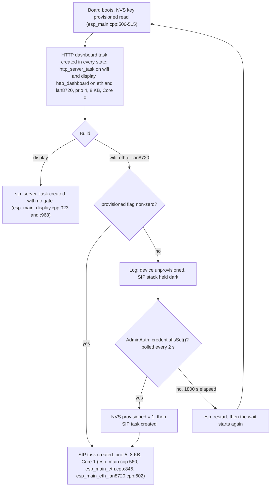
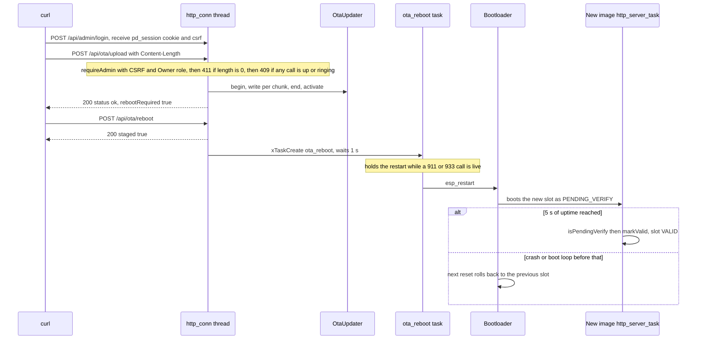

# Flashing pocket-dial Firmware

This guide covers building and flashing pocket-dial firmware onto an ESP32-S3 board (or a classic ESP32 for the `lan8720` build), and updating it afterward over the air (OTA).

## 1. Which firmware for which board

Pick the transport with `-D SIP_TRANSPORT=<transport>`:

| Board | `SIP_TRANSPORT` | Chip target |
|-------|-----------------|-------------|
| Guition JC3248W535 (3.5" touch display) | `display` | `esp32s3` |
| Generic ESP32-S3 / SoftAP | `wifi` | `esp32s3` |
| Waveshare ESP32-S3-ETH / LilyGO T-ETH (W5500) | `eth` | `esp32s3` |
| LilyGO T-Internet-COM (internal-EMAC LAN8720) | `lan8720` | `esp32` (classic) |

The browser flasher offers the `display`, `wifi` and `eth` builds only. Build `lan8720` from source, as described in §2.

Published image sizes are listed in `docs/firmware/index.json`. Every published image fits comfortably in the 6 MB `ota_0` / `ota_1` slots.

## 2. Build

**ESP-IDF v6.0 or later is required.** `main/CMakeLists.txt` enforces it at configure time, so an older toolchain stops immediately with a clear message instead of failing ~1400 objects in with `component esp_driver_ledc could not be found`. LEDC, GPIO, SPI and I2C were split out of the monolithic `driver` component after v5.2, and this project requires them by their split names. Both `.github/workflows/ci.yml` and `.github/workflows/release.yml` build on v6.0.1. To reproduce an older release artifact, use the toolchain that shipped it. Nothing on `main` builds under v5.

```bash
. $IDF_PATH/export.sh            # set up the ESP-IDF environment (see the note above)
idf.py set-target esp32s3
idf.py -D SIP_TRANSPORT=display build     # or wifi / eth
```

For the `lan8720` build, set the classic ESP32 target instead: `idf.py set-target esp32`, then `idf.py -D SIP_TRANSPORT=lan8720 build`. The configure step stops for any other target.

The build produces, under `build/`:

- `bootloader/bootloader.bin`
- `partition_table/partition-table.bin`
- `SipServer.bin` (the application)
- `flash_args` (the exact offsets, used by `idf.py flash`)

## 3. First-time flash (USB)

The very first install of an OTA-capable build has to go on over the USB/serial port. The dual-OTA partition layout (see [OTA.md](OTA.md)) differs from any single-`factory` image. After that first flash, you can update wirelessly from the dashboard.

Connect the board over USB and identify the serial port:

- Linux: `/dev/ttyUSB0` or `/dev/ttyACM0`
- macOS: `/dev/cu.usbserial-*` or `/dev/cu.usbmodem-*`
- Windows: `COM3` (check Device Manager → Ports)

### Option 0: from the browser, no toolchain

Open **<https://glomargadaffi.github.io/pocket-dial/flasher/>** in Chrome, Edge, or Opera on a desktop, plug the board in over USB, pick the variant (Ethernet / display / Wi-Fi) and click **Flash board**. The page pulls the images from the **GitHub Pages mirror** under `docs/firmware/<tag>/`, not from the Release assets. Release-asset URLs send no CORS header, so a browser page cannot `fetch()` them (issue [#138](https://github.com/GlomarGadaffi/pocket-dial/issues/138)). The page reads `../firmware/index.json` same-origin (`FIRMWARE_INDEX` in `docs/flasher/index.html`), and the `Publish firmware to Pages` step in `.github/workflows/release.yml` publishes the mirror. It writes the images from your machine; nothing is uploaded.

**Warning:** There is no Waveshare variant in any release. The flasher's `esp32s3-eth` image is the **LilyGO T-ETH-Elite**, and `PD_ETH_BOARD` defaults to `elite` (see `main/CMakeLists.txt`). Flashing it to a Waveshare ESP32-S3-ETH writes the wrong W5500 pin map, which aborts boot and leaves the board in a reset loop (see [HARDWARE.md §3](HARDWARE.md)). That board must be built from source with `idf.py -D SIP_TRANSPORT=eth -D PD_ETH_BOARD=waveshare build`. The flasher also takes locally built `.bin` files under *Flash your own build instead*. Details in [flasher/README.md](flasher/README.md).

The flasher can also write the device's configuration at flash time (Wi-Fi mode, SoftAP security and passphrase, upstream STA credentials, and the SIP registrar mode) through the collapsed *Set Wi-Fi, AP security and SIP registrar mode while flashing* panel. That panel is opt-in and off by default: leave it alone and the flasher touches no configuration at all. It is the only way to configure a headless `eth` or `wifi` board before its first boot. See §5.

### Option A: `idf.py` (recommended)

```bash
idf.py -p COM3 flash         # Windows
idf.py -p /dev/ttyUSB0 flash # Linux
```

This writes the bootloader, partition table, and app at the correct offsets and
can `monitor` the serial log with `idf.py -p COM3 monitor` (or `flash monitor`).

### Option B: `esptool` directly

```bash
esptool.py -p COM3 -b 460800 --chip esp32s3 write_flash \
  0x0      build/bootloader/bootloader.bin \
  0x8000   build/partition_table/partition-table.bin \
  0xf000   build/ota_data_initial.bin \
  0x20000  build/SipServer.bin
```

The `ota_data_initial.bin` at `0xf000` points the bootloader at `ota_0` (offset `0x20000`) for the first boot. `idf.py flash` handles this for you.

The offsets in the `esptool` command match the current partition table. `nvs`, `otadata`, `phy_init`, `ota_0` and `ota_1` all keep their exact offsets and sizes, and `partitions.csv` states this as a contract in its header. Neither `idf.py flash` nor the `esptool` command above writes `cfgseed`. It is left erased (`0xFF`), which the firmware treats as "no seed" and ignores. See §5.

### First boot: what you will actually see

Nothing about the dashboard is hidden, gated at the transport, or delayed. As soon
as the board is up:

- **The HTTP dashboard answers on its port immediately**, in every state,
  provisioned or not. The listener opens when `HttpServer` is constructed and stays
  open for the life of the process. There is no star-code and no admin-open window:
  `grep -rn 4887 src/` returns nothing. A **connection refused is therefore always a
  genuine fault** (wrong address, wrong network, board still booting), never a gate
  to open.
- The login is `admin` / `admin`: a username and a password, not a PIN. It ships
  well-known on purpose, so first contact needs no out-of-band secret.
- **You must replace it before anything else works.** While the default credential
  stands, a logged-in session gets `403 {"error":"setup_required"}` from every
  admin-gated route, read-only `GET`s included. Without a session the response is
  `401 {"error":"authentication required"}`. The single exception is
  `POST /api/admin/set-credential`. OTA, factory reset, Wi-Fi changes, registrar mode
  and AP security all wait on it.
- **On the `wifi`, `eth` and `lan8720` builds the SIP registrar does not start at
  all until a credential is committed.** The boot task logs
  `[boot] device unprovisioned — SIP stack held dark until credential committed`
  and polls every 2 s; no phone can register until you finish setup. If nothing is
  committed within 30 minutes, the board reboots and begins the wait again. A board
  that restarts on you mid-setup is behaving as designed, not crashing. The
  `display` build is **not** gated this way: it boots into its normal network role
  and brings SIP up regardless.



The exact `curl` calls are in
[SETUP_GUIDE.md §3](SETUP_GUIDE.md#3-log-in-and-complete-setup-first).

### Migration note (single-`factory` → dual-OTA)

If the board previously ran a single-`factory` image, the partition layout
changes. The `nvs` partition stays at `0x9000`/`0x6000`, so saved Wi-Fi
credentials and the stored admin credential *can* survive, but a full chip erase
(`esptool.py -p COM3 erase_flash`) wipes them. After a migration flash that lost
NVS, expect to re-onboard Wi-Fi and to go through first-use setup again: the device
falls back to the built-in `admin`/`admin` login and refuses every other admin
action until you replace it. The *separate* DTMF admin PIN (the phone-keypad
`*PIN#code` menu secret, unrelated to the web login) is erased with it, and has no
default, so that menu is disabled until you set one again.

### Boards flashed before `coredump` and `cfgseed`

The current `partitions.csv` declares two data partitions that older layouts lack.
`coredump` holds the panic coredump (issue #382). `cfgseed`
(`data, 0x41, 0xFFF000, 0x1000`) is a 4 KB partition at the very top of the 16 MB
flash, used for flash-time configuration (§5). Both are carved out of the space that
`prompts` occupies. `nvs`, `otadata`, `phy_init`, `ota_0` and `ota_1` keep their exact
offsets and sizes.

An OTA update ships an app image and **never rewrites the partition table**. A
board flashed before these partitions existed therefore does not have them, and
current firmware runs on it normally. A missing `cfgseed` partition is the normal
case, not an error: the firmware finds nothing and keeps its NVS-stored
configuration. A missing `coredump` partition means coredumps are unavailable, which
is not an error either. The 4 MB `sdkconfig.defaults.esp32_constrained` layout
(`partitions_4mb.csv`) has no room for `cfgseed` at all.

The only way to add these partitions to an existing board is a full USB flash of
the new partition table, with the bootloader and the app. `idf.py flash`, the
`esptool` command in §3, and the browser flasher's *Full flash* mode each do this in
one operation.

## 4. Updating over-the-air (after the first USB flash)

Once a device runs an OTA-capable build, you can push new firmware without a
cable. An upload needs these things from the admin session:

- The `pd_session` cookie, set by `POST /api/admin/login`.
- The session's `X-CSRF` token, which `POST /api/admin/login` returns in its JSON
  response.
- An owner-role session, once an owner account exists. Until then a sysop login is
  enough. Once one exists, a sysop session gets
  `403 {"error":"owner privilege required"}` on upload. See [OTA.md §3](OTA.md) for
  how the owner role is set up.

There is no unauthenticated upload path in any provisioning state. The reboot step
needs a sysop session and the CSRF token; it does not need the owner role.

**Finish first-use setup before attempting an OTA.** While the board is still on the
shipped `admin`/`admin` credential, `POST /api/ota/upload` and `POST /api/ota/reboot`
return `403 {"error":"setup_required"}` like every other admin-gated route. Only
`POST /api/admin/set-credential` is exempt. See
[SETUP_GUIDE.md §3](SETUP_GUIDE.md#3-log-in-and-complete-setup-first).

The port itself is not a gate. The HTTP listener is open from boot in every state,
and there is no star-code, no bounded admin-open window, and no `keepalive` route in
`src/`. If a connection is refused, the fault is real, so do not look for a window to
open. See [API.md §0](API.md#0-reachability--admin-session-layer-read-this-first).

```bash
DEVICE=http://192.168.4.1
JAR=cookies.txt

# 1. Log in (always required), capturing the cookie AND the CSRF token.
#    The credential is a username + password, not a PIN.
LOGIN=$(curl -s -c "$JAR" \
     -H "Origin: $DEVICE" \
     -X POST --data "username=YOUR_USERNAME&password=YOUR_PASSWORD" \
     "$DEVICE/api/admin/login")
# -> {"status":"ok","authenticated":true,"needsSetup":false,"csrf":"3f2a...e91c"}
#    "needsSetup":true means the board is still on admin/admin, and the upload
#    below will 403 setup_required until POST /api/admin/set-credential runs.

CSRF=$(printf '%s' "$LOGIN" | sed -n 's/.*"csrf":"\([0-9a-f]*\)".*/\1/p')
[ -n "$CSRF" ] || { echo "login failed: $LOGIN" >&2; exit 1; }

# 2. Stream the new image to the inactive OTA slot
curl -s -b "$JAR" \
     -H "Origin: $DEVICE" \
     -H "X-CSRF: $CSRF" \
     -H "Content-Type: application/octet-stream" \
     -X POST --data-binary @build/SipServer.bin \
     "$DEVICE/api/ota/upload"

# 3. Reboot into the new image
curl -s -b "$JAR" \
     -H "Origin: $DEVICE" \
     -H "X-CSRF: $CSRF" \
     -X POST "$DEVICE/api/ota/reboot"
```

A script that sends the cookie but no `X-CSRF` header gets
`403 {"error":"missing or invalid CSRF token"}` on the upload and reboot steps. A
script that skips step 1 gets `401 {"error":"authentication required"}`. **There is
no ungated OTA endpoint in any state.** Full walk-through and response codes:
[OTA.md §3](OTA.md).

The bootloader brings the new image up in a *pending-verify* state. The firmware
confirms it automatically a few seconds after the SIP and HTTP servers come up (see
[OTA.md](OTA.md) §4). If the new image crashes on boot, the bootloader rolls back to
the previous slot, so the board is not bricked.



**Warning:** The dual-slot layout, the pending-verify confirmation and the rollback
path are all implemented, but the **full OTA cycle has never been run end to end on
hardware**. Treat your first wireless update as the test of it, and keep a USB cable
within reach.

Check status any time:

```bash
curl http://192.168.4.1/api/ota/status
```

## 5. Flash-time configuration (`cfgseed`)

A board with no screen (the `eth` and `wifi` variants) has nowhere to display a
generated SoftAP passphrase and no dashboard to reach before it is on a network.
`cfgseed` solves that: the browser flasher writes a **256-byte fixed-layout
record** into the `cfgseed` partition at `0xFFF000`, and the firmware reads it
**once** on first boot and copies the flagged fields into NVS.

| Topic | Detail |
|---|---|
| What can be seeded | Wi-Fi mode (captive-portal default / STATION / AP), SoftAP WPA2 on-off, SoftAP passphrase, upstream STA SSID + password, SIP registrar mode |
| Who writes it | The browser flasher, over USB, before first boot, **only**. There is no CLI tool for this. |
| Who reads it | `DeviceConfig::applyFlashSeed()`, called at boot after `nvs_flash_init()` and the NVS schema-version check |
| Applied how often | Once per record. Each write carries a `gen` counter; the firmware stores it as `cfgseed_gen` and ignores the partition until a *newer* `gen` appears, so a plain reboot never re-clobbers settings you changed since. |
| Wire format | `src/Helpers/DeviceConfig.hpp` is authoritative (magic `PDCS`, version, per-field `has-*` flag bits, CRC-32 over bytes `[0,252)`). |

**The firmware never writes this partition.** It only ever reads it, which is why
the erase-before-write discipline `partitions.csv` documents for raw data
partitions does not apply here.

**Opt-in, and off by default.** The flasher panel is governed by an *Apply these
settings to the board* checkbox that is unchecked on load. While it is unchecked
`cfgseed` is not in the flash plan at all, so reflashing a board you already
configured never clobbers its passphrase, Wi-Fi mode, or upstream credentials.
Every control inside the panel also has a *Leave as is* position, and only a
control moved off it sets its flag in the record.

**Use a Full flash, not App only.** *App only* does not rewrite the partition
table, so a seed written that way lands on a layout that does not declare
`cfgseed` and is ignored until a full flash. A **Full flash** writes the new
partition table and the seed in the same operation, so the board comes up already
knowing about the partition and reads the seed on that first boot.

On the pure-Ethernet `eth` build there is no SoftAP at all, so the AP fields are
inert there; the seed's useful field on that variant is the SIP registrar mode
(and `wifi_mode`, which matters if the board is later reflashed to a Wi-Fi
variant). `/api/factory-reset` clears `cfgseed_gen` along with the AP settings,
so "factory" on a seeded board means **as flashed**, not as hardcoded.

### 5.1 SoftAP WPA2

The standalone SoftAP can require WPA2 rather than coming up open. It is
opt-in and defaults to off: turning it on forces every already-associated
phone, ATA, and laptop to be re-paired with the new passphrase, so a firmware
update must not do it to a live fleet on its own.

The device generates its own passphrase from the hardware CSPRNG on first
access and stores it in NVS: 20 characters from `23456789ABCDEFGHJKMNPQRSTVWXYZ`
(no `0`/`O`, `1`/`I`/`L`, `U`), because it gets read off a small LCD or a serial
log and retyped into a desk phone. You can see it in four places:

- on the LVGL onboarding screen, on the `display` build;
- on the serial console at AP bringup, as
  `INFRA: SoftAP passphrase (WPA2): <psk>`, the headless build's only local
  channel, and yes, that is in the clear: anyone with a serial cable is already
  inside the physical trust boundary;
- in the dashboard, and over `GET /api/ap-security` (see [API.md](API.md));
- in the browser flasher's result notice, with a **Copy** button, when the
  passphrase was set at flash time.

Enabling WPA2 from the dashboard does **not** restart the radio; that would drop
the client that just asked for the passphrase. The change lands at the next AP
bringup, so power-cycle the board to see it take effect.

The shipped defaults remain an **open** SoftAP, a **`learn`** SIP registrar
(trust-on-first-use; `open` is retired, #502), plain HTTP, and unsigned OTA.
Everything in this section is something an operator turns on deliberately.

## 6. Troubleshooting

| Symptom | Fix |
|---------|-----|
| Port not found / permission denied | Install the CP210x/CH34x USB-UART driver; on Linux add yourself to the `dialout` group. |
| Flash fails / garbage output | Lower baud (`-b 115200`), or hold **BOOT** while connecting to force download mode. |
| Boots to old firmware after OTA | The new image failed verification and rolled back; check the serial log, rebuild and retry. |
| Colors look wrong on the display | Confirm the `display` transport build (`CONFIG_LV_COLOR_16_SWAP=y` is set in `sdkconfig.defaults`). |
| Wi-Fi creds / admin credential lost after flashing | Expected after a full `erase_flash` or layout migration. The board is back on `admin`/`admin` and demands first-use setup again; the separate DTMF admin PIN is gone too. On `wifi`/`eth`/`lan8720` the SIP registrar stays down until you complete setup, see *First boot* in §3. |
| Connection refused on port 80 | Always a genuine fault: wrong address, wrong network, or the board has not finished booting. The listener opens at construction and stays open in every provisioning state. There is no `*4887` star-code or admin-open window to trigger first. See [API.md §0](API.md#0-reachability--admin-session-layer-read-this-first). |
| `403 {"error":"setup_required"}` from any admin route | The board is still on the default `admin`/`admin` login. Until you replace it via `POST /api/admin/set-credential`, every other admin-gated route (`GET`s included) refuses a logged-in session. Without a session the response is `401`. See [SETUP_GUIDE.md §3](SETUP_GUIDE.md#3-log-in-and-complete-setup-first). |
| `429 {"error":"too many failed attempts..."}` on login | The brute-force lockout is engaged: 5 consecutive wrong username/password attempts → 60 s, doubling on each repeat lockout to a 16-minute cap. It is keyed per client address, and a correct login clears that client's counter. The counters are RAM-only; power-cycling clears them without touching the stored credential. |
| `403 {"error":"missing or invalid CSRF token"}` from a script | The script sends the session cookie but no `X-CSRF` header. Capture the token from the login response, §4. |
| Flash-time settings had no effect | Either the panel's *Apply these settings to the board* box was left unchecked (the default), or the seed was written in *App only* mode onto a partition table that predates `cfgseed`. Redo it as a **Full flash**, §5. |
| Phones can't associate after enabling WPA2 | Expected: WPA2 breaks every existing association. Re-pair each device with the generated passphrase (`GET /api/ap-security`, the serial log, or the display). |
