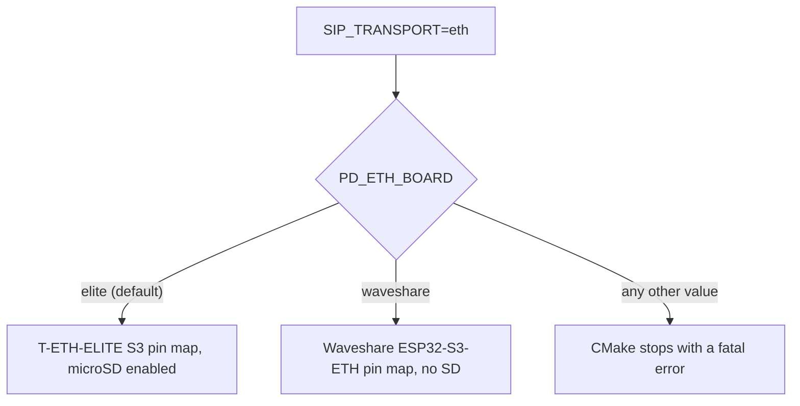

# Pocket-Dial ESP32 Firmware: Hardware Configuration Guide

This document gives the pin maps, wiring notes, and Bill of Materials (BOM) for the boards that run the **pocket-dial** firmware.

## 1. Supported Hardware Boards Overview

The **pocket-dial** firmware builds for several hardware targets. It supports two product configurations:

1. Interactive smart displays, which run an on-screen LVGL UI with real-time log scrolling, status fields, and a captive portal.
2. Headless PoE signalling servers, which are compact SIP servers powered over Ethernet, built for high throughput and packet-processing reliability.

The targets differ in hardware, so the configuration is managed through preprocessor pin defines and target SDK configs.

### Choosing the Ethernet board

The `eth` transport is the default and builds for two W5500 boards. Pick one at build time with `-D PD_ETH_BOARD=<board>`:

- `elite` (default): LilyGO T-ETH-ELITE S3. The microSD slot is enabled.
- `waveshare`: Waveshare ESP32-S3-ETH. No SD card support is built.

Any other value stops the CMake configure step with a fatal error (`main/CMakeLists.txt:55-57`). The T-ETH-Lite in section 4 is not wired into the build.



## 2. Guition JC3248W535 Smart Display (3.5" Black LCD)

The Guition JC3248W535 is an all-in-one smart display powered by an ESP32-S3. It has a 3.5-inch 320 x 480 screen, a capacitive touch panel, and a built-in battery voltage divider on GPIO 5.

```
       ┌────────────────────────────────────────────────────────┐
       │                                                        │
       │                   Guition JC3248W535                   │
       │                   320 x 480 QSPI TFT                   │
       │                      (AXS15231B)                       │
       │                                                        │
       └────────────────────────────────────────────────────────┘
          │ TFT SCK=47                │ I2C SDA=4
          │ TFT CS=45                 │ I2C SCL=8
          │ QSPI TFT Lines            │ (no INT/RST routed —
          │ [21, 48, 40, 39, 38=TE]   │  touch is polled)
          ▼                           ▼
      ┌────────────────────────────────────────────────────────┐
      │                      ESP32-S3R8                        │
      │        (8MB Octal PSRAM + 16MB QSPI Flash Chip)        │
      └────────────────────────────────────────────────────────┘
                       │ GPIO 5 (ADC1_CH4)
                       ▼
                 [ Battery divider ]
```

### Pin Assignments

- Display interface: QSPI (Quad SPI) panel bus.
- Touch controller: AXS15231B on standard I2C bus 0.

| Hardware Pin Name | ESP32-S3 GPIO | Signal Type | Description |
| :--- | :---: | :---: | :--- |
| `TFT_CS` | **GPIO 45** | Output | Display SPI Chip Select |
| `TFT_SCK` | **GPIO 47** | Output | Display SPI Clock |
| `TFT_D0` | **GPIO 21** | Output / IO | QSPI Data Line 0 |
| `TFT_D1` | **GPIO 48** | Output / IO | QSPI Data Line 1 |
| `TFT_D2` | **GPIO 40** | Output / IO | QSPI Data Line 2 |
| `TFT_D3` | **GPIO 39** | Output / IO | QSPI Data Line 3 |
| `TFT_BL` | **GPIO 1** | Output | LED Backlight Control (High = Backlight ON) |
| `TOUCH_SDA` | **GPIO 4** | Bidirectional | Touch Controller I2C SDA (Pull-up Required) |
| `TOUCH_SCL` | **GPIO 8** | Output | Touch Controller I2C SCL (Pull-up Required) |
| `TOUCH_RST` | **not routed** | N/A | The AXS15231B on this board has no reset line brought out. The driver is set up with `rst = GPIO_NUM_NC` (`main/esp_main_display.cpp:322-323`). |
| `TOUCH_INT` | **not routed** | N/A | No touch interrupt either: `int = GPIO_NUM_NC` (`main/esp_main_display.cpp:322-323`), and **touch is polled**. |
| `BATTERY_ADC` | **GPIO 5** | Analog Input | Voltage divider ADC channel (simulated or ADC1_CH4). Hardware only: no firmware reads it. |

**Warning:** GPIO 11 and 12 are the microSD CMD and CLK lines on this board, not touch pins. Wiring a touch line to them collides with the SD slot. See the microSD notes below.

**PSRAM configuration:** This board uses an ESP32-S3R8 with 8 MB of Octal PSRAM. In `sdkconfig`, PSRAM must be enabled in Octal mode at 80 MHz. The display uses one full-screen LVGL draw buffer of 320 x 480 pixels at 2 bytes each (307.2 KB), allocated in `MALLOC_CAP_SPIRAM` to prevent internal SRAM exhaustion (`main/esp_main_display.cpp:754-761`). Flushes go through a small internal DMA band buffer, `s_band_buf`, because the SPI master cannot DMA from PSRAM. The firmware does not use double-buffered flushing.

### microSD (#80)

The board's microSD slot is SD_MMC (SDIO), 1-bit mode only. Only CLK, CMD, and D0 are broken out. D1 to D3 are not wired. On this board they would land on GPIO 48, 40, and 39, which the QSPI panel uses as `TFT_D1`, `TFT_D2`, and `TFT_D3`. The slot does not use SPI mode.

| Signal | ESP32-S3 GPIO |
| :--- | :---: |
| `SD_MMC_CLK` | **GPIO 12** |
| `SD_MMC_CMD` | **GPIO 11** |
| `SD_MMC_D0`  | **GPIO 13** |

**Sources** (three independent, all agreeing):

- The vendor's own Arduino demo bundle (`NorthernMan54/JC3248W535EN`, `.../Demo_Arduino/DEMO_PIC/pincfg.h`): `SD_MMC_CLK`/`SD_MMC_CMD`/`SD_MMC_D0` = 12/11/13.
- The `GlomarGadaffi/jc3248-display-driver` bring-up repo's `main/board.h` and `docs/Pinout-and-Hardware.md`: the same three pins, documented as "verified against the board's own pinout sheet".
- This repo's `main/esp_main_display.cpp` comment (lines 64-69), which identifies GPIO 11 and 12 as the microSD CMD and CLK lines on its own.

There are no conflicts. GPIO 11, 12, and 13 do not collide with the `TFT_*` pins (45/47/21/48/40/39/1/38), the `TOUCH_*` pins (4/8; the touch IC has no INT or RST routed), or `BATTERY_ADC` (5). Note that **GPIO 38 is `TFT_TE`**, the tearing-effect line, which the pin table above omits.

**Still open for #80.** This needs the physical board. The sources above narrow the question but do not close it:

- The vendor spec sheet (`JC3248W535C_I_Y`) describes the TF card interface as *"reserve[d]"*, and its labeled rear-connector photo shows no SD slot at all (Boot, Reset, Type-C, battery/power JSTs, 8P IO, HC1.0 4P, Speak, no card slot). Whether the slot is populated on a given unit needs a look at the board.
- `pincfg.h` and the sibling repo disagree with this repo's touch pin comment on one unrelated line (`TOUCH_PIN_NUM_INT` 3 vs. this board's documented NC). That is a reminder that these are a close but not necessarily identical board revision, so a continuity check (multimeter, slot pads to GPIO 12/11/13) before wiring is still the safer first step, per the issue.

## 3. Waveshare ESP32-S3-ETH + PoE Module

An ESP32-S3 board with a built-in PoE module and a W5500 SPI Ethernet controller.

```
       ┌──────────────────┐
       │     RJ45 PoE     │
       └────────┬─────────┘
                │
                ▼
       ┌──────────────────┐             ┌──────────────────┐
       │   W5500 MAC/PHY  │<─── SPI ───>│    ESP32-S3R8    │
       └──────────────────┘             └──────────────────┘
         SCLK: GPIO 13                    SCLK: SPI2_SCLK
         MISO: GPIO 12                    MISO: SPI2_MISO
         MOSI: GPIO 11                    MOSI: SPI2_MOSI
         CS:   GPIO 14                    CS:   SPI2_CS
         INT:  GPIO 10                    INT:  GPIO Pin Interrupt
         RST:  GPIO 9                     RST:  GPIO output
```

### Pin Assignments

- Ethernet controller: Wiznet W5500 MAC/PHY.
- SPI host device: `SPI2_HOST` (FSPI).
- Bus speed: **40 MHz**. At 80 MHz, driver install fails with `ESP_ERR_TIMEOUT`. The GPSPI divides an 80 MHz source by integers, so any request from 40 to 79 MHz runs at 40 MHz (`main/esp_main_eth.cpp:150-156`).

A wrong W5500 pin map does not fail softly. `esp_eth_driver_install()` returns `ESP_ERR_TIMEOUT`, the `ESP_ERROR_CHECK` in `eth_init_w5500()` aborts the boot, and **the board sits in a reset loop with no network to diagnose it over** (108 consecutive `rst:0xc` in one capture).

The values below are the Waveshare defines in `main/esp_main_eth.cpp:116-129`. They were verified on hardware in [#155](https://github.com/GlomarGadaffi/pocket-dial/issues/155) and are the ones running on this board.

| Signal Name | ESP32-S3 GPIO | Bus Signal | Description |
| :--- | :---: | :---: | :--- |
| `W5500_SCLK_GPIO` | **GPIO 13** | SPI2 SCLK | SPI Serial Clock |
| `W5500_MISO_GPIO` | **GPIO 12** | SPI2 MISO | SPI Master Input Slave Output |
| `W5500_MOSI_GPIO` | **GPIO 11** | SPI2 MOSI | SPI Master Output Slave Input |
| `W5500_CS_GPIO` | **GPIO 14** | SPI2 CS | SPI Chip Select (Active Low) |
| `W5500_INT_GPIO` | **GPIO 10** | Input | W5500 Hardware Interrupt Pin |
| `W5500_RST_GPIO` | **GPIO 9** | Reset | Waveshare **does** wire a real reset line (the Elite does not) |

This board is not the default build. `PD_ETH_BOARD` defaults to `elite` (`main/CMakeLists.txt:37-39`), whose pin map is different. Building for a Waveshare board without `-D PD_ETH_BOARD=waveshare` flashes the Elite map and produces the reset loop described above. No release artifact includes a Waveshare variant: the browser flasher's `esp32s3-eth` image is the T-ETH-Elite, so this board must be built from source.

## 4. LilyGO T-ETH-Lite W5500 (ESP32-S3 Target)

A widely used dev board with an integrated SD/TF card slot, 16MB flash, and 8MB PSRAM, plus a W5500 SPI Ethernet controller.

This board is not wired into the build yet. `PD_ETH_BOARD` accepts only `elite` and `waveshare`, and any other value stops configure with a fatal error (`main/CMakeLists.txt:55-57`). The pin table below is for reference.

### Pin Assignments

- Ethernet controller: Wiznet W5500 MAC/PHY.
- SPI host device: default hardware SPI.

| Signal Name | ESP32-S3 GPIO | Description |
| :--- | :---: | :--- |
| `W5500_SCLK` | **GPIO 10** | SPI Clock |
| `W5500_MISO` | **GPIO 11** | SPI MISO |
| `W5500_MOSI` | **GPIO 12** | SPI MOSI |
| `W5500_CS` | **GPIO 9** | SPI Chip Select (CS) |
| `W5500_INT` | **GPIO 13** | Hardware Interrupt Pin |
| `W5500_RST` | **GPIO 14** | Hardware Reset Pin |

## 5. LilyGO T-ETH-ELITE S3 (W5500, PoE): default `eth` board

The current default Ethernet target. An ESP32-S3-WROOM-1 carrier board (16 MB flash,
8 MB PSRAM) pairing a W5500 SPI Ethernet controller with onboard 802.3af PoE and a
40-pin Raspberry-Pi-compatible header (T-ETH ELite Shield compatible). A microSD slot
shares a second SPI bus. This is a **different board from the T-ETH-Lite** above: the
W5500 pin map is not the same, so build it with `-D PD_ETH_BOARD=elite` (the default).

```
       ┌──────────────────┐
       │   RJ45 PoE 802.3af│  (Class 0, input 36–57 V)
       └────────┬─────────┘
                │
                ▼
       ┌──────────────────┐             ┌──────────────────────┐
       │   W5500 MAC/PHY  │<─── SPI ───>│  ESP32-S3-WROOM-1     │
       └──────────────────┘             │  (16MB flash/8MB PSRAM)│
         SCLK: GPIO 48                   └──────────────────────┘
         MISO: GPIO 47
         MOSI: GPIO 21
         CS:   GPIO 45
         INT:  GPIO 14
         RST:  not wired (-1)
```

### Pin Assignments

- Ethernet controller: Wiznet W5500 MAC/PHY.
- SPI host device: `SPI2_HOST` (FSPI).
- Bus speed: 40 MHz, the hardware-verified maximum for this board. The Elite's W5500 pins route through the S3 GPIO matrix (not IOMUX). The GPSPI divides its 80 MHz source by integers, so 80 MHz fails at driver install (`ESP_ERR_TIMEOUT`), and any request from 40 to 79 MHz runs at 40 MHz.

| Signal Name | ESP32-S3 GPIO | Bus Signal | Description |
| :--- | :---: | :---: | :--- |
| `W5500_SCLK_GPIO` | **GPIO 48** | SPI2 SCLK | SPI Serial Clock |
| `W5500_MISO_GPIO` | **GPIO 47** | SPI2 MISO | SPI Master Input Slave Output |
| `W5500_MOSI_GPIO` | **GPIO 21** | SPI2 MOSI | SPI Master Output Slave Input |
| `W5500_CS_GPIO` | **GPIO 45** | SPI2 CS | SPI Chip Select (Active Low) |
| `W5500_INT_GPIO` | **GPIO 14** | Input | W5500 Hardware Interrupt Pin |
| `W5500_RST_GPIO` | **-1 (Unused)** | Reset | Not wired to a GPIO; reset via SPI soft command |

The microSD/TF slot is on a **separate SPI bus** (`SPI3_HOST`; the W5500 owns `SPI2_HOST`), so the card and Ethernet never contend. It is mounted at `/sdcard` (FATFS) during `eth` boot on this board. `GET /api/status` reports `sd.{present,mounted,capacityMb}`.

The music-on-hold clip is read from `/sdcard/moh.wav` and must be **8 kHz mono G.711 µ-law WAV**. Prepare one with `ffmpeg -i music.mp3 -ar 8000 -ac 1 -acodec pcm_mulaw moh.wav`. `POST /api/moh/upload` (`handleMohUpload` in `src/Helpers/HttpServer.cpp`) first stores the upload at `/sdcard/moh.wav`, replacing any previous file, and only then checks the format. A clip in the wrong format stays on the card, and the upload returns `422` with a message that says the clip was stored but is not an 8 kHz mono µ-law WAV. If the request handler is not attached yet, the upload returns `200` and the clip is checked on the next boot.

These four GPIOs (9, 10, 11, and 12) are used only on the Elite. On the Waveshare ESP32-S3-ETH, the same pins (9 to 14) are that board's W5500 `SCLK`/`MISO`/`MOSI`/`CS`/`INT`/`RST`, so driving a card there would fight the Ethernet controller. `main/CMakeLists.txt` links the SD stack and defines `PD_ETH_HAS_SD` for `PD_ETH_BOARD=elite` only. A card must be **FAT32**: ESP-IDF's FatFs does not mount exFAT, which is how cards over 32 GB ship from the factory.

| Signal Name | ESP32-S3 GPIO |
| :--- | :---: |
| `SD_MISO` | **GPIO 9** |
| `SD_MOSI` | **GPIO 11** |
| `SD_SCLK` | **GPIO 10** |
| `SD_CS` | **GPIO 12** |

The W5500 `SCLK`/`MISO`/`MOSI`/`CS` pins (48/47/21/45) overlap the GPIO numbers the Guition display uses for its QSPI TFT bus (§2). That is harmless, because those are different boards with different firmware builds, but do not cross-wire the two pin maps.

**Warning:** PoE and USB power. The Elite's PoE front end is an isolated 802.3af PD module (DP9900M-5V) with a polyfused 5 V output. A P-FET (AO3401A) between USB VBUS and the 5 V rail switches off automatically when PoE power is present, and its body diode blocks back-feed into the USB host. So simultaneous PoE and USB-serial is safe with the OTG switch off. The OTG switch's only job is to back-feed the PoE 5 V to the USB-C connector, to power OTG peripherals. Leave it **off** whenever a computer is attached. Power the board only from active 802.3af or 802.3at equipment, not passive injectors.

The parts and circuit above come from the board schematic. That schematic is not in this repo, so they are not checked here.

## 6. LilyGO T-Internet-COM (LAN8720, ESP32-WROVER-E target)

A legacy ESP32-WROVER-E board with Power-over-Ethernet (PoE) and an RMII-based LAN8720 Ethernet PHY. It uses the ESP32's internal Ethernet MAC.

The firmware calls this board the LilyGO T-Internet-COM, and it takes the pin map from that board's schematic. Section 8 and [HARDWARE_SELECTION.md](HARDWARE_SELECTION.md) name it the T-POE-Pro. The repo does not show whether these are one board, so check the name against the board before buying parts.

```
       ┌──────────────────┐
       │     RJ45 PoE     │
       └────────┬─────────┘
                │
                ▼
       ┌──────────────────┐             ┌──────────────────┐
       │    LAN8720 PHY   │<─── RMII ──>│  ESP32 Internal  │
       └──────────────────┘             │  Ethernet MAC    │
         MDC:  GPIO 23                  └──────────────────┘
         MDIO: GPIO 18
         CLK:  GPIO 0 (OUT)
         PWR:  GPIO 4 (driven HIGH)
```

### Pin Assignments

- Ethernet PHY: LAN8720 (RMII mode).
- PHY address: `0`.
- Reference clock mode: `EMAC_CLK_OUT` on **GPIO 0**. The ESP32 generates the 50 MHz clock and outputs it on GPIO 0 (`main/esp_main_eth_lan8720.cpp:210-214`). GPIO 16 and GPIO 17 can also output this clock, but only when PSRAM is not in use (ESP-IDF Ethernet documentation). This firmware uses GPIO 0. Under ESP-IDF v6 the clock pin is a plain integer, and the `EMAC_APPL_CLK_OUT_GPIO` enum no longer exists.

| Signal Name | ESP32 GPIO | RMII Signal | Description |
| :--- | :---: | :---: | :--- |
| `ETH_MDC_PIN` | **GPIO 23** | MDC | Management Data Clock |
| `ETH_MDIO_PIN` | **GPIO 18** | MDIO | Management Data Input/Output |
| `LAN8720_POWER_GPIO` | **GPIO 4** | PHY enable | PHY power-enable, driven **HIGH** before init |
| `LAN8720_PHY_RST_GPIO` | **-1 (unmanaged)** | PHY_RST | No dedicated PHY reset is driven. `config.h`'s `NRST=5` is believed to be the **4G modem** reset on this board, not the LAN8720's |
| RMII CLK | **GPIO 0** | CLK_OUT | 50 MHz reference clock output |

## 7. Generic Standalone AP (Wi-Fi Only)

For developers lacking Ethernet or smart displays, the firmware compiles onto any standard ESP32 / ESP32-S3 Development Board (e.g., ESP32-WROOM-32D, ESP32-S3-DevKitC-1).

- Wi-Fi mode: SoftAP.
- Broadcast SSID: `esp32-sipserver`.
- Network password: Open (WIFI_AUTH_OPEN), or configurable via NVS.
- Fallback IP gateway: `192.168.4.1`.

## 8. Bill of Materials (BOM) Estimates

The table gives estimated parts and prices for one **pocket-dial** station.

| Component Name | Description | Manufacturer Part Number | Quantity | Est. Unit Price (USD) |
| :--- | :--- | :--- | :---: | :---: |
| **Guition Smart Display** | ESP32-S3 3.5" black display board (320x480) with case | Guition JC3248W535 | 1 | $14.50 |
| **PoE Ethernet Module** | ESP32-S3 core board with W5500 SPI Ethernet and PoE RJ45 | Waveshare ESP32-S3-ETH | 1 | $18.90 |
| **PoE Ethernet + RPi-header board** | ESP32-S3-WROOM-1 board, W5500 SPI Ethernet, 802.3af PoE, 40-pin header, microSD (**default `eth` board**) | LilyGO T-ETH-ELITE S3 | 1 | $21.90 |
| **Ethernet Dev Board** | ESP32-S3 LilyGO board with W5500 SPI Ethernet | LilyGO T-ETH-Lite S3 | 1 | $15.50 |
| **RMII Ethernet Board** | ESP32-Wrover board with LAN8720 RMII Ethernet | LilyGO T-POE-Pro | 1 | $19.90 |
| **Battery Divider Resistors** | 100kΩ 1% and 220kΩ 1% resistors for battery ADC divider | Generic | 1 set | $0.10 |
| **USB-C Data Cable** | High-speed data cable for flashing and serial monitoring | Generic | 1 | $2.00 |

## 9. Assembly & Wiring Guidelines

### A. Touch I2C Pull-Up Requirements

On boards where the touch controller (AXS15231B) is connected, ensure that **4.7kΩ pull-up resistors** are soldered between:
- `TOUCH_SDA` (GPIO 4) and 3.3V power rails.
- `TOUCH_SCL` (GPIO 8) and 3.3V power rails.

Many JC3248W535 display clones omit these, resulting in I2C timeouts and immediate panel initialization crashes.

### B. High-Frequency SPI Ethernet Routing

If breadboarding the Waveshare or LilyGO W5500 SPI interfaces:

- Keep SPI line paths **shorter than 5 cm** to prevent clock skew.
- Ground lines should be bundled alongside high-speed clock signals (`SCK` and `MOSI`) to shield against EMI.
- High-speed SPI clock lines running at **40 MHz** (the configured W5500 bus speed, `main/esp_main_eth.cpp:150-156`) will experience significant crosstalk if unshielded or loosely jumpered.
