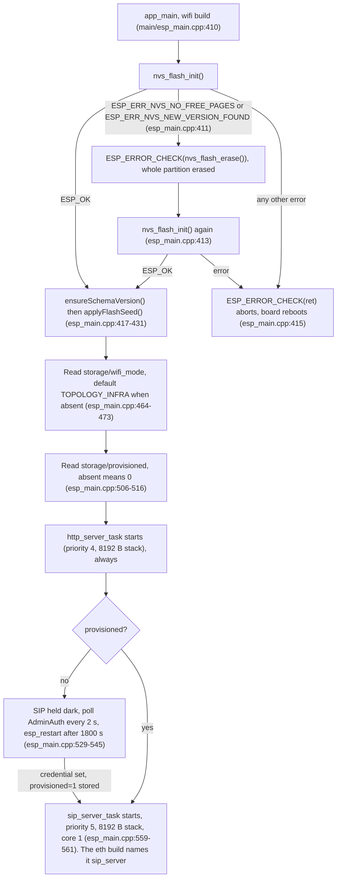
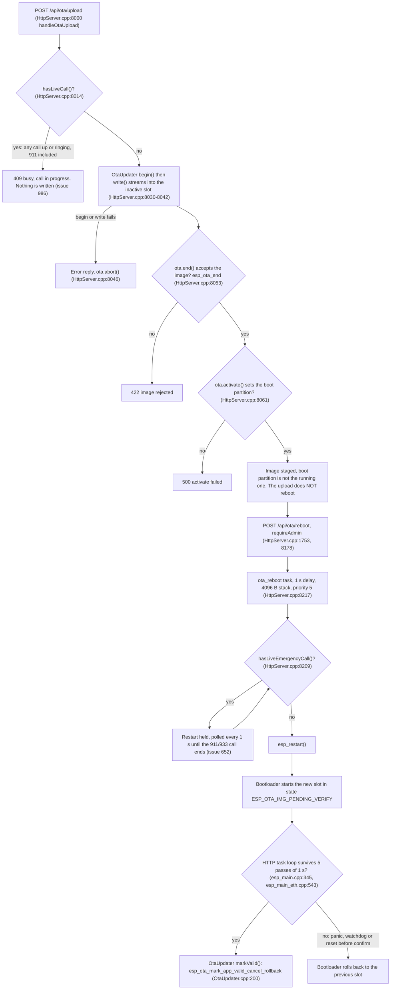

# ESP32 Pocket-Dial Firmware: Field Incident Playbook

Triage and recovery steps for pocket-dial ESP32 and ESP32-S3 boards in the field. It is for field engineers, administrators and firmware maintainers.

## Check the device posture first

Before you triage, establish which posture the device is in. One ungated `curl` shows most of it:

```bash
curl -s http://192.168.4.1/api/admin/status
# -> {"provisioned":false,"needsSetup":true,"authenticated":false,"sessionRemainingSec":0}
```

- The dashboard is always reachable on port 80. The listener accepts connections in every provisioning state. There is no dark-by-default management plane, and no DTMF star-code reopens one. *Connection refused* is a real fault, not a gate ([API.md §0](API.md); regression-pinned by `tests/AdminHttpGate_test.cpp`, `AdminHttpGate.Boot_Provisioned_StillListensImmediately`).
- `needsSetup:true` means the board is still on the shipped default login `admin`/`admin`. Every admin-gated route, gated `GET`s included, answers `403 {"error":"setup_required"}` until the credential is replaced (§4.8).
- Mutating calls need a session and an `X-CSRF` header from the first login (§4.6). No unprovisioned state skips them.
- On a `wifi`, `eth` or `lan8720` board that has never been set up, no SIP runs at all. `app_main()` holds the SIP task down until a credential is committed (§8). The `display` build is the exception and starts SIP unconditionally.
- The SoftAP may be WPA2 (`GET /api/ap-security`, once logged in and set up). You may not be able to join at all (§7).
- The SIP registrar may be `learn` or `secure` (`GET /api/registrar`, same gate), so phones may be refused by design (§4.3). The shipped default is `learn` (#441): an unknown phone is adopted on its first REGISTER, and only Secured devices must prove a secret. `open` is retired (#502).


## Quick Reference Matrix

Use this matrix for rapid triage based on visible device indicators and active diagnostic symptoms:

| Scenario / Symptom | Primary Indicators | Probable Root Cause | Instant Recovery Action |
| :--- | :--- | :--- | :--- |
| **Every API call rejected `403 setup_required`** | • `{"error":"setup_required"}`<br>• Even read-only routes refused<br>• `/api/admin/status` → `needsSetup:true` | • Board still on the shipped `admin`/`admin` default; forced first-use setup | • Log in `admin`/`admin`, then `POST /api/admin/set-credential` with a real username+password (§4.8) |
| **API call rejected `403` CSRF** | • `{"error":"missing or invalid CSRF token"}`<br>• Script/`curl` that worked before | • Every mutating route requires the per-session `X-CSRF` header | • Capture `"csrf"` from the login response, resend with `-H "X-CSRF: …"` (§4.6) |
| **Dashboard refuses connections** | • *Connection refused*, not `401`/timeout | • **A real fault**, the listener is unconditional; there is no window to reopen | • Verify the IP and that nothing local filters port 80 (§6). **`http_dashboard` is a FreeRTOS task name, not a log line.** It is the task name on `eth` and `lan8720` builds (`main/esp_main_eth.cpp:814`). The `wifi` build calls its task `http_server_task` (`main/esp_main.cpp:525`). Neither name is printed at boot, so do not wait for it |
| **Login returns `429`** | • `{"error":"too many failed attempts…"}`<br>• Correct password also refused | • Login lockout (5 fails) or aggregate backstop (20 fails), **escalating**. The 5-fail lockout is per client since #530, but the 20-fail backstop is per principal, so another host's guessing can still lock you out (§4.7) | • Wait it out (cooldown doubles per trip, caps ~16 min; only a correct login clears it), or power-cycle, the counters are in-RAM (§4.7) |
| **Port 5060 dead, port 80 alive, `wifi`/`eth`/`lan8720` board never configured** | • `[boot] device unprovisioned — SIP stack held dark…` in the serial log<br>• Board reboots every ~30 min | • Boot provisioning gate: SIP is not started until a credential exists (**not** on the `display` build) | • Complete setup over HTTP; watch for `[boot] credential set — unblocking SIP stack` (§8) |
| **Whole fleet de-registers at once** | • Every handset "not registered"<br>• `GET /api/registrar` → `"mode":"secure"`, empty roster | • Registrar switched to `secure` before any extension was adopted/secured | • `POST /api/registrar mode=learn`, the light-touch fix, and the one to reach for. Factory reset also clears `reg_mode` since #188 (§4.3), but wipes far more. **Note: "re-adopt, secure, then re-switch" cannot currently be completed**, there is no way to set a per-extension secret, so no device can be marked Secured; see [LEARN_MODE.md](LEARN_MODE.md) Step 4 |
| **Cannot join the SoftAP** | • Client prompts for a password<br>• Boot log `auth:WPA2-PSK` | • AP security enabled (dashboard or flash-time seed) | • Read the per-device passphrase from serial / LVGL / `GET /api/ap-security` (§7) |
| **Watchdog Reset** | • Boot loops with `TG0WDT_SYS_RST`<br>• Logs showing `Task watchdog got triggered` | • Thread starvation on Core 1<br>• Infinite loop in SIP message parser | • Increase TWDT timeout in sdkconfig<br>• Add `vTaskDelay` yields in parsing loops |
| **NVS / Credential Corruption** | • Core boot loops on `nvs_flash_init()` failure<br>• Constant boot loop back to factory SoftAP | • Flash sector wear-out<br>• Brownout mid-write (incomplete `nvs_commit`) | • Programmatic partition format on error<br>• Force sector erase with `esptool.py` |
| **SIP Engine Deadlock** | • SIP endpoints unregisterable (5060 dead)<br>• HTTP Dashboard running on Core 0 (80/8080 active) | • Recursive locking of `RequestsHandler::_mutex`<br>• Lock-order inversion in paging | • Trigger CPU crash dump / JTAG stack trace<br>• Hard power cycle (there is no general remote-restart endpoint, §3) |
| **Session Pool Exhaustion** | • Device returns `503 Service Unavailable`<br>• Dashboard shows active sessions stuck at limit | • Unreleased sessions from ended calls<br>• Memory leak or failed cleanup after bye/cancel | • Power-cycle<br>• Confirm the slot-recycling `Session::release()` path is present (§4.1) |
| **AOR Injection Attempts** | • Console logs show `Invalid character in Address of Record`<br>• SIP client receives `400 Bad Request` | • Exploit attempt injecting bad chars into From/To AOR<br>• Malformed third-party network scans | • Input sanitized automatically. Monitor logs<br>• Restrict network CIDR range |
| **Scanner Bucket DoS** | • Device logs drop packets from scanning IPs<br>• Metrics display high `packetsDropped` value | • Distributed botnets scanning port 5060<br>• Overflow of rate bucket lookup table | • Rate-limiter caps tables automatically at 256<br>• Standard auto-cleanup sweeps old IPs |
| **OTA Failure / Rollback** | • Device boots old firmware after OTA update<br>• Bootloader prints `Rollback triggered...` | • Missing `esp_ota_mark_app_valid_cancel_rollback`<br>• Network dropout mid-stream | • Verify OTA validation timing<br>• Flash known working binary to active slot |


## 1. Watchdog Resets (Task & Hardware WDT)

ESP32 chips feature both a **Hardware Watchdog Timer (WDT)** in the Timer Group and a **Task Watchdog Timer (TWDT)** managed by FreeRTOS. A watchdog reset indicates that the CPU has been occupied continuously by a high-priority task without yielding control to the system idle tasks or lower-priority routines.

```
       ┌─────────────────────────────────────────────────────────┐
       │     SipServer Loop / UDP Receive Task (Priority 5)      │
       └────────────────────────────┬────────────────────────────┘
                                    │  Parses incoming SIP packet
                                    ▼
       ┌─────────────────────────────────────────────────────────┐
       │     Infinite Parsing / Processing Loop (No yields)      │
       └────────────────────────────┬────────────────────────────┘
                                    │  Fails to call vTaskDelay()
                                    ▼
       ┌─────────────────────────────────────────────────────────┐
       │      Idle Task Starved (CPU Core 0/1 pinned @ 100%)     │
       └────────────────────────────┬────────────────────────────┘
                                    │  WDT counter expires
                                    ▼
       ┌─────────────────────────────────────────────────────────┐
       │        Task Watchdog Triggered (Panic / Reboot)        │
       └─────────────────────────────────────────────────────────┘
```

### Detection & Symptoms
1. Serial Console Logs: Look for the signature panic message:
   ```text
   E (12345) task_wdt: Task watchdog got triggered. The following tasks did not reset the watchdog in time:
   E (12345) task_wdt:  - IDLE1 (CPU 1)
   E (12345) task_wdt: Tasks currently running:
   E (12345) task_wdt: CPU 0: http_server_task
   E (12345) task_wdt: CPU 1: sip_server_task
   ```
2. Reset Reason Check: Upon reboot, the bootloader logs the reset reason. If `esp_reset_reason_t` is called, it returns `ESP_RST_WDT`.
3. Register Stack Dumps:
   ```text
   Guru Meditation Error: Core  1 panic'ed (Interrupt wdt timeout on CPU1).
   Core  1 register dump:
   PC      : 0x400d54c8  PS      : 0x00060034  A0      : 0x400d5a1c  A1      : 0x3ffd5480
   ```

### Diagnosis Procedure
To map raw hex addresses (like `PC : 0x400d54c8`) back to the specific line of C++ code causing the deadlock or lockup, use the ESP-IDF toolchain's backtrace decoder:

```bash
# For Standard ESP32 (Xtensa)
xtensa-esp32-elf-addr2line -pfia -e build/SipServer.elf 0x400d54c8 0x400d5a1c

# For ESP32-S3 (Xtensa-S3)
xtensa-esp32s3-elf-addr2line -pfia -e build/SipServer.elf 0x400d54c8 0x400d5a1c
```

The `.elf` used for decoding must match the exact build running on the device. Otherwise the line offsets are wrong.

### Recovery & Prevention
- Insert Cooperative Yields: Ensure that every high-priority loop, especially inside `UdpServer::receiveLoop` or the SIP engine's `RequestsHandler::tick()`, yields control.
  ```cpp
  // Force a task block to allow IDLE task execution and watchdog feeding
  vTaskDelay(pdMS_TO_TICKS(1)); 
  ```
- Adjust WDT Parameters: If complex multi-party paging or intense network scanning requires more overhead, increase the task watchdog timer duration inside `sdkconfig` via:
  ```text
  CONFIG_ESP_TASK_WDT_TIMEOUT_S=15
  ```


## 2. NVS & Credential Corruption

The device uses Non-Volatile Storage (NVS) to save Wi-Fi SSID, passphrases, modes and the security posture. Incomplete flash operations during sudden power interruptions (brownouts) or flash sector wear-out can lead to a corrupted partition.

NVS holds the security posture, so erasing it is a policy change, not just a network reset. The relevant keys, by namespace:

| Namespace | Keys | What they are |
| :--- | :--- | :--- |
| `storage` | `wifi_mode`, `wifi_ssid`, `wifi_pass`, `decayed` | Wi-Fi / onboarding state |
| `storage` | `admin_user`, `admin_pw_salt`, `admin_pw_hash` | The web login credential (`AdminAuth.hpp:29-31`) |
| `storage` | `admin_pin_salt`, `admin_pin_hash` | The **separate** phone-keypad DTMF PIN |
| `storage` | `ap_secure`, `ap_psk` | SoftAP WPA2 |
| `storage` | `cfgseed_gen` | Which flash-time seed generation has been applied |
| `storage` | `schema_ver` (u16) | Which **key layout** this device's config is written in (#181). Device-wide, not per-namespace. The factory-reset per-key clear leaves it alone. The whole-partition erase on ESP builds removes it, and the next boot stamps the current version again |
| `storage` | `provisioned` (u8) | The **boot latch** that lets SIP start (§8). The whole-partition erase on ESP builds removes it (§6) |
| `pbxcfg` | `reg_mode`, `admin_ext` | Registrar admission mode; the DTMF admin extension (`pbxpersist::kNvsNamespace`, `src/SIP/PbxPersist.hpp:16`) |
| `tapicfg` | Telephony-API credential slots | Carrier OAuth `client_id`/`client_secret` |
| `didmap` | DID → extension table | |
| `cdrlog` | Call-detail ring | |

An NVS erase therefore **re-opens the access point, returns the login to the `admin`/`admin` default, returns the registrar to `learn` (the default since #441; `open` is retired, #502), and re-arms the boot provisioning gate**. `provisioned` goes away, so SIP is held dark again until a credential is committed. It does **not** change the HTTP listener, which is always open regardless. That combination is what makes an NVS erase a real recovery tool, and also what makes it a deliberate act.



### Detection & Symptoms
1. Crash Loops: The firmware crashes and restarts indefinitely at boot-time with error logs from `app_main`:
   ```text
   E (450) app_main: NVS Initialization Failed: ESP_ERR_NVS_NO_FREE_PAGES (0x110d)
   ```
2. Loss of Connection Parameters: The device boots into the default Standalone AP (`esp32-sipserver`), failing to connect to the previously configured local Station Wi-Fi network, despite no user configuration changes.
3. **A board that was working now sits in the provisioning wait.** An auto-erase of a corrupted NVS also drops `provisioned`, so the next boot logs `[boot] device unprovisioned — SIP stack held dark until credential committed` and no phone can register until someone logs in and completes setup (§8).

### Diagnosis Procedure
- Monitor serial output during device initialization.
- Look for errors associated with NVS key retrieval, specifically `nvs_open` or `nvs_get_str` returning `ESP_ERR_NVS_NOT_FOUND` (0x1102).

### Recovery & Prevention
To resolve a hard NVS corruption or partition block lockup, execute an explicit NVS partition erase using `esptool.py`.

#### Step 1: Locate the NVS Partition Address
Check your partition table (usually at `0x8000`). The NVS partition is at offset `0x9000` and size `0x6000` (24 KB). It is **byte-identical across every layout in this repo** (`partitions.csv` for 16 MB and `partitions_4mb.csv`), and it is deliberately never moved or resized.

#### Step 2: Manually Erase the NVS Sector
```bash
# Clean NVS sector ONLY (retains core application and partition table)
esptool.py -p COM3 -b 460800 erase_region 0x9000 0x6000
```

**An NVS erase does not always clear the security posture.** The `cfgseed` partition can put it straight back. On the 16 MB layout, one 4 KB sector at `0xFFF000` (`cfgseed`, subtype `0x41`) holds a 256-byte record written by the browser flasher at install time, carrying the SoftAP WPA2 passphrase, `wifi_mode`, the registrar `regMode`, and upstream STA credentials. `DeviceConfig::applyFlashSeed()` reads it once at boot and applies it **whenever the stored `cfgseed_gen` is missing or differs**, so a freshly erased NVS re-applies the seed by design. If you erase NVS to recover from a locked-down posture and the board comes back locked down, erase the seed too:

```bash
esptool.py -p COM3 -b 460800 erase_region 0xFFF000 0x1000
```

The firmware **only ever reads** this partition; the flasher is the sole writer. Boards flashed before `cfgseed` existed, and the 4 MB constrained layout, simply have no such partition. `applyFlashSeed()` returns `false` silently. That is the normal case, not an error.

**Warning:** If `erase_region` does not resolve the loop, the entire flash chip must be cleared to eliminate persistent bad partition tables. This wipes all firmware partitions, so use the following command with caution:

```bash
esptool.py -p COM3 erase_flash
```

#### Programmatic Fallback (C++ Safeguard)
Verify that `app_main` implements the standard Espressif auto-erase safeguard (present in `esp_main.cpp`):
```cpp
esp_err_t ret = nvs_flash_init();
if (ret == ESP_ERR_NVS_NO_FREE_PAGES || ret == ESP_ERR_NVS_NEW_VERSION_FOUND) {
    ESP_ERROR_CHECK(nvs_flash_erase());
    ret = nvs_flash_init();
}
ESP_ERROR_CHECK(ret);
```


## 3. SIP Engine Deadlocks & Thread-Safe Logging

`RequestsHandler` keeps a concurrent, snapshot-based view for the dashboard. A deadlock occurs if recursive operations or lock-order inversion lock `RequestsHandler::_mutex` permanently, starving SIP execution.

### Detection & Symptoms
1. Partial Responsiveness: The HTTP dashboard is fully active on Core 0 (`http://192.168.4.1:80` returns the operator console instantly), but the metrics showing active sessions, registered extensions, and processed packet counts remain frozen.
2. SIP Protocol Silent Drop: Active SIP phone endpoints show `No Registration` or timeout with status `408 Request Timeout` on port `5060` (UDP).
3. Task Monitor Frozen: Serial console logs do not show `UdpServer` or `RequestsHandler::tick` processing notices.

**Rule out the provisioning gate first.** On a `wifi`, `eth` or `lan8720` board that has never been set up, **no SIP task exists** (§8). Live HTTP with dead SIP is far more often the gate than a deadlock. Check the serial log for `[boot] device unprovisioned …` before you reach for JTAG. The `display` build has no such gate, so this does not apply there.

### Diagnosis Procedure
If JTAG or a GDB debugger is connected, attach to the target chip to view running backtraces:

```text
(gdb) thread apply all bt
...
Thread 2 (sip_server_task):
#0  vPortPlaceOnEventList (pxEventList=0x3ffd5a20, xTicksToWait=4294967295) at tasks.c:3120
#1  xQueueSemaphoreTake (xQueue=0x3ffd5a10, xTicksToWait=4294967295) at queue.c:1530
#2  std::mutex::lock (this=0x3ffd31b4) at mutex.cpp:45
#3  RequestsHandler::handle (this=0x3ffd3110, request=...) at RequestsHandler.cpp:115
```

The `std::mutex` in the ESP-IDF toolchain is **non-recursive**. It wraps a standard FreeRTOS binary semaphore. If a function holding the lock calls another member that also requests the lock, for example `sweepExpired()` called from another locked method without passing lock ownership, the task self-deadlocks immediately.

### Core Thread-Safe Buffered Logging (Issue #57B)
To avoid deadlocks from raw, synchronous console output (`std::cout`/`std::cerr`) stalling inside locked sections under heavy concurrency:
- The safeguard: the engine uses a thread-safe private queue, `_logQueue`, and the helper `queueLog()` to store log strings while inside locked sections.
- The result: all log statements inside `handle()`, `tick()` and `forceDisconnect()` are queued under the lock. They reach the serial console only after `_mutex` is released, so other threads are not held up.

### Recovery and Prevention

**There is no general-purpose remote-restart endpoint.** Check what your build does before you rely on any route in this table:

| Route | Wi-Fi / display builds | `eth` / `lan8720` builds | Host build |
| :--- | :--- | :--- | :--- |
| `POST /api/wifi/mode_ap` | Writes `wifi_mode=2` and reboots after 1 s | **`501 Not Implemented`**, the whole body is inside `#if defined(POCKETDIAL_HAS_WIFI)`, which these transports do not define (`main/CMakeLists.txt:240-243`) | `501` |
| `POST /api/ota/reboot` | With a staged image, reboots into it. With nothing staged it is a plain restart and needs `confirm=1`, or the answer is `400`. A plain restart during a live emergency call gets `409` | Same (it is gated on `ESP_PLATFORM`, not Wi-Fi) | `200`, simulated no-op, with the same `confirm=1` rule |
| `POST /api/factory-reset` | Clears everything listed in §2, then `200` + reboot | Identical, same clearing, `200`, and reboot. Only the four Wi-Fi NVS keys are skipped, since a wired board has none | `200` (no reboot; nothing to restart) |

So on a **wired** board in this state, recovery is a **power cycle** or a serial-triggered reset, not an HTTP call. On a Wi-Fi board the `mode_ap` recipe still works, and needs the full gate:

```bash
DEVICE=http://192.168.4.1
JAR=cookies.txt

LOGIN=$(curl -s -c "$JAR" -H "Origin: $DEVICE" \
     -X POST --data "username=admin&password=YOUR_PASSWORD" "$DEVICE/api/admin/login")
CSRF=$(printf '%s' "$LOGIN" | sed -n 's/.*"csrf":"\([0-9a-f]*\)".*/\1/p')
[ -n "$CSRF" ] || { echo "login failed: $LOGIN" >&2; exit 1; }

curl -s -b "$JAR" -H "Origin: $DEVICE" -H "X-CSRF: $CSRF" \
     -X POST "$DEVICE/api/wifi/mode_ap"
# -> {"status":"ok","message":"Operational mode set to Standalone AP. Rebooting..."}
```

### Locking rules

- Never invoke external or callback functions while holding `_mutex`.
- Copy the registrar state you need into local stack frames, using `RegistrarSnapshot` copy structures, before running extensive parsing or dispatch.
- If a method must be called both internally (with the lock held) and externally, split it into a public locked wrapper and a private unlocked implementation. The private one is typically suffixed `_Unformatted` or `_NoLock`.


## 4. Resource Allocation & Security Safeguards (Issues #54-#59)

The firmware is reinforced against remote attacks, memory leaks, and exhaustion exploits via specific C++ logic guards implemented in Issues #54 through #59.

### 4.1 Session Pool Exhaustion (Issue #54)
- Symptom: Endpoints cannot establish new calls and receive `503 Service Unavailable`, but the dashboard shows 0 active calls.
- Root Cause: Saturated static memory pool allocation. The SIP engine pre-allocates up to 32 `SipClient` slots and 8 `Session` slots. If a session is closed but not properly dereferenced/released, the slot is leaked.
- C++ Safety Guard: The system implements a slot-recycling `.release()` method on the `Session` class, clearing core pointers (`_src`, `_dest`, `_inviteMessage`, `_pendingTargets`, and `_callID`). 
- Automatic Reclamation: On call termination (`endCall()`, `sweepExpired()`, or `forceDisconnect()`), `.release()` is explicitly triggered on active session objects. The allocation method (`allocateSession()`) automatically sweeps the pre-allocated `_sessionPool` to reclaim slot keys that are no longer actively mapped in `_sessions`.

### 4.2 Address of Record (AOR) Input Injection (Issue #55)
- Symptom: Remote endpoints send malicious headers containing non-alphanumeric or command symbols, trying to hijack parsing or configuration logic.
- Root Cause: Missing input bounds checks.
- C++ Safety Guard: The function `RequestsHandler::isValidAor()` (`src/SIP/RequestsHandler.cpp:11471`) strictly checks Address of Record strings in incoming `REGISTER` and `INVITE` requests. It enforces a strict whitelist containing alphanumeric characters, the delimiters `.`, `-`, `_`, `+`, **and `*` and `#`**, and it rejects strings longer than 64 characters (`kMaxAorLen`). The last two are deliberate. Without them the star/pound feature codes (`*8`, `**<ext>`, the `*PIN#` admin menu) would be undialable. Malformed inputs are rejected immediately with a `400 Bad Request` packet, preventing any buffer or parsing anomalies.

### 4.3 Registrar admission mode, mass de-registration

- Symptom: Every handset drops to "not registered" at the same moment. No power, cabling or Wi-Fi change. New registrations are refused, but calls in progress are not torn down.
- Root Cause: The registrar was switched to **`secure`** before any extension had been adopted and secured. In `secure` mode every `REGISTER` is digest-challenged (RFC 2617, MD5). A fleet that never went through `learn` has no secret to answer with, so all of them fail at once.

The registrar mode is a runtime setting, not a compile-time flag. It is an NVS-backed value with three values (`pbxcfg`/`reg_mode`, `Registrar::loadMode()`, `src/SIP/Registrar.cpp:31-48`).

| Mode | Admission | Where it comes from |
| :--- | :--- | :--- |
| `open` | **Retired (#500).** It accepted any `REGISTER` and any `INVITE` with no credential. A board that stored it boots `learn`, and `POST /api/registrar mode=open` answers `400`. | — |
| `learn` | Trust-on-first-use: an unknown MAC claiming an extension is adopted unverified; already-secured devices stay digest-enforced and MAC-locked. **The default** (fresh boards #397; every former `open` board #500). | Dashboard *Extension Registration & Onboarding* panel; `POST /api/registrar` |
| `secure` | Every `REGISTER` **and every `INVITE`** digest-challenged; extension ↔ MAC locked. | As above, or the flash-time `cfgseed` record (`regMode`, byte 13), the only way to set it on a headless board before first boot. Requires v1.4.1 or later. On v1.3.0 and v1.4.0 that field was written to the wrong NVS namespace and had no effect ([#151](https://github.com/GlomarGadaffi/pocket-dial/issues/151)) |

To check the mode:
```bash
# GET → no X-CSRF needed, but it IS session-gated (and refused with 403
# setup_required while the board is still on admin/admin): log in first (§4.6/§4.8)
# and reuse the jar. Without a cookie you get 401, not the mode.
curl -s -b "$JAR" http://192.168.4.1/api/registrar
# -> {"attached":true,"mode":"secure","devices":[]}
```
An empty (or all-`learned`) roster with `"mode":"secure"` confirms it. `"attached":false`
with `"mode":"unknown"` is a normal transient, the SIP engine is not bound yet.

**Recovery.** The dashboard is always up, so there is no window to race. Take the time to do it properly:

1. **Revert the mode over HTTP.**
   ```bash
   curl -s -b "$JAR" -H "Origin: $DEVICE" -H "X-CSRF: $CSRF" \
        -X POST --data "mode=learn" "$DEVICE/api/registrar"
   ```
   Then let the phones re-adopt, verify the roster, promote each device
   (`POST /api/registrar/device` with `action=secure`), and only then return to `secure`.
2. **If you cannot log in either** (lost password on top of it), recover over USB: erase NVS
   (`erase_region 0x9000 0x6000`, this clears *every* namespace including `pbxcfg`, so the
   registrar goes back to `learn`), and the `cfgseed` sector too if the board was seeded
   (§2).

**Factory reset clears `reg_mode`, so it can rescue this.** `DeviceConfig::clearAll()` writes `learn` to `pbxcfg`/`reg_mode` (`src/Helpers/DeviceConfig.cpp:979`) rather than erasing the key. That write is what lets a reset come back like a fresh install (#397). The namespace fix that makes the write land in `pbxcfg` is [#188](https://github.com/GlomarGadaffi/pocket-dial/issues/188). The whole-partition erase that factory reset runs on ESP builds removes the key as well.

**Prefer `POST /api/registrar mode=learn` anyway.** It fixes the lockout without wiping the credential, the DTMF PIN, `tapicfg`, `didmap` and `cdrlog`. Factory reset also re-arms the flash-time seed, which can itself carry `regMode`. A board *seeded* `secure` therefore comes back `secure`. Clearing that needs a re-flash or an erase of the `cfgseed` sector.

**The `409` is a guard, not a fault.** `POST /api/registrar mode=secure` while no extension is yet `secured` is refused with `{"error":"no extensions are secured yet; switching to secure now would reject every phone…"}`. Overriding it with `confirm=LOCKOUT` is how the incident above happens. Only use it when a secured handset demonstrably exists.

**Residual risk.** The extension-to-MAC lock is learned from the ARP table and can be spoofed on a hostile L2. It composes with digest auth as defence in depth, but it is not a cryptographic device identity ([THREAT_MODEL.md §9.2](THREAT_MODEL.md) E-3). In `secure` mode both `REGISTER` and `INVITE` are challenged. `RequestsHandler::onRegister()` and `RequestsHandler::onInvite()` call `Registrar::admitSecure()` (`src/SIP/RequestsHandler.cpp:1483` and `:2426`). In `learn` mode, an `INVITE` naming a secured extension is challenged too (#505). In-dialog requests (BYE, CANCEL, PRACK, REFER) are not challenged independently. They are checked against the dialog's known leg addresses by source IP instead (`isDialogSourceAuthorized()`, `src/SIP/RequestsHandler.cpp:12051`).

### 4.4 Distributed Scanner Memory Exhaustion (Issue #58)
- Symptom: Memory exhaustion crashes under intense external scanner traffic (port sweeps).
- Root Cause: Unbounded allocation of rate-limiting buckets keyed by IP inside the `_rateBuckets` map.
- C++ Safety Guard: Two protections mitigate this:
  1. `RequestsHandler::tick()` sweeps old rate-limit entries (unused for more than 60 seconds) out of the map.
  2. `RequestsHandler::allowPacket()` (`src/SIP/RequestsHandler.cpp:11437`) enforces a hard ceiling of 256 concurrently monitored IPs. Once it is reached, scanning packets from any newly detected foreign IPs are dropped automatically to shield CPU and heap resources.

### 4.5 Whole-Message Header Mutations (Issue #59)
- Symptom: Media stream (audio/video) metadata inside the SDP body is corrupted or stripped when the SIP engine rewrites message headers.
- Root Cause: Standard header replacement functions searching across the entire packet string rather than isolating the header block.
- C++ Safety Guard: The header block is split from the body once, when a message is parsed. `splitMessage()` in `src/SIP/SipMessage.cpp` finds the first blank line (`\r\n\r\n`, or `\n\n`) and keeps the body apart from the header lines. Header lookups through `SipMessage::findHeaderIndex()` (`src/SIP/SipMessage.cpp:367-376`) compare only those parsed header lines, by full name or compact form and without regard to case. A header edit therefore cannot match inside an SDP body segment. This keeps codec and payload bindings reliable.

### 4.6 Per-session CSRF token, `403` on a call that used to work

- Symptom: `403 Forbidden` with body `{"error":"missing or invalid CSRF token"}`. The session cookie is valid, but the request is missing the second half of the gate.
- Root Cause: Every **mutating** request must echo a per-session 128-bit CSRF token in an **`X-CSRF`** header. `HttpServer::requireAdmin()` checks it centrally, so no route can skip it (`src/Helpers/HttpServer.cpp:4617-4624`). The `Origin` check deliberately still admits requests with no `Origin` header at all, which is what keeps `curl` and the CI smoke suite working. The token, not the Origin, is therefore the load-bearing control ([API.md §0](API.md), [THREAT_MODEL.md](THREAT_MODEL.md) T-2).
- Instant Recovery: capture `"csrf"` from the login response body and resend it.

```bash
DEVICE=http://192.168.4.1
JAR=cookies.txt

LOGIN=$(curl -s -c "$JAR" -H "Origin: $DEVICE" \
     -X POST --data "username=admin&password=YOUR_PASSWORD" "$DEVICE/api/admin/login")
# -> {"status":"ok","authenticated":true,"needsSetup":false,"csrf":"3f2a...e91c"}

CSRF=$(printf '%s' "$LOGIN" | sed -n 's/.*"csrf":"\([0-9a-f]*\)".*/\1/p')
[ -n "$CSRF" ] || { echo "login failed: $LOGIN" >&2; exit 1; }

# Reuse "$JAR" + "$CSRF" on every mutating call for the life of the session.
curl -s -b "$JAR" -H "Origin: $DEVICE" -H "X-CSRF: $CSRF" \
     -X POST --data "extension=1001" "$DEVICE/api/kill"
```

**Tell the rejections apart before you change anything.** They are different problems, and the JSON body is what separates the `403`s:

| Status + body | Meaning | Action |
| :--- | :--- | :--- |
| `401 {"error":"authentication required"}` | No / expired `pd_session` | Log in |
| `403 {"error":"cross-origin request rejected"}` | `Origin` host ≠ `Host` | Send a matching `Origin`, or omit it |
| `403 {"error":"setup_required"}` | Still on the `admin`/`admin` default | Complete setup (§4.8) |
| `403 {"error":"missing or invalid CSRF token"}` | Session valid, token absent/wrong | Add `X-CSRF` |
| `403 {"error":"owner privilege required"}` | Session is not an owner, on an owner-only route such as factory reset or firmware upload | Log in with the owner account. A sysop session passes only while no owner account exists |

**Exempt** (no token needed): `POST /api/admin/login` and `POST /api/admin/logout`, which are same-origin checked only, and every `GET`. There is no exemption for an unprovisioned device. The session gate applies from the first boot, which is why the shipped default credential exists (`HttpServer::requireAdmin()`, `src/Helpers/HttpServer.cpp:4591-4653`).

Sessions carry a **30-minute sliding** expiry (`AdminAuth::kSessionTtlMs`). Each successful validation pushes the deadline out, so a working operator is not logged out mid-incident. A re-login mints a **new** token. Re-capture it, and do not reuse the old one. `GET /api/admin/status` reports the remaining life as `sessionRemainingSec`.

### 4.7 Login lockout (`429`), escalating

- Symptom: `POST /api/admin/login` → `429 {"error":"too many failed attempts; try again later"}`, sometimes with the **correct** password, sometimes for an operator who never typed a wrong one.
- Root Cause: two independent counters (`src/Helpers/AdminAuth.hpp:65-87`, [THREAT_MODEL.md §5.2](THREAT_MODEL.md)):

| Counter | Trips at | Cooldown |
| :--- | :--- | :--- |
| **Per-client** (since #530), keyed on the HTTP peer address and principal, 8 LRU buckets | 5 consecutive failures (`kMaxFailedAttempts`) | 60 s (`kLockoutMs`), **doubling per successive trip**, capped ~16 min (`kMaxLockoutShift = 4`) |
| **Aggregate backstop**, per principal (username), across all clients | 20 consecutive failures (`kMaxFailedAttemptsGlobal`) | Same doubling ladder, also up to ~16 min; locks out that principal from **every** client (the other principal is unaffected) |

- **The trip count survives the cooldown.** The second lockout is 2 min, the third 4 min, and only a **correct login** clears either counter.
- **The DTMF PIN has its own bucket in the same table.** `AdminAuth::verifyDtmfPin()` accounts against the unkeyed `""` bucket. PIN and web failures therefore do not lock each other out. Eight failed web logins from fresh addresses can still evict the PIN bucket and clear a PIN lockout (#561).
- Instant Recovery: wait. The lockout always auto-clears and never permanently locks the device. Pre-existing sessions stay valid throughout, and only `login` is throttled, so a browser still logged in elsewhere is your fastest route back in. Failing that, power-cycle. Both counters live in a process-local static (`AuthState`), never in NVS, so a reboot clears every lockout without touching the credential. Hitting the aggregate counter without guessing means something on the link is hammering `/api/admin/login`. Treat that as an incident in its own right.
- Note: the per-client key is for fairness, not trust. A source address is trivially spoofable on a shared link, which is why the aggregate backstop exists. Since #530 the key is supplied on every request. The aggregate backstop still counts across one address's cooldowns, so a single persistent guesser can trip it (THREAT_MODEL D-3).

### 4.8 Forced first-use setup, `403 setup_required` on everything

- Symptom: You are logged in, but every route, including read-only ones like `GET /api/registrar`, returns `403 {"error":"setup_required","message":"Change the default admin credential before continuing."}`.
- Root Cause: The device ships with a well-known default login (`admin`/`admin`, `AdminAuth::kDefaultUsername`/`kDefaultPassword`) so the dashboard is usable out of the box. `HttpServer::requireAdmin()` refuses everything except the one route that fixes that, until it is fixed (`src/Helpers/HttpServer.cpp:4628-4637`). This is layer 4 of the gate, after same-origin, session and CSRF.
- Instant Recovery:

```bash
DEVICE=http://192.168.4.1
JAR=cookies.txt

LOGIN=$(curl -s -c "$JAR" -H "Origin: $DEVICE" \
     -X POST --data "username=admin&password=admin" "$DEVICE/api/admin/login")
# -> {"status":"ok","authenticated":true,"needsSetup":true,"csrf":"…"}
CSRF=$(printf '%s' "$LOGIN" | sed -n 's/.*"csrf":"\([0-9a-f]*\)".*/\1/p')

curl -s -b "$JAR" -H "Origin: $DEVICE" -H "X-CSRF: $CSRF" \
     -X POST --data "username=admin&password=CHANGE-THIS-PASSWORD" \
     "$DEVICE/api/admin/set-credential"
# -> {"status":"ok","provisioned":true,"needsSetup":false}
```

- Password ≥ 8 characters, username 1–32 with no whitespace or control characters (`src/Helpers/AdminAuth.hpp:47-50`). Both fields must be sent together, or the answer is `400`.
- The session survives the change, so the same `$JAR`/`$CSRF` keep working.
- The optional `dtmfPin=` field (4–16 digits) sets the **separate** phone-keypad admin PIN. It has **no default**, so the `*PIN#code` admin menu is entirely unreachable until one is explicitly set. On a fresh or freshly reset board there is no DTMF recovery path.


## 5. Over-The-Air (OTA) Failures & Rollbacks

OTA updates use dual application partitions (`ota_0` and `ota_1`) along with a dedicated `otadata` control partition. This configuration ensures that if a newly flashed firmware fails, the system automatically rolls back to the previous stable partition.

**Warning:** OTA has never been run end to end on any board, not in CI and not on the bench. Everything in this section is read off the implementation and the ESP-IDF contract. Treat the first OTA on any board as an experiment, with serial attached and a USB recovery path ready.



Production builds confirm the new image after 5 s of healthy operation. The bench-only rollback probe (`POCKETDIAL_OTA_ROLLBACK_PROBE`, `main/esp_main_eth.cpp`) waits 60 s and restarts without confirming, so the bootloader's rollback can be exercised.

### Detection & Symptoms
1. **Silent rollback:** After an OTA firmware update, the device boots but still shows the old version string on the HTTP dashboard.
2. Boot Logs Rollback Signature: The serial console displays the following bootloader notifications:
   ```text
   I (520) esp_image: Verifying image signature...
   I (545) esp_ota_ops: Partition ota_1 has pending rollback state.
   W (550) esp_ota_ops: Diagnostics failed or app crashed before validating. Rolling back...
   I (562) esp_ota_ops: Setting active partition to ota_0. Rebooting...
   ```

### Diagnosis Procedure
- Connect to the serial port during boot.
- Run `esp_ota_get_state_partition()` to check the active state.
  - `ESP_OTA_IMG_NEW` (Flashed, unverified)
  - `ESP_OTA_IMG_PENDING_VERIFY` (Booted, awaiting validation)
  - `ESP_OTA_IMG_VALID` (Committed stable)
  - `ESP_OTA_IMG_INVALID` (Rollback candidate)

### Recovery & Prevention
To bypass rollback logic and manually recover a device stuck in a corrupted OTA state, use direct flash operations via `esptool.py` to restore partition state:

```bash
# Step 1: Clear the OTA selection table (forces the bootloader back to the first app slot)
esptool.py -p COM3 -b 460800 erase_region 0xf000 0x2000

# Step 2: Manually flash a verified stable SipServer binary directly to partition ota_0
esptool.py -p COM3 -b 460800 write_flash 0x20000 build/SipServer.bin
```

**Warning:** Check these offsets against the partition table you actually flashed before you run either command. Writing an app image to the wrong offset lands it on `phy_init` or NVS. The 16 MB and 4 MB layouts come from `partitions.csv` and `partitions_4mb.csv`:

| Partition | Offset (16 MB) | Size (16 MB) | Offset (4 MB) | Size (4 MB) |
| :--- | :--- | :--- | :--- | :--- |
| `nvs` | `0x9000` | `0x6000` | `0x9000` | `0x6000` |
| `otadata` | `0xf000` | `0x2000` | `0xf000` | `0x2000` |
| `phy_init` | `0x11000` | `0x1000` | `0x11000` | `0x1000` |
| `ota_0` | `0x20000` | `0x600000` | `0x20000` | `0x1E0000` |
| `ota_1` | `0x620000` | `0x600000` | `0x200000` | `0x1E0000` |
| `coredump` | `0xC20000` | `0x20000` | `0x3E0000` | `0x20000` |
| `prompts` | `0xC40000` | `0x3BF000` | n/a | n/a |
| `cfgseed` | `0xFFF000` | `0x1000` | n/a | n/a |

The `nvs`, `otadata` and `ota_0` offsets are the same in both layouts, and an OTA never rewrites the partition table.

#### Verification API Call
Ensure your firmware contains the following safety pattern immediately after ensuring successful network bring-up and SIP initialization:
```cpp
#include "esp_ota_ops.h"

void verify_firmware_on_boot() {
    const esp_partition_t *running = esp_ota_get_running_partition();
    esp_ota_img_states_t ota_state;
    
    if (esp_ota_get_state_partition(running, &ota_state) == ESP_OK) {
        if (ota_state == ESP_OTA_IMG_PENDING_VERIFY) {
            // Check essential service states (SIP ports bound, network OK)
            if (g_sipServer != nullptr) {
                ESP_LOGI("OTA", "Self-diagnostics passed. Marking app as valid!");
                esp_ota_mark_app_valid_cancel_rollback();
            } else {
                ESP_LOGE("OTA", "Diagnostics failed. System will roll back on reboot.");
                esp_ota_mark_app_invalid_rollback_and_reboot();
            }
        }
    }
}
```

Pushing an image over the network (`POST /api/ota/upload`, `POST /api/ota/reboot`) goes through the same gate as every other mutating endpoint: same-origin, session, completed setup, and **`X-CSRF`** (§4.6). A request without a valid `X-CSRF` token gets `403 {"error":"missing or invalid CSRF token"}`. On a board still on `admin`/`admin`, a request that passes the earlier checks gets `403 {"error":"setup_required"}`. Firmware upload also needs the Owner role (`src/Helpers/HttpServer.cpp:958`). The one exception is a sysop session, which passes while no owner account exists. The full worked recipe is in [OTA.md §3.2](OTA.md). OTA images remain **unsigned**. The upload is gated by the admin session, the same-origin and CSRF checks and the owner role, and nothing more ([THREAT_MODEL.md](THREAT_MODEL.md) T-5).


## 6. Locked Out of the Management Plane

There is no dark-by-default HTTP transport, no bounded admin-open window, no `POST /api/admin/keepalive`, and no `*4887` DTMF trigger to reopen anything. `grep -rn 4887 src/` returns nothing. The HTTP listener accepts connections on every build and in every provisioning state (`tests/AdminHttpGate_test.cpp`). If a runbook or a colleague tells you to "dial `*4887` from the admin extension," that instruction is obsolete. Following it wastes the time you should spend on the real cause below.

Being locked out means one of four things. Work down the list.

| Symptom | What it is | Way back |
| :--- | :--- | :--- |
| `403 {"error":"setup_required"}` on everything | The board is still on the shipped `admin`/`admin` default | Log in with it and `POST /api/admin/set-credential` (§4.8). No mystery, no recovery needed |
| `401 {"error":"authentication required"}` | No/expired session | Log in. Sessions are 30-minute sliding (§4.6) |
| `429` on `/api/admin/login` | Brute-force lockout, escalating to ~16 min | Wait, use a browser that is still logged in, or **power-cycle**, the counters are in RAM only (§4.7) |
| `401 {"error":"invalid username or password"}` and you have lost the password | The real lockout. There is no password recovery: only a salted, iterated SHA-256 hash is stored | See below |

### Recovery when the password is genuinely lost

1. **Any browser still holding a session** is the fastest path. Use the dashboard's **Factory Reset** button, which already has the session's CSRF token rendered into the page. It clears the credential, the DTMF PIN, `tapicfg`, `didmap` and `cdrlog`, resets the registrar mode to `learn`, and returns the board to `admin`/`admin`. On ESP builds it also clears the `provisioned` boot latch, so the SIP gate closes again until setup is completed (§8). It also re-arms the flash-time seed. The reset answers `200` and reboots on every ESP build (§3). See the caveats in [TROUBLESHOOTING.md](TROUBLESHOOTING.md#forgot-the-admin-password).
2. **If a DTMF admin PIN was set**, dialing `*<PIN>#9991` from the admin extension (`pbxcfg`/`admin_ext`, default `1001`) runs a full wipe and restarts. The wipe covers the SD call history and voicemail, the last coredump, and a whole-partition `nvs_flash_erase()` (`src/SIP/DtmfFeatureCodes.cpp`, the `999` branch of `runAdminCode()`, lines 402-489). This needs the admin extension **registered** and the PIN known. Since there is no default DTMF PIN, this path does not exist on a board nobody deliberately configured for it.
3. **Otherwise it is USB.** Erase NVS (`esptool.py -p COM3 erase_region 0x9000 0x6000`) or re-flash. Remember the `cfgseed` caveat in §2: a seeded board re-applies its flashed posture on the next boot.

The SSH sysop terminal (`SshServer`/`Tui`, wolfSSH, port 22) has been **removed**, not hardened. If a runbook or a colleague tells you to "just SSH in", that surface does not exist on any build.


## 7. Access-Point Security (WPA2), cannot associate

The SoftAP can come up `WIFI_AUTH_WPA2_PSK` instead of open. It is **off by default** and a
firmware update never turns it on, enabling it forces every associated phone to be
re-paired, so it is always a deliberate operator action, from the dashboard or the flash-time
seed ([THREAT_MODEL.md](THREAT_MODEL.md) trust boundary TB-1; `src/Helpers/DeviceConfig.hpp`).

### Detection & Symptoms
1. The SSID is visible but the client prompts for a password, or rejects the one on file.
2. Boot log: `INFRA: SoftAP SSID:esp32-sipserver channel:1 auth:WPA2-PSK  DHCP server active`.
3. On the `display` build, the `My-Ap` **onboarding** AP is always WPA2. It does not use the hardcoded `12345678` that older firmware used. The standalone AP follows the `ap_secure` flag, like every other build. Both use the same per-device passphrase (`main/esp_main_display.cpp`).

### Recovery, read the passphrase
There is no factory default and nothing baked into the image: each unit generates its
own 20-character passphrase from the hardware CSPRNG, over an alphabet with no ambiguous
glyphs (no `0`/`O`, `1`/`I`/`L`, `U`) so it survives being read off an LCD and retyped.

| Build | Where it appears |
| :--- | :--- |
| `display` | On the LVGL onboarding screen, beside the SSID |
| `wifi` (headless) | Serial boot log: `INFRA: SoftAP passphrase (WPA2): …`, deliberate; a serial cable is already inside the physical trust boundary |
| Any | `GET /api/ap-security` → `{"secure":true,"psk":"…"}`, or the dashboard's *Security* → *Wi-Fi access point security* section, once logged in **and past forced setup** |
| Any | The browser flasher, if it was written at flash time |

Change it with `POST /api/ap-security` (`secure`, `psk`, `regenerate`; needs `X-CSRF`). **The
radio is not restarted**, doing so would drop the client that just made the request, losing
the response and the passphrase it still has to display, and would tear down live calls. The
change lands at the next AP bringup. Write down a rotated passphrase **before** you restart.

The `eth` build has no SoftAP; none of this applies to it.

**Warning:** On a headless board with AP security on, no remembered admin password, and nobody associated, the only routes in are a **serial console** (the passphrase is logged every boot) or a **re-flash**. Capture the passphrase before you need it.


## 8. Boot provisioning gate: SIP dead, HTTP alive on a new board

**Applies to the `wifi`, `eth` and `lan8720` builds. Not the `display` build.**

**Symptom:** Port 80 answers at once and port 5060 answers nothing. No phone can register. The board reboots about every 30 minutes.

**This is `app_main()`'s provisioning gate, working as designed.** The HTTP dashboard task is launched first and unconditionally. It has to be, since it is the only way to configure the device. The SIP task is not created until an admin credential has been committed (`main/esp_main_eth.cpp:817-842`, and the matching blocks in `main/esp_main.cpp:529-558` and `main/esp_main_eth_lan8720.cpp:557-585`).

The **`display`** build deliberately omits this. Its onboarding model is "up usable, secure later": it boots straight into its normal network role and starts SIP regardless of whether a credential exists (`main/esp_main_display.cpp:908` and `:951`). On a display board, a dead port 5060 is therefore a real fault, not a gate. See §3.

### Detection & Symptoms
```text
W (…) app_main: [boot] device unprovisioned — SIP stack held dark until credential committed
I (…) app_main: [boot] waiting for admin credential...
```
and, after §4.8 is completed:
```text
I (…) app_main: [boot] credential set — unblocking SIP stack
```

### Recovery
Complete forced setup over HTTP (§4.8). The SIP task starts within a couple of seconds.

- The wait is bounded: `kMaxCredentialWaitSec` is 1800 s, after which the board reboots and re-enters the same wait rather than hanging with no watchdog on the gate (`main/esp_main_eth.cpp:822-830`).
- Once passed, the gate latches. The firmware writes `provisioned=1` into `storage` and skips the gate on later boots.
- On ESP builds, **`POST /api/factory-reset`** erases the whole NVS partition, which clears the latch as well. A factory-reset board therefore comes back on `admin`/`admin` with the gate closed, and SIP stays down until a credential is set. The per-key clears alone would not clear the latch. If the whole-partition erase fails, the log says so and the latch can survive.
- Only a whole-partition NVS erase re-arms the gate. That covers a factory reset on ESP, a manual erase, and an NVS auto-erase after corruption. This is why a corrupted-NVS incident can present as "the phones all died" on a board that was working yesterday (§2).
