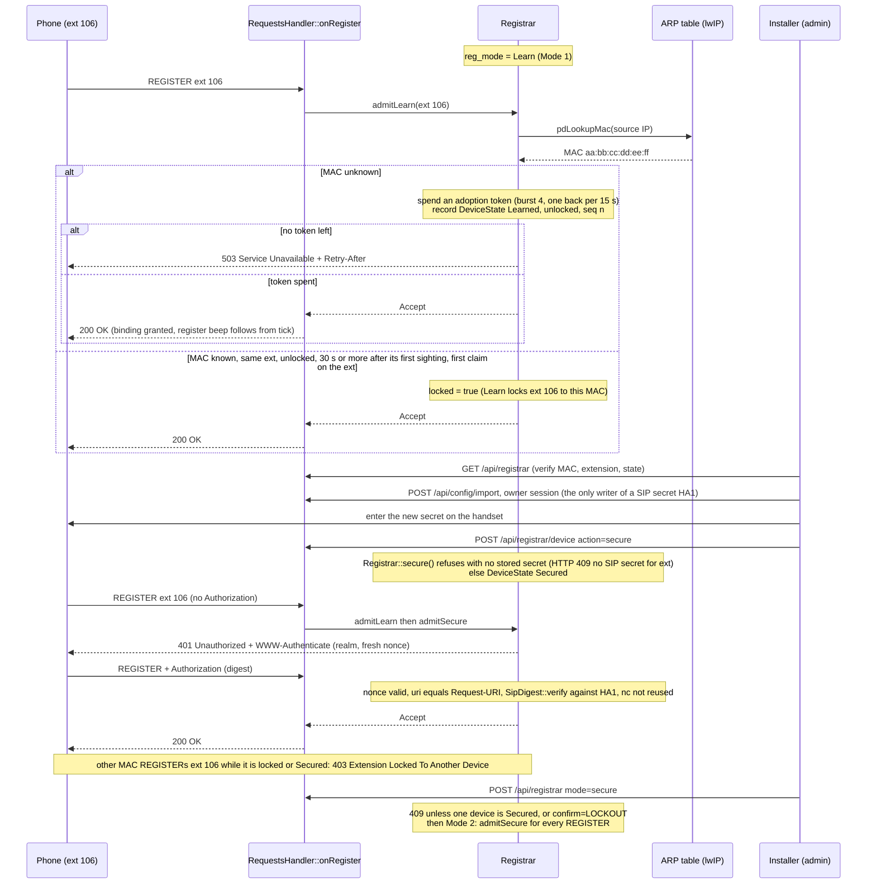

# Learn Mode: Fleet-Cutover Runbook

This runbook covers converting an existing phone deployment to pocket-dial, adopting the phones already on it in Learn mode and then moving them to Secure. It is written for installers and field operators, and it is an operational runbook, not an implementation spec.

Learn mode lets you drop pocket-dial into a *running* phone deployment and adopt the handsets that are already there, without re-typing a SIP account into every phone. The phones keep working on their current credentials (trust-on-first-use, keyed by device **MAC**). The intended next step is to issue a new secure secret per extension from the config panel and flip each device, or the whole box, to **Secure**, which locks every extension to the MAC that claimed it. No current build can issue a secret from its plaintext value (see Step 4). The honest boundary: Learn mode trusts the LAN. Run the adoption window short, admin-initiated, on a trusted or WPA2 link. See [THREAT_MODEL.md](THREAT_MODEL.md) §9 (Learn-mode auth surface) and [FEATURE_ROADMAP.md](FEATURE_ROADMAP.md) §3.3 (SIP digest auth).

## Status

Shipped on `main` (digest auth + Learn mode). It is operator-selectable from the dashboard, `POST /api/registrar`, or the flash-time `cfgseed` seed. The seed route works from **v1.4.1** onward. On v1.3.0 and v1.4.0 it silently did nothing ([#151](https://github.com/GlomarGadaffi/pocket-dial/issues/151)). **The open registrar is retired** (#500, desmo 2026-09-27).

Every board runs `learn` or `secure`. A **fresh install boots in `learn`**. An **existing board that had no stored mode, or had `open` stored, is switched to `learn`** by the schema v2 migration (and `loadMode()` rewrites a stored `open` if it ever sees one). A **factory reset returns the board to `learn`**. If the mode can't be read or saved, the board boots `learn` (#441). A stored mode (dashboard, API or `cfgseed`) always wins.

## 1. Registrar modes

The registrar mode is a runtime setting (NVS-backed, chosen at onboarding and changeable
from the dashboard's *Devices* → *Registration* control, or `POST /api/registrar`).
It controls how a REGISTER is treated.

There are two routes to it, and which one you want depends on whether the board is already
on a network you can reach:

- **The dashboard** (*Devices* → *Registration*, or `POST /api/registrar` directly) works for any board you can reach over HTTP. **The dashboard is always reachable on its port.** The HTTP listener opens at boot and stays open. There is no dark-by-default admin plane, no `*4887` star-code, no bounded admin-open window and no `POST /api/admin/keepalive`. If the dashboard refuses your connection, that is a genuine fault (wrong address, wrong network, or a board that never finished booting), not a gate you need to open. You do need to **log in**, and on an unclaimed board you must replace the default credential first (see §3, Step 0).
- The browser flasher's flash-time configuration panel: the only way to pick a mode
  *before first boot*, which matters on a headless board you are about to deploy somewhere
  you would rather not visit twice.

**Warning:** That panel only works from firmware v1.4.1 onward. On v1.3.0 and v1.4.0 the seed's `regMode` was written to NVS namespace `storage` while `Registrar::loadMode()` reads `pbxcfg`, so it silently did nothing ([#151](https://github.com/GlomarGadaffi/pocket-dial/issues/151)). If you seeded a mode at flash time on one of those builds, the board came up in its compiled-in default regardless (`open` on those builds). Check `GET /api/registrar` rather than assuming.

| Mode | What it does | When to use it |
|------|--------------|----------------|
| **Learn** (`1`, TOFU adoption) | Adopts unknown phones on first REGISTER **without verifying** (trust-on-first-use), records `{MAC, extension}`, and keeps them alive on their *current* credentials. The phone's next REGISTER from the same MAC, at least 30 s after its first, **locks** the extension to that MAC (#440, #515). Already-secured devices are still digest-challenged. A different MAC claiming a locked or secured extension is rejected. | **The default and the floor.** Phones work with nothing to configure. Until its phone registers again 30 s or more after its first REGISTER, an extension can still be claimed by any device, and a phone on another subnet or sharing a NAT router's MAC is never locked (§5), so adopt on a trusted link. |
| **Secure** (`2`, closed) | Every REGISTER is digest-challenged (RFC 2617, MD5). Only extensions whose secret you have set/rotated can register, and each is locked to its adopted MAC. | **Steady-state production.** The target you flip to once the fleet is adopted and secrets are issued. |

There is no open mode (`0`) (#500): the API answers `400` for it, and a board or
config import that still says `open` gets `learn`. Mode transitions are explicit admin
actions: there is no silent downgrade. Moving Secure → Learn is logged; do it only deliberately. See
[THREAT_MODEL.md](THREAT_MODEL.md) §9 (no-silent-downgrade).

## 2. How a phone's MAC is obtained (read this first)

Phones **do not put their MAC in SIP**. The SIP `User-Agent` header carries only a
firmware/model string, and there is no MAC anywhere in the REGISTER. pocket-dial resolves
the phone's MAC by looking up the REGISTER's **source IP in the LAN ARP table**
(IP → MAC, via the device's own network interface).

Two consequences you must plan around:

- **LAN-only.** ARP resolution works only for devices on the same L2 segment as
  pocket-dial. A phone reaching the registrar through a router (different subnet) has no
  ARP entry here and **cannot be MAC-adopted or locked**. Keep the phones and the box on one flat
  segment during cutover.
- **First-packet timing caveat.** The ARP entry for a phone may not exist yet on its
  *very first* packet. pocket-dial resolves the MAC a beat later (after the initial
  exchange / keepalive `OPTIONS`) and retries. On an ARP miss `admitLearn()` adopts *nothing*: it accepts the REGISTER,
  unless the extension is already locked or secured. A locked extension is accepted only
  from its registered IP and port (the owner's own refresh; ARP entries age out, and the
  table holds 40 on the full builds, 10 on the 8-phone constrained one). Any other source on
  the box's subnet gets no answer while the box ARPs it, and the phone's retransmission of the
  same REGISTER is checked against the lock as usual (#864); a source on another subnet gets
  `503` with `Retry-After: 5`. A secured one is digest-challenged (#507). The
  MAC is the device map's key (`_devices` in `src/SIP/Registrar.hpp`), so a row with a blank
  MAC cannot exist. The phone is simply **absent** from the roster until a cycle where ARP
  resolves. Wait one registration interval and re-check; look for a missing
  row, not a blank one.

Implication for the lock: because the lock is keyed on a MAC learned from ARP, it is a
*trust-the-LAN* control, not a cryptographic one. ARP/MAC can be spoofed on a hostile L2.
The lock raises the bar; **WPA2 / a trusted LAN is the real boundary.** This is stated
plainly in [THREAT_MODEL.md](THREAT_MODEL.md) §9.

## 3. The cutover sequence

Do this on a **trusted link** (ideally WPA2 on the SoftAP, or a trusted wired segment), with the box's admin credential already claimed. Keep the adoption window short.

### Step 0: Prepare
- [ ] pocket-dial powered, on the **same L2 segment** as the existing phones.
- [ ] **Admin credential claimed.** The board ships with a known default login
      (`admin`/`admin`) and refuses every other admin action, including
      `GET /api/registrar`, with `403 {"error":"setup_required"}` until you replace it
      via `POST /api/admin/set-credential`. Log in with the default, set a real
      username + password (8-character minimum), and only then touch the registrar. See
      [ONBOARDING.md](ONBOARDING.md). *(This is a login credential, not a PIN; the
      numeric DTMF PIN is a separate, optional secret for the phone-keypad admin menu and
      is not involved in any of this.)*
      On the `wifi`, `eth` and `lan8720` builds this is not optional in a second sense:
      the SIP stack is held down at boot until a credential is committed, so **no phone
      can register and adoption cannot begin** until you have done it. The `display`
      build is deliberately not gated this way.
- [ ] You know the current extension list and which phone is which (you will verify MACs).
- [ ] Link is trusted: WPA2 SoftAP or a segmented/trusted wired LAN. Avoid an open AP for
      the window if you can ([THREAT_MODEL.md](THREAT_MODEL.md) §9, TOFU-window risk).

### Step 1: Drop in and choose Learn
Bring pocket-dial up as the registrar the phones point at (point the phones' SIP server at
the box, or take over the address the old registrar held). At onboarding, choose **Learn**
as the registrar mode (writes `reg_mode = 1`).

### Step 2: Phones adopt on first REGISTER (TOFU)
As each phone's registration refreshes, it REGISTERs to pocket-dial. In Learn mode an
**unknown MAC** is accepted **without credential verification** and recorded as
`{MAC, extension, state = LEARNED}`. The phone keeps working on whatever credentials it
already had; you have not changed the handset yet. This is the trust-on-first-use step:
the box trusts the first device to claim an extension on the LAN.

Registrations refresh on the phones' own expiry cycle. You can reboot a phone (or trigger "re-register") to adopt it immediately rather than waiting for its lease to lapse.

### Step 3: Verify the adopted roster
Open the **devices / registrar view on the web dashboard**. It is reachable at any time
(the listener is never gated; see [THREAT_MODEL.md](THREAT_MODEL.md) §5.5), you just need
a logged-in session, and `GET /api/registrar` is one of the reads that requires one.
Confirm every expected phone appears with the right **MAC · extension ·
state** (`LEARNED` / `ONLINE`). **This is the trust-on-first-use checkpoint: verify it
before you secure anything.** If a row is missing, see §2 (first-packet caveat); wait one
cycle. If an *unexpected* MAC adopted an extension, you have a rogue/duplicate device on
the segment. Stop, investigate, and forget it (§6) before proceeding.

### Step 4: Assign / rotate per-extension secrets

**Warning:** Step 4 cannot be carried out on any current build, and the two steps after it depend on it.

No current build can set a per-extension SIP secret from its plaintext value. Nothing in the firmware calls `SipSecretStore::setSecret()` or `generateSecret()`; both are used only by the test suite. There is no HTTP route, dashboard field, serial command or `cfgseed` flag that sets one. The dashboard has no SIP secret field (its only "API Key / Secret" input, in `src/Helpers/index_html.h`, is the telephony API key), and `cfgseed` carries only apSecure, apPsk, wifiMode, staCreds and regMode (the `kSeedHas*` flags in `src/Helpers/DeviceConfig.hpp`).

The only writer of a secret is the owner-gated config import. `POST /api/config/import` with a non-empty `password` (owner role required) restores HA1 values from the encrypted block's `extensionSecrets` list through `SipSecretStore::setHa1()`. When that list is present, it also clears (`clearSecret()`) any secured extension the file leaves out. The export route writes only HA1 values already stored on the board, so an encrypted file carrying a new value has to be built outside the firmware. This runbook does not describe how to build one.

The consequences follow all the way down:

* `Registrar::secure()` refuses and only logs when the extension has no secret (`src/SIP/Registrar.cpp`), so **Step 5 cannot mark any device Secured**. The API answers `409 {"error":"no SIP secret for ext <ext>"}` for that device, which names the real cause.
* `admitSecure()` rejects every REGISTER with *Extension Not Provisioned* (`src/SIP/Registrar.cpp`), so **flipping `reg_mode = 2` locks out the entire fleet** rather than securing it. The `409` guard on `POST /api/registrar mode=secure` (in `src/Helpers/HttpServer.cpp`) exists to stop you doing this, and it refuses unless you override it with `confirm=LOCKOUT`. **Do not override it.** The guard only checks whether any device is Secured. Once one device is Secured, a flip goes through even if other adopted phones still have no secret, and those phones are rejected.

The digest machinery itself is real and host-tested: `SipDigest`, the HA1 store, and the challenge path on both REGISTER and INVITE. What is missing is an operator-facing way to set a secret from its plaintext value. Until one exists, `learn` mode (TOFU + MAC lock) is the strongest admission mode that can actually be deployed, and this runbook stops at Step 3.

*The rest of this section describes the intended design, for whoever wires up that path, not a procedure you can follow today.*

For each extension, **set or rotate a secret** from the config panel (M1: manual, on the
web dashboard; M2 auto-reprovision is later; see §7). The box stores
**HA1 = MD5(extension : realm : secret)** per extension, the recoverable-equivalent digest
credential, **not** a one-way hash (digest auth requires the server to be able to recompute
the response). Then put that secret on the matching handset (type it into the phone's web UI
for M1).

**Warning:** The HA1 in NVS is a **bearer credential at rest**; anyone who can read it can authenticate as that extension. This pairs with the flash-encryption / Secure Boot item already tracked in [THREAT_MODEL.md](THREAT_MODEL.md) (§7 P2). Do not export or log secrets.

### Step 5: Flip to Secure (per device, then the box)

**Warning:** Step 5 is blocked by Step 4. No device can be marked Secured while its extension has no secret, and flipping the box to `reg_mode = 2` in that state is a full fleet lockout, not a hardening step. Read the Step 4 warning before doing anything here.

Mark each adopted device **Secured** once its new secret is on the handset and it
digest-authenticates cleanly. A secured device is now locked to its MAC: a REGISTER for
that extension from a *different* MAC is rejected (`403`/`401`). When every device is
secured and verified, flip the **registrar mode to Secure** (`reg_mode = 2`) so the
whole box challenges every REGISTER and no new unverified phone can be adopted.

### Lock semantics (what "Secured" enforces)
- **Extension ↔ MAC binding.** A secured extension answers only to its adopted MAC. A
  different MAC claiming it is rejected; this is the anti-spoof lock.
- **Digest required.** A secured device must present a valid digest response computed from
  its secret. Wrong/absent secret → challenge/reject, never silent accept.
- **Learn does not apply to it.** Even while the box is still in Learn mode, an
  already-secured device is digest-enforced (Learn's TOFU acceptance applies only to
  *unknown* MACs).

## 4. Sequence diagram (Learn-mode cutover)

This sequence follows one phone (ext 106) through the Learn-mode REGISTER path (`Registrar::admitLearn`) and then through Secured enforcement (`Registrar::admitSecure`). The secret and Secured steps are the intended design: see the Step 4 warning above.



ASCII fallback:

```
 PHONE (ext 106)            pocket-dial (LEARN)            INSTALLER
     |  REGISTER (current creds)  |                            |
     |--------------------------->| src-IP -> ARP -> MAC        |
     |                            | unknown MAC: TOFU accept    |
     |   200 OK (stays alive)     | record {MAC,106,LEARNED}    |
     |<---------------------------|                            |
     |                            |<--- verify roster ---------|
     |                            |<--- set/rotate secret -----| store HA1=MD5(106:realm:secret)
     |<------ enter new secret ---|----------------------------|
     |                            |<--- mark SECURED (lock) ---|
     |  REGISTER (no auth)        |                            |
     |--------------------------->| 401 challenge              |
     |<------ 401 (nonce) --------|                            |
     |  REGISTER + Authorization  |                            |
     |--------------------------->| verify digest vs HA1       |
     |<------ 200 OK -------------|                            |
     |                            |<--- all secured: Mode=SECURE
   (rogue MAC for ext 106 ----> 403/401: extension↔MAC lock)
```

## 5. The TOFU window discipline

Learn is the default and the floor (the open registrar is retired, #500). A
phone's next REGISTER from the same MAC locks its extension to that MAC (#440), and a different
MAC is then refused (`403 Extension Locked To Another Device`). Only REGISTERs whose source
resolves in the box's ARP table count, the locking one must come at least 30 s after the
phone's first (#515: a burst of two REGISTERs per MAC never locks), and the lock goes to
the extension's **first claim**: while an earlier-adopted device's row still holds the extension, a later device
stays plain TOFU however often it registers. An unlocked MAC that registers a second
extension is marked **shared** and never locks; its row keeps the extension it registered
first, and the second extension gets no row (#820).

Its exposure is every extension **not yet locked**. Any device that REGISTERs one is
admitted **without verification** and takes its binding. What happens after that depends
on whether the phone's own row is the extension's first claim:

- **Fails open: no other device can lock it.** The first claim is a row that has not locked yet
  or never will: its phone has not yet registered again 30 s after its first, its device
  has gone, or it is a shared row (a NAT router's first extension, or the old extension of
  a phone re-provisioned while unlocked). Anyone can still register the extension as TOFU,
  but nobody can lock its phone out. Forget a gone or shared row (the roster's State column
  reads `locked`, `shared` or `unlocked` for each row, and `GET /api/registrar` has the
  `locked` and `shared` booleans, #882) to let the right phone lock, and forget any other row on that extension you do not recognise, because the
  oldest remaining row becomes the first claim. This holds only while the row stays in the
  device table: a full table (`POCKETDIAL_MAX_CLIENTS`, 32 by default) evicts the oldest
  unlocked row, offline first, to adopt a new MAC, and a row that never locks is one of
  those. Once it is evicted, the extension falls into the next list.
- **Does not fail open: another device can lock the phone out.** The phone holds no row
  on the extension, so nothing claims it, and any other on-link device that registers it
  twice, at least 30 s apart, locks it. The lock is saved, so it survives a reboot.
  - A phone on another subnet (an ARP miss never adopts it): once the locker holds the
    binding, the phone gets `503` with `Retry-After` on every REGISTER (§8).
  - The second and later phones behind a NAT router (the router's row holds only its first
    extension): `403 Extension Locked To Another Device`.
  - **A phone moved to another extension while its row was unlocked**: the row stays on
    the old extension, so the phone holds no claim on the new one and gets `403` there
    once another device locks it. The row does not follow the phone, so an unauthenticated
    REGISTER cannot move it (#820). desmo accepted this residual
    on 2026-10-04 (#852). **Forget the phone's row when you move it** (§6).

The protection for every case above is Secure (digest), but no current build can set the
per-extension secret it needs (§3, Step 4). Until then, watch the roster and forget rows
deliberately. So:

- **Adopt what you own, promptly.** Let every phone register once on a trusted link, check
  the roster, and **forget** anything you don't recognise. The first device to claim an
  extension is the one that locks it, so a rogue that won the race keeps the extension
  until you forget it.
- **Firmware changes.** After an upgrade from pre-#440 firmware every adopted device loads
  unlocked and locks on its phone's next resolved REGISTER. Where two rows already hold
  one extension, the first claim is the row that loaded first, which is storage order, not
  necessarily the older claim: check the roster for duplicate extensions right after the
  upgrade. A downgrade to pre-#440 firmware keeps the devices but drops every lock (and
  the shared marks) at its next write of the device table.
- **Default on every board.** A fresh install, a factory reset and any board
  that used to run the retired open mode (#500) all boot in Learn, because the alternatives are
  worse out of the box: open accepted anyone, and Secure refuses every phone until secrets
  exist. For the strongest posture, secure each phone and switch to Secure.
- **Prefer an encrypted/trusted link.** Run the window on WPA2 (or a trusted wired segment)
  so a passive sniffer can't observe the cutover and a stranger can't associate and race to
  claim an extension. On an open AP the window is materially riskier; see
  [THREAT_MODEL.md](THREAT_MODEL.md) §9 (residual risk if left open).
- **Watch the roster during the window.** A claim you didn't expect = a device you didn't
  authorize. Adopt only what you recognize, then close the window by flipping to Secure.

Residual risk, stated plainly: the lock you get at the end is MAC-based and the MAC is
ARP-derived, strong against accidental collisions and casual spoofing on a trusted LAN,
**not** against a determined attacker on a hostile L2 who can spoof MACs. The real boundary
remains the link (WPA2 / trusted LAN). Learn mode buys you a low-friction cutover; it does
not buy you cryptographic device identity.

One more residual (#820): **one forged packet keeps an extension from ever locking.** A
REGISTER for any other extension, sent with an unlocked phone's source IP (so ARP returns
the phone's MAC), marks the phone's row shared. The mark is saved, and only forgetting the
row clears it. The phone keeps its extension and is not locked out, because its row is
still the first claim, but that extension never locks, so any device on the link can keep
taking its binding as TOFU. A locked or Secured row is not affected. The answer is Secure. Until it
can be deployed, the cure is to forget the phone's row (and any row on that extension you
do not recognise) and let the phone register again. The roster shows the rows this has hit:
they read `shared` (`"shared": true` in `GET /api/registrar`, #882).

## 6. Edge cases, rollback, and forget

### A phone whose MAC changes
The lock is keyed on MAC. If a handset's MAC changes (NIC swap, hardware replacement,
some phones randomize, or a dock/adapter changes the L2 address), a secured or locked extension will
**reject** the new MAC (that is the lock doing its job). To recover:

1. Confirm the change is legitimate (you actually replaced/moved hardware).
2. **Forget** the old adoption for that extension (removes the MAC↔ext binding).
3. Re-adopt: briefly return to **Learn**, let the new MAC claim the extension (TOFU),
   re-issue/rotate the secret, mark Secured again. Then return the box to **Secure**.

A MAC change is indistinguishable, at the registrar, from a different device claiming the
extension, so re-adoption is a deliberate admin action, by design.

### A phone moved to another extension
A phone's row keeps the extension it was adopted as; re-provisioning the phone does not
move it (#820). While that row exists the phone holds no claim on its new extension, so
any other on-link device that registers the new extension twice, at least 30 s apart,
locks it, and the phone is then refused there with `403` (§5). Its old extension stays
unlocked for everyone, and `GET /config/<mac>.cfg` keeps serving the old extension
([PROVISIONING.md](PROVISIONING.md) §3). desmo accepted this on 2026-10-04 (#852). So when
you move a phone, do these together:

1. Change the extension on the phone.
2. **Forget its row, by MAC.** Use the **Forget** button on that row of the dashboard
   roster (it sends the MAC), or `POST /api/registrar/device` with
   `action=forget&target=<MAC>`. By extension the route answers `409` while two rows hold
   it. The row to forget has the phone's MAC and still shows the old extension. It reads
   `shared` if the phone was unlocked when you moved it, `locked` if it was locked.
3. Reboot the phone, or make it re-register. It is adopted afresh on the new extension,
   and its next REGISTER at least 30 s later locks it, if no other row holds that
   extension first. If another MAC already holds the new extension in the roster, find out
   what it is and forget that row too, or it stays the first claim.

The roster's State column (`learned · shared`, `learned · locked`, `learned · unlocked`,
`secured`) and the `locked` and `shared` booleans of `GET /api/registrar` (#882) tell the
rows apart: `unlocked` is plain TOFU, `shared` never locks, and a `secured` row is enforced
by its state. Go by MAC and extension when you forget.

### Rollback / forget
- Forget one device: removes its `{MAC, ext}` entry from the device registry
  (`Registrar::forget()` in `src/SIP/Registrar.cpp`). The extension is then unclaimed and can
  be re-adopted (in Learn) or left unregistered. `POST /api/registrar/device` accepts an
  extension only while one row holds it; with two it answers `409` and changes nothing, so
  forget by MAC, as the dashboard does (#820). **It does not remove the HA1.** The digest
  credential lives in a separate NVS namespace (`sipauth`, `SipSecretStore.cpp:25`) and
  survives a forget, so "forget" is not a credential revocation.
- **Rotate instead of forget:** not available from plaintext. Nothing in the firmware calls
  `SipSecretStore::setSecret()`, for the same reason Step 4 is blocked. An encrypted config
  import that carries a different HA1 for an extension overwrites the stored one, so a secret
  can be replaced that way, but only with an encrypted file built outside the firmware. See
  the warning in Step 4.
- Roll the whole box back to Learn: explicit admin mode change (logged, no silent
  downgrade). Reverts to the cutover posture; use only deliberately and re-secure promptly.

## 7. What is M1 vs later (M2)

| Capability | Milestone | Notes |
|------------|-----------|-------|
| Runtime registrar mode (Learn/Secure) | **M1 (now)** | NVS-backed; chosen at onboarding. Open retired (#500). |
| Digest auth on REGISTER (challenge/verify) | **M1 (now)** | RFC 2617 (MD5). Secure mode also digest-challenges INVITE (drawbridge #125); binding a call to its caller's registered address is #497. |
| Learn-mode TOFU adoption keyed by MAC | **M1 (now)** | Unknown MAC adopted; recorded `{MAC, ext}`. |
| Extension ↔ MAC lock (anti-spoof) | **M1 (now)** | Different MAC for a secured ext, or (#440) a Learn-locked one → reject. |
| Set / rotate per-extension secret in config panel | **Not built** | No route, UI field or console sets a secret from its plaintext value. `SipSecretStore::setSecret()` has no production caller. The only writer is the owner-gated config import, which restores HA1 values from an encrypted file. This is the gap that blocks Steps 4-5. |
| **Auto-reprovision** (push new creds to the phone) | **M2 (later)** | Zero-touch cutover via the provisioning HTTP path + `check-sync`. The route is **`GET /config/<mac>.cfg`**, dispatched by `isProvisioningConfigPath` in `src/Helpers/HttpServer.cpp`. There is no `/provision/{mac}.cfg` route; see [PROVISIONING.md](PROVISIONING.md). Note it still serves a blank password field, so it cannot complete a credential cutover on its own. |

For M1, **the operator types the rotated secret into each handset.** M2 removes that step by
auto-reprovisioning the phone over HTTP; until then, plan for a touch on each phone's web UI
to deliver the new secret.

## 8. Troubleshooting

| Symptom | Likely cause | Action |
|---------|--------------|--------|
| Phone not adopted; not on roster | Phone hasn't re-registered yet, or it's on a different subnet (no ARP entry) | Reboot/re-register the phone; confirm phone and box are on the **same L2 segment** (§2). |
| Phone missing from the roster just after its first REGISTER | First-packet ARP miss (§2) | Wait one registration interval; its row appears on the next cycle that resolves the MAC. Don't secure it until the row is present. |
| Phone drops to `401`/`403` after you secured it | New secret not yet on the handset, or typed wrong | Re-enter the secret on the phone; confirm it matches the one you set (rotate again if unsure). |
| A **different MAC** is rejected for an extension | The extension↔MAC **lock** working as designed | If the MAC change is legitimate, **forget** then re-adopt (§6). If not, you have a rogue device. Investigate. |
| `503` with `Retry-After: 5` on REGISTER in Learn | The extension is locked, this REGISTER's source is not on the box's subnet (so ARP cannot resolve it), and it is not the extension's registered IP and port (a refresh from there is accepted). An on-link source never sees it: the box ARPs it without answering and checks its retransmission (#864) | A locked phone that keeps getting it sits behind a router (§2): forget its device. |
| Unexpected device appears on the roster during the window | Someone associated and claimed an unclaimed extension (TOFU) | Forget it; tighten the link (WPA2), shorten the window, re-run (§5). |
| New phone won't register after you flipped to **Secure** | Secure mode challenges everything; an un-adopted phone has no secret | Briefly return to **Learn** to adopt it (or set its secret + adopt MAC), then return to **Secure**. |
| Phones work but you suspect eavesdropping during cutover | Open AP: TOFU window and creds observable on the link | Enable **WPA2 on the SoftAP** (the fix with the biggest payoff; [THREAT_MODEL.md](THREAT_MODEL.md) §6) and re-run the window. |

## See also
- [THREAT_MODEL.md](THREAT_MODEL.md) §9, the auth-surface analysis (digest, TOFU window, MAC-lock, secret-at-rest, mode transitions).
- [FEATURE_ROADMAP.md](FEATURE_ROADMAP.md) §3.3, SIP digest auth and WPA2 priorities.
- [PROVISIONING.md](PROVISIONING.md), the per-MAC secret store and the M2 auto-reprovision path.
- [ONBOARDING.md](ONBOARDING.md), first-boot setup and replacing the default admin credential.
