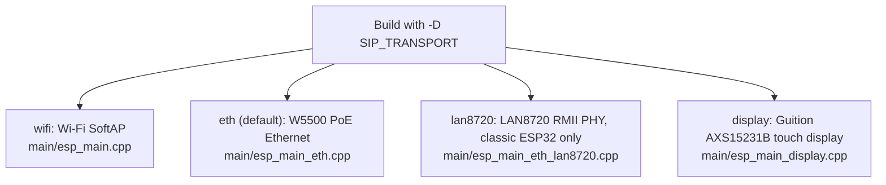

# Pocket-Dial Firmware Onboarding Guide

This guide takes you from a clean machine to a compiled and flashed pocket-dial firmware, with the HTTP dashboard running on your development board.

## Prerequisites & Tools

Install the toolchain and platform dependencies for your operating system before you begin.

### 1. Hardware Drivers

Install the correct USB-to-UART bridge driver for your target board:

* Silicon Labs CP210x: [Download CP210x VCP Drivers](https://www.silabs.com/developers/usb-to-uart-bridge-vcp-drivers) (common on standard ESP32 DevKits)
* WCH CH340 / CH341: [Download CH340 Drivers](http://www.wch-ic.com/downloads/CH341SER_EXE.html) (common on low-cost S3 boards, displays, and clone devkits)

### 2. ESP-IDF Toolchain (v6.0 or later; v5.x will not configure)

The firmware requires **ESP-IDF v6.0+**. This is a hard floor, not a recommendation. `main/CMakeLists.txt:19-24` raises a CMake `FATAL_ERROR` on anything below v6.0, so a v5.x toolchain fails at configure time, before a single file is compiled. Both `.github/workflows/ci.yml` and `release.yml` build on **v6.0.1**. v5.1.2 and v5.2.1 are not usable, and CI no longer builds them.

* Windows installation: Download and run the [ESP-IDF Offline Installer](https://dl.espressif.com/dl/esp-idf/) (select version `6.0.1`).
* Linux/macOS installation: Follow the [Espressif Standard Shell Setup Guide](https://docs.espressif.com/projects/esp-idf/en/stable/esp32/get-started/linux-macos-setup.html).

## Step 1: Environment Activation

To load the correct compilers (`xtensa-esp32-elf-gcc`, `xtensa-esp32s3-elf-g++`), build utilities (`cmake`, `ninja`), and target tools (`esptool.py`, `idf.py`) into your current shell session:

### Windows (PowerShell)
```powershell
# Open PowerShell and run the export script generated during installer setup
. ~\esp\esp-idf\export.ps1
```

### Linux / macOS
```bash
# Source the export script in your active terminal
. $HOME/esp/esp-idf/export.sh
```

If activation succeeds, running `idf.py --version` prints `ESP-IDF v6.0.x`. Anything below v6.0 stops with the `FATAL_ERROR` from `main/CMakeLists.txt`.

## Step 2: Clone & Configure

1. Clone the repository and submodules:
   ```bash
   git clone --recursive https://github.com/GlomarGadaffi/pocket-dial.git
   cd pocket-dial
   ```

2. Select your target chip architecture:
   The firmware supports multiple physical boards. Tell the build system which chip you are compiling for:
   ```bash
   # For classic ESP32 devboards (e.g. NodeMCU, LilyGO T-Internet-COM)
   # NOTE: the Waveshare ESP32-S3-ETH is an S3 board — use esp32s3 for it.
   idf.py set-target esp32

   # For ESP32-S3 boards (e.g. Guition AXS15231B Display, LilyGO T-ETH-Lite)
   idf.py set-target esp32s3
   ```

## Step 3: Select Your Hardware Transport Layer

The firmware has a modular physical layer. Pick a transport at compile time by passing `-D SIP_TRANSPORT` to `idf.py`. Each transport maps to one entrypoint file, listed in the table below.



| Transport Parameter | Target Board Description | Primary Entrypoint File |
| :--- | :--- | :--- |
| `wifi` | Broad support. Starts a Standalone Access Point named `esp32-sipserver` | `main/esp_main.cpp` |
| `eth` *(Default)* | **W5500 only** (LilyGO T-ETH-Elite S3 default, or Waveshare ESP32-S3-ETH with `-D PD_ETH_BOARD=waveshare`; the two pin maps are entirely different and the wrong one reset-loops the board) | `main/esp_main_eth.cpp` |
| `lan8720` | **A separate transport, not part of `eth`.** Classic ESP32 + LAN8720 RMII PHY; hard-errors unless `IDF_TARGET == esp32` | `main/esp_main_eth_lan8720.cpp` |
| `display` | Guition AXS15231B **3.5" 320x480** LCD, pins graphics to Core 1 and SIP on Core 0 | `main/esp_main_display.cpp` |

Choose one of the following build commands to match your hardware:

```bash
# Option A: Build for Standalone Wi-Fi (Any standard ESP32 or S3 Board)
idf.py -D SIP_TRANSPORT=wifi build

# Option B: Build for Ethernet (PoE / Wired W5500 setup)
idf.py -D SIP_TRANSPORT=eth build

# Option C: Build for Guition Touch Display (Requires AXS15231B with LVGL)
idf.py -D SIP_TRANSPORT=display build
```

## Step 4: Security Customizations (Issues #54-#59)

Before you compile, set the security options for your environment.

### 1. Learn vs. Secure Mode Authentication (Issue #56)

By default, the SIP engine starts in **Learn** mode, which is trust-on-first-use. Open Mode is retired (#502). **Secure** mode is the one that blocks unauthorized traffic, but every phone needs a per-extension secret first. Read the warning below before you choose it.

**Warning:** Editing a `#define` does nothing for this setting. The old `POCKETDIAL_OPEN_REGISTRAR` macro was removed (#500). The header comment at `src/SIP/RequestsHandler.hpp:4-11` describes the runtime setting.

* To enable Secure mode: the registrar admission mode is a **runtime** setting, persisted in NVS as `reg_mode` in the `pbxcfg` namespace. Change it with `POST /api/registrar` (`mode=learn` or `mode=secure`) from a logged-in dashboard session, or seed it at flash time through the `cfgseed` record. See [LEARN_MODE.md](LEARN_MODE.md) for the cutover procedure.
* Effect: in `learn`, an unknown MAC is adopted on a trust-on-first-use basis. If the same MAC registers again for the same extension at least 30 seconds after its first sighting, the extension locks to that MAC automatically. The lock does not happen if an earlier-adopted device already holds the extension. Promoting a device to Secured is a separate admin step; a Secured device stays locked to its MAC and is digest-checked. In `secure`, every `REGISTER` **and** `INVITE` is digest-challenged.

**Warning:** There is currently no way to create or rotate a per-extension SIP secret. The only path that brings one back is restoring an encrypted configuration backup that already holds it (`POST /api/config/import`). Without secrets, `secure` rejects every phone rather than protecting them. `POST /api/registrar mode=secure` refuses with `409` unless you override it. Read [LEARN_MODE.md](LEARN_MODE.md) Step 4 before you plan on `secure`. `learn` is the strongest mode that can actually be deployed today.

### 2. Address of Record (AOR) Validation (Issue #55)

The engine checks SIP Address of Record (AOR) values during inbound packet parsing. The check is `RequestsHandler::isValidAor()` in `src/SIP/RequestsHandler.cpp`.

* Only alphanumeric characters and the characters `.`, `-`, `_`, `+`, **`*` and `#`** are allowed, and a value must be 1 to 64 characters long. The last two matter: without them, the star and pound feature codes (`*8` group pickup, `**<ext>` directed pickup, the `*PIN#` admin menu) would not be dialable.
* Malformed values, such as injection strings or script probes, are rejected with a `400 Bad Request` SIP response. This blocks potential parsing and configuration hijacking attempts.

### 3. Distributed Scanner Denial-of-Service Defense (Issue #58)

The system prevents memory exhaustion by network scanners in two ways:

* Rate-limit tracking buckets that have been inactive for more than 60 seconds are swept from memory in `RequestsHandler::tick()`.
* The rate-limit map holds at most 256 source IPs. The cap is a literal in `RequestsHandler::allowPacket()`. When the map is full, a packet from a new source IP is dropped without a reply. Sources that already have a bucket are not affected by the cap.

## Step 5: Flash the Board

Connect your development board with a USB-C or micro-USB cable that carries data. Identify the serial port assigned to your device:

* Windows: Open Device Manager and check `Ports (COM & LPT)` (e.g., `COM3`, `COM12`).
* Linux: Run `ls /dev/ttyUSB*` or `ls /dev/ttyACM*` (e.g., `/dev/ttyUSB0`).
* macOS: Run `ls /dev/cu.usbserial*` or `ls /dev/cu.usbmodem*`.

Flash the compiled firmware binaries and partition tables directly to the flash memory of your board, and start the serial monitor:

```bash
# Replace 'COM3' or '/dev/ttyUSB0' with your actual port address
idf.py -p COM3 flash monitor
```

If the flashing utility times out while it connects, hold down the physical **BOOT / FLASH** button on the board, press and release the **EN / RST** button, then release the BOOT button. This forces the chip into ROM bootloader mode. Then run the command again.

## Step 6: Manual HTTP API Verification

After flashing, the device boots and the serial monitor shows its logs. If the board runs in **Wi-Fi SoftAP** or **Display** mode:

1. Connect to the network. On your laptop or phone, join the Wi-Fi network named **`esp32-sipserver`**. It is **open by default** (no password). If access-point security has been enabled, from the dashboard or at flash time through the browser flasher, you need the device's own generated WPA2 passphrase instead. See [SETUP_GUIDE.md](SETUP_GUIDE.md#turning-on-access-point-security-wpa2) for where to read it. On a display build that is still in captive-portal onboarding, the setup AP is **`My-Ap`** instead. It is a WPA2 network, and its passphrase is shown on the onboarding screen. See [SETUP_GUIDE.md](SETUP_GUIDE.md#variant-captive-portal-onboarding-touch-display-build).
2. Retrieve the server IP. The SoftAP gateway IP defaults to **`192.168.4.1`**.

You can now query and control the firmware with standard terminal commands, or by opening `http://192.168.4.1/` in your browser.

Sections 3 and 4 call admin routes. After you log in, every admin-gated route except `POST /api/admin/set-credential` returns `403` with `setup_required` while the board still has its shipped login (`admin`/`admin`). Change the login first, as described in [SETUP_GUIDE.md section 3](SETUP_GUIDE.md#3-log-in-and-complete-setup-first). The gate order is described in [API.md §0.1](API.md#01-the-gates-in-the-order-requireadmin-applies-them).

### 1. Get Live System Status (Uptime, Registered Clients, and Sessions)

Retrieves system metrics and registered SIP extensions.

#### Command
```bash
curl -s http://192.168.4.1/api/status
```

#### Expected JSON Output
```json
{
  "ip": "192.168.4.1",
  "port": 5060,
  "httpPort": 80,
  "uptime": 45,
  "packetsProcessed": 12,
  "packetsDropped": 0,
  "clients": [
    {
      "number": "100",
      "address": "192.168.4.2:5060"
    }
  ],
  "sessions": []
}
```

### 2. Scan Local Wi-Fi Networks

Triggers an active network scan and returns reachable SSID lists, their signal strength, and encryption types.

#### Command
```bash
curl -s http://192.168.4.1/api/wifi/scan
```

#### Expected JSON Output
```json
{
  "networks": [
    {
      "ssid": "HQ-Office-WiFi",
      "rssi": -65,
      "encryption": "WPA2"
    },
    {
      "ssid": "Guest-Zone",
      "rssi": -82,
      "encryption": "WPA2"
    }
  ]
}
```

### 3. Connect Device to a Client Wi-Fi Network

Saves credentials into the `"storage"` NVS namespace, changes operating mode to station, and initiates an automatic system restart.

This route is admin-gated. An unauthenticated call returns `401`. The call needs a `pd_session` cookie and a matching `X-CSRF` header, because `POST /api/wifi/connect` runs `requireAdmin()` with CSRF checking on (`needCsrf=true`). Log in first, keep the cookie, and echo the CSRF token that the login returns. See [API.md §0.1](API.md#01-the-gates-in-the-order-requireadmin-applies-them).

#### Command
```bash
# 1. Log in; keep the cookie jar. The response body carries the CSRF token.
curl -c jar.txt -X POST \
     -H "Origin: http://192.168.4.1" \
     -d "username=admin&password=YOUR_PASSWORD" \
     http://192.168.4.1/api/admin/login

# 2. Now the real call, with the session cookie and the token.
curl -b jar.txt -X POST \
     -H "Origin: http://192.168.4.1" \
     -H "X-CSRF: <token from the login response>" \
     -H "Content-Type: application/x-www-form-urlencoded" \
     -d "ssid=HQ-Office-WiFi&password=MySecurePassword" \
     http://192.168.4.1/api/wifi/connect
```

#### Expected Response
```json
{
  "status": "ok",
  "message": "WiFi credentials saved. Rebooting to Station Mode..."
}
```

### 4. Force Disconnect an Active Call Extension (admin session + CSRF)

Sends a disconnect command to terminate the session of a rogue or deadlocked extension.

Matching `Origin`/`Host` headers are not enough. This route runs the full `requireAdmin(..., needCsrf=true)` chain in `src/Helpers/HttpServer.cpp`: a same-origin check, then a valid `pd_session` cookie, then a matching `X-CSRF` token, then the forced-setup check. Without a session it returns `401 {"error":"authentication required"}`.

#### Command
```bash
# Reuses the cookie jar and CSRF token from the login in §3.
curl -b jar.txt -X POST \
     -H "Origin: http://192.168.4.1" \
     -H "X-CSRF: <token from the login response>" \
     -H "Content-Type: application/x-www-form-urlencoded" \
     -d "extension=100" \
     http://192.168.4.1/api/kill
```

#### Expected Response
```json
{
  "status": "ok",
  "disconnected": "100"
}
```

## IDF Monitor Shortcuts

When viewing the console logs inside `idf.py monitor`, use these keyboard shortcuts to manage your session:

* `Ctrl + ]`: Exit the serial monitor and return to your terminal shell.
* `Ctrl + T` then `Ctrl + R`: Toggle the RST pin of the board to trigger a hardware reboot.
* `Ctrl + T` then `Ctrl + L`: Toggle hex logging output (displays raw serial packets).
* `Ctrl + T` then `Ctrl + H`: Display help menu showing all console monitor controls.
