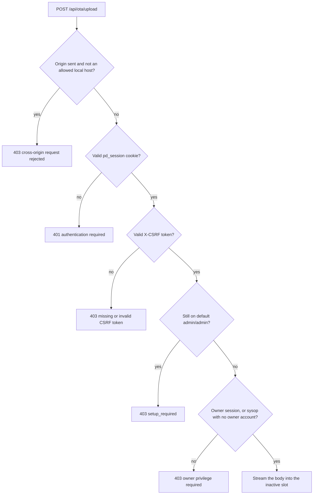
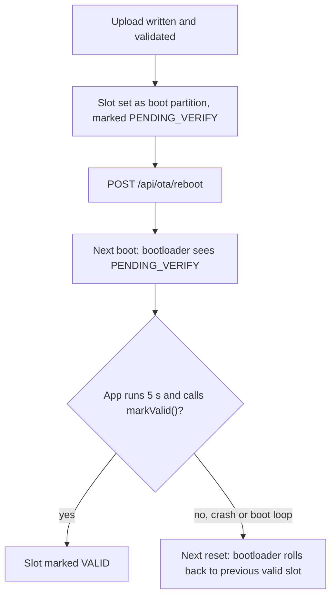

# Over-The-Air (OTA) Firmware Updates

pocket-dial updates the ESP32-S3 firmware over the air into one of two app slots
on the 16 MB flash, and rolls back to the previous slot if the new image does not
confirm a healthy boot. This document covers the partition layout, building and
pushing an update, the rollback strategy, the one-time migration from the old
single-app layout, and the security posture.

**Warning:** images are not signed yet. Anyone on the local link who holds an
owner login can flash firmware, and until an owner account exists the sysop
login is enough (see §6). Restrict `/api/ota/*` to the local link until Secure
Boot v2 lands (see [THREAT_MODEL.md](THREAT_MODEL.md)).

The first end-to-end run on hardware was on 2026-09-26, on `.244` (esp32s3 elite
eth), fully remote, with `tools/ota/remote_ota.sh` (#395). It covered refusals
(truncated and wrong-chip images, 422, no reboot), a real OTA `ota_0 -> ota_1`
that booted pending, marked itself valid and re-registered the phone, and a
rollback probe that never confirmed itself and was rolled back by the bootloader.
Results are in #395.

**Warning:** apart from the bench run above, nothing in this document has been
proven on a device. CI still never executes the dual-slot OTA flow with rollback
on real hardware. Specifically:

- The only OTA code CI executes is the HTTP wrapper on the host build, where
  there is no flash. CI compiles the firmware in an ESP-IDF matrix job, but it
  never runs those images. `tests/http/test_api.sh` TC-OTA-03 asserts that the
  upload returns `501` on the host. It runs only when `ALLOW_DESTRUCTIVE=1`, which
  `--allow-destructive` sets, or `SERVER_PID` sets implicitly. TC-OTA-06 asserts that the reboot endpoint returns
  `200`. When `SERVER_PID` is set, TC-OTA-07 checks that the server process is
  still alive afterwards, because the host reboot is a no-op. So CI proves the
  routing, the auth gate and the streaming bypass of the 16 KB body cap. It
  proves nothing about `esp_ota_write`, `esp_ota_end`,
  `esp_ota_set_boot_partition`, the bootloader's `PENDING_VERIFY` handling, or
  rollback.
- The release workflow has no runtime or update-path test.
  `.github/workflows/release.yml` builds the firmware, runs
  `tools/ci/check_no_bench_probe.py` on the build output, stages the artifacts and
  publishes them. That check is a static scan for the bench probe. No step runs
  the image.
- The partition-table guard in `ci.yml` checks `partitions.csv` as text. It
  confirms the layout has not regressed to single-slot; it does not flash
  anything.

**Consequence for a fleet update:** apart from the bench run above, the first
real exercise of this path will be on your hardware. Do the first update on
**one** device that you can physically reach with a USB cable, and confirm the
whole cycle (upload → reboot → healthy boot → `markValid()` in the log, see
§4.1) before touching a second. The rollback in §4 is the designed behaviour of
`CONFIG_BOOTLOADER_APP_ROLLBACK_ENABLE`. It was observed once, with the bench
probe image (#395).

## 1. Partition layout

### 1.1 Partition table

`partitions.csv` is the source of truth for the layout. The table below is a copy
of its current contents.

```
# Name,     Type, SubType,  Offset,    Size
nvs,        data, nvs,      0x9000,    0x6000
otadata,    data, ota,      0xf000,    0x2000
phy_init,   data, phy,      0x11000,   0x1000
ota_0,      app,  ota_0,    0x20000,   0x600000
ota_1,      app,  ota_1,    0x620000,  0x600000
coredump,   data, coredump, 0xC20000,  0x20000
prompts,    data, 0x40,     0xC40000,  0x3BF000
cfgseed,    data, 0x41,     0xFFF000,  0x1000
```

### 1.2 Rationale

| Partition | Offset | Size | Why |
|-----------|--------|------|-----|
| `nvs` | `0x9000` | `0x6000` (24 KB) | Same offset and size as the previous single-`factory` layout, so the data stays compatible across the migration. Holds WiFi creds plus, in namespace `storage`, the admin login credential (`admin_user`, `admin_pw_salt`, `admin_pw_hash`) and the separate phone-keypad DTMF PIN (`admin_pin_salt`, `admin_pin_hash`). **Do not move or resize.** |
| `otadata` | `0xf000` | `0x2000` (8 KB) | Two 4 KB sectors (the required size). Records which slot is active and the per-slot rollback and validation state. |
| `phy_init` | `0x11000` | `0x1000` (4 KB) | RF calibration blob. Same role as before; shifted up to make room for `otadata`. |
| `ota_0` | `0x20000` | `0x600000` (6 MB) | First app slot. |
| `ota_1` | `0x620000` | `0x600000` (6 MB) | Second app slot (A/B partner). |
| `coredump` | `0xC20000` | `0x20000` (128 KB) | Panic coredump store (#382). Boards flashed before this table have none; see §1.2a. |
| `prompts` | `0xC40000` | `0x3BF000` (about 3.7 MB) | Raw data partition (subtype `0x40`) reserved for future stored prompts and voicemail. Its last 4 KB sector holds the factory-reset journal (#473). |
| `cfgseed` | `0xFFF000` | `0x1000` (4 KB) | Raw data partition (subtype `0x41`) in the last sector of the 16 MB flash. The flasher writes one 256-byte configuration record here, and the firmware reads it once at boot. |

Arithmetic and alignment checks:

- `nvs` ends at `0x9000 + 0x6000 = 0xf000`, where `otadata` starts.
- `otadata` ends at `0xf000 + 0x2000 = 0x11000`, where `phy_init` starts.
- App partitions must be 64 KB-aligned on the ESP32-S3 (MMU flash-mapping
  granularity). `0x20000` and `0x620000` are both multiples of `0x10000`.
- `ota_1` ends at `0x620000 + 0x600000 = 0xC20000`. The partitions above it
  (`coredump`, `prompts` and `cfgseed`) run to the top of the 16 MB
  (`0x1000000`) flash, so no free flash is left. Any new partition has to be
  carved out of an existing one, which is a table change and needs a serial
  reflash (see §1.2a).
- Each 6 MB slot is about 4 times the current ~1.5 MB display image. That leaves
  headroom for UI growth without re-partitioning, which would force another full
  reflash.

`sdkconfig.defaults` already points the build at this file:

```ini
CONFIG_PARTITION_TABLE_CUSTOM=y
CONFIG_PARTITION_TABLE_CUSTOM_FILENAME="partitions.csv"
```

### 1.2a OTA never changes the partition table (#514)

An OTA update rewrites one app slot and nothing else. The partition table at
`0x8000` is only written by a serial (USB) flash of the full image set. So a board
flashed before a partition was added (the `coredump` partition, #382) keeps its
old table after any number of OTA updates. It runs the new firmware, but without
that partition, and a panic on it cannot save a coredump.

To tell whether a board has the coredump partition, read `/api/status` →
`coredump.supported` (#531):

- `true`: the partition exists, and `/api/coredump*` works.
- `false`: the board was flashed before the partition existed. `/api/coredump`
  and `/api/coredump/erase` answer `404 coredump not supported`.

To gain the partition, do one full **serial** flash of the whole image set
(bootloader, partition table and app; see [FLASHING.md](FLASHING.md)). Before
that, take a config export (`/api/config/export`) and back up NVS if the board
holds anything you need, because a table change is a destructive reflash. The
#401 soak verdict (`tools/soak/soak_verdict.py`) fails its `no-new-coredump`
check on a board whose `supported` is `false`, unless `--allow-no-coredump` is
passed, because such a board cannot record a crash.

### 1.3 Rollback Kconfig

Added to `sdkconfig.defaults`:

```ini
CONFIG_BOOTLOADER_APP_ROLLBACK_ENABLE=y
```

This is the single canonical symbol for the anti-rollback and app-validation
workflow in ESP-IDF v5.x. There is no separate `CONFIG_APP_ROLLBACK_ENABLE` in
mainline IDF; that name does not exist as a Kconfig option, so it is
intentionally not added. With this enabled, a freshly activated OTA image boots
in the `PENDING_VERIFY` state and is rolled back to the previous slot on the next
reset unless the running app confirms a healthy boot (see §4).

## 2. Building

OTA is an on-device feature. The ESP-IDF build produces the image you upload.

```bash
# (one-time) point at your ESP-IDF v6.0+ install (v5.x fails at configure — see ONBOARDING.md)
. $IDF_PATH/export.sh

# Pick the transport you ship; the display build is the large one (~1.5 MB).
idf.py -D SIP_TRANSPORT=display set-target esp32s3
idf.py -D SIP_TRANSPORT=display build

# The OTA image is the application binary:
#   build/SipServer.bin
```

The desktop/host build (`cmake -B build -S . && cmake --build build`) compiles
the same `OtaUpdater` and HTTP endpoints, but with stubs: there is no flash
to write, so the host cannot perform a real update (see §3.4).

## 3. Pushing an update

### 3.1 Endpoints

| Method & path           | Auth                                                        | Behaviour |
|-------------------------|-------------------------------------------------------------|-----------|
| `POST /api/ota/upload`  | Owner session + CSRF (sysop until an owner account exists)  | **Streaming.** Writes the request body into the inactive slot, validates it, and stages it for boot. |
| `GET  /api/ota/status`  | None (read-only, no secrets)                                | JSON: running, boot and next partition, `inProgress` and `pendingVerify` flags, `otaSupported`. |
| `POST /api/ota/reboot`  | Admin session + CSRF                                        | Reboots into the staged image on the device. On the host, a no-op simulation. |

Both mutating endpoints go through `HttpServer::requireAdmin(sock, req, needCsrf,
minRole)`, the same gate as the other admin routes (see [API.md](API.md) §0.1).
It applies the checks below in order and stops at the first failure. The upload
passes `minRole` as owner. The reboot uses the default, sysop.

1. **Same-origin.** A request carrying an `Origin` header must match an allowed
   local host. A request with no `Origin` at all (curl, native tooling, the smoke
   suite) is admitted by design. The `Origin` check is a browser-only control and
   is not what protects the endpoint. Failure is
   `403 {"error":"cross-origin request rejected"}`.
2. **Session.** A valid `pd_session` cookie is required unconditionally. Failure
   is `401 {"error":"authentication required"}`.
3. **CSRF.** The mutating routes also require the session's token in an `X-CSRF`
   header. Failure is `403 {"error":"missing or invalid CSRF token"}`.
4. **Forced initial setup.** While the device still stands on the factory-default
   `admin`/`admin` credential, every admin-gated route except
   `POST /api/admin/set-credential` is refused with
   `403 {"error":"setup_required"}`.
5. **Owner role (upload only).** The upload requires an owner session. A sysop
   session passes only while no owner account exists. Failure is
   `403 {"error":"owner privilege required"}`.

The order matters. CSRF (check 3) runs before the setup check (check 4). On a
factory-fresh device, a script that logs in but sends no `X-CSRF` header gets the
CSRF `403`, not `setup_required`. The message names the first failure, not the
only problem.

The upload gate, as a decision path:



**There is no login-free path to OTA.** A fresh device ships with a default login
credential, so the session check applies from the first boot. Check 4 refuses OTA
until that default is replaced. A factory-fresh board cannot be flashed over the
air until someone logs in as `admin`/`admin` and commits a real credential, and
whoever does that first owns the device (see §6).

`/api/ota/upload` is not subject to the 16 KB request body cap. It is intercepted
before the buffered path and streamed, because a firmware image is over 1.5 MB.

`GET /api/ota/status` is ungated: it has no origin check and no session. It
reports only partition labels and the pending-verify flag.

**Reboot responses.** The answer depends on whether an image is staged. The
response has a `staged` field, so a caller can tell which case it hit.

- Staged image: `200 {"status":"ok","staged":true,"message":"rebooting into the new image..."}`.
  The device restarts about one second later. If a 911 or 933 call is live, the
  restart waits until the call ends.
- Nothing staged: the reboot is a plain restart and needs `confirm=1`. Without
  it, the endpoint answers `400 {"error":"reboot with no staged image requires confirm=1"}`.
  With `confirm=1` it answers `200` with `"staged":false`. A plain restart during
  a live emergency call answers `409 {"error":"emergency call in progress"}`.

### 3.2 Curl walk-through

Before you start:

- The device must already have a real admin credential. On the factory default
  `admin`/`admin`, every step after login returns `403 {"error":"setup_required"}`.
  Replace the default first, from the dashboard or with
  `POST /api/admin/set-credential` (`username=` and `password=` form fields). That
  call needs a session and a CSRF token from a default-credential login.
- Upload needs the owner role. Once an owner account exists, a sysop login gets
  `403 {"error":"owner privilege required"}` on upload, so log in with the owner
  account. Create one with `POST /api/admin/set-owner-credential`, which a sysop
  session can call only while no owner account exists (see
  [API.md](API.md#two-role-privilege-model-issue-173)). Before an owner account
  exists, the sysop login is enough.

```bash
DEVICE=http://192.168.4.1          # or http://pocketdial.local
JAR=cookies.txt

# 1) Log in with the owner USERNAME + PASSWORD to obtain a pd_session cookie AND
#    the session's CSRF token. Every mutating request needs BOTH: the cookie
#    proves who you are, the token proves the request came from something that
#    was told the token rather than from a page that merely rode your cookie.
#    The Origin header is optional for a script (a request with no Origin is
#    admitted); it is shown here so the recipe also works pasted into a browser
#    context.
LOGIN=$(curl -s -c "$JAR" \
     -H "Origin: $DEVICE" \
     -X POST --data "username=YOUR_USER&password=YOUR_PASS" \
     "$DEVICE/api/admin/login")
# -> {"status":"ok","authenticated":true,"needsSetup":false,"role":"owner","csrf":"3f2a...e91c"}
#
# Wrong credentials -> 401 {"error":"invalid username or password"}. Repeated
# failures trip the lockout (per client, see THREAT_MODEL.md D-3) -> 429
# {"error":"too many failed attempts; try again later"}. A stale script still
# POSTing "pin=..." sends no username at all, so it fails this way and will lock
# its own source address out.
# "needsSetup":true means the login succeeded against the DEFAULT credential —
# fix that before going further or step 3 returns 403 setup_required.
# "role" is "owner" or "sysop". Once an owner account exists, upload needs "owner".

CSRF=$(printf '%s' "$LOGIN" | sed -n 's/.*"csrf":"\([0-9a-f]*\)".*/\1/p')
[ -n "$CSRF" ] || { echo "login failed: $LOGIN" >&2; exit 1; }

# 2) Inspect current OTA state (optional).
curl -s "$DEVICE/api/ota/status"
# -> {"running":"ota_0","runningPartition":"ota_0","inProgress":false,"boot":"ota_0","next":"ota_1","pendingVerify":false,"otaSupported":true,"error":""}

# 3) Stream the new firmware into the inactive slot.
#    Content-Length is set automatically by --data-binary @file.
curl -s -b "$JAR" \
     -H "Origin: $DEVICE" \
     -H "X-CSRF: $CSRF" \
     -H "Content-Type: application/octet-stream" \
     -X POST --data-binary @build/SipServer.bin \
     "$DEVICE/api/ota/upload"
# -> {"status":"ok","bytes":1543210,"rebootRequired":true,"nextPartition":"ota_1",
#     "message":"image staged; POST /api/ota/reboot to boot it"}

# 4) Reboot into the new image.
curl -s -b "$JAR" \
     -H "Origin: $DEVICE" \
     -H "X-CSRF: $CSRF" \
     -X POST "$DEVICE/api/ota/reboot"
# -> {"status":"ok","staged":true,"message":"rebooting into the new image..."}
```

A script written for older firmware fails in two ways:

- It posts `pin=YOUR_PIN`. The login handler reads the `username` and `password`
  form fields, so the attempt fails with `401` and counts toward the lockout.
- It sends the session cookie but no `X-CSRF` header. Upload and reboot return
  `403 {"error":"missing or invalid CSRF token"}`. Capture the token from the
  login response, as shown above.

A script that skips login gets `401 {"error":"authentication required"}` on every
device in every state (see §3.1).

The gate on these endpoints has five checks: same-origin, then the session
cookie, then the per-session CSRF token on the mutating routes ([API.md](API.md)
§2.1), then the forced-setup refusal while the default credential stands, then the
owner role on upload. A recipe that sends only the cookie gets `403`.

The upload has no unprovisioned exemption. An unauthenticated upload gets `401` on
any device in any state. A device still on the default `admin`/`admin` also gets
`403 setup_required`, so a factory-fresh board cannot be flashed over the air
until an operator commits a real credential.

### 3.3 Upload response codes

| Code | Meaning |
|------|---------|
| `200` | Image written, validated, and staged. `rebootRequired:true`. |
| `401` | No or invalid `pd_session` cookie: `{"error":"authentication required"}`. Applies on every device in every state. |
| `403` | `{"error":"cross-origin request rejected"}`: an `Origin` header was sent and did not match an allowed local host. |
| `403` | `{"error":"missing or invalid CSRF token"}`: the session is valid but `X-CSRF` was absent or stale. |
| `403` | `{"error":"setup_required"}`: the device is still on the default `admin`/`admin`. Change it via `POST /api/admin/set-credential` first. |
| `403` | `{"error":"owner privilege required"}`: the session is a sysop session and an owner account exists. |
| `411` | Missing or zero `Content-Length`. The stream size is required. |
| `400` | Upload truncated or socket closed early, or a flash write failed mid-stream. |
| `422` | `esp_ota_end()` rejected the image (bad magic, corrupt, or not a valid app). |
| `500` | `esp_ota_begin` or `esp_ota_set_boot_partition` failed. |
| `501` | Host build only: OTA is not available off-device. |

### 3.4 Host (desktop) build behaviour

The host binary is for development and CI smoke tests. It has no flash.

- `POST /api/ota/upload` drains the request body, bounded by `Content-Length` and
  the existing 5 s per-socket receive timeout, so it never hangs. It returns
  **`501 {"error":"OTA only available on device"}`**. The stub returns 501 rather
  than a simulated `200`, so a real update can never be confused with the host
  stub in tooling or CI.
- `GET /api/ota/status` returns valid JSON with placeholder partition labels
  (`"running":"host"`, …) and `"otaSupported":false`.
- `POST /api/ota/reboot` follows the same `confirm=1` rule as the device when
  nothing is staged. Without `confirm=1` it returns `400`. With it, it returns
  `200 {"status":"ok","staged":false,"simulated":true,…}` and **does not exit the
  process**, so the smoke-test suite keeps running.

## 4. Rollback strategy and failure handling

**Strategy: mark-valid-on-healthy-boot.** It is the simplest sound scheme, and it
is what `CONFIG_BOOTLOADER_APP_ROLLBACK_ENABLE=y` is built for.

1. `POST /api/ota/upload` writes the image to the inactive slot and, on success,
   calls `esp_ota_set_boot_partition()`. The slot is now the boot choice, but it
   is marked `PENDING_VERIFY`.
2. `POST /api/ota/reboot` restarts the device into that slot.
3. On the next boot the bootloader sees `PENDING_VERIFY`. After about 5 seconds of
   stable operation (§4.1), the application calls
   `esp_ota_mark_app_valid_cancel_rollback()` (exposed as
   `OtaUpdater::markValid()`), which flips the slot to `VALID`.
4. If the new image crashes or boot-loops before it calls `markValid()`, the
   bootloader rolls back to the previously valid slot on the next reset. The
   device is not bricked.



### 4.1 Where the firmware calls markValid()

Each of the four firmware entry points confirms a healthy boot from its
`http_server_task`: `main/esp_main.cpp`, `main/esp_main_eth.cpp`,
`main/esp_main_eth_lan8720.cpp` and `main/esp_main_display.cpp`. After the SIP
engine and HTTP dashboard are up, the task waits **5 seconds** of stable operation
(`otaSettleSec >= 5` in each file), then confirms the image:

```cpp
#include "OtaUpdater.hpp"
// ... in the dashboard task's steady-state loop, after the servers are up:
if (OtaUpdater::isPendingVerify()) {
    OtaUpdater::markValid();   // confirm this image; cancel the pending rollback
}
```

The 5-second gate means an image that crashes or boot-loops during startup never
reaches `markValid()`, so the bootloader rolls it back to the previous slot on the
next reset. The check is cheap and idempotent. `isPendingVerify()` is `false` on a
normal boot, so the check does nothing except immediately after an OTA.

A bench-only build flag, `POCKETDIAL_OTA_ROLLBACK_PROBE`, replaces the confirmation
in `esp_main_eth.cpp`. After 60 seconds, if the image is still pending, it restarts
without calling `markValid()`. It exists to exercise rollback on a board that
nobody can reset, and it must not ship.

**Health-gate scope:** the confirmation runs in the normal operating path, the one
a configured device follows after an OTA reboot. The display build's first-run
captive-onboarding path does not confirm, because that path is not reachable as a
post-OTA boot of a configured device. A stricter health signal, such as
confirming only after the first successful SIP REGISTER, is a possible future
refinement.

### 4.2 Other failure modes

| Failure | Behaviour |
|---------|-----------|
| Upload truncated (Wi-Fi drop mid-stream) | The `esp_ota_write` stream ends short. The handler calls `ota.abort()` and returns `400`. The boot partition is unchanged, and the device keeps running the current image. |
| Corrupt image | `esp_ota_end()` returns `ESP_ERR_OTA_VALIDATE_FAILED` → `422`. Slot not activated. |
| Power loss during write | The slot is partially written but never activated; `otadata` still points at the running slot. Next boot is the old image. Re-upload to retry. |
| New image boot-loops | Anti-rollback restores the previous slot; the image is only confirmed after a healthy boot reaches `markValid()` (§4.1). |

## 5. Migration from the single-`factory` layout

The old single-`factory` layout had one `factory` app partition at `0x10000`, size
`0x400000`. Moving to dual-OTA **changes the partition table itself**, which the
running firmware cannot rewrite from inside an OTA.

**A one-time, full reflash over USB/JTAG is required** to migrate a device from the
old single-`factory` layout to the new dual-OTA layout. After that, updates are
OTA.

```bash
. $IDF_PATH/export.sh
idf.py -D SIP_TRANSPORT=display set-target esp32s3
idf.py -D SIP_TRANSPORT=display build
idf.py -p /dev/ttyUSB0 flash      # writes bootloader + new partition table + app to ota_0
```

### 5.1 NVS / re-onboarding caveat

`nvs` is kept at the **identical** offset (`0x9000`) and size (`0x6000`), so its
contents are *layout-preserved*. **However**, a full migration flash often erases
the whole chip depending on the method used:

- `idf.py flash` writes only the bootloader, partition table, and app; it does
  **not** explicitly erase `nvs`, so creds *may* survive.
- `idf.py erase-flash` (or a factory programming jig) **wipes everything**,
  including `nvs`.

Because the safe assumption differs per tool and the partition table offsets for
everything *after* `nvs` have shifted, treat the migration as a clean slate.

After migrating a device to the dual-OTA layout, **re-onboard it**: reconnect WiFi
and **set the admin username and password again** (and the DTMF PIN, if you use
the phone-keypad admin menu). Do not assume the old WiFi password or credential
carried over.

A wiped `nvs` returns the device to the factory-default `admin`/`admin` with
forced first-use setup, which has a consequence worth planning for on a fleet
migration.

On the **wifi**, **eth** and **lan8720** builds the SIP stack is **held down at boot
until an admin credential is committed** through the web dashboard. A freshly
migrated board comes up with the dashboard reachable but **no SIP service at all**.
It logs `device unprovisioned — SIP stack held dark until credential committed`,
and `/api/registrar` answers `{"attached":false,"mode":"unknown","devices":[]}`.
That is the designed state, not a fault.

The wait is bounded. The board **reboots itself to retry after 30 minutes**
(`kMaxCredentialWaitSec = 1800`, identical in all three builds). A board that keeps
restarting every half hour after migration usually means nobody has finished
onboarding it, not that the image is bad.

The **display** build is deliberately not gated this way. It boots straight into its
normal network role ("up usable, secure later") and onboards from the screen.

## 6. Security

OTA images are unsigned and unencrypted. The controls on the upload path are:

- the **admin session** gate: a username and password login that mints a
  `pd_session` cookie. It is enforced on every device in every state. The login
  route has a brute-force lockout (`429`). The lockout is kept per client, with a
  per-principal aggregate backstop on top (see [THREAT_MODEL.md](THREAT_MODEL.md)
  D-3);
- the **owner role** on upload: an owner session, or a sysop session while no
  owner account exists (see §3.1);
- the **per-session CSRF token** (`X-CSRF`) on the mutating routes; and
- the **same-origin** check, which constrains browsers only. A request with no
  `Origin` header is admitted, so this is defence in depth, not the gate.

Anyone who (a) is on the local link and (b) holds the owner username and password
can flash arbitrary firmware. Until an owner account exists, the sysop username and
password are enough. This matches threats **T-5 (firmware/OTA tampering)** and
**E-1** in [THREAT_MODEL.md](THREAT_MODEL.md).

There is no unauthenticated path to OTA on any device in any state.

**There is a first-run race.** Because the factory default is a published
credential, anyone with link-layer reach to an unclaimed device can log in as
`admin`/`admin`, commit their own credential, and then flash it. The race is
first-come-first-owns (THREAT_MODEL §5.1), not an open door. It is still a race, so
**provision on the bench, not on the deployed link.**

The numeric PIN that still exists is the **DTMF PIN** for the phone-keypad admin
menu (`*PIN#code`: NTP resync, WiFi topology switch, factory reset). It has no
default, is unrelated to the web session, and **unlocks no HTTP and no OTA**.

Operational guidance until signing lands:

- **Replace the default `admin`/`admin` credential on every device before it
  leaves the bench.** The firmware forces this before it accepts an OTA, but the
  default is a published credential: a device left on it is one the first person
  to reach it will claim and own.
- **Create an owner account.** Once it exists, only an owner login can upload
  firmware (see [API.md](API.md#two-role-privilege-model-issue-173)). A lost owner
  password cannot be reset over the network. If the DTMF admin PIN is lost as
  well, the only way back in is a factory reflash over USB.
- Choose a real password. The login route is always reachable (the dashboard
  listener is always bound, see §6.1), so the credential and the lockout are the
  whole HTTP-plane defence.
- **Restrict OTA to the local link.** The device is a LAN appliance. Do not expose
  `/api/ota/*` to the internet.
- Verify the image you push, for example by comparing a hash of
  `build/SipServer.bin` against your build artifact, before uploading.
- **Update one reachable device first.** The end-to-end path has run once on
  hardware (#395), and CI does not run it. See the warning at the top of this
  document.

### 6.1 The dashboard is always reachable

The HTTP dashboard listener is always bound. No DTMF star code, provisioning grace
window or keepalive endpoint opens it. `HttpServer`'s constructor opens the listen
socket at start-up, and the socket stays open. `requireAdmin()` is the only admin
gate.

For an operator this has one practical consequence. "Connection refused" on the
dashboard port is always a genuine fault: a crashed or unbooted device, a wrong
address, or a network problem. It is never an expected security state to be
cleared with a star code. Do not look for a way to "reopen" the web UI on a device
that is not answering.

Roadmap (durable fix, see [THREAT_MODEL.md](THREAT_MODEL.md) §roadmap, P2):

- Secure Boot v2: the bootloader verifies an RSA/ECDSA signature on the app,
  so only images signed with your private key will boot.
- Flash encryption: protects NVS (WiFi password, admin hash) and the app
  against a physical flash read (threats T-4 / I-3).
- Signed OTA images: `esp_ota_*` verifies the image signature against the
  Secure Boot key on write, closing the unsigned-OTA gap above.

These are intentionally **out of scope** for Phase-1 (they require key
management, a secured factory-provisioning flow, and burning eFuses, a one-way
operation), but the partition layout and rollback workflow shipped here are
forward-compatible with all three.

## 7. File map

| File | Change |
|------|--------|
| `partitions.csv` | Single `factory` → dual-OTA (`otadata` + `ota_0` + `ota_1`); `nvs` unchanged. |
| `sdkconfig.defaults` | `CONFIG_BOOTLOADER_APP_ROLLBACK_ENABLE=y`. |
| `src/Helpers/OtaUpdater.{hpp,cpp}` | Portable wrapper over the ESP-IDF `app_update` API; host stubs. |
| `src/Helpers/HttpServer.{hpp,cpp}` | Streaming `/api/ota/upload` interception + `/api/ota/status` + `/api/ota/reboot`. |
| `main/CMakeLists.txt` | Added `OtaUpdater.cpp` to `SRCS` and `app_update` to `REQUIRES`. |
| `docs/OTA.md` | This document. |
