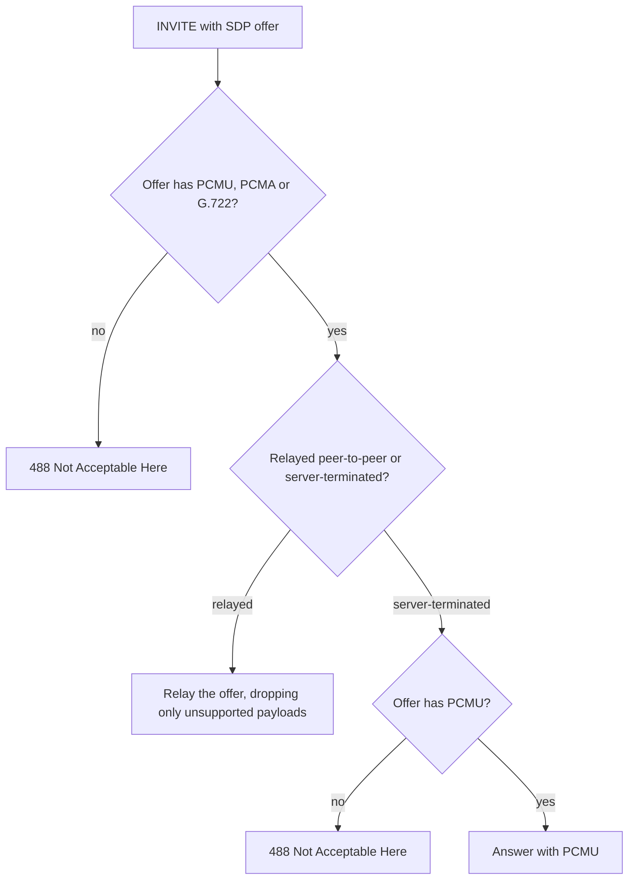
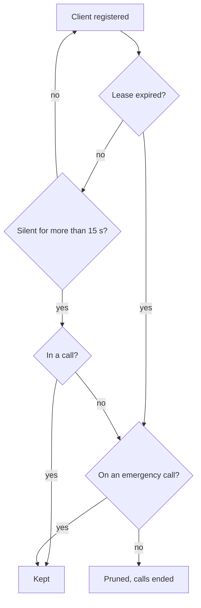

# Phone Compatibility & Registration

How to register SIP clients, softphones and hardware IP phones, against **pocket-dial**.
Every client uses the same core settings. This document gives per-client field mappings,
documents known interoperability quirks, and provides a "tested configuration" table.

For the end-to-end first call, see [SETUP_GUIDE.md](SETUP_GUIDE.md). For board choice, see
[HARDWARE_SELECTION.md](HARDWARE_SELECTION.md). For the registrar's admission modes, see
[LEARN_MODE.md](LEARN_MODE.md).

## 1. Universal settings (every client)

| Field | Value |
| :--- | :--- |
| SIP server / registrar / domain / proxy | `192.168.4.1` (SoftAP), or the device's LAN IP on wired builds; `pocketdial.local` where mDNS resolves |
| Port | `5060` |
| Transport | **UDP only** (the engine does not speak TCP, TLS or SIPS) |
| Username / Auth ID / extension | your choice, e.g. `1001` (see the reserved list below) |
| Password | **depends on the registrar mode; see §1.1.** On a factory-default board (Learn mode) any value or blank registers an unclaimed extension. |
| Audio codec | **G.711** µ-law (PCMU, `0`) / a-law (PCMA, `8`) always; **G.722** (`9`) between two phones that both offer it. DTMF telephone-event (any payload number, `101` by convention) passes through |
| Registration expiry | ≤ `3600` s (`MAX_EXPIRES` and `MIN_EXPIRES` in `RequestsHandler.cpp`; the registrar caps higher values to 3600 and floors anything under 30 s) |
| NAT / STUN / ICE / rport | **off** (ordinary call media is peer-to-peer on one L2 segment; NAT traversal only adds latency and failure modes) |

### 1.1 SIP passwords: digest auth ships, but the shipped default is Learn

The registrar has **two runtime modes** (the `Mode` enum in `Registrar.hpp`; the open mode is
retired, #500). The mode is selected at runtime and persisted in NVS as `reg_mode`. Change it
from the dashboard (`POST /api/registrar`) or at flash time via the `cfgseed` record. Full detail
is in [LEARN_MODE.md](LEARN_MODE.md).

| Mode | What a REGISTER has to prove | Password on the phone |
| :--- | :--- | :--- |
| **Learn** (*the shipped default*, `Registrar::chooseBootMode`) | Trust-on-first-use: an unknown MAC is adopted and accepted unverified; a device you later promote to *Secured* must present a digest, and its extension is MAC-locked against spoofing (`Registrar::admitLearn`). | Blank until you promote the device; then the password you set. |
| **Secure** | RFC 2617 digest auth for every provisioned extension (`Registrar::admitSecure`, `SipDigest.cpp`). | Required, must match. |

**Warning:** a fresh board trusts on first use. SIP digest authentication is fully implemented,
but it is **not on by default**. An out-of-the-box unit adopts, unverified, the first device on
the link to REGISTER an unclaimed extension. Moving to Secure mode is a deliberate operator
action. See [THREAT_MODEL.md](THREAT_MODEL.md).

The server never stores a plaintext SIP secret. It only ever stores `HA1 = MD5(ext:realm:secret)`
(`SipSecretStore.cpp`). Whoever sets a password is the only party who ever holds it.

### 1.2 Codecs: what actually gets negotiated

pocket-dial does **not** transcode. What it does depends on whether the call is relayed
peer-to-peer or terminated on the board:

* **Relayed peer-to-peer legs** (ordinary extension-to-extension calls, hold, transfer,
  ring/hunt groups, pickup, and park when no hold-music clip is loaded) admit
  **PCMU, PCMA and G.722**. Each phone's own offer/answer is relayed with its preference order
  and payload numbering intact. `SipMessage::filterAudioCodecs(/*allowWideband=*/true)` only
  *drops* payloads the PBX won't carry, and the relay sites call it (for example
  `CallForker::buildInviteFork` and `ParkOrbit`). Two G.722-capable phones therefore negotiate
  wideband between themselves.
* **Server-terminated legs** (`440` tone, `555` anchor bridge, `888` conference, the `997` page
  and voicemail) are PCMU-only. `buildMediaSdp()` answers `m=audio <port> RTP/AVP 0`, and adds
  the caller's telephone-event payload type when its offer had one. Each of those paths admits a
  caller only if the offer includes PCMU (`offersSupportedAudio(/*allowWideband=*/false,
  /*allowPcma=*/false)`). A PCMA-only offer gets a 488, because the board does not decode A-law
  (#304). The `777` echo answer is narrowed the same way, with
  `filterAudioCodecs(/*allowWideband=*/false, /*allowPcma=*/false)`.
* A phone offering **nothing** the PBX will carry (Opus/G.729-only) gets a clean
  **488 Not Acceptable Here** rather than an answer advertising payloads it never offered. The
  relay-level check at the top of `RequestsHandler::onInvite` admits G.722. Each server-terminated
  leg applies the narrower PCMU check above.

The same decision as a flow:

Keep G.711 (PCMU at minimum) enabled on every client. G.722 is a bonus that works
phone-to-phone; G.711 is what every server-terminated feature speaks. You do *not* need to
disable G.722. Leaving it on costs nothing and buys wideband on internal calls.

`SipMessage::enforceG711()` still exists in the tree but has **no production callers**; it is
deprecated.

### 1.3 Reserved extensions (never assign these to a phone)

| Code | What it is |
| :--- | :--- |
| `777` | Echo test (SDP loopback, see §4) |
| `999` | All-page broadcast |
| `440` | Server tone stream (server-sourced RTP) |
| `555` | Anchored-media bridge (`kAnchorCallExt`) |
| `888` | Meet-me conference (`ConferenceRoom::EXT`) |
| `997` | Multicast paging (§3, off by default) |
| `700`–`709` | Call-park orbits (`ParkOrbit.hpp`) |
| `980`–`989` | Paging zones |
| `*8`, `**<ext>` | Group pickup / directed pickup |

## 2. Softphones

The menu paths and labels in this section and in §3 were not checked against a specific app or
firmware version. Confirm them in the version you run.

### Linphone (desktop / mobile)

1. Settings → Account → add a SIP account manually.
2. SIP address: `sip:1001@192.168.4.1`.
3. SIP proxy / transport: `192.168.4.1:5060`, **UDP**.
4. Disable "outbound proxy" and any ICE/STUN/TURN under network settings.
5. Audio codecs: enable **PCMU** and **PCMA** (G.722 optional); disable Opus/speex/G.729.

### Zoiper

1. Add account → manual configuration → SIP.
2. Domain / host: `192.168.4.1`, username `1001`, transport **UDP**.
3. Under Codecs, keep **G.711 u-law / a-law** (G.722 optional); drop everything else.
4. Disable STUN/rport in network settings.

### MicroSIP (Windows)

1. Menu → Add Account.
2. SIP server: `192.168.4.1`, Username `1001`, Domain `192.168.4.1`, transport **UDP**.
3. Codecs: select **PCMU** and **PCMA** (G.722 optional).

### Groundwire / Acrobits

1. Add SIP account (generic SIP).
2. Server `192.168.4.1`, port `5060`, username `1001`, transport **UDP**.
3. In advanced/codec settings, keep **G.711**; turn ICE/STUN **off**.

## 3. Hardware IP phones

Configure hardware desk phones by hand through their web UI (server, port, codec and transport
as above). Then read [PROVISIONING.md](PROVISIONING.md).

pocket-dial does ship an auto-provisioning endpoint, `GET /config/<mac>.cfg` in Yealink key
format. It serves a MAC-keyed file only for a MAC already in the Learn-mode adopted-device
registry. The one exception is zero-touch assignment (#826): while a window is open, a phone
that fetches the file from its own ARP-verified MAC is given the next free extension
([PROVISIONING.md](PROVISIONING.md) §3.1). Two bootstrap forms are served without any registry
check: the Polycom master file `000000000000.cfg`, and the Cisco SPA bootstrap for a
model-keyed request. The endpoint therefore re-provisions phones you already brought up by hand.
It cannot bootstrap an unknown phone outside a zero-touch window.

### Yealink (e.g. T2x / T4x series)

- Account → Register: Server Host `192.168.4.1`, Port `5060`, Transport **UDP**,
  Register Name / User Name `1001`.
- Codec: keep **PCMU** and **PCMA** in the enabled list (G.722 optional); remove
  Opus/G.729.
- NAT: set NAT Traversal = Disabled, rport = Disabled, STUN = Disabled.

**Register beep.** On a *new* binding (not a lease refresh) the server sends the phone a
short intercom auto-answer INVITE so it plays its own tone, then tears the call back down
(`RegisterBeeper.cpp`). This is signalling only; the server sources no RTP for it. The
Call-Info / Alert-Info / P-Auto-Answer headers that make this work were written against
Yealink's auto-answer behaviour.

### Grandstream (e.g. GXP / GRP series)

- Account → General: SIP Server `192.168.4.1`, SIP Transport **UDP**, SIP User ID `1001`,
  Authenticate ID `1001`.
- Audio codecs: preferred vocoder list = **PCMU** then **PCMA** (G.722 optional).
- Disable STUN and "Use NAT IP".

### Cisco (SPA / MPP series)

- Ext 1 → Proxy and Registration: Proxy `192.168.4.1`, Transport **UDP**.
- Subscriber Information: User ID `1001`.
- Audio Configuration: preferred codec **G711u** / **G711a**; turn off ICE/STUN.

### Polycom / Poly

- Configure the SIP registrar address `192.168.4.1:5060`, transport **UDPOnly**, line
  address/auth user `1001`.
- Codec preferences: enable **G711_Mu** and **G711_A**.

### Multicast paging (`997`, #800)

With paging enabled (`PUT /api/multicast-paging`, `docs/API.md`), dialing `997` is answered
by the PBX itself (`a=sendrecv`, PCMU; it never sends RTP back, and a `recvonly` answer made a
Yealink hold the page, #909). The caller's audio is re-sent as G.711 µ-law RTP to the multicast
group, default **`239.0.1.75:50000`**, TTL 1 (it never leaves the LAN). Phones that listen on
that group play the page with no SIP call of their own, so a phone that is offline to SIP or
already on a call can still hear it.

One page runs at a time: a second `997` caller gets `486 Busy Here`. A page ends on the caller's
BYE, or after 5 s with no RTP from the caller. A re-INVITE or SDP UPDATE on the page is answered
`200` with SDP. A hold (`sendonly`/`inactive`) pauses the page. Nothing the held phone still
sends reaches the group, and that does not count as liveness, so a hold longer than 5 s ends the
page. A resume un-pauses it. Not yet proven on a phone.

Listening settings (no firmware work on the phone side):

* **Yealink (T32G):** Features → Multicast Listening: address `239.0.1.75:50000`, priority as wanted.
* **Snom (370):** multicast paging, "Multicast listening address" `239.0.1.75:50000`.

No board has sent a page yet. On the Ethernet builds the other media paths transmit through the
L2 bypass, but this one goes through an lwIP UDP socket. That path has not been checked with a
packet capture or a real phone (#800).

## 4. Behavior to expect after registration

- The registrar pings each registered client with a SIP `OPTIONS` keepalive **every 5 s**
  (`RequestsHandler::tick()`). It then checks each client in `RequestsHandler::sweepExpired()`:
  * A client silent for more than **15 s** is pruned, unless it is in a call (#533). A phone in a
    call is not pruned for missed pings.
  * A client whose registration lease has expired is pruned even while it is in a call. Its
    calls are ended.
  * Neither kind of prune happens while the client is on an emergency call (911/933), so a
    lapsed lease is enforced only after that call ends.
- The same tick ends a connected call whose phone has sent the board no RTP for **60 s** (#604),
  sending the phone a BYE, so a phone that lost power or left the LAN does not hold a slot until
  its lease runs out. It watches only calls the board carries media for: a trunk relay, the `555`
  anchor bridge and, since #1003, each `888` conference leg. A conference leg has one counter, so
  a participant whose phone stops sending is dropped while the others keep talking. The counter
  counts PCMU audio packets only: telephone-event and comfort-noise packets do not count, and a
  phone that does silence suppression and sends nothing for 60 s in a conference is dropped. The
  clock starts at the first 1 Hz tick that sees the count move and fires on the first tick at or
  past 60 s, so the reap lands 60 to 62 s after the last packet.
  * Not watched: a held call (the clock restarts on resume), `777` (an SDP loopback, the board
    sees no RTP), `440` and a call parked with hold music (the board answers `sendonly`, so the
    phone is meant to send nothing; a parked call has its own timeout), ordinary
    extension-to-extension calls (peer-to-peer), and the `997` page and voicemail legs (the page
    has its own 5 s silence sweep above; voicemail is outside this one). A 911/933 gets a 4 h
    bound instead (#741).
  * A `440` tone call is ended after **10 minutes** (600 s), however healthy (#1003): the phone is
    sent a BYE and the stream slot is freed. The board answers `sendonly`, so a phone that
    vanished without a BYE cannot be told from a listener by silence, and its stream would hold
    the one `440` slot (every other caller gets 486) until the registration lease ran out. The
    clock starts at the first 1 Hz tick after the call is answered. A 911/933 never uses `440`.

Leave each phone's "answer OPTIONS / keep-alive" behavior at its default (on). The pruning
decision for one registered client is:

- A registered extension appears in the `clients` array of
  [`GET /api/status`](API.md#get-apistatus); an active call appears in `sessions`.
- If the client pool is full, a new REGISTER receives `503 Service Unavailable`; the phone
  retries on its next refresh ([SCALING.md §4](SCALING.md)).
- **Session timers (RFC 4028).** The PBX never sends a refresh. On the `440` tone and a call
  pickup it answers a phone that only *supports* timers (`Supported: timer`, plus a
  `Session-Expires`) with no `Session-Expires` and no `Require`, so no timer runs on that
  call. A phone that *requires* them (`Require: timer`, for example pjsua `--use-timer=2`) gets
  its own `Session-Expires` and `Require: timer` back, because RFC 4028 §9 owes it both and
  pjsua hung up on a `440` answer without them (`BYE` with `Reason: SIP ;cause=421`). The PBX
  arms no expiry of its own for either leg (#739). The other answers the PBX writes itself
  (`777`, `888`, park, voicemail, the trunk handset leg) still carry no timer whatever the
  phone asked, although §9 owes a phone that requires one a timer there too; that has not been
  measured on those legs (open, #739).
- **Provisional responses from the callee are relayed as-is.** A `180 Ringing` that a callee
  sends with an SDP body is forwarded with that body intact. `onRinging` hands it straight to
  `endHandle`. The only bodiless `180`s are the ones the server generates itself: the `777` echo
  leg, and the broadcast and ring-group fan-outs in `CallForker`. They never had a body to begin
  with.

  The exception is a relayed call whose caller sent `Require: 100rel` while the `forward100rel`
  feature flag is on (off by default). The PBX then rewrites that 180 as a reliable provisional:
  no body, with `Require: 100rel` and an `RSeq` added.

  If a strict terminal hangs while ringing or loops on early media, disable early media on the
  *calling* phone. Do not expect the server to intervene.

### Where the audio actually goes

| Call type | RTP path |
| :--- | :--- |
| Ordinary extension → extension | **Peer-to-peer.** The board never touches the media; only SDP is relayed, and the `c=` line is never rewritten. |
| Hold / resume, blind & attended transfer, ring/hunt groups, pickup | **Peer-to-peer**, same property preserved; only the codec list is narrowed. |
| Call parked on an orbit | **Peer-to-peer only while no hold-music clip is loaded.** With a clip loaded the board answers the parked leg `sendonly` from its own port and transmits G.711 µ-law to it for the duration of the park (`ParkOrbit::onInvite`); with no clip it answers `a=inactive` and sources nothing. Retrieve returns the call to peer-to-peer either way. A handset that cannot accept a `sendonly` answer on a re-INVITE will show this as a park-specific fault. |
| `777` echo test | **Peer-to-peer, to itself.** The answer is an SDP loopback of the caller's own offer, so the phone streams to its own address. The board sources and receives *no* RTP. The loopback is built in the `777` branch of `RequestsHandler::onInvite`. |
| `440` tone | **Server-terminated.** The board opens an RTP socket and sends a synthesized µ-law tone (`RtpSender.cpp`). One concurrent stream. A call is ended with a BYE after 10 minutes (§4). |
| `555` anchor bridge | **Server-terminated.** The board sends *and* receives RTP and bridges it to an `AnchorClient`. `POCKETDIAL_MAX_ANCHOR_CALLS` = 4; effective limit is `min(provider, 4)`, and the default `LoopbackAnchorClient` declares 1. |
| `888` conference | **Server-terminated.** The board decodes, mixes and re-encodes every leg (`MixBus`, `ConferenceRoom`). Capped at `POCKETDIAL_CONF_LEGS` = 4, no PIN, one global room. A leg whose phone sends no RTP for 60 s is ended with a BYE (§4). |
| Outbound trunk call | **Server-terminated, two legs.** Your handset ↔ the board is ordinary **RTP** (a SIP phone speaks nothing else) through `MediaBridge`. The board ↔ carrier leg is the AnchorClient's chunked-HTTPS PCM16 stream, **not** SIP and **not** RTP, so the board never registers to an ITSP. Reaching a trunk at all requires a dial-plan rule with `action=trunk`; there is no "9" prefix and no fallback. See [FEATURE_ROADMAP.md §1.3](FEATURE_ROADMAP.md) and [`POST /api/dialplan`](API.md#post-apidialplan). |

## 5. Quick verification per client

1. Register the client; confirm it shows "registered".
2. Confirm the extension appears on the dashboard (`/api/status` → `clients`).
3. Dial **`777`**. You should hear your own voice. This does not prove the board's RTP:
   `777` is an SDP loopback, so all it proves is that the phone can reach its own RTP
   address and that a codec survived negotiation.
4. Dial **`440`**. You should hear a steady tone. *This* is the step that proves the board
   can source RTP to your phone.
5. With a second extension registered, dial it directly; confirm two-way audio (proves the
   peer-to-peer path).
6. Dial **`999`**. Confirm other registered phones are paged. Note that `999` is a
   fork-and-pick broadcast: the INVITE goes to every registered phone and the **first** to
   answer wins; the rest are CANCELed (`CallForker::buildCancel`). For a genuine N-way bridge,
   dial **`888`**.

If any step fails, see [TROUBLESHOOTING.md](TROUBLESHOOTING.md) (registration timeouts,
one-way/no audio, call drops).

## 6. Tested configuration

One handset has ever been tested against real hardware. Everything else in this table is a
known-good *baseline configuration*, not a test result. The rest of the project's test evidence
is host-only (gtest, plus pjsua/SIPp against the desktop binary on loopback). Fill in rows as you
validate your own fleet, and leave a cell blank rather than guessing.

| Client | Type | Firmware/Version | Server:Port | Transport | Extension | Codecs enabled | Register | 777 echo | 999 page | Direct call | Outbound trunk | Notes |
| :--- | :--- | :--- | :--- | :---: | :--- | :--- | :---: | :---: | :---: | :---: | :---: | :--- |
| **Yealink T29** | IP phone | not recorded | bench board | UDP | not recorded | PCMU (by construction; not recorded) | **PASS** | not tested | not tested | not tested | **PASS** (two-way audio) | The only handset ever tested. See below. |
| Linphone | Softphone | | `192.168.4.1:5060` | UDP | | PCMU, PCMA | | | | | | baseline config only |
| Zoiper | Softphone | | `192.168.4.1:5060` | UDP | | PCMU, PCMA | | | | | | baseline config only |
| MicroSIP | Softphone | | `192.168.4.1:5060` | UDP | | PCMU, PCMA | | | | | | baseline config only |
| Groundwire | Softphone | | `192.168.4.1:5060` | UDP | | PCMU, PCMA | | | | | | baseline config only |
| Yealink (other models) | IP phone | | `192.168.4.1:5060` | UDP | | PCMU, PCMA | | | | | | baseline config only |
| Grandstream | IP phone | | `192.168.4.1:5060` | UDP | | PCMU, PCMA | | | | | | baseline config only |
| Cisco | IP phone | | `192.168.4.1:5060` | UDP | | G711u, G711a | | | | | | baseline config only |
| Polycom/Poly | IP phone | | `192.168.4.1:5060` | UDP | | G711_Mu, G711_A | | | | | | UDPOnly transport; baseline config only |

### What the Yealink T29 result actually covers (2026-09-13)

A real Yealink T29 was registered to the bench board and **outbound PSTN was verified end to
end**: one call rang through to carrier voicemail (answered at 21.2 s) and one was answered
by a person with **two-way audio**. That is the first real-handset evidence in the project's
history.

What it **does** prove, beyond registration and the trunk itself: the handset leg of that call
ran through `RtpReceiver` / `RtpSender` / `MediaBridge` / `PlayoutBuffer` on a real board, so
the **handset-facing RTP path is verified on-target for the anchor-bridge shape**. That is the
only on-target media evidence the project has.

What it does **not** cover, and what nobody should read into it:

* The internal features (`777`, `999`, `888`, `440`, `555`, park, transfer, pickup, BLF) were
  not exercised on that handset. In particular, **`440` and `888` have never been run on
  hardware at all**; the `MixBus` conference mixer is entirely unproven on-target.
* **No automated test has ever exercised on-device RTP.** `RtpSender.cpp` and `RtpReceiver.cpp`
  compile to **host stubs** off-target, so every green media test in the suite exercises a stub,
  not the radio. The rest of the suite is host-only too: gtest, plus pjsua/SIPp driven against the
  **desktop** binary on loopback.
* OTA has never been executed anywhere.
* The Yealink provisioning key set in [PROVISIONING.md](PROVISIONING.md) has still never been
  confirmed against a physical handset.

Related: [SETUP_GUIDE.md](SETUP_GUIDE.md) · [LEARN_MODE.md](LEARN_MODE.md) ·
[PROVISIONING.md](PROVISIONING.md) · [HARDWARE_SELECTION.md](HARDWARE_SELECTION.md) ·
[TROUBLESHOOTING.md](TROUBLESHOOTING.md) · [API.md](API.md)
