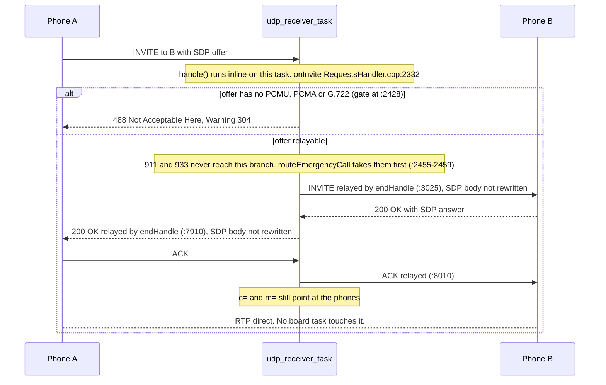
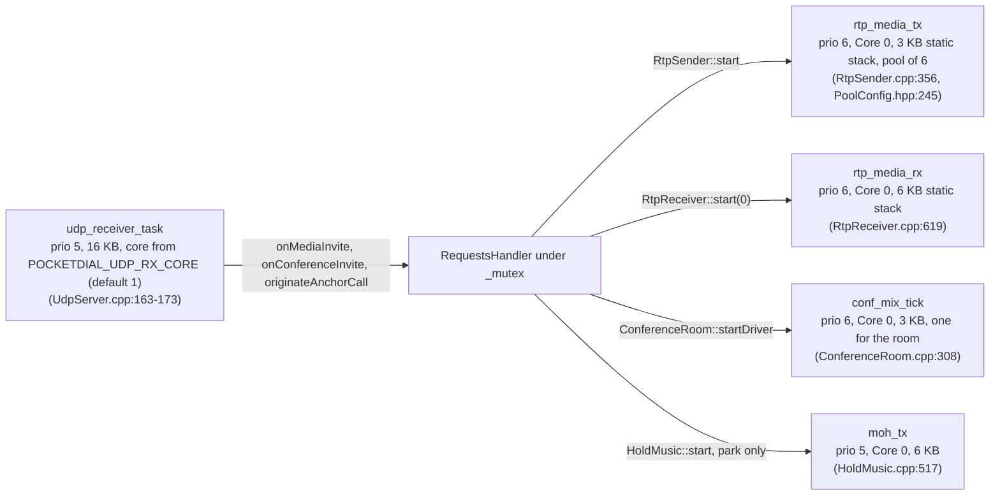

# Server-Side RTP on Pocket-Dial

This document describes the server-side RTP path as it ships, and the pre-implementation design it started from, for an engineer extending the media path or sizing a deployment. The cost analysis (§2) and the implementation sketch (§4) are pre-implementation estimates and a design sketch, and were never re-measured against the shipped code.

## 0. What ships today

The server is no longer media-free. Three virtual extensions (`440`, `555`, `888`)
terminate media on the board, an outbound trunk call crosses it on both sides, and **a call
parked on an orbit is transmitted to by the board as well** whenever a music-on-hold clip is
loaded. The ordinary extension-to-extension call is the one path that never touches it:

| Path | Does the board touch RTP? | Detail |
| :--- | :--- | :--- |
| **Ordinary extension → extension** | **No.** Pure peer-to-peer. | SDP is relayed with the body unchanged; the `c=` connection line is **never** rewritten. An offer with no PCMU, PCMA or G.722 is refused up front with `488` (`RequestsHandler.cpp:2428`). `SipMessage::filterAudioCodecs(/*allowWideband=*/true)` runs only on forks, transfers, park and pickup. |
| **Hold / resume, blind & attended transfer, ring/hunt groups, pickup** | **No.** | Same property kept deliberately, see `RequestsHandler.cpp:11798` ("Relay the SDP UNTOUCHED"), `CallForker.cpp:56`, `CallPickup.cpp:99`. |
| **Call parked on an orbit** | **Only with music on hold configured, and then transmit only.** | With a MoH clip loaded, park answers `sendonly` from the `HoldMusic` port and adds the parked leg to the shared clip stream (`ParkOrbit.cpp:68-86`), so the board transmits to the parked phone for the whole park. One-way only: the parked phone's own audio is not carried, and the retrieve is still an SDP swap back to peer-to-peer. With no clip loaded (the default), park answers `a=inactive` and the board sources nothing. |
| **`777` echo test** | **No.** | It is an SDP loopback: the answer is the caller's own offer handed back (narrowed to PCMU), so the phone streams to its own address. `RequestsHandler.cpp:2467-2620`. A code comment elsewhere in the tree that implies the server echoes the audio is wrong. |
| **`440` tone** | **Yes, transmit only.** | `RtpSender` synthesizes a G.711 µ-law tone 20 ms at a time and sends it to the caller. Fixed server port `5062`. **One concurrent stream**; a second dial gets `486 Busy Here`. |
| **`555` anchor bridge** | **Yes, both directions.** | `MediaBridge` pairs an `RtpReceiver`/`RtpSender` with an `AnchorClient`, decoding handset RTP into the anchor and draining the anchor's audio out of a `PlayoutBuffer`. `POCKETDIAL_MAX_ANCHOR_CALLS` defaults to **4** (`PoolConfig.hpp:292-293`). Active on default firmware via the `LoopbackAnchorClient` reference implementation, which declares `maxConcurrentCalls() == 1` (`LoopbackAnchorClient.hpp:40`), so the **effective** `555` cap on a stock board is 1. `RequestsHandler::anchorCallLimit()` takes the minimum of the provider's value and the config (`RequestsHandler.cpp:4600-4618`). |
| **`888` meet-me conference** | **Yes, decode, mix, re-encode.** | `ConferenceRoom` owns one `MixBus`; each leg is its own `RtpReceiver`/`RtpSender`/`MediaBridge` trio on a bus port. `POCKETDIAL_CONF_LEGS` defaults to **4** (`PoolConfig.hpp:203-204`), and `MixBus::MAX_PORTS` is set to that value (`MixBus.hpp:27`). No PIN, one global room. |
| **Outbound trunk call** | **Yes, on the handset leg.** | Two legs. Handset ↔ board is ordinary **RTP** through `MediaBridge` in ANCHOR mode, which owns the handset-facing `RtpReceiver`/`RtpSender` pair (`MediaBridge.hpp:17-18`). `MediaBridge::startBridge` is called at `RequestsHandler.cpp:5226` (`originateAnchorCall`) and at `RequestsHandler.cpp:526` (the anchor's `Answered` event). Board ↔ carrier is the AnchorClient's chunked-HTTPS PCM16 stream, **not** RTP and **not** SIP. Same `POCKETDIAL_MAX_ANCHOR_CALLS` budget as `555`, but `TelephonyAnchorClient` declares the full **4** (`TelephonyAnchorClient.hpp:69`), so a real trunk carries up to four concurrent outside calls, not one. |

**Codecs on server-terminated legs are PCMU only.** `buildMediaSdp()` (`RequestsHandler.cpp:2900`)
emits `m=audio <port> RTP/AVP 0`, and adds the caller's telephone-event payload type to that
line when the offer carried one. Each such leg admits a caller only if it offers PCMU
(`offersSupportedAudio(/*allowWideband=*/false, /*allowPcma=*/false)`, for example
`RequestsHandler.cpp:3136` for `440` and `:3408` for `888`), answering `488 Not Acceptable Here`
otherwise. The `777` echo answer is narrowed by
`filterAudioCodecs(/*allowWideband=*/false, /*allowPcma=*/false)` (`RequestsHandler.cpp:2617`).
Relayed peer-to-peer legs admit PCMU, PCMA **and G.722**.

### 0.1 Shipped modules

The proposed `src/Media/` directory was never created; everything landed under `src/SIP/`:

| File | Role |
| :--- | :--- |
| `src/SIP/RtpSender.{hpp,cpp}` | One-way RTP transmit: µ-law encode, tone synthesis, RTP header build, 20 ms pacing task. Optional `FrameProvider` lets a bridge supply frames instead of the tone. |
| `src/SIP/RtpReceiver.{hpp,cpp}` | RTP receive + depacketize into a sink. |
| `src/SIP/PlayoutBuffer.{hpp,cpp}` | The jitter-absorbing ring. Hard ceiling 1600 samples = **200 ms @ 8 kHz**; overrun drops oldest; underrun fills comfort noise. Tracks underruns/overruns. |
| `src/SIP/MixBus.{hpp,cpp}` | The summing junction. Per-port rings, minus-self mix held in int32 and clipped exactly once on the way out. `FRAME` = 160 samples. `MAX_PORTS` equals `POCKETDIAL_CONF_LEGS` (4 by default). |
| `src/SIP/MediaBridge.{hpp,cpp}` | Anchors one call's LAN RTP to either an `AnchorClient` (ANCHOR mode) or a `MixBus` port (BUS mode). |
| `src/SIP/ConferenceRoom.{hpp,cpp}` | Owns one `MixBus`, the per-leg transport, and the **single** 20 ms mix-tick driver. |

No automated test has ever exercised any of this on-target. The DSP and packetization helpers
are platform-independent and host-unit-tested. The FreeRTOS tasks that drive the device are
compiled only for `ESP_PLATFORM`. On Linux, `RtpSender` runs a real UDP socket with a
`std::thread` pacing loop (`RtpSender.cpp:579`). Off the device, `RtpReceiver` compiles to host
stubs that enforce the one-stream cap and do no I/O (`RtpReceiver.cpp:859`). The media tests
(`Rtp_test`, `RtpReceiver_test`, `MediaBridge_test`, `MixBus_test`, `PlayoutBuffer_test`,
`ConferenceRoom_test`) all run on that host build, not on the radio.

The project has exactly one piece of real-hardware media evidence: an outbound trunk call from
a Yealink T29 answered by a person **with two-way audio** (2026-09-13). That call ran the handset
leg through `RtpReceiver` / `RtpSender` / `MediaBridge` / `PlayoutBuffer` on a real board, so it
is genuine on-target proof of the **anchor-bridge shape** of this media stack. It proves nothing
about `440`, whose standalone tone path has **never been run on hardware**. The `MixBus` /
`ConferenceRoom` mixer (`888`) has run on `.244` (2026-09-27). That run panicked the board (#498:
`MixBus::tick`'s frames overflowed the 3,072-byte `conf_mix_tick` stack). The fix (#499) is
merged and has not been re-run on hardware.

### 0.2 What is still absent

Music-on-hold shipped for park only (issue #162), as `src/SIP/HoldMusic.{hpp,cpp}`, in a
narrower form than the plan in §3(c). These are still absent:

* **Call recording**, **RTP relay / NAT traversal**, **announcement injection**.
* **RTP statistics.** Nothing computes or exposes jitter, loss or MOS. `PlayoutBuffer`'s
  underrun/overrun counters exist but are not surfaced on the dashboard or in any API
  response; `/api/status` carries no media quality fields.
* **999 as a mixer.** `999` is still fork-and-pick: the INVITE goes to every registered
  phone and the **first** to answer wins; the rest are CANCELed (the cancel is built by
  `CallForker::buildCancel`, `CallForker.cpp:198`). The real N-way bridge is the separate
  `888` meet-me room.

## 1. Why P2P remains the default, and what server RTP unlocked

### 1.1 Why ordinary media is peer-to-peer

The device is a registrar + proxy/redirect-ish B2B-light signalling box. When A calls B:

1. A's INVITE (with SDP offering `m=audio <portA> RTP/AVP ...`) reaches the server. The
   server refuses it with `488` if the offer has no PCMU, PCMA or G.722 (`offersSupportedAudio`,
   `RequestsHandler.cpp:2428`), otherwise forwards the offer toward B with the SDP body unchanged.
2. B answers `200 OK` with its own SDP (`m=audio <portB> ...`). The server forwards it back
   to A with the body unchanged (`:7910`). `filterAudioCodecs()` narrows the list only where the
   board builds a new offer or answer: ring-group forks, transfers, park, pickup.
3. **The `c=` connection address and `m=` port in each SDP still point at the phones
   themselves.** Once both sides have each other's `IP:port`, they stream RTP directly. The
   server is out of the media path entirely.



This is why `PoolConfig.hpp` can say a `Session` "costs the server only signalling/bookkeeping
RAM — not bandwidth or DSP". A signalling session is ~200 B of state. **The ordinary call path
is fast and light precisely because the server never sees an audio packet**: hold and
transfer relay SDP untouched apart from the codec list, and that holds for every ordinary
call. **Park is the exception**: with a music-on-hold clip loaded the board answers the parked
leg `sendonly` from its own port and transmits to it (`ParkOrbit.cpp:68-86`). The exception is
bounded: one direction, one leg, only while parked, and only when an operator has uploaded a
clip.

### 1.2 What server-side RTP bought, and what it did not

| Capability | Status |
| :--- | :--- |
| **Real conferencing / mixing** | **Shipped as `888`** (`ConferenceRoom` + `MixBus`), capped at 4 legs by default, one global room, no PIN. This is a *separate* extension: `999` is unchanged and still fork-and-pick. |
| **Server-sourced audio** | **Shipped as `440`**, a synthesized tone, transmit-only. It is a test tone, not music-on-hold. |
| **Bridging to an off-LAN party** | Shipped as `555`: `MediaBridge` in ANCHOR mode; one concurrent call on the default loopback provider, up to four on a real trunk. The far side is an `AnchorClient` over HTTPS/WebSocket, **not** an RTP relay and **not** a SIP trunk. |
| **NAT traversal / media relay** | Not built. There is no B2BUA RTP relay and no rewriting of a peer-to-peer call's `c=` line. |
| **Call recording** | Not built. |
| **Music-on-Hold** | **Shipped, for park only** (`HoldMusic.*`, issue #162). A G.711 µ-law 8 kHz mono clip is read off the SD card into PSRAM once at load, then a 20 ms tick reads 160 bytes **once** and `sendto`s the identical payload to every parked listener, one global cursor, so a late joiner lands mid-track as if tuning into a broadcast. No per-leg decode, no `MixBus`, no `RtpSender` instance per listener. Playback is a memcpy: the clip is stored in the wire format. The SD card is deliberately kept out of the media path (sdspi `poll_busy()` busy-spins, and 100–250 ms card GC stalls would be audible dropout on every listener at once). Falls back to silent `a=inactive` hold whenever there is no clip. **A party its own phone puts on hold is unaffected**: that still hears whatever its firmware plays. |
| **Announcement injection** | Not built as a media feature. |
| **DTMF** | Feature codes arrive as SIP INFO. On relayed peer-to-peer legs `telephone-event` simply passes through untouched. On legs the board terminates it is also decoded: `RtpReceiver` implements RFC 4733 reception on the negotiated dynamic payload type: 4-byte event parse (`RtpReceiver.cpp:174-187`), event-code→keypad mapping for the 16 DTMF symbols (`:189-199`) with hook-flash and tone events ignored (`:390-399`), and press deduplication keyed on the event's RTP timestamp (`:401-410`), which is the whole difficulty of RFC 4733. |
| **RTP statistics (jitter / loss / MOS)** | Not built (§0.2). |

## 2. ESP32-S3 cost analysis (pre-implementation estimates)

Everything in §2 is an estimate made *before* any media code was written, and it has never
been re-measured against the shipped `RtpSender` / `MixBus` / `ConferenceRoom`. The
unit-economics arithmetic (§2.1) is arithmetic and still correct. The concurrency ceilings
(§2.4) are educated guesses that were **never validated**. The shipped caps
(`POCKETDIAL_CONF_LEGS` = 4 and `POCKETDIAL_MAX_ANCHOR_CALLS` = 4, with the default loopback
provider limiting `555` to 1) are the numbers that actually bound the firmware. They were chosen
conservatively for reasons documented in `PoolConfig.hpp`, not derived from the table below.
Read §2 as *why the caps are low*, not as *what the hardware can do*.

### 2.1 The unit economics of one G.711 stream (arithmetic, still valid)

G.711 at 8 kHz, 20 ms ptime:

```
8000 samples/s × 1 byte/sample × 0.020 s   = 160 bytes audio / packet
+ RTP header (12 B) + UDP (8 B) + IP (20 B) = 200 bytes on the wire / packet
packets per second                          = 1000 ms / 20 ms = 50 pps
payload bitrate                             = 160 B × 50 × 8   = 64 kbit/s
on-the-wire bitrate (one direction)         ≈ 200 B × 50 × 8   = 80 kbit/s
```

So **one RTP stream = 50 pps, ~64 kbit/s payload (~80 kbit/s on the wire), each direction.**
A two-party call is two streams each way. The shipped 20 ms cadence and 160-sample frame
match this exactly (`RtpSender::SAMPLES_PER_PKT` = 160, `MixBus::FRAME` = 160).

### 2.2 Estimated cost of a 2-party relay (never built)

A relay receives a packet on socket A and re-sends it to B (and vice versa). Per two-party
call:

* Packets: 50 pps in + 50 pps out, per direction = **~200 pps of relay work**
  (100 in, 100 out) for a single bidirectional call.
* CPU (estimate): pure relay (no decode) is `recvfrom` → look up session → rewrite dest →
  `sendto`. The LwIP/socket path is the real cost, not arithmetic. Budgeted conservatively at
  **~30–60 µs of CPU per relayed packet**; at 200 pps that is ~6–12 µs/ms ≈ **0.6–1.2% of one
  core per call**. CPU was not expected to be the binding constraint for pure relay.
* RAM (estimate): ~200–400 B/stream without a jitter buffer; add ~480 B–1 KB/stream with a
  60 ms buffer of 160 B frames.
* **Wi-Fi: this was identified as the constraint.** Relaying *doubles* airtime: every
  audio packet is received and re-transmitted over the same half-duplex radio. A two-party
  relay ≈ 320 kbit/s of media airtime (4 × 80 kbit/s) plus 802.11 per-frame overhead that
  dwarfs the payload at these tiny frame sizes. Small frames are airtime-expensive.

### 2.3 Estimated cost of an N-party mixer (shipped as `888`, capped at 4)

A mixer must **decode** each incoming stream to 16-bit PCM, **sum** them, **clip** to int16,
**re-encode** G.711, and send each participant the mix-minus-self.

```
per 20 ms frame, N participants:
  N × decode (G.711→PCM)        : 160 table lookups each  → cheap
  build mix bus                 : sum N×160 int16 samples
  per participant: subtract self, clip, encode (PCM→G.711)
  N × sendto                    : N syscalls / 20 ms
```

* CPU: arithmetic is trivial (µ-law decode is a LUT). The cost is **syscalls and the
  per-frame deadline**: all N decodes + the mix + N encodes + N `sendto` calls must complete
  **every 20 ms**.
* Hard limit: the **20 ms wall clock**. Overrun it and you drop a frame and everyone hears
  a click.
* **Estimated ceiling: ~6–8 mixed participants on a dedicated core.** **The shipped cap is 4**
  (`POCKETDIAL_CONF_LEGS`, `PoolConfig.hpp:203-204`). The comment above it
  (`PoolConfig.hpp:198-202`) gives the reason: a conference leg costs one `Session` slot, one
  RTP receive task, one RTP send task and two `MixBus` rings (**~6 KB**) per participant, on top
  of the room's own mix-tick task. Four legs is what comfortably fits the constrained node.
  Raise it only alongside `POCKETDIAL_MAX_SESSIONS` and a look at free heap.

One structural point is worth keeping visible: **the mix tick is the master clock and there is
exactly one of it.** Each leg's `RtpSender` runs its own 20 ms cadence, so hanging the mix tick
off a sender would give N competing clocks draining the bus N times per frame.
`ConferenceRoom::startDriver()` stands up one dedicated 20 ms driver for the whole room; a leg's
sender only ever calls `MixBus::outputFrame()`.

### 2.4 Estimated concurrency ceilings (not validated)

Per `docs/SCALING.md`, internal DRAM headroom after IDF + Wi-Fi was ~290–320 KB on a plain
ESP32. The existing pools cost about 58 KB by default (see [SCALING.md](SCALING.md) §2). Two
facts were expected to dominate:

1. **IRAM was ~100% used**, so RTP code would have to live in flash-cached paths subject to
   i-cache misses; acceptable at a 20 ms cadence, but the hot loop must not be
   latency-sensitive at the microsecond level. *(Not re-checked against the current build.)*
2. **A media session is ~1–2 KB, not the ~200 B of a signalling session.** The shipped figure
   is ~6 KB of `MixBus` rings per conference leg plus two task stacks.

| Build | Media core available | Relayed 2-party calls | Mixed participants |
| :--- | :--- | :---: | :---: |
| Headless / Ethernet (S3) | Core 0 mostly free | *est.* 4–6 | *est.* 6–8 |
| Display (JC3248W535) | Core 1 = LVGL only; share Core 0 | *est.* 2–3 | *est.* 3–4 |

**These numbers were never measured.** Relay was never built at all, so its column is purely
hypothetical. The mixer shipped with a flat cap of 4 legs on every build. They were bounded
first by Wi-Fi airtime, then by the 20 ms deadline, then by RAM; wired Ethernet builds relax
the airtime constraint substantially.

### 2.5 Latency budget

Server-terminated media adds delay on top of peer-to-peer:

```
P2P one-way:        capture(20) + network + playout         ≈ 40–80 ms typical
Server-terminated:  capture(20) + net→server + server queue
                    + playout buffer + net→peer + playout
                    ≈ 100–180 ms  (estimate)
```

The ITU-T G.114 comfort ceiling is ~150 ms one-way, so every ms of buffer matters. The
shipped `PlayoutBuffer` enforces a **hard 200 ms ceiling** (1600 samples @ 8 kHz) with a
target-depth drain holding steady state far lower. The `PlayoutBuffer` header notes that a 1 s
buffer "let mouth-to-ear delay balloon". This is another reason to **prefer peer-to-peer
whenever possible**, which the ordinary call path still does.

## 3. Architecture options and their outcomes

### (a) Pure relay / B2BUA: **not built**

The server would terminate both media legs, rewriting the SDP it sends each phone so `c=`/`m=`
point at the server. Rejected as the default, and never built: it doubles airtime
for *every* call including ones that did not need it, adds latency to every call, and has the
biggest blast radius if the media task stalls. **The shipped code never rewrites a
peer-to-peer call's `c=` line.**

### (b) Selective relay: **not built**

Default to P2P and insert the server only when needed (different subnets, unreachable private
`c=`, or a policy flag). Judged the right way to ship relay *if* relay were ever needed. It
was not: the device is primarily a same-LAN intercom and the NAT case has not come up.

### (c) MoH player: recommended first, not built as proposed

Transmit-only G.711 clip looped from flash/PSRAM to a held phone. This was the document's
headline recommendation. The `440` **tone** shipped first instead: the same transmit-only shape
(`RtpSender`) and the same "prove the RTP pipe" purpose, but synthesized rather than played from
a stored clip, and not wired to hold signalling. Music-on-hold later shipped for park only
(§0.2). A party its own phone puts on hold still hears whatever that firmware plays.

### (d) Conference mixer: **built, but as `888`, not as `999`**

The proposal was to replace fork-and-pick `999` with a true mixer. Instead a **new** virtual
extension `888` was added with its own `MixBus`/`ConferenceRoom`, leaving `999` unchanged as
the all-page broadcast. That is the better outcome: paging and conferencing are different
features and `999`'s fork-and-pick semantics are what an all-page wants.

### 3.5 Planned phases and what was built

| Phase | Planned | Built |
| :--- | :--- | :--- |
| 1 | MoH player and RTP stats scaffolding | `440` tone (`RtpSender`). Music-on-hold came later, for park only. No stats. |
| 2 | RTP stats on a receive path | `RtpReceiver` and `PlayoutBuffer` shipped. Stats are never surfaced anywhere. |
| 3 | Selective relay, wired-only | Not built. Instead, the `555` anchor bridge (`MediaBridge` and `AnchorClient` over HTTPS). |
| 4 | `999` conference mixer, gated behind measured headroom | `888` meet-me room (`MixBus` and `ConferenceRoom`), capped at 4 legs. `999` is unchanged. The measured-headroom gate did not happen: the cap was chosen from a RAM budget, and nothing has been measured on-target. |

The plan's *sequencing instinct* was right (transmit-only first, then receive, then bridging,
then mixing), and that is the order things were built in. Its *feature* predictions were not:
RTP statistics and relay still do not exist, the conference landed on a different extension,
and MoH, the thing the plan put *first*, arrived last of all, in a different shape (`HoldMusic`,
park-only, one shared cursor rather than the per-listener `MohPlayer` imagined here).

## 4. Implementation sketch (as originally proposed)

This is the original pre-implementation sketch. The file layout it proposes does **not** match
the shipped code; see §0.1 for the real module list. It is kept for the design reasoning (lock
discipline, static allocation, task pinning), most of which the implementation did follow.

### 4.1 Where it hooks in

Proposed:

```
src/SIP/RequestsHandler.cpp   ← session wiring: start/stop media
src/SIP/SipSdpMessage.*       ← SDP rewrite for server-terminated legs
src/Media/RtpEndpoint.*       ← NEW: UDP RTP socket + packetiser/depacketiser + stats
src/Media/RtpRelay.*          ← NEW: pairs two RtpEndpoints, or fans out
src/Media/MohPlayer.*         ← NEW: transmit-only G.711 clip looper
src/Media/JitterBuffer.*      ← NEW: fixed-depth reordering buffer
```

In the shipped code there is no `src/Media/` directory. `RtpSender`, `RtpReceiver`,
`PlayoutBuffer`, `MixBus`, `MediaBridge` and `ConferenceRoom` all live in `src/SIP/`.
`RtpEndpoint` was split into separate send and receive classes. `RtpRelay` was never written.
`MohPlayer` was never written under that name: the feature shipped as
`src/SIP/HoldMusic.{hpp,cpp}`, as a shared player rather than a per-listener one (see §1.2).
`JitterBuffer` became `PlayoutBuffer`.

### 4.2 SDP for server-terminated legs

The proposal was a `rewriteMediaTarget(serverIp, allocatedPort)` splice into the existing
`_messageStr`. The shipped code instead builds the server's **own** SDP body with
`RequestsHandler::buildMediaSdp(serverIp, rtpPort, sendrecv, dtmfPt, recvonly)`
(`RequestsHandler.cpp:2900`), rather than rewriting the caller's. The body is
`m=audio <port> RTP/AVP 0` plus `a=rtpmap:0 PCMU/8000`, with the caller's telephone-event
payload type appended when one was offered. Server RTP ports: `440` uses a fixed `5062`
(`RtpSender.cpp:36`, `SERVER_RTP_PORT`); conference legs get theirs from
`ConferenceRoom::rtpPortFor(callID)` (`ConferenceRoom.cpp:165`).

### 4.3 Packet path

```
440 tone (transmit only):
  [RtpSender task] every 20 ms:
     synthesize 160 µ-law samples (or pull from a FrameProvider)
     → wrap in RTP (seq++, ts+=160, SSRC) → sendto(caller_ip:port)

555 anchor bridge (both directions):
     RtpReceiver → MediaBridge::onHandsetRtp → decode → AnchorClient::writeAudio()
     AnchorClient rx → MediaBridge::feedRx → PlayoutBuffer → RtpSender's FrameProvider

888 conference (decode / mix / re-encode):
     per leg: RtpReceiver → MediaBridge (BUS mode) → MixBus::inputFrame(port)
     one 20 ms driver tick: MixBus::tick() sums every active port in int32
     per leg: RtpSender pulls MixBus::outputFrame(port) = the sum of every OTHER port,
              clipped exactly once on the way out
```

### 4.4 Buffering

Proposed: a fixed-depth ring of 3–4 frames (60–80 ms), compile-time constant, no dynamic
resize on the hot path. Shipped as `PlayoutBuffer`: a 1600-sample (200 ms) hard ceiling
with a target-depth drain, overrun dropping oldest and underrun filling low-amplitude comfort
noise, plus underrun/overrun counters (which nothing reads, §0.2).

### 4.5 Static allocation & threading

Proposed, and largely followed:

* **Bounded pools, not dynamic growth.** Shipped as `POCKETDIAL_CONF_LEGS` (4) and
  `POCKETDIAL_MAX_ANCHOR_CALLS` (4, with the default loopback provider limiting it to 1);
  `RtpSender` and `RtpReceiver` each enforce a one-stream cap internally, so a conference leg
  gets its own pair rather than sharing the `440` sender.
* **No hot-path heap.** Shipped: the tone is synthesized 160 samples at a time into a fixed
  member buffer; nothing is allocated per packet.
* **Dedicated FreeRTOS tasks, pinned.** Shipped: `RtpSender`, `RtpReceiver` and
  `ConferenceRoom`'s driver each create a pinned task with `xTaskCreateStaticPinnedToCore`, from
  static slots (`PsramTask.hpp`). On a display build Core 1 is LVGL-only and must not be touched.
* **Lock discipline: media packets must never take the SIP `_mutex`.** The media task reads
  the far-end `IP:port` from an immutable per-session snapshot captured at call setup, and
  `sendto` happens on the media task, never inside the registrar lock, the same spirit as the
  existing Outbox pattern.

The proposal said a media-pool exhaustion should "fall back to P2P gracefully". It does not. The
call is refused:

* a second `440` while a tone stream is live gets **486 Busy Here** (`RequestsHandler.cpp:3155`);
* a conference leg beyond the room's cap (a fifth, on the default build) gets **486 Busy Here**,
  "room full or media failed to start" (`RequestsHandler.cpp:3444`);
* a `555` dialled while every anchor bridge slot is in use gets **503 Service Unavailable**,
  deliberately *not* 486, because 486 would mean the called party is busy when in fact every
  bridge slot is (`RequestsHandler.cpp:5491-5497`). The comment at `RequestsHandler.cpp:5491`
  also intends a `Retry-After` header, but this refusal does not set one.

There is no P2P fallback for a server-terminated feature, because these features *are* the
server media; there is no far phone to fall back to. The refusal order for a server-terminated
extension, in the order each handler checks it, is:


The `555` lane is also the 911/933 route (`routeEmergencyCall`, `RequestsHandler.cpp:5050`).
It is reached before the dial plan, the secure-mode challenge and the `422` floor
(`:2443-2459`), and `originateAnchorCall` is called with `respondIfDisconnected=false`, so a
down anchor never produces the `404` above. When no route exists the answer is
`503 Emergency Call Not Routable` with a `Warning: 399` header and no `Retry-After`
(`:5177`). A full anchor is a `503 Service Unavailable` only after one non-emergency call has
been ended to make room.

The tasks behind those server-terminated legs, as created in code:



`440` transmits from fixed UDP port `5062` (`RtpSender.cpp:36`). Every `RtpReceiver` binds an
OS-chosen port (`start(0, ...)`, `MediaBridge.cpp:97`) and advertises it in the answer SDP.

### 4.6 Interaction with codec enforcement

The proposal assumed `enforceG711()` guaranteed `0 8 101` in every answer, so the packetiser
could be fixed-format with no negotiation logic. **`enforceG711()` is deprecated with no
production callers** (`SipMessage.hpp:172`). The live guarantee comes from a different place and
is narrower: the server builds its own PCMU-only SDP (`buildMediaSdp()`), and admits a caller
onto a server-terminated leg only if it offers PCMU, answering `488 Not Acceptable Here`
otherwise (`RequestsHandler.cpp:3136` for `440`, `:3408` for `888`). The practical effect the
media layer depends on is the same (**server-terminated legs are PCMU, 160 B payload, 20 ms**),
but relayed peer-to-peer legs are *not* so constrained: they may negotiate PCMA or G.722 between
the phones, and the media layer never sees them.

### 4.7 Media-path diagrams

```
ORDINARY CALL — peer-to-peer (server out of the media path; still the default):

   Phone A ───── SIP (INVITE/OK) ─────► [ pocket-dial ] ◄───── SIP ───── Phone B
        │                                registrar/proxy                      │
        │                         (narrows codec list; c= untouched)          │
        └──────────────── RTP G.711 (direct, 64 kbit/s ea way) ───────────────┘
                          server NEVER sees these packets


888 CONFERENCE — server terminates every leg:

   Phone A ──RTP──►┌─────────────────────────────────┐◄──RTP── Phone B
                   │           pocket-dial           │
   Phone C ──RTP──►│  RtpReceiver ─► MediaBridge ─►  │◄──RTP── Phone D
                   │         MixBus (int32 sum)      │
                   │  RtpSender  ◄─ minus-self mix ◄─│
                   └─────────────────────────────────┘
                   one 20 ms tick drives the whole room; 4 legs max
                   every packet crosses the radio TWICE (in + out)
```

## 5. Risks as assessed before implementation

These were written before the media code existed. They still read as the right risk list, but
**none has been validated on-target**, because on-device RTP has never been exercised by a test
(§0.1).

| Risk | Detail | Mitigation as shipped |
| :--- | :--- | :--- |
| **Wi-Fi half-duplex / airtime (assessed as the biggest)** | Server-terminated media doubles airtime on a shared half-duplex radio; tiny 200 B frames are airtime-inefficient. Expected to cap concurrency ahead of CPU. | Ordinary calls stay peer-to-peer; server media is confined to opt-in virtual extensions with hard caps (4 conference legs, 4 anchor calls by config and 1 on the default loopback provider, 1 tone stream). Prefer wired builds for conferencing. **Not measured.** |
| **Added latency** | Server-terminated media plus buffering eats the G.114 150 ms budget. | `PlayoutBuffer` hard ceiling 200 ms with a target-depth drain holding steady state lower. **Not measured.** |
| **CPU saturation → glitches** | The 20 ms deadline is hard; mixing is most exposed. | One dedicated pinned mix-tick task per room; legs capped at 4. **Watermark never measured on-target.** |
| **IRAM exhaustion** | IRAM was ~100% used, so the media hot loop runs from flash-cached code subject to i-cache misses. | The per-frame loop is small and branch-light; the 20 ms cadence tolerates cache misses. **Current IRAM headroom not re-checked.** |
| **RAM** | Media sessions are ~1–2 KB each (estimate); shipped conference legs are ~6 KB of rings plus two task stacks. | Small fixed caps. Note there is no graceful P2P fallback: the call is simply refused (§4.5). |
| **Security: RTP injection** | An attacker who learns a session's `IP:port`/SSRC can inject forged RTP. The SIP rate limiter does not cover RTP ports. | `440`'s port is **fixed at 5062**, which makes it the easiest target on the box. Validate inbound source against the negotiated peer, check SSRC continuity, and rate-cap per port; **verify against the current `RtpReceiver` before relying on any of this.** |
| **Conflicts with "fast and light"** | The original value proposition was a media-free server. | Preserved where it matters: ordinary calls, hold and transfer are still 100% peer-to-peer. Server media is otherwise confined to features the user must explicitly dial, plus park, which transmits only when an operator has loaded a hold-music clip. |

## 6. If you are extending this

1. **Measure something on-target first.** The single largest gap in this document is that
   every performance number in it is an estimate and every media test runs on the host build,
   not the device. A real 4-leg `888` conference on a real board, with a scope on the frame
   deadline, would be worth more than any further design work.
2. **Do not break the peer-to-peer property of the ordinary call path.** It is what makes 8
   concurrent calls fit. Hold and transfer keep it deliberately; park breaks it in one bounded
   direction when a hold-music clip is loaded, and anything new should stay at least that
   bounded.
3. **Music-on-hold is built** (issue #162), but not via the `RtpSender::FrameProvider` hook one
   might expect: `HoldMusic` owns its own socket and 20 ms task precisely so ten parked callers
   do not cost ten `RtpSender` instances with ten unread receive paths. It covers **park only**;
   a party its own phone puts on hold still hears whatever that handset plays.
4. **RTP statistics are nearly free.** `PlayoutBuffer` already counts underruns and overruns;
   nothing surfaces them. Adding them to `/api/status` would give the dashboard its first
   media-quality signal.

Related: [CONFERENCE_MIXER.md](CONFERENCE_MIXER.md) ·
[PHONE_COMPATIBILITY.md](PHONE_COMPATIBILITY.md) · [SCALING.md](SCALING.md) ·
[ARCHITECTURE.md](ARCHITECTURE.md)
