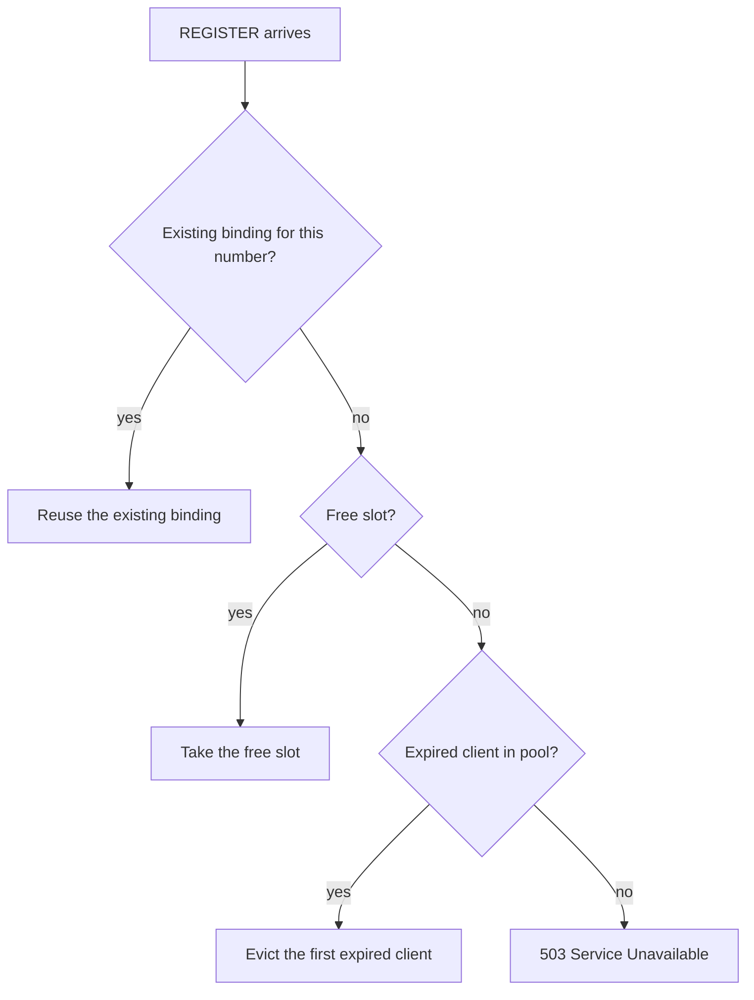

# Scaling & Capacity Planning

How to size the **pocket-dial** SIP registrar for a given board, what it costs in
RAM, and what breaks if you push it too far.

Capacity is set at **compile time** by three macros in
[`src/SIP/PoolConfig.hpp`](../src/SIP/PoolConfig.hpp). The defaults (`32`
clients, `8` sessions, `52` messages) target a generic Wi-Fi ESP32. The message
pool is derived, not a literal: `POCKETDIAL_MSG_POOL` defaults to
`MAX_CLIENTS + MAX_SUBSCRIPTIONS + 4` = 32 + 16 + 4 = **52**
(`PoolConfig.hpp:80-81`). That sizing keeps a `999` all-page fan-out and a BLF
`NOTIFY` burst in the same locked section from spilling to the heap. Overriding
it breaks that sizing; see §3. To raise the caps on an S3 build with PSRAM, pass
`-D` flags. The tier table in §3 has ready-to-paste build commands.

## 1. Why RAM is the binding constraint (not CPU or bandwidth)

pocket-dial's default call path is a **signalling-only** SIP server. It registers
endpoints, routes INVITE/BYE/CANCEL, and brokers call setup. It does **not** touch
the audio for an ordinary call:

* **RTP media is peer-to-peer.** Once two phones complete the SDP offer/answer,
  they stream G.711 audio *directly to each other's IP:port*. The ESP32 never
  sees an RTP packet, never transcodes, never mixes. A connected call costs the
  server **zero** ongoing CPU and **zero** media bandwidth. It keeps only the few
  hundred bytes of `Session` bookkeeping that record who is talking to whom. (The
  capacity model below is about this path. `AnchorClient`/`MediaBridge`/`MixBus`
  are an opt-in exception that puts the board in the media path when a fork wires
  them in; see [FEATURE_ROADMAP.md](FEATURE_ROADMAP.md) Non-Goals; they carry their own,
  separate CPU/RAM budget, not accounted for here.)
* **Signalling is bursty and tiny.** A REGISTER or INVITE is a sub-1 KB UDP
  datagram handled in microseconds. Even with aggressive OPTIONS keepalives the
  packet rate per client is a handful per *minute*.

So the question "how many phones / calls can this board host?" reduces almost
entirely to **"how much SRAM can I afford to reserve for pre-allocated pools?"**
That is exactly what the `POCKETDIAL_MAX_*` knobs control.

### Pre-allocation model

All three pools are filled **once, at construction** (Issue #53), and objects are
*recycled* thereafter via `reset()`; the steady-state hot path performs **no heap
allocation**. This is deliberate: the ESP32 heap has no MMU and no compaction, so
a long-running server that mallocs/frees per packet will eventually fragment and
fail an allocation at the worst possible moment. Pre-allocation trades a fixed,
known, up-front RAM cost for **deterministic, fragmentation-free** runtime. The
corollary is that **the pool sizes are the device's hard concurrency limits**, and
they are paid for whether the box ever handles one call or its ceiling.

## 2. Per-object RAM cost (the inputs to the budget)

Approximate steady-state footprint per pooled object on a 32-bit Xtensa target
(`sizeof` of the struct + any owned heap buffer + the `shared_ptr` control block).
These are deliberately rounded **up** for allocator overhead, so a real device will
sit a little under these figures.

| Pool object | Dominant members | Owned heap | Budget per slot |
| :--- | :--- | :--- | ---: |
| **`SipClient`** | `std::string` extension (SSO, no heap for short numbers), `sockaddr_in` (16 B), `int`, 3× `steady_clock::time_point` (8 B each) | none (extension fits in SSO) | **~100 B** |
| **`Session`** | `std::string` Call-ID (~32–40 B on heap), 2× `shared_ptr<SipClient>`, `State` enum, `time_point`, broadcast `vector` (empty for normal 1:1 calls) | ~40 B Call-ID | **~200 B** |
| **`SipSdpMessage`** | base `SipMessage`: 12× `string_view` (16 B each ≈ 192 B), SDP adds 6 more + int; plus the owned **`std::string _messageStr`** holding the entire raw SIP+SDP packet | ~0.6–0.9 KB packet buffer | **~1 KB** |
| **`SipTransaction`** | `char msg[POCKETDIAL_TX_MSG_BYTES]` retransmit buffer (1500 B), Call-ID/branch/CSeq-method char arrays (~212 B), `sockaddr_in`, 3× `time_point` | none (the buffer is inline, by design) | **~1.75 KB** |

Reasoning: clients are cheap because an extension like `"1001"` lives in the
string's small-string-optimization buffer (no allocation). Sessions add a heap
Call-ID and a couple of `shared_ptr`s. The message objects dominate the budget:
each one owns a full reusable packet buffer (the SDP body alone is several hundred
bytes), which is precisely why we recycle them instead of reallocating per packet.

### Default static budget (32 / 8 / 52 / 40+16)

```
clients     :  32 × ~100 B  ≈   3.2 KB
sessions    :   8 × ~200 B  ≈   1.6 KB
messages    :  52 × ~1   KB ≈  53.2 KB
transactions:  56 × ~1.75KB ≈  97.6 KB   <-- dominant term
                              ----------
TOTAL                       ≈ ~156 KB static SRAM
```

The transaction pools are the dominant term, ahead of the message pool.
`sizeof(TransactionLayer)` is **99,912 B** at the defaults, measured, not
estimated; `TxLifecycle.TheLayerStaticFootprintIsVisibleHere` in
`tests/TransactionLayerRfc17_test.cpp` asserts a ceiling on it so the number
cannot drift silently. It breaks down as 40 client slots
(`POCKETDIAL_MAX_TRANSACTIONS`, sized `MAX_SESSIONS*2 + MAX_SUBSCRIPTIONS + 8` so
a full BLF NOTIFY fan-out cannot evict INVITE retransmit coverage) plus 16 server
slots (`POCKETDIAL_MAX_SERVER_TRANSACTIONS`), each carrying an inline 1500-byte
copy of the message it may have to put back on the wire.

That inline buffer is the whole cost and it is deliberate: a transaction must be
able to retransmit after the pooled `SipMessage` it came from has been recycled
into a different call, so it cannot hold a reference. It has to own the bytes.

The budget above does not include the kept header-line buffers. Between uses,
each pooled message keeps up to `POCKETDIAL_KEPT_LINE_BYTES` (8192 by default)
of header-line buffer, and the two string arrays behind those lines add about
4.5 KB more. One slot can therefore hold about 12.5 KB at most. Pool-wide that is
`POCKETDIAL_MSG_POOL` × 12.5 KB, about 650 KB at the 52-slot default if every
slot were full at once (`src/SIP/PoolConfig.hpp:84-97`). These buffers are heap
allocations under 16 KB, so on the S3 they go to internal DRAM first. The 8 KB
limit is four 2 KB datagrams' worth, so legitimate traffic is never trimmed. The
constrained build sets the limit to 4 KB (`main/CMakeLists.txt`).

**On a no-PSRAM board this is internal DRAM and it matters.** The default S3R8
profile has `CONFIG_SPIRAM_USE_MALLOC=y`, and `RequestsHandler` is far larger
than the 16 KB always-internal threshold, so the whole engine, including the
transaction pools, lands in PSRAM. `sdkconfig.defaults.esp32_constrained` sets
`CONFIG_SPIRAM=n`, and on that tier ~156 KB against ~290–320 KB of usable
internal DRAM is no longer a comfortable margin. Note that the `POCKETDIAL_*`
knobs are `-D` compiler flags, **not** Kconfig options, so switching to the
constrained sdkconfig does **not** scale them down on its own; the build has to
pass them. The `SIP_CONSTRAINED` build switch (`main/CMakeLists.txt`) passes its
own, smaller set of caps; the flags below are the manual route. For that tier,
start with:

```
-DPOCKETDIAL_MAX_TRANSACTIONS=16 \
-DPOCKETDIAL_MAX_SERVER_TRANSACTIONS=6 \
-DPOCKETDIAL_TX_MSG_BYTES=900
```

which brings the layer to roughly 25 KB. The trade is real and worth stating
plainly: fewer slots means pool exhaustion sheds retransmit tracking sooner (the
message still goes out once, the pre-transaction-layer behaviour), and a smaller
buffer means any message over the limit is stored truncated and never
retransmitted at all. Both degrade loudly rather than silently. Exhaustion logs
`[tx] client pool exhausted` / `[tx] server pool exhausted`, and an oversized
message logs `[tx] message too large to retransmit` naming the method and
Call-ID. 900 bytes comfortably holds a BYE, CANCEL, NOTIFY or a bodiless
response; it will truncate an INVITE carrying a large SDP offer, so check those
logs on a constrained build before trusting the number.

## 3. Hardware tiers

Pick the row that matches your board and paste its build command. All three
build the same firmware; only the pool caps differ.

| Tier | Board | `MAX_CLIENTS` | `MAX_SESSIONS` | Msg pool | Static pool RAM | Realistic concurrent calls |
| :--- | :--- | ---: | ---: | ---: | ---: | :--- |
| **Pocket** | Generic ESP32 (Wi-Fi SoftAP) | **32** (default) | **8** (default) | 52 (derived) | **~156 KB** | Up to 5 phone-to-phone calls, ~10 phones (SoftAP-limited) |
| **Office** | ESP32-S3 + 8 MB PSRAM (Guition JC3248W535) | **64** | **24** | 84 (derived) | **~280 KB** | ~24 calls, 50+ phones |
| **Rack** | ESP32-S3 + W5500 PoE (wired Ethernet) | **128** | **48** | 148 (derived) | **~480 KB** | ~48 calls, 100+ phones |

The concurrent-calls column is a practical expectation, not just `MAX_SESSIONS`.
It folds in the network-layer ceilings discussed in §5 (SoftAP association cap,
socket and FD limits). On a wired Rack node the session pool, not the network,
is the limit. On a Pocket SoftAP node the **10-station Wi-Fi association cap**
(`max_connection`, see §5) bites long before the 32-client pool does.

The static pool RAM column is the §2 total for each tier: clients, sessions,
messages and transaction pools. It excludes the kept header-line buffers, which
can add up to about 12.5 KB per message slot on top (§2). These figures are
arithmetic on the macros in `src/SIP/PoolConfig.hpp`, so re-derive them when those
macros change.

### Build commands

#### Pocket (generic ESP32, defaults, nothing to pass)

```sh
# Host build (desktop Linux/Windows) — used for tests/CI
cmake -B build -S . -DCMAKE_BUILD_TYPE=Release
cmake --build build

# ESP-IDF firmware
idf.py build
```

#### Office (ESP32-S3 / 8 MB PSRAM, Guition display board)

```sh
# Host build
cmake -B build -S . -DCMAKE_BUILD_TYPE=Release \
  -DCMAKE_CXX_FLAGS="-DPOCKETDIAL_MAX_CLIENTS=64 -DPOCKETDIAL_MAX_SESSIONS=24"

# ESP-IDF firmware
idf.py build -DCMAKE_CXX_FLAGS="-DPOCKETDIAL_MAX_CLIENTS=64 -DPOCKETDIAL_MAX_SESSIONS=24"
```

**Warning:** do not pass `-DPOCKETDIAL_MSG_POOL` on this tier. The default
derivation gives 64 + 16 + 4 = **84** for `MAX_CLIENTS=64`. A smaller value
shrinks the pool below the all-page and `NOTIFY` fan-out it is sized for
(`src/SIP/PoolConfig.hpp:80-81`), so SIP packets are refused under load (§4).
Leave it unset and it tracks `MAX_CLIENTS` automatically.

#### Rack (ESP32-S3 + W5500/PoE wired Ethernet)

```sh
# Host build
cmake -B build -S . -DCMAKE_BUILD_TYPE=Release \
  -DCMAKE_CXX_FLAGS="-DPOCKETDIAL_MAX_CLIENTS=128 -DPOCKETDIAL_MAX_SESSIONS=48"

# ESP-IDF firmware
idf.py build -DCMAKE_CXX_FLAGS="-DPOCKETDIAL_MAX_CLIENTS=128 -DPOCKETDIAL_MAX_SESSIONS=48"
```

As with Office, leave `POCKETDIAL_MSG_POOL` unset. The derivation gives
128 + 16 + 4 = **148**.

**PSRAM (Office and Rack).** The message pool stays in internal SRAM, which avoids
PSRAM access latency on the signalling path. Each slot is a separate allocation
under 16 KB, which the allocator places in internal DRAM first. The transaction
pools are the larger part of these totals, about 180 KB on Office and about 310 KB
on Rack, against 512 KB of internal SRAM on the ESP32-S3. On the default S3R8
profile, §2 places them in PSRAM with `RequestsHandler`. The LVGL frame buffers on
the Guition board (≈307 KB each, see [HARDWARE.md](HARDWARE.md) §2) also use PSRAM.
If you push the message pool into the hundreds, you can move that pool to PSRAM as
well.

## 4. Graceful degradation when a pool is exhausted

Running out of a pool is a **defined, recoverable** condition, never a crash or
an out-of-memory abort. Each pool degrades in its own well-behaved way:

* **Client pool full (REGISTER).** `allocateClient()` first tries to reuse an
  existing binding, then a free slot, then **evicts an already-expired client**
  (the first one it finds in pool order, not necessarily the oldest). Only if
  every slot holds a live registration does it fail, and then the registrar
  replies **`503 Service Unavailable`**. The phone's SIP stack retries on its
  normal REGISTER refresh timer, so a client that arrives after a slot frees up
  simply registers on its next attempt.
* **Session pool full (INVITE / 999 broadcast).** `allocateSession()` returns
  `nullptr` when no slot is free, and every INVITE path answers
  **`503 Service Unavailable`** (see `onInvite()` and the broadcast handler in
  `RequestsHandler.cpp`). The caller hears fast-busy / "service unavailable"
  rather than the call hanging. Existing calls are untouched.
* **Message pool drained: refused, no fallback (#409).** `getMessageFromPool()`
  returns `nullptr` as soon as all `POCKETDIAL_MSG_POOL` slots are in use, logs
  `"[WARNING] SIP Message pool exhausted (N total)! Refusing (no heap fallback, #409)."`
  (rate-limited to 1-in-100), and counts it in `/api/status` `msgPoolRefusals`.
  The call sites in `RequestsHandler.cpp` that check it drop the packet and rely on
  the peer's RFC 3261 §17 retransmit. There is no heap fallback because an
  allocation at that point would take internal DRAM on the SIP task exactly when
  it is scarcest. Shedding load is the intended behaviour at that depth, but it
  does refuse work. It matters most during a 999 all-page, which transiently needs
  one message per paged target. The sizing rationale is in
  `src/SIP/PoolConfig.hpp:69-79`.

The REGISTER path through `allocateClient()`, in order:



All three counters surface on the dashboard (`getClientCount()`,
`getSessionCount()`, processed/dropped packet counters), so operators can watch
headroom and bump the tier before exhaustion becomes routine.

None of the measurements in this section can be checked from this tree. Their
run records were kept in `tests/load/STRESS_FINDINGS.md`, which commit `327f180`
stopped tracking. Treat them as reported results, not reproduced ones.
[BENCHMARKS.md](BENCHMARKS.md) describes the same gap.

**Measured (Issue #79):** driving registrations from 40 distinct source IPs
(bypassing the Issue #38 per-IP limiter) against a default-tier host build
confirmed the client-pool ceiling lands exactly at 32, with a clean `503` on the
overflow and no crash. The session-pool ceiling (8) is real server-side
(confirmed via server logs) and the ordinary call-setup path 503s cleanly at it,
but the `777` echo/diagnostic extension does **not** currently surface that 503
to the caller; see Issue #115. This was a single-host, host-build measurement
(loopback-range source IPs, not real distinct hosts), not a real multi-host run
against firmware.

**Measured on firmware, multi-host (Issue #79, 2026-09-06).** The host-build run
above was repeated against a real board, a LilyGO T-ETH-Elite S3 (W5500,
`SIP_TRANSPORT=eth`, default 32/8 tier). It was driven concurrently from **two
genuinely distinct physical hosts** on the same LAN, so the Issue #38 per-IP
token bucket is bypassed by having separate buckets rather than by loopback
aliases:

| source host | attempts | `200` | `503` | p50 latency |
|---|--:|--:|--:|--:|
| `192.168.12.110` | 25 | **25** | 0 | 7.3 ms |
| `192.168.12.161` | 25 | **7** | 18 | 11.8 ms |
| **total** | 50 | **32** | 18 | — |

The client-pool ceiling lands at **exactly 32** across the two hosts, matching
`POCKETDIAL_MAX_CLIENTS`, confirming the pool is global, not per-source. Every
rejection was a clean `503 Service Unavailable`; `packetsDropped` stayed 0, and
the serial console showed no watchdog, panic, abort or reboot. The board kept
answering REGISTERs afterwards. A separate single-host run (45 attempts, paced
under the per-IP limit) reproduced the same 32/13 split with p50 4.6 ms.

Two caveats apply. First, the **session** ceiling (8) was *not* cleanly
demonstrated on firmware: 14 concurrent `777` echo calls returned 11 × `200` and
3 × *no response at all* rather than `503`, the Issue #115 behaviour, confirmed
on hardware. Second, sustained registration load makes the register-beep INVITE
flood the transaction client pool
(`[tx] client pool exhausted — INVITE sent without retransmit tracking`), which
is Issue #148. A starved pool also drops unrelated signalling, so the latency
figures above should be read as "healthy tier, known beep bug", not as a clean
bill of health.

## 5. Why the defaults are 32 / 8, and what breaks if you 10× them

**Why 32 clients / 8 sessions?** The default target is a generic ESP32 running a
Wi-Fi **SoftAP** (a small office, a classroom, a pop-up intercom). In that
deployment:

* The firmware sets the SoftAP's association cap to **10 stations** (`max_connection`,
  set in `main/esp_main.cpp` at lines 38 and 121, and in `main/esp_main_display.cpp`
  at line 370). The Wi-Fi driver's own limit is not verified in this tree. 32
  client slots is more than three times that cap, which leaves room for
  stale-binding churn without ever being the limit.
* 8 sessions means up to 8 simultaneous calls. A phone-to-phone call needs two
  registered phones, so a 10-station SoftAP allows at most five phone-to-phone
  calls at once.
  The session pool itself is an `8 × ~200 B` rounding error in the budget.
* The whole thing is about **~156 KB** (see §2, which includes the transaction
  pools). That is about half of the ~290–320 KB of usable internal DRAM on a plain
  ESP32, so the rest has to cover the Wi-Fi buffers, the HTTP dashboard, the
  captive-portal DNS and LVGL.

In short: 32 clients and 8 sessions sit above the SoftAP's station cap on the
cheapest supported board, so the pool is never the thing that fails first. The
22 client slots that the cap cannot fill cost about 2 KB.

What breaks if you naively 10× to 320 / 80 / 320:

* **Static SRAM exhaustion.** The pools would total about 845 KB: about 370 KB of
  clients, sessions and messages, plus about 475 KB of transaction slots (272 slots
  at 1.75 KB). That exceeds the *entire usable internal DRAM* of a plain ESP32
  (~290–320 KB) and the 512 KB of internal SRAM on the S3. The firmware would fail
  to boot or starve the Wi-Fi stack. The transaction layer is the larger share, so
  move the pools to PSRAM before going this large.
* **Heap fragmentation at boot.** 320 message objects each own a packet buffer;
  allocating them all at startup on a fragmented heap can fail even when *total*
  free bytes look sufficient, because there's no single contiguous run. (The
  `.reserve()` calls in the constructor mitigate the *vector* spine, but not the
  per-object buffers.)
* **FreeRTOS task-stack pressure.** Bigger pools mean larger snapshot vectors and
  longer locked sweeps in `tick()`/`sweepExpired()`; the dashboard/SIP task stacks
  must grow to match, competing for the same SRAM you just spent on pools.
* **File-descriptor / socket limits.** lwIP defaults to a small number of sockets
  (`CONFIG_LWIP_MAX_SOCKETS`, often 10–16). Hundreds of *registered* clients is
  fine (they share one UDP listener), but anything that opens per-peer sockets, or
  the HTTP dashboard under load, hits the FD cap long before 320 clients matters.
* **SoftAP association cap (Pocket tier).** Even with 320 client slots, the SoftAP
  is configured for 10 stations. The extra slots are pure wasted RAM unless you're
  on **wired Ethernet** (the Rack tier), which is exactly why high client counts
  belong on the W5500/PoE board, not a SoftAP node.

Rule of thumb: scale clients/sessions to match your *network tier* (SoftAP →
stay near defaults; wired Ethernet → scale up), keep the message pool ≈ the client
count, and watch the dashboard headroom counters. Doubling is routine; 10× needs a
wired board, internal-SRAM math, and probably the message pool in PSRAM.
