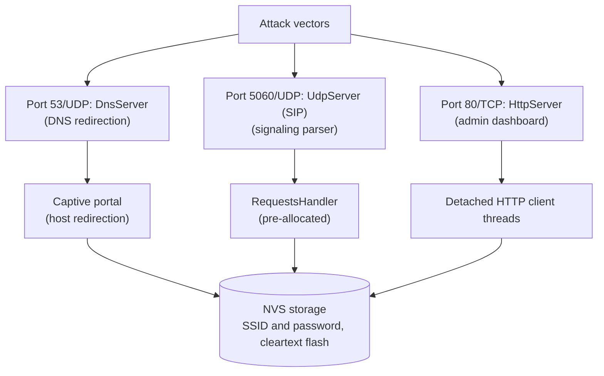
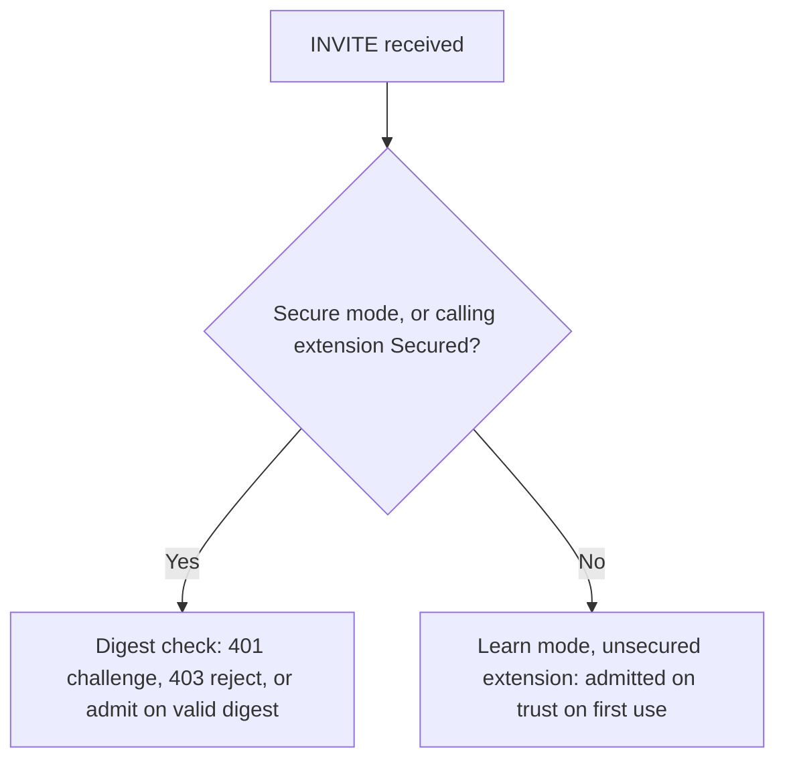

# Firmware Security Audit and Threat Model

Security audit and threat model for the pocket-dial ESP32 PBX firmware (`GlomarGadaffi/pocket-dial`).

## Scope and status

- Date: June 1, 2026
- Auditor: AgencyAuditSpecialist
- Audited commits: `8be61da` and `f919178`
- Status: complete for the post-refactor review and threat evaluation. No fresh security audit has been run against the current tree.

## Read first: corrections for the current firmware

This is a point-in-time record. It does not describe the firmware as it ships today. The four corrections below describe the current code and take precedence over the detailed sections where the two differ.

1. **The dashboard is always reachable.** The HTTP listener is always bound on a provisioned device. The dark-by-default transport in SEC-04's remediation table does not exist: there is no `*4887` star code, no DTMF-opened admission window, and no grace period. A search of `src/` for `grantAdminHttpGraceWindow` and `4887` returns no hits (`grep -rn "grantAdminHttpGraceWindow\|4887" src`). Do not follow an operator procedure that reopens the web UI with a star code. It does not apply to this firmware.
2. **The admin credential is a username and password, not a PIN.** `AdminAuth` ships with the default `admin`/`admin`, and first use forces a change. `HttpServer::requireAdmin` refuses every admin-gated request except `POST /api/admin/set-credential` until `AdminAuth::needsInitialSetup()` returns false. The login route is `POST /api/admin/login`. A separate numeric DTMF PIN (`*PIN#code`) opens the phone-keypad admin menu. It is unrelated to the web session and grants no HTTP access.
3. **INVITE is digest-challenged for Secured extensions.** In Secure mode, and in Learn mode for an extension an admin has promoted to Secured (#505, merged as PR #512), an INVITE is checked with the same digest machinery as REGISTER. The check verifies against the `INVITE` method taken from the request line. It lives in `RequestsHandler::onInvite`. Unsecured Learned extensions keep trust on first use. See [INVITE admission](#invite-admission).
4. **The default registrar mode is `learn`** (#441). The `open` mode is retired (#502). A fresh board adopts an unknown MAC on its first REGISTER for an unclaimed extension, and it admits an INVITE from a Learned (unsecured) extension without a challenge. Digest is enforced for devices promoted to Secured (REGISTER, and INVITE since #505) and for every extension in `secure` mode. Review bypasses are fixed: #507 by #487 (an ARP miss no longer admits a Secured extension without digest), #560 by #562 (the relayed ACK and re-INVITE/UPDATE no longer carry the INVITE's credential), #525 by #570 (a reused nonce or `nc` is re-challenged), and #549 by #555 (a credentialed INVITE cannot be replayed to another destination).

Code references in this report name a file and a symbol, not a line number, because line numbers drift. To find a symbol in the current tree, run `grep -n`, for example `grep -n "HttpServer::requireAdmin" src/Helpers/HttpServer.cpp`.

Some call handling has moved out of `RequestsHandler` into `CallForker`, `CallPickup`, `ParkOrbit`, `BlfSubscriptions`, `DtmfFeatureCodes` and `CdrRing`. The gate and INVITE symbols cited in this report remain in `RequestsHandler`.

## Executive summary

This report evaluates the network-facing and local attack surfaces of the firmware. The primary objectives are to analyze entry points, assess the robustness of parsers, review access control mechanisms, and classify findings using CVE-class severity ratings and CVSS v3.1 scoring vectors.

The firmware has mitigated two high-risk vulnerabilities: Host/Origin validation (DNS rebinding) and SIP signaling input validation. SEC-04 (missing authentication) is resolved on both the HTTP and SIP planes.

The most important open issue is cleartext WiFi credentials in flash NVS (SEC-03, Medium severity). Its durable fix is flash encryption with Secure Boot v2. The dominant residual risk is now the open SoftAP link, not an authentication gap. WPA2 for the SoftAP is available but defaults to off for fleet compatibility, so it protects only deployments that enable it. See [THREAT_MODEL.md](THREAT_MODEL.md) §6 and TB-1.

## System attack surface

The pocket-dial PBX exposes multiple UDP and TCP listening services and interacts directly with non-volatile flash storage.



1. HttpServer (Port 80/TCP): Exposes the admin dashboard, network scanning endpoints, and session teardown controls. Dispatches connections to detached thread contexts.
2. SIP UDP Server (Port 5060/UDP): Listens for SIP registration, call invites, session control signaling, and OPTIONS pings.
3. DNS Redirect Server (Port 53/UDP): Runs in captive portal mode to resolve all domain queries to the ESP32's local IP address.
4. NVS Storage (Flash Partition): Stores plain text WiFi STA credentials and device system flags.
5. BLE (Bluetooth Low Energy): Not currently implemented. Custom GATT characteristics and bonding key security are threat-modeled below for future revisions.

## Issue severity summary

| ID | Finding Title | CVSS v3.1 Vector | Severity | Status |
| :--- | :--- | :--- | :--- | :---: |
| **SEC-01** | Host/Origin Header Validation Bypass (DNS Rebinding) | `CVSS:3.1/AV:N/AC:H/PR:N/UI:R/S:U/C:H/I:H/A:H` | High (7.5) | Resolved |
| **SEC-02** | Missing Request Parsing Validation on SIP Signaling | `CVSS:3.1/AV:N/AC:L/PR:N/UI:N/S:U/C:N/I:L/A:N` | Medium (5.3) | Resolved |
| **SEC-03** | Cleartext WiFi Credentials Storage in Flash NVS | `CVSS:3.1/AV:P/AC:L/PR:N/UI:N/S:U/C:H/I:N/A:N` | Medium (4.6) | Active |
| **SEC-04** | Lack of Authentication on Admin HTTP and SIP Interfaces | `CVSS:3.1/AV:A/AC:L/PR:N/UI:N/S:U/C:H/I:H/A:N` | High (8.1) | Resolved |

Scores are CVSS v3.1 base scores, computed from the vectors in the table.

## Detailed findings

### SEC-01: Host/Origin Header Validation Bypass (DNS Rebinding)

- Classification: CWE-346: Origin Validation Error
- Severity: **High (CVSS v3.1 base score 7.5)**
- Vulnerable component: `HttpServer::isSameOrigin` in [HttpServer.cpp](../src/Helpers/HttpServer.cpp), called by `HttpServer::requireSameOrigin`.

#### Description

The vulnerable check compared the `Origin` header with the `Host` header on mutating POST requests (`/api/kill`, `/api/wifi/connect`). It did not require `Host` to be a local name.

An attacker can mount a DNS rebinding attack by resolving a malicious domain (for example, `attacker.com`) to the ESP32's IP (`192.168.4.1`) with a low TTL. Malicious JavaScript running in a victim's browser can then send requests with `Host: attacker.com` and `Origin: http://attacker.com`. The comparison returns `true`, which bypasses the CSRF protection and allows unauthorized configuration writes.

#### Resolution

Resolved. `isSameOrigin()` requires the scheme-stripped `Host` to be an authorized local name: the device's active IP, `192.168.4.1`, `pocketdial.local`, `localhost`, or `127.0.0.1`. The `Origin` host must then match `Host`. When both carry an explicit port, the ports must match as well. Requests with no `Origin` header are admitted by design, because curl and native clients do not send one.

A rebinding request with a foreign `Host` header, such as `Host: attacker.com`, is rejected with `403 Forbidden` by `HttpServer::requireSameOrigin`.

### SEC-02: Missing Request Parsing Validation on SIP Signaling

- Classification: CWE-20: Improper Input Validation
- Severity: **Medium (CVSS v3.1 base score 5.3)**
- Vulnerable component: `RequestsHandler::handle` in [RequestsHandler.cpp](../src/SIP/RequestsHandler.cpp). The validator is `SipMessage::isValidMessage()` in [SipMessage.cpp](../src/SIP/SipMessage.cpp).

#### Description

Malformed or truncated UDP packets parse to empty headers. Header mutation calls such as `setVia()` and `setFrom()` then call `.find("")` on those empty members. The search returns index `0`, so the modified value is prepended to the start of the packet and corrupts the SIP Request-Line.

#### Resolution

Resolved. `RequestsHandler::handle` drops a null or structurally invalid packet before any handler runs. The gate calls `SipMessage::isValidMessage()`, which requires a non-empty start line and method or status token, plus the `Via`, `To`, `From`, `Call-ID` and `CSeq` headers. `Max-Forwards` is not checked, because the code treats it as request-only. Tests in `tests/SipMessage_test.cpp` cover a missing header for each of the five headers, along with empty, truncated, and no-separator packets (#265).

A datagram that contains only CR/LF is counted as a keep-alive before the gate (#430). The per-source IP rate limiter runs after the gate as a second layer against floods. It takes its own mutex, ahead of the handler lock, so traffic from blocked addresses does not contend with signaling.

### SEC-03: Cleartext WiFi Credentials Storage in Flash NVS

- Classification: CWE-312: Cleartext Storage of Sensitive Information
- Severity: **Medium (CVSS v3.1 base score 4.6)**
- Vector: `CVSS:3.1/AV:P/AC:L/PR:N/UI:N/S:U/C:H/I:N/A:N`
- Vulnerable components:
  - `HttpServer::sendApiWifiConnect` in [HttpServer.cpp](../src/Helpers/HttpServer.cpp) writes the password to NVS.
  - `DeviceConfig::setWifiPassword` in [DeviceConfig.cpp](../src/Helpers/DeviceConfig.cpp) writes the same key. It is called from `HttpServer::sendApiConfigImport`.
  - The boot path in [esp_main_display.cpp](../main/esp_main_display.cpp) reads the key back.

#### Description

When standard STA credentials are saved through the onboarding captive portal, `HttpServer::sendApiWifiConnect` commits them directly to Espressif NVS flash in cleartext, under the `"storage"` namespace and the key `"wifi_pass"`. The display boot path reads this value and registers it with the network stack.

Because flash encryption is disabled by default, an attacker with physical access to the device can hook up to the UART programming pins and dump the raw SPI flash contents to extract the WiFi network password.

#### Proof of concept (attack scenario)

1. An attacker gains physical access to the PBX hardware.
2. They connect a standard USB-to-UART bridge to the TX/RX/GND pinout of the ESP32.
3. They boot the ESP32 into flash download mode and dump the SPI flash contents:
   ```bash
   esptool.py --port COM3 --baud 921600 read_flash 0 0x1000000 flash_dump.bin
   ```
4. They run a strings extraction search on the binary dump to expose the cleartext password:
   ```bash
   strings flash_dump.bin | grep -A 2 wifi_ssid
   ```

#### Remediation

1. Enable Flash Encryption: enforce compile-time Espressif hardware flash encryption (via `menuconfig` or `sdkconfig.defaults`) to encrypt the partition tables, NVS, and application firmware partitions using an AES-256 key burned directly into the eFuse blocks.
2. Credential Obfuscation: encrypt passwords before writing them to NVS, using a symmetric algorithm (such as AES-CTR) with a key derived from the device-unique MAC address combined with compile-time salts.

### SEC-04: Lack of Authentication / Access Control on HTTP APIs and SIP Server

**Status: Resolved.** Both planes now have authentication. The description and proof of concept below record the original finding. The remediation status shows what shipped and what residual risk remains.

- Classification: CWE-306: Missing Authentication for Critical Function
- Severity: **High (CVSS v3.1 base score 8.1)** for the vector below
- Vector: `CVSS:3.1/AV:A/AC:L/PR:N/UI:N/S:U/C:H/I:H/A:N`
- Vulnerable component: `HttpServer` routing and `RequestsHandler` registrations.

#### Description

1. Admin Dashboard: The administration panel does not require any credentials. Any device connected to the local network or Access Point can query `/api/status` to view active calls and registered extension numbers, or make POST requests to `/api/kill` to terminate active calls.
2. SIP Registrar: The SIP engine does not implement authentication challenges. Any softphone client can register arbitrary extensions without entering a password, allowing an attacker to intercept incoming and outgoing voice calls.

#### Proof of concept (attack scenario)

1. An attacker joins the `esp32-sipserver` network.
2. They launch a standard softphone client (such as Linphone or MicroSIP).
3. They register as extension `100` targeting SIP proxy `192.168.4.1`.
4. Because the PBX does not issue a `401 Unauthorized` challenge, the registration succeeds instantly, evicting the legitimate extension from the registrar.
5. Alternatively, the attacker issues a simple curl request to disconnect calls:
   ```bash
   curl -X POST -H "Content-Type: application/x-www-form-urlencoded" -d "extension=101" http://192.168.4.1/api/kill
   ```

#### Remediation status

| Plane | Shipped control |
|---|---|
| HTTP admin | Admin credential and server-side session (128-bit token, `HttpOnly`/`SameSite=Strict` `pd_session` cookie) on every mutating endpoint. Brute-force lockout with exponential backoff and an aggregate per-principal backstop, tracked per client since #530. The per-principal backstop can still be tripped by one address; see [THREAT_MODEL.md](THREAT_MODEL.md) D-3. Per-session CSRF token required in `X-CSRF`. Same-origin checking. Security response headers. All admission decisions go through `HttpServer::requireAdmin()`. |
| HTTP transport | None. The listener is always bound on a provisioned device, so the login endpoint is reachable by anyone with link-layer reach. |
| SIP registrar | Digest authentication (RFC 2617, MD5, `qop=auth`) challenging `REGISTER`, with runtime-selectable `learn` and `secure` modes and a per-extension HA1 secret store. `open` is retired (#502). **`secure` is not deployable:** nothing in the firmware calls `SipSecretStore::setSecret()`, so no extension can be given a secret, `Registrar::secure()` refuses, and `secure` mode rejects every phone instead of authenticating it. `learn` (trust on first use with an ARP MAC lock) is the strongest mode that can actually run. See [THREAT_MODEL.md](THREAT_MODEL.md) §9 and [LEARN_MODE.md](LEARN_MODE.md) Step 4. |

Residual risk:

- The first-run window is open by design. A factory-fresh device ships with `admin`/`admin` and forces a change on first use, so onboarding stays possible (THREAT_MODEL §5.1).
- The registrar's default mode is `learn` (#441). Digest protects only devices promoted to Secured, or every extension in a `secure` deployment. The review gaps #507, #560, #525 and #549 are fixed by #487, #562, #570 and #555.
- The stored HA1 is a bearer credential at rest. This is what makes SEC-03's flash-encryption fix matter.

See [THREAT_MODEL.md](THREAT_MODEL.md) §5 and §9.

#### INVITE admission

An INVITE is digest-checked when the registrar is in Secure mode, or when the calling extension is Secured. The check answers with a `401` challenge, rejects with `403`, or admits a request that carries a valid digest. Otherwise, in Learn mode with an unsecured extension, the INVITE is admitted on trust on first use.



#### Original remediation guidance

These recommendations are kept for reference. The shipped controls are listed in the remediation status table above.

1. HTTP Authentication: Implement standard HTTP Basic Authentication or token-based session cookies for all web endpoints.
2. SIP Digest Authentication: Implement standard MD5 Digest Authentication (RFC 3261 §22) inside `onRegister` and `onInvite` handlers to challenge registrations and outbound invites against a static list of authorized extension passwords:
   ```cpp
   // Recommended SIP Digest Challenge pseudocode inside onRegister:
   if (!hasAuthorizationHeader(data)) {
       auto challenge = build401UnauthorizedChallenge(data);
       _outbox.emplace_back(data->getSource(), challenge);
       return;
   }
   if (!verifyDigestResponse(data, extPassword)) {
       auto forbidden = build403Forbidden(data);
       _outbox.emplace_back(data->getSource(), forbidden);
       return;
   }
   ```

## Architectural and BLE security hardening

### Bluetooth Low Energy (BLE) threat model

While the current firmware does not use Bluetooth, the threats below apply if BLE is added in future revisions for mobile onboarding or remote provisioning.

Two attack paths apply. BLE sniffing leads to an unencrypted credential leak. A Just-Works MITM bypasses pairing verification and leads to an unauthorized WiFi configuration write.

1. **Just-Works pairing.** By default, BLE "Just Works" pairing uses an unauthenticated protocol exchange, which leaves it open to active man-in-the-middle (MITM) hijacking.
   - *Hardening:* enforce **BLE Passkey Entry** or **Numeric Comparison** pairing, using Out-of-Band (OOB) QR codes rendered on the 3.5" LCD screen.
2. **Eavesdropping on custom GATT characteristics.** Provisioning clients that write passwords to standard unencrypted GATT characteristics expose credentials to over-the-air sniffing.
   - *Hardening:* require **LE Secure Connections** with AES-CCM encryption, and restrict read and write permissions on the custom SSID and password characteristics to authenticated, bonded links.
3. **Storage of bonding keys.** Bonding keys must be stored securely in an encrypted NVS partition to prevent extraction.
