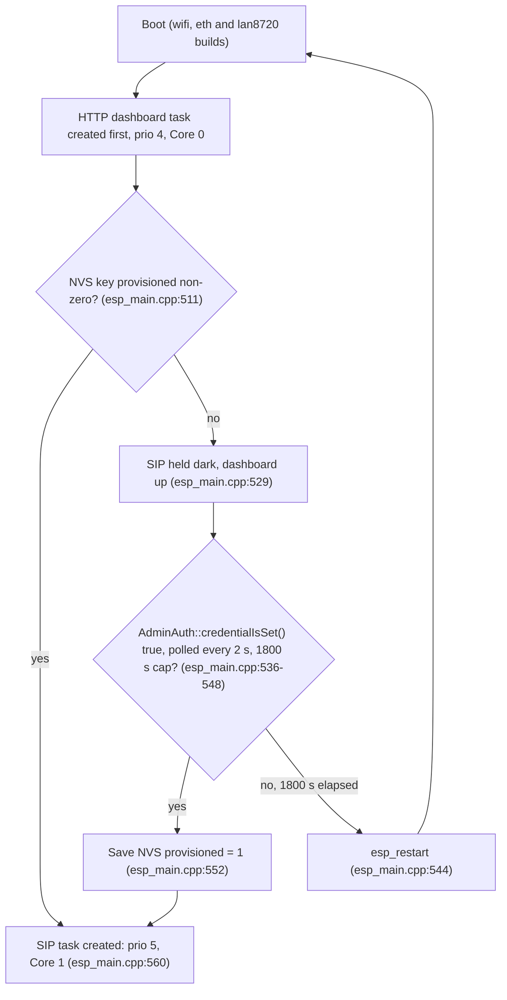

# First-Time Setup Guide

This guide takes a freshly flashed **pocket-dial** device from power-on to a working
test call. It assumes a Wi-Fi SoftAP build (the default standalone Access Point mode);
notes call out where the wired-Ethernet and touch-display variants differ.

If you have not flashed firmware yet, do that first. See the build instructions in
[../README.md](../README.md#on-a-board) and, for updating an already-flashed device,
[OTA.md](OTA.md). This document picks up **after** the firmware is on the board.

What you will do:

0. [Check the network requirements](#network-requirements)
1. [Power on and join the device's Wi-Fi](#1-power-on-and-join-the-device)
2. [Open the dashboard](#2-open-the-dashboard)
3. [Log in and complete setup (do this first)](#3-log-in-and-complete-setup-first)
4. [Register a softphone or IP phone](#4-register-a-phone)
5. [Make a test call (777 echo, then 999 all-page)](#5-make-a-test-call)
6. [Quick-start checklist](#6-quick-start-checklist)

## Network requirements

pocket-dial opens nothing to the internet and needs nothing forwarded to it. Before you
start, check these against your router and firewall:

- **No inbound WAN ports are needed or wanted.** Do not forward any port from the WAN side
  to the board or to a phone.
- **The ITSP connection is outbound only.** Provider calls go through the anchor: a
  TLS connection on port 443 from the board to the provider. The provider never connects
  in to you.
- **The phones' RTP stays on the LAN.** Phone-to-phone audio never leaves your network,
  and the board never carries it.
- **No port forwarding and no firewall "RTP range" are required.** Do not open a UDP media
  range for the board or the phones.

## 1. Power on and join the device

When a standalone Wi-Fi build boots, it spawns its own **open** access point and runs an
internal DHCP server. The SIP registrar binds to `192.168.4.1:5060` and the HTTP
dashboard to `192.168.4.1:80`.

| Setting | Value | Source |
| :--- | :--- | :--- |
| SoftAP SSID | `esp32-sipserver` | `main/esp_main.cpp` (`EXAMPLE_ESP_WIFI_SSID`) |
| Security | Open, no password | `WIFI_AUTH_OPEN` (`main/esp_main.cpp`) |
| Channel | 1 | `EXAMPLE_ESP_WIFI_CHANNEL` |
| Max associated stations | 10 | `EXAMPLE_MAX_STA_CONN` |
| Gateway / server IP | `192.168.4.1` | DHCP server default |
| Hostname (mDNS) | `pocketdial.local` | The default comes from `POCKETDIAL_HOSTNAME` in `src/SIP/SipServer.cpp:30-31`. It is set with `mdns_hostname_set` at `src/SIP/SipServer.cpp:104`, not in `main/esp_main.cpp`. See the note below the table. |

On the `wifi`, `eth` and `lan8720` builds, mDNS is not advertised until setup is complete. The `SipServer` constructor starts mDNS, and `sip_server_task` in `main/esp_main.cpp` creates the `SipServer` only after the credential gate at `main/esp_main.cpp:511-540` has passed. On an unprovisioned wired unit, the only route to the dashboard is the IP address from the router's DHCP table. The `display` build registers mDNS during onboarding and is the exception.

Steps:

1. Power the board over USB-C (or PoE on a wired board).
2. On your laptop or phone, open Wi-Fi settings and join **`esp32-sipserver`**. No
   password is required *unless* access-point security has been switched on (below).
3. Wait for your client to receive a DHCP lease (an address in the `192.168.4.x` range).

**Warning:** The SoftAP is **open by default**. Anyone in radio range can join, and the dashboard, SIP signalling and call audio all cross that link in the clear. Log in and replace the default admin credential immediately (step 3), then **turn access-point security on**. It is the single most effective hardening available on this device, because it encrypts all three at once. See [THREAT_MODEL.md](THREAT_MODEL.md) §6.

On the `wifi`, `eth` and `lan8720` builds, the SIP registrar does not start until you complete step 3. The boot task reads the provisioning flag. If the flag is set, SIP starts at once. If it is not set, the task logs `[boot] device unprovisioned — SIP stack held dark until credential committed` and polls every 2 seconds. The dashboard is up the whole time, since that is how you provision, but **no phone can register until the admin credential is replaced**. When a credential is committed, the device saves the provisioning flag and starts SIP. If nothing is committed within 30 minutes, the board reboots and starts the wait over. A restart mid-setup is designed behaviour, not a crash. Do step 3 before step 4, not after.



The `display` build is **not** gated this way. It boots into its normal network role and brings SIP up regardless of provisioning state.

### Turning on access-point security (WPA2)

It is off by default on purpose: switching it on forces every phone already
associated with the access point to be re-paired, so it is never done to a live fleet
by a firmware update. Enable it deliberately, in one of two ways:

* From the dashboard: *Security* → *Wi-Fi access point security*.
  Tick the box and save. The change takes effect the next time the access point starts.
* At flash time: the [browser flasher](https://glomargadaffi.github.io/pocket-dial/flasher/)
  can write the setting and the passphrase directly to the board. This is the easiest
  route for the headless `esp32s3-wifi` variant. (The `esp32s3-eth` build has no SoftAP
  at all; it is a node on your wired LAN, so access-point security does not apply to it.)

**Finding the passphrase.** The device generates its own, per unit; there is no
factory default, and nothing is baked into the firmware image. It is 20 characters from
an alphabet with no ambiguous glyphs (`23456789ABCDEFGHJKMNPQRSTVWXYZ`, no `0`/`O`, no
`1`/`I`/`L`, and no `U`), so it survives being
read off a screen and retyped into a desk phone. Read it from whichever applies:

| Build | Where the passphrase appears |
|-------|------------------------------|
| `display` | On the LVGL screen during captive-portal onboarding |
| `wifi` (headless) | Logged over serial at boot (`idf.py monitor`) |
| `eth` | Not applicable, this build has no SoftAP |
| Any | The dashboard panel above, once logged in as admin |
| Any | The browser flasher, if you set it at flash time |

You can rotate it from the same dashboard panel. Write the new one down **before**
restarting the access point; rotating it drops every associated phone.

### Variant: captive-portal onboarding (touch-display build)

The Guition JC3248W535 display build can boot into a **captive-portal onboarding** mode
that brings up a separate setup AP named **`My-Ap`** (`ONBOARDING_SSID` in
`main/esp_main_display.cpp`) and shows a join QR code on screen. When you join, the
device redirects all web traffic to its setup page so you can either join an existing
Wi-Fi network (Station mode) or stay in Standalone AP mode.

The portal's choices are state-changing, so they take the same admin gate as everything else. `POST /api/wifi/connect`, `POST /api/wifi/mode_ap` and `POST /api/configuring` all run through `requireAdmin`. Without a session they return `401`. With a valid session they return `403 {"error":"setup_required"}` while the board is still on `admin`/`admin`. Log in and replace the credential (step 3) first. The two calls that still work before setup completes are `POST /api/admin/login`, which does not go through `requireAdmin` at all (it only checks same-origin), and `POST /api/admin/set-credential`, the one path the `setup_required` refusal exempts. That call still needs the session cookie and CSRF token the login just handed you.

The onboarding portal has a **5-minute decay watchdog** (`CAPTIVE_DECAY_SECONDS = 300` in `main/esp_main_display.cpp`). If no configuration is confirmed within five minutes, the device reboots into Standalone AP mode (`esp32-sipserver`) on its own. If your portal disappears, rejoin `esp32-sipserver` and continue from step 2.

### Variant: wired Ethernet / PoE

Wired builds are nodes on your wired LAN and obtain an
address via DHCP (with static fallback). There is no SoftAP; reach the dashboard at the
device's LAN IP or at `pocketdial.local`. See [HARDWARE_SELECTION.md](HARDWARE_SELECTION.md)
for board specifics.

These builds compile **without** `POCKETDIAL_HAS_WIFI` (`main/CMakeLists.txt`), so the Wi-Fi routes are compiled out to a stub that answers `501 {"error":"WiFi is not available on this build -- this board has no WiFi radio in its current Ethernet-transport configuration"}` (#167). `POST /api/wifi/connect` and `POST /api/wifi/mode_ap` do nothing here: there is no Wi-Fi fallback into an `eth` board. If the board drops off the wired LAN, recovery is the serial console or a USB reflash, not a rescue AP.

**Warning:** `POST /api/factory-reset` is **not** in that set. It is fully real on a wired board. It clears the admin credential and DTMF PIN, `DeviceConfig`, the Telephony-API slots, the DID table and the CDR ring. On success it answers `200` and reboots. The board comes back unprovisioned and holds SIP down until you commit a new admin credential, exactly like a virgin board. The endpoint catalog in [API.md](API.md#post-apifactory-reset) lists everything the reset clears, and its error responses.

## 2. Open the dashboard

Open a browser on the joined client and navigate to:

```
http://192.168.4.1
```

or, where mDNS resolves:

```
http://pocketdial.local
```

You should see the operator console (Overview first). It renders live data from
[`GET /api/status`](API.md#get-apistatus): the server IP/port, uptime, processed/dropped
packet counters, the list of registered extensions, and any active call sessions.

**The dashboard is always reachable.** The HTTP listener opens when the server is constructed and stays open for the life of the process, in every provisioning state. There is nothing to unlock, open, or dial first. Firmware built before commit `de1a36e` went dark once a PIN was set, and a `*4887` DTMF star-code reopened it. That mechanism was removed and no longer exists in `src/`. If a colleague or an older runbook tells you to dial in to open the port, they are describing firmware that no longer exists. So a refused connection or a timeout here is always a real fault: wrong address, wrong network, or a board that has not finished booting. See [TROUBLESHOOTING.md](TROUBLESHOOTING.md#dashboard-unreachable).

## 3. Log in and complete setup (first)

**Log in and replace the default credential before doing anything else.** The device ships with a well-known default login (username `admin`, password `admin`), so this step needs no out-of-band secret. Every state-changing endpoint requires a valid, authenticated session. Until you replace the default credential, a logged-in session gets `403 {"error":"setup_required"}` from every other gated route. The firmware enforces this, not just the dashboard. See [API.md §0](API.md#0-reachability--admin-session-layer-read-this-first).

Every admin-gated route requires a valid `pd_session` cookie (else `401`), and
**mutating** routes additionally require the session's CSRF token in an `X-CSRF`
header (else `403`):

* Mutating (cookie + `X-CSRF`): `/api/kill`, `/api/dnd`, `/api/forward`,
  `/api/group`, `/api/dialplan`, `/api/wifi/connect`, `/api/wifi/mode_ap`,
  `/api/configuring`, `/api/factory-reset`, `POST /api/ap-security`,
  `POST /api/registrar`, `/api/registrar/device`, the `/api/telephony-config`
  and `/api/did-mapping` writes, the music-on-hold routes (`POST /api/moh/preview`,
  `POST /api/moh/preview/stop`, `POST /api/moh/upload`), and the OTA endpoints
  (`/api/ota/upload`, `/api/ota/reboot`).
* Read-gated (cookie only, no CSRF): `GET /api/ap-security`,
  `GET /api/registrar`, `GET /api/telephony-config`, `GET /api/did-mapping`,
  `GET /api/pcap`, `GET /api/trace`, `GET /api/diagnostics/pcap`, `GET /api/moh`.
* Ungated, readable before you log in: `GET /`, `GET /api/status`,
  `GET /metrics`, `GET /api/wifi/scan`, `GET /api/ota/status`,
  `GET /config/<mac>.cfg`, and `GET /api/admin/status` (which is how the dashboard
  decides whether to show you the login form or the setup form). `GET /api/cdr` is
  read-gated since #207; see [THREAT_MODEL.md](THREAT_MODEL.md) §4 E-2.

The lists above are partial. The full inventory, with the role each route needs, is the endpoint catalog in [API.md §4](API.md#4-rest-api-endpoint-catalog).

Some routes also need the **owner** role, not just a sysop session. Examples are `POST /api/factory-reset`, `POST /api/ota/upload`, `POST /api/media-tx`, `GET /api/coredump`, `POST /api/admin/set-owner-credential`, and `POST /api/config/export` or `POST /api/config/import` when a `password` is sent (the encrypted secrets block). A sysop session passes the owner check only while no owner credential exists. After that, a sysop gets `403 {"error":"owner privilege required"}`.

While `admin`/`admin` is still in place, a request with a valid session gets `403 {"error":"setup_required"}` from every gated route above, including the read-only `GET`s. `POST /api/admin/set-credential` is the only exemption, and it still needs the session cookie and CSRF token. A request with no session gets `401` before the setup check runs.

### Log in and complete setup from the dashboard

Use the login form on the dashboard. It opens on a login form;
logging in with the default `admin`/`admin` credential immediately routes to
a forced setup form (new username, new password, and an optional DTMF admin
PIN) that nothing else on the dashboard is usable until you submit.

### Log in and complete setup from the command line

```bash
DEVICE=http://192.168.4.1     # or http://pocketdial.local

# 1. Log in with the shipped default credential.
LOGIN=$(curl -s -i -H "Origin: $DEVICE" \
     -X POST --data "username=admin&password=admin" \
     "$DEVICE/api/admin/login")
SESSION=$(echo "$LOGIN" | sed -n 's/.*pd_session=\([0-9a-fA-F]*\).*/\1/p' | head -1)
CSRF=$(echo "$LOGIN" | sed -n 's/.*"csrf":"\([0-9a-fA-F]*\)".*/\1/p' | head -1)

# 2. Complete setup: replace the login credential, optionally set a DTMF PIN.
curl -s -H "Origin: $DEVICE" -H "Cookie: pd_session=$SESSION" -H "X-CSRF: $CSRF" \
     -X POST --data "username=YOUR_USERNAME&password=YOUR_PASSWORD&dtmfPin=YOUR_DTMF_PIN" \
     "$DEVICE/api/admin/set-credential"
# -> {"status":"ok","provisioned":true,"needsSetup":false}
```

Credential rules and behavior, from `src/Helpers/AdminAuth.{hpp,cpp}` and the threat model:

| Property | Value |
| :--- | :--- |
| Password minimum length | 8 characters (`kMinPasswordLength`); shorter returns `400` |
| Username | 1-32 chars, no whitespace/control characters (`kMinUsernameLength`/`kMaxUsernameLength`) |
| DTMF admin PIN | Optional, 4-16 digits (`kMinDtmfPinLength`/`kMaxDtmfPinLength`); no default: the phone-keypad `*PIN#code` menu stays fully disabled until one is set |
| Storage | Salted, iterated SHA-256, 50,000 rounds, 128-bit random salt per secret (NVS keys `admin_user`/`admin_pw_salt`/`admin_pw_hash` for the login credential, `admin_pin_salt`/`admin_pin_hash` for the DTMF PIN, independent, so clearing/rotating one never touches the other) |
| Brute-force lockout | 5 consecutive failed logins → 60-second lockout (`429`), doubling on each repeat lockout to a 16-minute cap (`kLockoutMs << kMaxLockoutShift`). Keyed **per client address** (8 least-recently-seen buckets), so ordinary fat-fingering by one client does not lock out another; a correct credential clears that client's counter. There is also an aggregate backstop, counted separately for the sysop and owner logins. 20 failures across *all* clients trip the same escalating lockout for that login (`kMaxFailedAttemptsGlobal`), so a determined attacker rotating source addresses can still stall logins. Counters are RAM-only; a power cycle clears them without touching the stored credential. |
| Session token | ≥128-bit opaque, `HttpOnly` + `SameSite=Strict` cookie, 30-minute sliding expiry |

The hash is salted and iterated, but a short or common password is still guessable if an attacker ever obtains the flash contents physically. **Use a real, unique password.** The forced-setup step exists to make you do this instead of leaving `admin`/`admin` in place.

You can verify auth state at any time with the read-only endpoint `GET /api/admin/status`. It returns the booleans `provisioned`, `needsSetup` and `authenticated`, plus `role` (`owner` or `sysop` while authenticated, otherwise an empty string), `ownerProvisioned` and `sessionRemainingSec`. `provisioned` and `needsSetup` describe the login credential only. The DTMF PIN has no status field. Its state shows up only indirectly, in whether `*PIN#code` DTMF actions work (the underlying check is `dtmfPinIsSet()`).

## 4. Register a phone

pocket-dial is a SIP registrar. Any SIP client, a softphone app or a hardware IP phone,
registers against it with these settings:

| Field | Value | Notes |
| :--- | :--- | :--- |
| SIP server / registrar / proxy | `192.168.4.1` | Or the device's LAN IP on wired builds; `pocketdial.local` where mDNS resolves |
| Port | `5060` | UDP signaling port |
| Transport | **UDP** | The engine only speaks UDP |
| Username / Auth ID / extension | your choice, e.g. `1001` | The registrar keys clients by this extension (AOR) |
| Password | (any / blank) | The registrar **ships in `learn` mode** (#441; `open` is retired, #502). In that mode it adopts a new phone on its first REGISTER without a challenge, so on a fresh board whatever you type here is ignored. Digest is required once an admin promotes the device to Secured, or for every provisioned extension in `secure` mode. Set the mode with `POST /api/registrar` once you are logged in. The mode is stored as `reg_mode` in NVS namespace **`pbxcfg`**. See [THREAT_MODEL.md](THREAT_MODEL.md) S-3 |
| Codec | **PCMU, PCMA and G.722** between two phones; **PCMU only** on legs the board terminates (`440`, `555`, `888`, hold music) | The server does **not** rewrite your codec list. `filterAudioCodecs(allowWideband=true)` only *drops* payloads it won't carry. It keeps each phone's own preference order and payload numbering, so two G.722-capable handsets negotiate wideband between themselves. `telephone-event` passes through. `enforceG711()` (`src/SIP/SipMessage.cpp:479`) has no production callers. |
| Registration expiry | up to `3600` s | `DEFAULT_EXPIRES`/`MAX_EXPIRES`; higher requests are capped to 3600 |

**Do not reuse the extensions `777` or `999`.** They are reserved virtual extensions for the echo test and the all-page broadcast (see step 5).

Steps:

1. Open your SIP client and create a new account/identity.
2. Enter server `192.168.4.1`, port `5060`, transport **UDP**.
3. Choose an extension (e.g. `1001`) as the username.
4. Keep **G.711 µ-law and a-law** in the codec list (disable Opus, G.729; G.722 can stay on).
5. Save. The client should show "registered".
6. Confirm on the dashboard: the extension appears in the `clients` list of
   [`GET /api/status`](API.md#get-apistatus).

Register a **second** extension (e.g. `1002`) on another client so you can place a real
call later. Per-client walkthroughs and known quirks are in
[PHONE_COMPATIBILITY.md](PHONE_COMPATIBILITY.md).

The registrar pings each registered client with a SIP `OPTIONS` keepalive every 5 seconds and prunes a client after about 15 seconds of silence (`RequestsHandler.cpp`). A phone that does not answer OPTIONS may be dropped from the registrar.

**If nothing registers at all** on a `wifi`, `eth` or `lan8720` build, check that you finished step 3 first. Those builds hold the SIP stack down until an admin credential is committed. Port 5060 is simply not listening yet, while the dashboard on port 80 answers normally. `idf.py monitor` shows `[boot] waiting for admin credential...` every couple of seconds when this is what is happening.

## 5. Make a test call

### 5a. Echo test: dial `777`

`777` is a built-in echo loopback. When an endpoint dials `777`, the server answers
`200 OK` using **the caller's own SDP connection info**, so the phone streams its audio
back to its own receive port, a zero-DSP hardware echo test (`RequestsHandler::onInvite`).

1. From a registered phone, dial **`777`**.
2. The call connects immediately. Speak, you should hear your own voice echoed back.
3. Hang up.

If you hear nothing, your audio path (codec/RTP) is the suspect, see
[TROUBLESHOOTING.md](TROUBLESHOOTING.md#one-way-or-no-audio).

### 5b. All-page broadcast: dial `999`

`999` is a parallel intercom/all-page. Dialing it forks the INVITE to **every other
registered extension** at once, injecting auto-answer headers; the first device to answer
`200 OK` is connected and the rest are cancelled (`RequestsHandler` broadcast handler).

1. Make sure at least one **other** extension is registered (e.g. `1002` from step 4).
2. From one phone, dial **`999`**.
3. Every other registered phone is paged simultaneously. When one answers, it is bridged
   to the caller and the others stop ringing.

### 5c. Direct extension-to-extension call

1. From `1001`, dial `1002` (the second extension you registered).
2. The callee rings; answer it.
3. Audio (RTP) flows **peer-to-peer** directly between the two phones; the device only
   brokers signaling (see [ARCHITECTURE.md](ARCHITECTURE.md) and [SCALING.md](SCALING.md)).
4. The active call appears in the `sessions` list on the dashboard.

## 6. Quick-start checklist

- [ ] Firmware flashed (see [README.md](../README.md#on-a-board) / [OTA.md](OTA.md)).
- [ ] Powered on; joined Wi-Fi SSID **`esp32-sipserver`** (open), or completed the
      `My-Ap` captive portal on the display build.
- [ ] Dashboard reachable at `http://192.168.4.1` (or `http://pocketdial.local`).
- [ ] Logged in with the default credential (`admin`/`admin`) and completed setup
      via `/api/admin/set-credential` (real username + password ≥8 chars).
- [ ] Logged in with the new credential (`/api/admin/login`) before using any gated control.
- [ ] (`wifi`/`eth`/`lan8720` only) Confirmed the SIP stack came up **after** setup;
      it is held down until the credential is committed, so this must precede the
      registration steps below.
- [ ] First softphone/IP phone registered: server `192.168.4.1:5060`, **UDP**, **G.711**,
      extension e.g. `1001`.
- [ ] Second extension registered (e.g. `1002`).
- [ ] Dialed **`777`**, heard echo.
- [ ] Dialed **`999`**, other phones paged.
- [ ] Placed a direct `1001 → 1002` call, two-way audio.

## 7. Optional: E911 notification and a carrier trunk (DEPRECATED)

**E911 notification.** Open **PBX Settings** (the **PBX** button or F6) →
**E911 Notification**. Set the extensions to notify on site when somebody dials 911,
the callback number and the location, then **Save**. The fields refill with what the
server kept. A factory reset clears these, so set them again after one (#646).

**Carrier trunk (DEPRECATED).** The SIP trunk is deprecated; the anchor is the supported ITSP path. The reason is the network design rule: pocket-dial's design rule is that nothing is opened or forwarded from the WAN side to the board or the phones (see [Network requirements](#network-requirements)). Existing trunks keep working. Configure one at `/setup/trunk`. A trunk with a password REGISTERs with the carrier and answers a 401 or 407 challenge with digest authentication. An IP-authenticated trunk does not register (#615). Outbound calls over the trunk are still under investigation: the carrier accepts the REGISTER but does not answer the INVITE (#618).

Next: [PHONE_COMPATIBILITY.md](PHONE_COMPATIBILITY.md) ·
[HARDWARE_SELECTION.md](HARDWARE_SELECTION.md) ·
[TROUBLESHOOTING.md](TROUBLESHOOTING.md) · [SCALING.md](SCALING.md)
