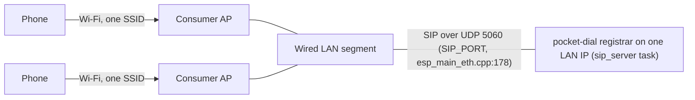
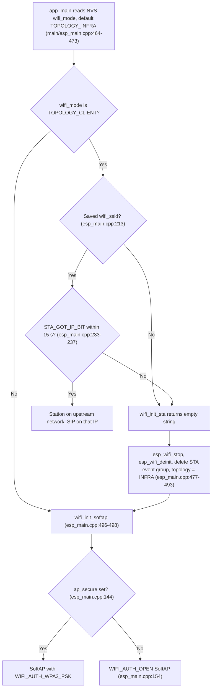

# Scaling past the SoftAP station cap

Status: decision document. Last updated 2026-10-12.

This document tracks [#176](https://github.com/GlomarGadaffi/pocket-dial/issues/176): what to do when a
deployment wants more phones than one `wifi`/`display` build's SoftAP can hold. It answers
how big the cap is and what to do about it, and it records the mesh-versus-wired-backbone
decision the issue asked for.

This is a deployment-topology decision, not a firmware change. Nothing in `src/` changes
because of this document.

Cross-references: [HARDWARE_SELECTION.md](HARDWARE_SELECTION.md) §2 (board and connectivity
choice), [SCALING.md](SCALING.md) §1 and §5 (why the cap exists, pool sizing),
[THREAT_MODEL.md](THREAT_MODEL.md) §2 (trust boundaries TB-1 and TB-2), and
[PROVISIONING.md](PROVISIONING.md) §4.4 (client isolation caveat).

## 1. The cap, precisely

The SoftAP build configures the Wi-Fi driver for a fixed number of associated stations:

```c
#define EXAMPLE_MAX_STA_CONN       10        // main/esp_main.cpp:39
...
wifi_config.ap.max_connection = EXAMPLE_MAX_STA_CONN;   // main/esp_main.cpp:136
```

`10` is a **build-time constant**, not a config knob. There is no NVS key or dashboard field
for it. Raising it does not fully solve the problem either. [SCALING.md §5](SCALING.md) states
that the ESP-IDF SoftAP caps associated stations at roughly **10–16**, a hard limit set by the
Wi-Fi driver. This document takes that figure from SCALING.md as given. SCALING.md does not cite
a source for it. The ESP-IDF stable API reference describes `max_connection` only as "Max number
of stations allowed to connect in", with no numeric limit, so the figure has not been checked
against a primary source here. The driver-internal reason for the number has not been re-derived.

So this is a **radio/driver ceiling**, not a pocket-dial resource-pool ceiling. It does not move
by editing `PoolConfig.hpp` or building the Office/Rack tier.

## 2. The constraint that shapes every option below

Before comparing topologies, one invariant has to hold for any of them, because it is what makes
ordinary calls work at all today:

> **Peer-to-peer RTP needs one flat L2 segment with no NAT between any two phones, and
> between every phone and the board.**

Concretely:

- Two phones on an ordinary call stream RTP directly to each other's IP:port
  ([SCALING.md §1](SCALING.md)). The board relays SDP unmodified and is never in that
  path. If a NAT boundary sits between the two phones, or between a phone and the
  connection address it was handed, that direct path breaks (see
  [TROUBLESHOOTING.md](TROUBLESHOOTING.md), "NAT/STUN/ICE enabled on the phone").
- `rport`/`received=` symmetric-response routing and the in-dialog BYE/CANCEL
  leg-IP-authorization check (`RequestsHandler::isDialogSourceAuthorized()`,
  `RequestsHandler.cpp`, search `isDialogSourceAuthorized`) both key on a phone's SIP
  packets arriving from the same address it registered or dialogued from. A topology
  that rewrites source addresses in flight (NAT) or hides them behind per-node subnets
  breaks that assumption the same way it breaks RTP.
- AP client isolation must stay off. If the wireless layer prevents associated
  stations from reaching each other directly, RTP fails outright. This is already called
  out in [TROUBLESHOOTING.md](TROUBLESHOOTING.md) ("Client isolation on the AP") and
  [PROVISIONING.md §4.4](PROVISIONING.md).

Any scale-out option that introduces NAT, per-node subnetting, or station isolation between
phones is disqualified before its trust model is even worth evaluating. It would break the
ordinary call path pocket-dial exists to run. This is the lens both options below are read through.

## 3. Option 1: ESP-WIFI-MESH

Idea: replace the single SoftAP radio with an ESP-WIFI-MESH network of ESP32 nodes, so a phone
can associate with whichever node is nearest, and traffic is relayed across the mesh to a root
node that runs (or reaches) the pocket-dial registrar.

### What ESP-WIFI-MESH is

It is an ESP-IDF library (`esp_mesh`) for self-organizing multi-hop networking **among ESP32
nodes**, built for IoT sensor/actuator mesh. It is not built for extending a consumer-grade
Wi-Fi AP's association capacity. Per
[Espressif's own ESP-WIFI-MESH guide](https://docs.espressif.com/projects/esp-idf/en/stable/esp32/api-guides/esp-wifi-mesh.html):

- The root node is the sole gateway to the external IP network. Every other node
  reaches the outside world only by relaying through the mesh to the root.
- Leaf nodes (nodes with no softAP interface for downstream connections) exist
  specifically because not every node can accept child connections. The topology is a
  constrained tree, not a flat cell layout.
- The guide documents mesh-node-to-mesh-node connectivity. It does **not** document
  ordinary, non-mesh Wi-Fi stations (a SIP phone has no ESP-MESH firmware) associating
  with an intermediate node's softAP and getting transparent IP reachability into the
  root's subnet. That use case is simply not addressed by the architecture as
  described. Silence is not confirmation either way. That is why the next section treats
  it as an open question that is disqualifying if the answer is unfavourable, rather than a
  settled "it doesn't work."

### Risk to the §2 invariant

This directly threatens the §2 invariant. If getting a non-mesh station's traffic from a leaf
node to the root requires the mesh layer to NAT or re-subnet it, which is the plausible
mechanism given the documented tree topology and root-only external gateway, then two phones
associated to two different mesh nodes would no longer share one flat L2 segment. P2P RTP and the
`rport`/leg-IP checks would break by construction.

This has not been verified against a working ESP-WIFI-MESH deployment, and nothing in this repo
runs it. It is a disqualifying risk read from the architecture documentation, not a measured fact.
Anyone revisiting this option must confirm the IP model on real hardware before writing any code.
If it needs NAT, option 1 is dead on that basis alone, independent of everything below.

### STRIDE pass

Even setting that aside, this is a large trust-boundary change, so it gets the STRIDE-style pass
the issue asked for:

| STRIDE | New risk introduced by ESP-WIFI-MESH that TB-1/TB-2 (single AP) do not have |
| :--- | :--- |
| **Spoofing** | Root-node election and mesh-node authentication are new identity questions. Which node is allowed to become root, and whether a rogue node can impersonate one, are decisions [THREAT_MODEL.md](THREAT_MODEL.md) has never had to make for a single-AP device. |
| **Tampering** | Per-hop link security ("MESH ID" + per-link auth) protects each hop, but **an intermediate relaying node sees, and can alter, plaintext SIP/RTP payload in transit**. It is not just a wire; it is a full peer with CPU and firmware. Today's single-AP model has exactly one such node (the board itself), and it's the trusted party. Mesh multiplies that role by the node count. |
| **Repudiation** | No change tracked here, but call/audit logging is currently single-device; a multi-node mesh has no shared log correlation story. |
| **Information disclosure** | Every relaying node is now a vantage point for RTP/SIP eavesdropping, not just the SoftAP's own radio range. The honest single-hop I-1/I-2 rows in [THREAT_MODEL.md §4](THREAT_MODEL.md) would need to become "any node on the path," multiplying the exposed surface by hop count. |
| **Denial of service** | A compromised or crashed intermediate node can black-hole every phone behind it, not just itself, a much larger blast radius than one AP's D-4 (RF jamming, out of scope today). |
| **Elevation of privilege** | The mesh root effectively becomes the trust anchor for the whole deployment; compromising it is worse than compromising one SoftAP, because it can pivot into every leaf's traffic. |

### Decision: not recommended

Even before the unverified NAT question, this replaces one well-understood, already-documented
trust boundary (TB-1, [THREAT_MODEL.md §2](THREAT_MODEL.md)) with a multi-node forwarding fabric.
That fabric needs its own threat model, its own root-election security story, and, per the
architecture as documented, a real risk of breaking the peer-to-peer RTP model this project is
built around. The payoff (a few more Wi-Fi stations per site) does not clear that bar. Revisit
only if a future ESP-WIFI-MESH release documents flat-L2, no-NAT connectivity for non-mesh stations
through leaf nodes. Even then, budget it as an "own threat model, own firmware mode" project, not
an incremental change.

## 4. Option 2: wired backbone of consumer APs, one pocket-dial as registrar

Idea: stop asking pocket-dial's own radio to cover the whole site. Put ordinary consumer/prosumer
Wi-Fi access points (already designed to each hold tens-to-hundreds of stations) on the walls.
All of them broadcast one SSID and all are uplinked to the same wired LAN segment. Phones roam
between those APs the normal way. That is what consumer AP firmware already does well, and it is a
solved problem outside this project. pocket-dial itself runs as one device on that same LAN,
acting purely as the SIP registrar/PBX. It is never the thing phones associate to.

Phones associate to the APs. The APs and the pocket-dial board all sit on one wired LAN segment:



### Why no firmware change is needed

pocket-dial's Wi-Fi role and its SIP-server role are already decoupled in the code that ships today:

- The board's Wi-Fi topology is selected by an NVS-stored `wifi_mode` flag between
  `TOPOLOGY_INFRA` (its own SoftAP, which is what the cap in §1 applies to) and
  `TOPOLOGY_CLIENT` (join an existing network as an ordinary station via `wifi_init_sta()`).
  The flag is switched from the dashboard, or with the `101` DTMF admin code, which reboots the
  device (`main/esp_main.cpp:44-46` and `:469`; `src/SIP/DtmfFeatureCodes.cpp:375`;
  [THREAT_MODEL.md §5.5](THREAT_MODEL.md)).
- Or skip Wi-Fi for the board entirely and use the `eth` build (W5500/LAN8720), which has
  **no station-association ceiling at all**. See [HARDWARE_SELECTION.md §2](HARDWARE_SELECTION.md),
  "Wired Ethernet".
- Either way, the SIP registrar just needs one reachable IP on the shared LAN. Nothing in
  `src/SIP/` cares, or has ever cared, which physical radio a phone associated to. It only sees
  SIP packets arriving over the socket, same as it does for a single-AP deployment today.

### Where this lands on the trust model

This is not a new boundary. It is TB-2 from [THREAT_MODEL.md §2](THREAT_MODEL.md) (LAN / joined-STA),
which already exists and is already documented: "Network is as trusted as the LAN's own
segmentation." The board is no longer the thing broadcasting an AP for phones to join. The
consumer APs are, and their own WPA2 or enterprise auth becomes the link-layer control, managed
entirely outside pocket-dial. No new STRIDE pass is needed. The existing TB-2 row and the §4 and §5
analysis in the threat model already cover it.

One caveat applies if the board itself is the `wifi` build in `TOPOLOGY_CLIENT`, rather than the
`eth` build. TB-1 does not disappear. It becomes a fallback.

On boot in `TOPOLOGY_CLIENT`, the board needs a saved SSID. If none is saved, `wifi_init_sta()`
gives up at `main/esp_main.cpp:218-221`. If one is saved, the board has 15 s to join the upstream
network (`main/esp_main.cpp:233-237`), and `wifi_init_sta()` gives up if it does not. In either case
the boot path falls straight back to `wifi_init_softap()` (`main/esp_main.cpp:477-498`), which
silently re-creates the board's own SoftAP. That AP is open unless `ap_secure` is set.



So an upstream Wi-Fi outage at boot time quietly reopens exactly the boundary this topology was
meant to retire. Two consequences follow. The `eth` build is the **preferred** way to place the
board in this topology, because it has no radio to fall back onto. If a `wifi` build is used
instead, turn on `ap_secure` (§6 of the threat model) so that the fallback AP is never open, even
transiently.

### Why it satisfies the §2 invariant

All the consumer APs bridge onto one wired LAN segment. There is no NAT, no per-AP subnet, and no
client isolation between stations on different APs. Client isolation is a per-AP setting, and it
must be left off. The same caveat applies to a single-AP deployment
([PROVISIONING.md §4.4](PROVISIONING.md)). Every phone and the pocket-dial board remain on one flat
L2, so peer-to-peer RTP, `rport`, and the leg-IP dialog checks all keep working exactly as they do
today.

### How to deploy it

These steps are configuration only. They involve no code changes.

1. Wire the consumer APs to a switch or router that forms one LAN. All APs are configured with
   the **same SSID**, same security, same subnet, and standard roaming (802.11r/k/v if the
   APs support it, orthogonal to pocket-dial).
2. Put the pocket-dial board on that same LAN: `eth` build plugged into the switch
   (preferred; see [HARDWARE_SELECTION.md](HARDWARE_SELECTION.md) for board options), or
   a `wifi`/`display` build switched to `TOPOLOGY_CLIENT` joining that SSID.
3. Point every phone's SIP registrar at the board's LAN IP (static, or
   `pocketdial.local` via mDNS), the same as any wired deployment.
4. Leave AP client isolation **off** on every consumer AP.

### Decision: recommended

Recommended, alongside the plain answer of "use the `eth` build" for sites that don't need Wi-Fi
phones at all. This gets past the ~10–16-station ceiling with commodity hardware, with zero
pocket-dial firmware changes and no new trust boundary to reason about.

## 5. Summary

| | ESP-WIFI-MESH | Wired backbone + consumer APs |
| :--- | :--- | :--- |
| Firmware change | Large (new build mode, new node role) | None |
| New trust boundary | Yes (multi-hop relay, root election, own STRIDE needed) | No (falls on existing TB-2) |
| P2P RTP / `rport` model | At risk (IP model unverified, plausible NAT break) | Preserved (one flat L2) |
| Verified today | No (unverified against real hardware) | Yes (topology switch and `eth` build both already ship) |
| **Recommendation** | **Not recommended for now** | **Recommended**, alongside the plain `eth` build |

Revisit option 1 only if all of these hold: no wired backbone is possible at the site (no cabling
budget or access at all, not just "prefers wireless"), the station count genuinely exceeds what a
couple of $30–50 consumer APs on one SSID can cover, and an ESP-WIFI-MESH release has, by then,
documented (and someone has verified on hardware) flat-L2, no-NAT connectivity for ordinary non-mesh
stations through leaf nodes. That is a narrow intersection. Most "more phones than one SoftAP"
problems are solved by section 4 alone.
