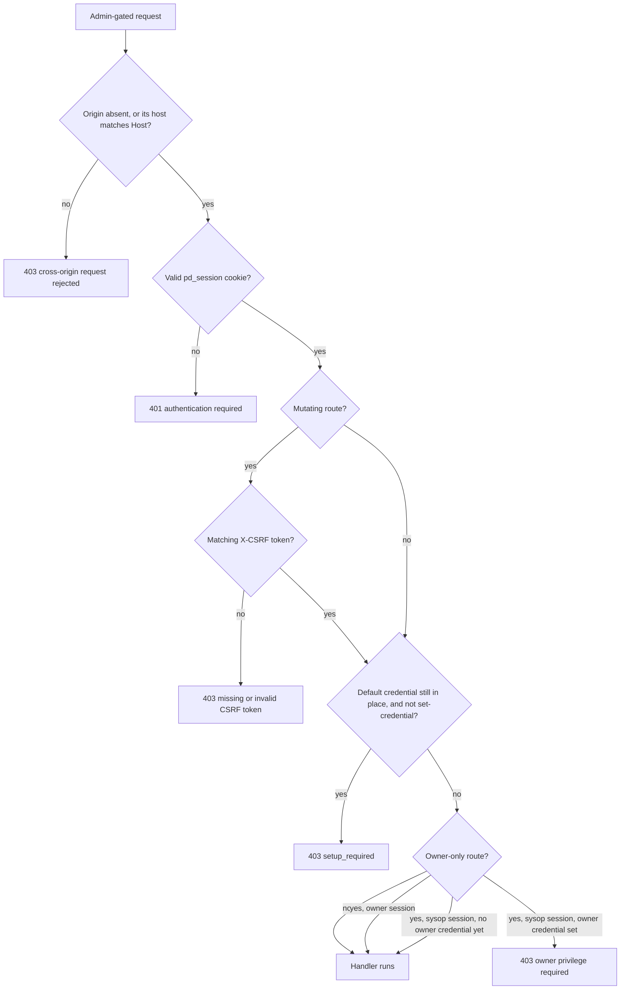
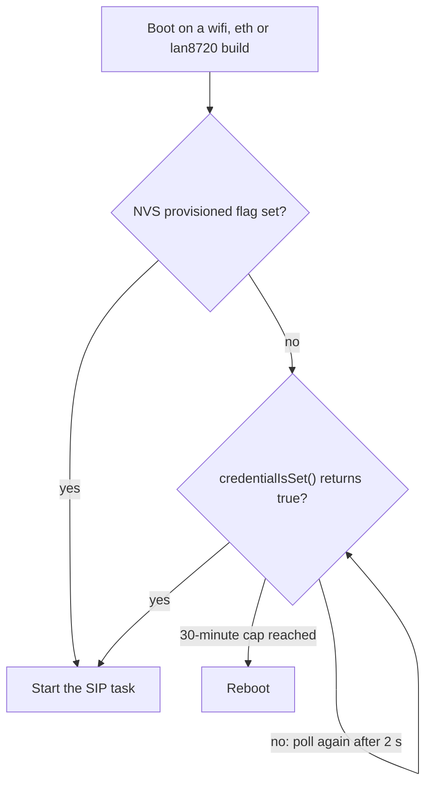

# Threat Model: pocket-dial ESP32 SIP PBX

Date: 2026-10-12 | Version: 2.1 | Author: Security Engineering | Phase: 1 (production hardening)

This is a STRIDE threat model for the pocket-dial ESP32 SIP PBX and its HTTP dashboard. It covers the locally reachable attack surface of a small appliance that runs its own open WiFi access point by default and uses a trust-on-first-use (`learn`) SIP registrar. It complements `docs/SECURITY_AUDIT.md`, which tracks CVSS-scored findings.

Every state-changing dashboard endpoint requires a login session and a per-session CSRF token. This closed the unauthenticated admin hole (audit finding SEC-04). The device refuses every other admin action until the shipped default credential is replaced.

The source of truth for the claims here is `src/Helpers/AdminAuth.{hpp,cpp}`, `HttpServer::requireAdmin()`, and `docs/API.md` §0. The admin credential is a username and password. The route that sets it is `POST /api/admin/set-credential`. The DTMF menu PIN is a separate numeric secret (§5.5).


## 1. System Overview

- Device: ESP32 / ESP32-S3 microcontroller, single firmware image.
- Role: self-contained SIP PBX. Registers SIP extensions, bridges calls, carries
  RTP audio (G.711 / PCMU/PCMA).
- Transports (build-time `SIP_TRANSPORT`):
  - `wifi` builds host a SoftAP (their own WiFi network) and/or join a station network.
  - `eth` builds use W5500 Ethernet (PoE); the device is a node on a wired LAN.
  - `display` builds combine a SoftAP with the local touchscreen UI (LVGL) and captive-portal onboarding.
- Listening services:
  | Service | Port | Proto | Purpose |
  |---------|------|-------|---------|
  | HTTP dashboard | 80 (device) / 8080 (host) | TCP | Status, call control, WiFi provisioning, **admin auth** |
  | SIP | 5060 | UDP | Registration, INVITE, OPTIONS, session control |
  | RTP | dynamic | UDP | Media (G.711) |
  | DNS (captive portal) | 53 | UDP | Resolves all names to the device IP during onboarding |

  The HTTP listener is opened in the `HttpServer` constructor and is never closed or
  conditionally opened. Reachability is not a security control here; `requireAdmin()`
  is (§5.1). On `wifi`/`eth`/`lan8720` builds the *SIP* stack, by contrast, is held down at
  boot until an admin credential is committed; the `display` build deliberately is not
  (§5.1, "up usable, secure later").
- Persistence: ESP-IDF NVS flash, in two namespaces.
  - `"storage"` holds WiFi mode/SSID/password, the SoftAP security flag and passphrase
    (`ap_secure`, `ap_psk`), a captive-portal `decayed` flag, the one-way `provisioned`
    boot flag, and the admin credentials. The sysop credential is `admin_user`,
    `admin_pw_salt` and `admin_pw_hash` (the web login). The owner credential is
    `owner_user`, `owner_pw_salt` and `owner_pw_hash`. The DTMF menu PIN is
    `admin_pin_salt` and `admin_pin_hash`.
  - `"pbxcfg"` holds PBX config, including the registrar admission mode `reg_mode` and the
    DTMF admin extension `admin_ext` (default `1001`). `reg_mode` lives in `pbxcfg`, not
    `storage`. Read the current mode with `GET /api/registrar`.
- Crypto available: mbedTLS on-device (SHA-256, `esp_random()` hardware CSPRNG). The
  admin module ships its own self-contained SHA-256 so the credential format is identical
  on device and on the host/CI simulator.
- Data classifications handled: call control state, WiFi credentials (a secret),
  device-integrity/config, admin credential, per-extension SIP digest secrets (HA1),
  real-time voice media.

### Host vs. device note
The desktop/CI build (`SipServer` binary) is a **developer/test simulator**, not a
production deployment. On host there is no NVS, so the admin credential and sessions live
in process memory for a single run (documented in `AdminAuth.hpp`). The host build's RNG
uses `std::random_device`-seeded `std::mt19937_64`; the device build uses the hardware
CSPRNG `esp_random()`. The trust boundaries below describe the **device**.


## 2. Trust Boundaries

```
            (most hostile)                                     (least hostile)
  ┌──────────────────────────┐   ┌───────────────────┐   ┌────────────────────┐
  │  OPEN SoftAP RF link      │   │  Wired/station LAN │   │  Device internals   │
  │  WIFI_AUTH_OPEN — anyone  │──▶│  (eth transport,   │──▶│  firmware, NVS,     │
  │  in radio range can join, │   │   or joined STA    │   │  SIP engine, RAM    │
  │  no link-layer encryption │   │   network)         │   │                     │
  └──────────────────────────┘   └───────────────────┘   └────────────────────┘
            │                              │                        │
            ▼                              ▼                        ▼
   HTTP / SIP / RTP / DNS         HTTP / SIP / RTP            local-only state
```

| # | Boundary | From → To | Current controls |
|---|----------|-----------|------------------|
| TB-1 | **Open SoftAP link (dominant link-layer boundary)** | Any RF-range device → device services | None at the link layer by default. The link is `WIFI_AUTH_OPEN` unless the operator turns on the opt-in WPA2 mode (`ap_secure`, §6). App-layer: same-origin + login session + per-session CSRF token on admin HTTP endpoints. |
| TB-2 | LAN (eth / joined STA) | LAN host → device services | Network is as trusted as the LAN's own segmentation. Same app-layer HTTP controls as TB-1. The SIP registrar boots in Learn mode on every build (§9), so a LAN host can claim an unclaimed extension without a credential (S-4). |
| TB-3 | Browser → HTTP server | Dashboard user → endpoints | `isSameOrigin()` (Origin vs. Host), HttpOnly + `SameSite=Strict` session cookie, no wildcard CORS, request-body cap (16 KB), per-socket recv timeout. |
| TB-4 | HTTP/SIP → NVS | Handlers → flash | Writes gated behind same-origin + session + CSRF (HTTP); salted/iterated admin password and DTMF-PIN hashes; explicit `confirm=ERASE` for factory reset. |
| TB-5 | Physical | Holder of the device → flash/JTAG | None by default. There is no flash encryption and no Secure Boot (see §7). |

The open SoftAP (TB-1) is the dominant link-layer boundary and the root of most residual risk on the `wifi` and `display` builds. Anyone within WiFi range can associate with no credential and becomes a peer on the device's IP network, with full reachability to HTTP, SIP, RTP and DNS. Read every threat below with "the attacker is an associated, unauthenticated AP client" as the baseline. The device is not WAN or Internet exposed by default (no port forwarding, no cloud component), so the realistic attacker is local and proximate, not remote.

The largest residual risk on a fresh board of any build is the SIP registrar's trust-on-first-use (§9). A fresh board boots in `learn` mode, and `open` is retired (#441, #502). Learn adopts an unknown MAC on its first REGISTER for an unclaimed extension without any credential (S-4). It also admits an INVITE from an unsecured Learned extension without a challenge. Only a device an admin has promoted to Secured must prove a secret on REGISTER and on INVITE (#505, #512). The review gaps on that path are closed. An ARP miss does not admit a Secured extension without a digest (#507, #487). The digest URI must match the Request-URI and To, and the INVITE's credential is stripped before any fork (#549, #555). The relayed ACK and re-INVITE or UPDATE do not carry that credential (#560, #562). A reused nonce or `nc` is re-challenged (#525, #570). An INVITE from any address other than the one the extension registered from is refused (#503). So any peer that can reach UDP/5060, over the open AP or a wired LAN, can claim an unclaimed extension and call as an unsecured one, from the address it registered from. TB-1 does not limit this. The HTTP admin plane has no equivalent gap: it is credential-gated from the first boot. Securing the fleet's devices (or running `secure`) is therefore the one hardening step every deployment needs, ahead of everything else in §7.


## 3. Assets

| Asset | Why it matters | Primary threats |
|-------|----------------|-----------------|
| **Call control** (force-disconnect, active sessions) | Denial of phone service; disrupting live calls | Spoofing, Tampering, DoS, EoP |
| **WiFi credentials** (station SSID/password in NVS) | Reusable secret; pivot to the upstream network | Info disclosure, Tampering |
| **Device integrity / config** (mode, factory reset, OTA image) | Bricking, persistent control, supply-chain implant | Tampering, EoP, DoS |
| **Admin access** (login password, session token, CSRF token) | Master key to all mutating actions | Spoofing, brute force, token theft, EoP |
| **DTMF admin PIN** (separate numeric secret, phone keypad only) | Unlocks NTP resync, topology switch, factory reset from any handset | Spoofing, brute force, EoP |
| **Voice media + signaling** (RTP G.711, SIP) | Call confidentiality and privacy | Info disclosure (eavesdrop), Repudiation |


## 4. STRIDE Threat Enumeration

Each row lists the threat, the current mitigation, and the **residual risk**.

### Spoofing
| ID | Threat | Mitigation | Residual risk |
|----|--------|-----------|---------------|
| S-1 | **Unauthenticated admin actions**, any AP/LAN peer POSTs `/api/kill`, `/api/wifi/connect`, `/api/wifi/mode_ap`, `/api/factory-reset`. (Audit SEC-04.) | Fixed. The gate is unconditional, and there is no unprovisioned bypass. Every admin-gated route (mutating routes *and* the sensitive GETs: `/api/pcap`, `/api/trace`, `/api/registrar`, `/api/telephony-config`, `/api/did-mapping`, `/api/ap-security`) requires a valid `pd_session` cookie from the very first boot, else `401`. Mutating routes additionally require the per-session `X-CSRF` token (T-2). The device ships a *known* default login (`admin`/`admin`) purely so the gate can be unconditional, and refuses everything except `POST /api/admin/set-credential` until that default is replaced (§5.1). | The default credential is public, so on a fresh board the real control is *who reaches the dashboard first*, a claim race, not an authentication check (§5.1). Password strength above the enforced 8-character floor is user-chosen. |
| S-2 | Session-cookie forgery / guessing | Token is ≥128-bit (`esp_random()` on device), opaque, validated server-side via constant-time compare; not derived from any user input. | Brute-forcing a 128-bit token over the network is infeasible; theft (S/T-3) is the realistic path. |
| S-3 | SIP identity spoofing (register or INVITE as another extension) | SIP signaling input is validated and bounded (audit SEC-02). Digest authentication challenges REGISTER, and INVITE in secure mode and for a Secured extension (§9.1). | A peer can register or call as an unsecured Learned extension, since that extension has no secret to check (S-4, §9.2). Digest is `auth`, not `auth-int`, so bodies are not integrity-protected. See §9.1 for the scope and the replay residual. |

### Tampering
| ID | Threat | Mitigation | Residual risk |
|----|--------|-----------|---------------|
| T-1 | Rewriting WiFi credentials / operating mode via dashboard | Same-origin + admin session + CSRF gate, applied from first boot (no post-provisioning caveat). | The fresh-board credential race (§5.1); physical attacker (T-4). On the `eth` and `lan8720` builds, `POCKETDIAL_HAS_WIFI` is undefined, so `/api/wifi/*` there is a gated **stub** that changes nothing (issue #167). Do not plan a recovery around it on a wired board. `/api/factory-reset` is not split that way (#189): the wipe, the `200` and the reboot all run on a wired board, and only the WiFi-key erase is skipped. It remains a usable recovery path on `eth` and `lan8720`. |
| T-2 | **CSRF**, a malicious page on the AP makes the victim's browser fire side-effecting POSTs | `isSameOrigin()` rejects requests whose `Origin` host ≠ `Host`; session cookie is `SameSite=Strict`; no wildcard `Access-Control-Allow-Origin`. A per-session **CSRF token** (128-bit, from `esp_random()`, stored in the session slot) that every mutating request must echo in an `X-CSRF` header. It is rendered into the dashboard document *and* returned by `POST /api/admin/login`, and is never set as a cookie, so a cross-origin page cannot read it even though the browser would attach the cookie for it. Checked centrally in `HttpServer::requireAdmin()`. | A request with **no** `Origin` (curl, native app) is still allowed by design, that is what lets scripts and `tests/http/test_api.sh` work, but it needs **both** the session cookie and a matching token regardless, from the first boot onward, so the Origin check is not load-bearing on its own. |
| T-3 | Request-body / parser abuse (oversized body, split TCP segments) | 16 KB body cap (`413`), `Content-Length` parsing with overflow guard, per-client `SO_RCVTIMEO`. | Low. |
| T-4 | **Physical flash tamper**, rewrite NVS / reflash | None by default. | High if device is physically obtained: NVS (incl. WiFi password and admin hash) is readable/writable. Mitigation is Secure Boot v2 + flash encryption (roadmap P2). |
| T-5 | **Firmware / OTA tampering** | The OTA upload route requires the owner role, a session and a CSRF token: `requireAdmin(..., needCsrf=true, Owner)`. Other mutating endpoints need only the sysop role. Until an owner credential exists, a sysop session also passes this check (§5.1). The board uses dual-slot OTA (`ota_0`/`ota_1`) with rollback. Images are **not signed**. | The OTA path has never been run end to end on any board, in CI or on the bench, so rollback is untested. Treat a field OTA as a first run. Unsigned images mean an attacker who holds a valid owner session (or a sysop session, before an owner credential exists) gets persistent code execution. **Durable fix: signed images, Secure Boot v2 and flash encryption** (roadmap P2). |
| T-7 | **SDP body abuse on the SIP plane** (CWE-674 class), a well-formed INVITE / re-INVITE / UPDATE / 200 OK whose SDP `a=` lines are the payload. The UNISOC T612 VoLTE RCE (SSD advisory, 2026) was a normal MMTel video offer carrying `a=acap:1 acap:1 ...`; the modem's RFC 5939 acap decoder recursed once per token until the task stack overflowed into a neighbour. A PBX that relays bodies untouched (this one does, on hold/resume and P2P legs) is also the *delivery vector* for phones that are vulnerable. | Design rule, pinned in code and tests. (1) Every SDP body is checked ONCE in `RequestsHandler::handle()` before any decoder or relay (regardless of method or status, and with the MIME type matched case-insensitively) by `SipMessage::checkSdp()`: one flat, zero-heap pass enforcing `SdpLimits` (body ≤ 4 KB, ≤ 256 lines, ≤ 512 B/line, ≤ 40 tokens/line, ≤ 32 formats per `m=`, `a=` names ≤ 32 token chars) and refusing the RFC 5939 / 6871 / 7104 capability-negotiation attributes outright (`acap tcap pcfg acfg creq rmcap omcap mfcap mscap lcfg sescap bcap ccap icap`) because the PBX does not implement them. A violation is a hard error for the whole body: `488 Not Acceptable Here` + `Warning: 399 … "SDP refused: <reason>"` on a request, silent drop (never relayed, never advances a transaction) on a response or ACK; counted in `getSdpRejected()`. (2) The decoders that then run (`applyAudioPolicy`, `getSdpDirection`, `SipSdpMessage`) are flat loops over fixed 128-slot tables, no heap, no `std::function`/callback on the parser task's stack, no handler dispatched from inside another. (3) Recursion is pinned structurally: `tests/tools/check_parser_callgraph.py` compiles the SIP TUs with GCC `-fcallgraph-info` and fails on any cycle or dynamic frame (`checkSdp` is 2 frames / ~200 B). (4) Backstop in `sdkconfig.defaults`: `CONFIG_FREERTOS_WATCHPOINT_END_OF_STACK` (hardware trap on the first write past a task stack) and `CONFIG_COMPILER_STACK_CHECK_MODE_STRONG` (per-frame canary). Tests: `tests/SdpAdmission_test.cpp`, `tests/SipSdpMessage_hardening_test.cpp`. | Low. Attributes the PBX does not read (`candidate`, `fingerprint`, `fmtp` values …) are still relayed verbatim inside the caps; a peer phone's own parser bugs in those are the phone's. `a=csup` is deliberately admitted (advertises support only). |
| T-8 | **TLS server-certificate verification silently disabled fleet-wide**. The build sets `CONFIG_ESP_TLS_SKIP_SERVER_CERT_VERIFY=y` (#159) so that the SMTP client's opt-in, LAN-relay-only "insecure" toggle works on the device. Without the symbol, `esp_tls` hard-fails the handshake instead. See the comment on the symbol in `sdkconfig.defaults`. That Kconfig option's own help text says it changes the **default** behaviour of every `esp_tls` client in the firmware image, not just the caller that asked for it: normally a caller that forgets to set `crt_bundle_attach`/`cacert_buf` gets a hard handshake failure (fail-closed, loud); with this symbol on, the same omission instead connects with **no verification at all** (fail-open, silent), a MITM-able connection to whatever the DNS/routing table currently points at, for anyone who ships that mistake. | Audited, not structurally prevented. Every `esp_tls_cfg_t`/`esp_http_client_config_t`/`esp_websocket_client_config_t` consumer in this tree as of 2026-09-14 was greped and confirmed to set `crt_bundle_attach` (or a pinned `cacert_buf`) unconditionally, or to branch on it explicitly the way `SmtpClient.cpp` does for its own opt-in toggle: `GoogleServiceAuth.cpp` (the OAuth2 token-exchange POST, the highest-value target, since an unverified connection there is a path to a forged access token), `TelephonyAnchorClient.cpp` (WSS + HTTPS, both instances), `SmtpClient.cpp` (two `esp_tls_cfg_t` sites, both correctly gated on `insecureSkipVerify`/`caCertPem`/default-bundle). `OtaUpdater.cpp` has no network client at all (it only writes bytes the dashboard's own HTTP server already received). | **The audit is a snapshot, not a gate.** Nothing in the build catches a *future* `esp_tls`/`esp_http_client`/`esp_websocket_client` caller that omits verification config, it now compiles clean and connects silently unverified instead of failing loudly the way it would have before this symbol was added. `sdkconfig.defaults` carries the re-audit greps inline; every PR that adds a new TLS-consuming client to this tree needs this row re-checked, the same standing caveat D-5 carries for the socket-leak pattern. |

### Repudiation
| ID | Threat | Mitigation | Residual risk |
|----|--------|-----------|---------------|
| R-1 | Admin/call actions are not attributable | Console logging exists; no tamper-evident audit trail; no per-user identity. There are two credential slots, sysop and owner. Each holds one username and password, and setting a username replaces the existing one rather than adding an account. The username is therefore a label, not an identity. | Medium. Acceptable for a single-admin appliance. One shared sysop credential (and one shared DTMF PIN) cannot distinguish operators. |

### Information Disclosure
| ID | Threat | Mitigation | Residual risk |
|----|--------|-----------|---------------|
| I-1 | **RTP voice eavesdropping on the open AP** | None at app layer (G.711 is uncompressed, unencrypted). | High on open SoftAP: any peer can sniff/replay call audio. The single highest-value fix is **WPA2 on the SoftAP** (encrypts the whole link). SRTP would be the app-layer fix but is heavyweight on the MCU. |
| I-2 | **SIP signaling disclosure** (who calls whom, extensions, topology) | None (cleartext SIP). | **High on open SoftAP**; same fix as I-1 (WPA2 link encryption). SIP-over-TLS is the app-layer option but costly on-device. |
| I-3 | WiFi station password recoverable | Stored cleartext in NVS (audit SEC-03). Not exposed over HTTP. | Recoverable by a **physical** attacker (flash read). Fix = flash encryption (P2). |
| I-4 | Verbose error / stack leakage | Endpoints return generic JSON errors; no stack traces or internal paths. | Low. |
| I-5 | Admin credential-hash disclosure | The sysop and owner passwords and the DTMF PIN are each stored as **salted, iterated SHA-256** (50k rounds, 128-bit random per-secret salt) in their own NVS keys. None is ever returned over HTTP or logged. | Offline cracking requires a **physical NVS read**; the salt defeats rainbow tables and the iteration count slows guessing. The DTMF PIN is the weak one by construction: a keypad can only type digits, so it is 4–16 digits and a 4-digit PIN is 10⁴ candidates, trivially crackable offline once flash is read. The login passwords have an enforced 8-character floor. See §5.2. |

### Denial of Service
| ID | Threat | Mitigation | Residual risk |
|----|--------|-----------|---------------|
| D-1 | Connection/slowloris exhaustion on HTTP | Detached per-connection threads, `SO_RCVTIMEO` (5 s), body cap; since #529 a 10 s deadline on everything read before dispatch (a trickled body is dropped and counted) and at most 2 of the 3 connection slots per source address. | A flood from the open AP can still pressure a constrained MCU. For what a handful of ordinary rejected requests costs, see D-5. |
| D-5 | **Resource exhaustion via the admin plane: the cost of a refused request.** E-2 covers what an unauthenticated read discloses. This row covers what a refused request costs. An attacker who cannot authenticate can still make the server do work and allocate. | Every route in `handleClient()` falls through to the single `closeSocket(clientSock)` at the end of the route chain, so a refused request costs one short-lived socket. Gated routes are written `if (requireAdmin(...)) { ... }`, so the false branch reaches that close. Writing a gate as `if (!requireAdmin(...)) return;` skips the close, so do not. The MoH routes (`GET /api/moh`, `POST /api/moh/preview`, `POST /api/moh/preview/stop`; [#215](https://github.com/GlomarGadaffi/pocket-dial/pull/215)) and the syslog routes (`GET /api/syslog`, `POST /api/syslog`; #227, #230) use the fall-through form. The one remaining early `return`, in the OTA upload, closes the socket first. `requireAdmin()` rejects a request on five paths (§5.1). Rate limiting on the SIP socket does not apply to the HTTP listener. | **Medium: a regression risk, not a live leak.** The leak is closed on every route today, but nothing enforces the convention. A future route written with an early `return` leaks one lwIP socket per rejected request, and it is reachable with no credential. The descriptor table is the whole budget, and the WAN anchor holds persistent TLS sockets out of that same pool. The bench measurement behind this row was taken on `main` at `e20226d`, before [#215](https://github.com/GlomarGadaffi/pocket-dial/pull/215): unauthenticated requests to `/api/moh`, **request 14 could not connect, 0/60 connections cleanly closed, and `/api/status` went unreachable**. The board left the network and did not recover without a reboot. The exact threshold depends on the board. The socket budget is set by `CONFIG_LWIP_MAX_SOCKETS`, which differs between `sdkconfig.defaults` and the constrained profile (`grep -n CONFIG_LWIP_MAX_SOCKETS sdkconfig.defaults*` shows the current values). PR #215's write-up cites 16 for the board it measured. Treat the threshold as board-dependent and the failure mode as certain. The durable fix is an RAII socket guard in `handleClient()`, so the close cannot depend on each route author following the convention. That guard is not yet implemented. Until it is, treat the HTTP listener as reachable only by trusted hosts on any board that matters, and re-check this row on every PR that touches `HttpServer.cpp`. |
| D-2 | Malicious call teardown (`/api/kill` abuse) | Admin-gated (session + CSRF) from first boot. | The fresh-board credential race (§5.1). **SIP-layer teardown (BYE spoofing)** is checked against a dialog leg's source address (#46, `RequestsHandler::isDialogSourceAuthorized()`), and that address is spoofable on the link. The check is not total. A handset-side BYE on a trunk call is answered before the check, in `RequestsHandler::onBye()` (#164). `isDialogSourceAuthorized()` also fails open on a dialog with a missing leg, such as a call that is still ringing. BYE is not digest-challenged. A Learned (unsecured) extension proves nothing (S-3, §9). |
| D-3 | Login-lockout used as self-DoS | Per-client buckets, keyed on the peer address and the principal (#530, #173). `handleClient()` sets `req.clientIp` on every request, and `sendApiAdminLogin()` keys the lockout check and the accounting on it (`AdminAuth::isLockedOutForAuth()`, `AdminAuth::authenticate()`). One guessing client's bucket locks after 5 failures for 60 s, and each further trip doubles the cooldown up to 16 minutes. Pre-existing sessions stay valid, and only `login` is throttled (`429`). | **Not retired.** An aggregate backstop per principal (20 consecutive failures across all clients, the same doubling cooldown, capped at 16 min; `kMaxFailedAttemptsGlobal` in `AdminAuth.hpp`) stays by design. Without it, address spoofing would buy an attacker a fresh bucket every 5 guesses (§5.2). The backstop is shared across clients, and **one address is enough to trip it**. Its failure count (`gb.failures`) keeps counting across that client's own cooldowns, and it clears only on a correct login or a trip. A single guesser reaches 20 failures in about 7 minutes and locks the real admin out, with the cooldown doubling on each trip up to 16 minutes. It auto-clears, and pre-existing sessions stay valid. The DTMF PIN has no HTTP peer, so it uses the unkeyed `""` bucket and its own legacy counter. **Residual (#561):** that bucket lives in the same 8-slot LRU table as the per-address web-login buckets, so eight failed web logins from fresh addresses evict it and clear an engaged PIN lockout. The PIN guards the remote factory reset (E-4). |
| D-4 | RF jamming / deauth of the SoftAP | None (inherent to WiFi). | Out of scope; physical/RF layer. |

### Elevation of Privilege
| ID | Threat | Mitigation | Residual risk |
|----|--------|-----------|---------------|
| E-1 | Anonymous AP/LAN peer → full admin control | Fixed. The session and CSRF gate covers every admin endpoint from the first boot. `requireAdmin()` has no "unprovisioned, admit everyone" branch. | The fresh-board credential race (§5.1); physical/OTA paths (T-4/T-5). |
| E-2 | Read endpoints leaking privileged actions | The sensitive reads require a session. The routes that reach a handler with no `requireAdmin()` call form a short, deliberate list, given below this table. | Not low. Each ungated route is argued in that list. Adding a route to it changes this row, so update both in the same PR (see CONTRIBUTING_FIRMWARE.md). |
| E-3 | **SSH sysop terminal as a second, unbounded admin surface** | Removed. `SshServer`, `Tui` and their wolfSSH transport were deleted rather than hardened (§5.5). HTTP is the only admin surface. | None; the surface no longer exists. |
| E-4 | **Spoofed DTMF admin menu**, an attacker on the local link sends a crafted SIP INFO carrying `*PIN#code` and a `From:` header claiming to be the admin extension, to fire NTP resync (`001`), a topology switch + reboot (`101`), or a **factory reset** (`999` + confirm digit `1`, which runs `nvs_flash_erase()` and restarts). | The DTMF PIN is the only real gate. The menu fires only when the `From:` number equals the configured admin extension (`admin_ext`, NVS `pbxcfg`, default `1001`) **and** `AdminAuth::verifyDtmfPin()` accepts the digits between `*` and `#`. The PIN is stored salted + iterated-SHA-256 like the web password, is verified **exactly once per completed code** (so one mistyped entry costs one counted failure, not several), and shares the brute-force lockout machinery (§5.2). There is no default DTMF PIN: `verifyDtmfPin()` returns false without hashing until an operator explicitly sets one, so the entire menu is unreachable on a freshly-flashed or freshly-reset device. A non-admin caller dialing the `*…#…` shape gets `403`. | As the code stands, *any* SIP INFO whose `Content-Type` is `application/dtmf-relay` reaches the admin parser, no dialog match, no check that the claimed extension is registered, and **no source-IP verification**. The `From:` header is free text, and nothing in this path checks it against a registration. The INFO handler does not consult the registrar mode either, so nothing stops an attacker asserting the admin extension. The PIN is therefore load-bearing on its own. **Set a long one.** A short numeric PIN is a factory-reset button reachable by any peer that can send UDP to port 5060. Retiring `open` (#441, #502) does not fix this, because the check is on `From:`, not on the registration. |


### Unauthenticated reads (E-2 in detail)

These routes reach a handler with no `requireAdmin()` call. The list comes from the route table in `HttpServer::handleClient()`:

- `GET /` (and `/index.html`), the dashboard shell.
- `GET /config/<mac>.cfg`.
- `GET /api/status`.
- `GET /metrics`.
- `GET /api/wifi/scan`.
- `GET /api/admin/status`.
- `GET /api/ota/status`.
- `GET /setup/trunk` and `GET /setup/email`, the setup shells.
- `POST /api/admin/login` and `POST /api/admin/logout`, which are gated only by `requireSameOrigin()`.

The sensitive reads are not in this class. `/api/pcap`, `/api/trace`, `/api/diagnostics/pcap`, `/api/registrar`, `/api/telephony-config`, `/api/did-mapping`, `/api/ap-security` and `/api/moh` all require a session. They serve raw SIP bytes, credential-adjacent config, or the AP passphrase in clear.

Per endpoint:

- `GET /api/admin/status` returns `provisioned`, `needsSetup`, `authenticated`, `role`, `ownerProvisioned` and `sessionRemainingSec`. It returns no secrets. `needsSetup: true` tells anyone who asks that the board still has the default `admin`/`admin` credential (§5.1). The call also slides the session (§5.3).
- `GET /metrics` emits a few unlabelled aggregate counters. It is ungated on purpose, because a Prometheus scraper cannot drive a login and CSRF handshake.
- `GET /api/ota/status` returns partition labels and the pending-image flag.
- `GET /config/<mac>.cfg` returns a Yealink provisioning file for any MAC in the Learn-mode adopted-device registry. It includes the extension number and the server IP, but not the SIP password. `src/SIP/ProvisioningConfig.hpp` emits `account.1.password =` empty.
- `GET /api/cdr` requires a session (#207), as `GET /api/trace` does. The call log it covers is the site's recent call history: caller, callee, start time and duration for every call in the ring.
- `GET /api/status` withholds the extension roster from an unauthenticated caller, along with the dial plan. `clientCount` and `rosterVisible` stay visible, so a client can tell "nobody is registered" from "you may not see who is". Live session details and parked-call rows need a session (#539). An unauthenticated caller gets only `sessionCount`, `oldestSessionSec` and `parkedCount`. The login form needs this endpoint to exist, but it does not need the roster. The roster matters for E-4, whose spoofed `From:` needs the admin extension number. `/api/status` also reports unlabelled operational numbers: `freeHeap`, `minFreeHeap`, `minFreeHeapSpiram`, `resetReason` and the `stackHwm_*` fields (per-task stack headroom). These carry no extension number, peer address, call content or credential, so they stay ungated, in the same class as `/metrics`.
- `GET /setup/trunk` and `GET /setup/email` are ungated shells, in the same class as `GET /`. The page renders no configuration. Its fields are fetched from gated APIs (`GET /api/email` and `GET /api/trunk`). Stored secrets are redacted to `hasPassword` and `hasGsaKey` booleans and are never echoed, even to an authenticated caller, matching the `secretSet` discipline in `TelephonyApiConfig`. That covers the SMTP AUTH password and the Workspace service-account private key.
- `POST /api/admin/login` and `POST /api/admin/logout` call `requireSameOrigin()` and nothing else. The login route is always reachable, which is why §5.2 matters.

## 5. Detailed Notes on Key Threats

### 5.1 First run: forced credential setup

There is no open onboarding window. `HttpServer::requireAdmin()` has no "unprovisioned, admit everyone" branch, so the gate is unconditional from the very first boot. The session-step comment in `HttpServer.cpp` says the same thing.

The device uses a shipped default credential with forced setup:

1. The device ships with a well-known login, `AdminAuth::kDefaultUsername` /
   `kDefaultPassword` = `admin` / `admin`. Its only purpose is to let the gate be
   unconditional, you must *log in* to do anything, even on a virgin board.
2. While that default still stands, `AdminAuth::needsInitialSetup()` is true and
   `requireAdmin()` refuses **every** admin-gated route, including the gated GETs,
   with `403 {"error":"setup_required"}`. The sole exemption is
   `POST /api/admin/set-credential`, the route that fixes it. Enforced server-side, not
   merely suggested by the dashboard UI.
3. `set-credential` still needs a session **and** a CSRF token, so the flow is
   genuinely: log in with the default → immediately replace it. Passwords are
   `kMinPasswordLength` = 8 chars minimum, 128 max; the username must be 1–32 chars with
   no whitespace or control characters.

The checks run in the order below, so the status codes are not interchangeable.



| What the caller has | Result |
|---|---|
| An `Origin` header whose host ≠ `Host` (a missing `Origin` is admitted, by design) | `403 cross-origin request rejected` |
| No valid `pd_session` cookie | `401 authentication required` |
| Session, mutating route, no/incorrect `X-CSRF` | `403 missing or invalid CSRF token` |
| Session **from the default credential**, any route but `set-credential` | `403 setup_required` |
| Sysop session on an owner-only route, once an owner credential exists | `403 owner privilege required` |

So an anonymous attacker sees `401`, not `setup_required`; `setup_required` is what an
operator sees after logging in with `admin`/`admin`. Until an owner credential exists, a sysop session also passes owner-only checks (`AdminAuth::sessionSatisfiesRole()`). Owner-only routes, such as OTA upload, are therefore sysop-reachable on a board that never created an owner account.

**The residual.** The default credential is published in the source, the README and this file. On a board that has been powered up but not yet claimed, the control is not authentication at all. It is a **race to claim**: whoever reaches the dashboard first sets the credential and locks everyone else out. `GET /api/admin/status` reports `needsSetup` unauthenticated, so an attacker can also find unclaimed boards by polling. An attacker must take a visible, persistent action (changing the credential) rather than silently use an open API, but the default is still not a secret.

**Operational guidance:** complete setup on first power-up, before the board is on a shared link. If you inherit a board that reports `needsSetup: true` and you did not just flash it, wipe it before claiming it. Prefer a reflash or the DTMF `999` reset over `POST /api/factory-reset`. The boot-time notes below explain why.

Boot-time behaviour and resets both bear on this.

On the `wifi`, `eth` and `lan8720` builds the SIP stack is held down until a credential is committed. `app_main()` polls `AdminAuth::credentialIsSet()` every 2 s and does not start the SIP task until that returns true. It reboots after a 30-minute cap rather than spinning forever. On those builds a never-claimed board is a dashboard waiting to be claimed, not a working PBX, which bounds what an attacker gains by winning the race.



The gate is skipped whenever the NVS `provisioned` flag (namespace `storage`) is set. That flag is written once, on the first successful claim. Neither `AdminAuth::clearCredential()` nor `DeviceConfig::clearAll()` touches it. Both reset doors (`POST /api/factory-reset` and the DTMF `999` code) end with `nvs_flash_erase()` of the whole NVS partition (#456). That erase takes the flag with everything else, and so does reflashing. If the erase fails, the reset journal says so on the next boot (`resetIncomplete` in `/api/status`), and what survives depends on the door. On the HTTP door the per-key erases already ran, so the board comes back on `admin`/`admin` with the SIP stack running. That is the `display` build's posture. The keypad door has no per-key erases, so after a failed erase nothing in NVS was erased at all. The old credential, PIN, trunk password and every other store are intact. On either door, run the reset again.

Flash-dump recovery after a reset (#450): `nvs_erase_key()` only marks an entry erased, so its bytes stay readable in a flash dump until page garbage collection. `nvs_flash_erase()` erases every sector of the partition, so a completed reset leaves none of the old NVS to dump. Outside NVS, both doors erase the coredump partition and wipe the SD CDR and voicemail archives. No CDR line or recording is written to the card after that wipe. The `cfgseed` partition is kept by design. A reset returns the board to how it was flashed, so re-flash the seed to forget what it carries.

The `display` build is not held down ("up usable, secure later"). Its touchscreen onboarding assumes a person standing in front of the device, so SIP comes up regardless. On that build the claim race is the only control.

The HTTP listener itself is never gated (§5.5).

### 5.2 Credential brute force
- Online: `verifyCredential()` (web login) and `verifyDtmfPin()` (phone keypad) share
  one bucket table (`AdminAuth`), but not one bucket: web logins are keyed per client
  since #530, the PIN uses the unkeyed `""` bucket, and a per-address flood can evict it
  (#561). Each bucket counts consecutive failures; after **5** it engages a **60 s**
  lockout during which even a correct credential is refused, `429 Too Many Requests` on
  the HTTP side.
  The trip count survives the cooldown, and each successive lockout doubles
  (`kLockoutMs << min(trips-1, 4)`, capped at 16 minutes). Only a **correct credential**
  clears the count. Without that, every cooldown would hand the attacker a fresh window of
  5 guesses, which walks a 4-digit secret in about a day and a half.
- Offline: a leaked hash (only obtainable via **physical NVS read**) is a salted,
  iterated SHA-256 (50,000 rounds, per-secret 128-bit salt). This defeats precomputation
  and slows guessing. The **login password** has an enforced 8-character floor, which
  makes offline attack expensive; the **DTMF PIN cannot**, because a telephone keypad can
  only send digits, 4 to 16 of them. A 4-digit PIN is 10⁴ candidates and falls instantly
  offline. **Choose a long DTMF PIN** (it is the credential behind a remote factory reset,
  E-4), and note that the real backstop for offline attack is flash encryption (P2).
- **Per-client accounting (#530).** `AdminAuth` keeps a fixed table of 8 least-recently-seen-evicted buckets keyed on a client string (`kMaxAttemptBuckets` in `AdminAuth.hpp`). `handleClient()` sets `req.clientIp` from the peer address on every request, and `sendApiAdminLogin()` keys each attempt on that address plus the principal the username resolves to (#173). One guessing client on the link locks out only its own bucket, but the aggregate backstop below still lets it lock the admin out (D-3). The key is for *fairness, not trust*. A source address is trivially spoofable on the shared link, and a spoofer only ever buys themselves a fresh bucket. The bucket table is bounded, so a flood of distinct addresses recycles records rather than growing memory. That is accepted on a device whose AP holds ten stations. Callers with no HTTP peer (the DTMF admin menu) share one unkeyed bucket in the same table, so eight failed web logins from fresh addresses evict it and clear an engaged PIN lockout (#561).
- **Aggregate backstop.** Source addresses are spoofable on this link. Per-client buckets alone would hand an attacker a fresh bucket and a fresh escalation ladder every 5 guesses. A second counter therefore runs across **all** clients, one per principal (sysop and owner, so spraying one cannot lock out the other). Its threshold is much higher, **20** consecutive failures, with the same doubling cooldown. That bounds the aggregate guess rate however many identities the attacker invents. The threshold sits far above ordinary fat-fingering. It counts across a client's own cooldowns and never decays, so one persistent guesser reaches it in about 7 minutes and locks the principal out (D-3). Any successful login clears it.

### 5.3 Session token theft & replay
Tokens are 128-bit, server-side, with a **30-minute *sliding* expiry**, every successful
validation pushes the deadline out by a full TTL so an actively-working admin is not logged
out mid-session, and a fixed-capacity table (8 slots; oldest or expired entries are evicted). `GET /api/admin/status` is ungated, but it calls the same session check (`isAuthed()`) that the gated routes use, so each poll slides the expiry too. The countdown it reports (`sessionRemainingSec`) is read after that slide. A dashboard that polls this endpoint therefore keeps its session alive, and its countdown restarts on every poll rather than running down. Each session also carries the per-session CSRF token described in T-2. Cookie flags: `HttpOnly` (no JS access → blunts XSS exfiltration) and
`SameSite=Strict` (browser won't attach it cross-site → blunts CSRF).
No `Secure` flag and no TLS: on plain HTTP over the open AP, a network sniffer can
capture the cookie in transit and **replay** it until expiry. This is the same root cause as
I-1/I-2 and has the same headline fix, **WPA2 on the SoftAP encrypts the cookie in flight**.
Residual: a token has no rotation and no binding to client IP, and because the expiry is
**sliding rather than absolute, a stolen token that the thief keeps exercising at least
once every 30 minutes never expires at all**, there is no absolute cap to fall back on
(§7 P1). Logout (`/api/admin/logout`) and factory reset both destroy sessions immediately,
so an operator who suspects theft has to act rather than wait it out.

### 5.4 Captive-portal / DNS-spoof phishing
In onboarding mode the device answers **all** DNS queries with its own IP (port 53) to
trigger the OS captive-portal prompt. On an open AP an attacker could stand up a competing
portal/AP to phish the WiFi password or the admin login. The same-origin check prevents a
foreign page from driving the *real* device's API, but it cannot stop a user from typing
secrets into a look-alike. Mitigation is again **WPA2** (raises the bar to join/impersonate)
plus user guidance to provision over a trusted link.

### 5.5 The two admin surfaces: an always-listening HTTP plane, and the DTMF keypad menu
There are two ways to administer a running device. They have separate credentials. The SSH terminal that once existed was removed (E-3).

#### 5.5.1 HTTP, always listening, never a transport gate

The HTTP listen socket is opened in the `HttpServer` constructor and stays open for the life of the process, whatever the provisioning state. Reachability is not, and must not be treated as, a security control. `requireAdmin()` (§5.1) is the control.

A dark-by-default listener was considered and rejected. Closing the listen socket on a provisioned device made the dashboard unreachable in practice, so the listener is unconditional. None of the parts of that design remain: there is no DTMF `*4887` star-code, no `grantAdminHttpGraceWindow` provisioning grace window, no keep-open route (`POST /api/admin/keepalive`) and no set-PIN route (`POST /api/admin/set-pin`). `grep 4887 src/` returns nothing.

**Consequence for debugging:** a refused connection to the dashboard port is always a genuine fault. Typical causes are a wrong IP, a wrong network, or a crashed or never-started HTTP task. It is never an expected security state, so do not look for a way to reopen the port.

The always-open listener has a cost. `/api/admin/login` is reachable by anyone who can route to the device, so online password guessing is always possible. The lockout machinery and the aggregate backstop in §5.2 exist for that reason. The per-client half is in place (§5.2, D-3): a single guesser is throttled on its own bucket, and the aggregate backstop bounds a spoofing spray. A dark-by-default design would have shrunk the exposure window, but at the price of an availability failure that made the device unadministrable.

**SSH was removed, not hardened.** `SshServer`, `Tui` and their wolfSSH transport were deleted outright (E-3). They were a second admin surface, listening on port 22 whenever the display transport was built, and they had no comparable gate discipline. HTTP is now the only network admin surface. The design notes under `docs/design/` describe the removed SSH TUI and are kept as design history only.

#### 5.5.2 The DTMF admin menu, a separate credential, and the one to be careful with
A handset can reach an admin menu by dialing `*<PIN>#<code>` and having the resulting SIP
INFO (`Content-Type: application/dtmf-relay`) relayed to the PBX. The codes are: `001` NTP
resync, `101` topology switch between station and AP mode (**reboots the device**), `200` a
stub, and `999` followed by confirm digit `1` for factory reset: `nvs_flash_erase()` then
restart.

The **DTMF PIN is a wholly separate secret from the web login.** Do not conflate them:

|  | Web dashboard | DTMF admin menu |
|---|---|---|
| Credential | username + password (≥8 chars) | numeric PIN, 4–16 digits |
| Default | `admin` / `admin`, forced replacement (§5.1) | None. The menu is disabled until a PIN is set. |
| Set via | `POST /api/admin/set-credential` (`username=`+`password=`) | the same route's `dtmfPin=` field |
| NVS keys | `admin_user`, `admin_pw_salt`, `admin_pw_hash` | `admin_pin_salt`, `admin_pin_hash` |
| Storage | salted, 50k-iteration SHA-256 | salted, 50k-iteration SHA-256 |
| Rate limiting | per-client bucket keyed on the peer address and the principal (since #530), plus the per-principal aggregate backstop, which one address can still trip (D-3) | the unkeyed `""` bucket (no HTTP peer) in the same LRU table, which web-login buckets can evict (#561), plus the legacy aggregate counter |

Having no default is the important property: `verifyDtmfPin()` returns false without even
hashing while `dtmfPinIsSet()` is false, so a freshly-flashed or freshly-factory-reset
device exposes no remote factory-reset button at all. Setting a DTMF PIN is what *creates*
that surface, it is optional, and a deployment that never uses the keypad menu should
simply never set one.

The PIN is verified exactly once per completed `*PIN#code`. The `#` terminates the PIN, so its length is unambiguous. One mistyped entry therefore costs one counted failure. The buckets are shared with the web login, so a per-length check could lock the admin out of both the keypad and the dashboard.

**Residual (E-4).** The menu's only checks are `From:` == `admin_ext` and the PIN. There is no source-IP verification, and no check that the claimed extension is even registered. Any INFO with a DTMF-relay body reaches the parser. The `From:` header is free text, and the registrar mode is not consulted (§9). The PIN is therefore the entire boundary in front of a remote factory reset. Choose it accordingly.

### 5.6 Cleartext SIP + RTP on the open AP
This is the largest *confidentiality* gap and is **independent of the dashboard credential gate**.
The admin credential protects *control*, not *media*. SIP signaling and G.711 RTP traverse the open
link in cleartext, so any associated peer can record calls and map who-calls-whom. App-layer
fixes (SIP-over-TLS, SRTP) are expensive on a constrained MCU and add key-management UX. The
**link-layer fix (WPA2 on the SoftAP) encrypts everything (dashboard, SIP, and RTP) at
once**, which is why it is the top recommendation below.


## 6. The TLS Question (HTTPS for the dashboard), answered honestly

**Should the dashboard serve HTTPS (self-signed) on the ESP32?**

**Recommendation: not as the primary control. Ship HTTP + the mandatory credential setup
(§5.1) now, and enable WPA2 on the SoftAP as the single most valuable *link-layer*
hardening.** Self-signed HTTPS is listed as a *documented optional* future enhancement,
not the headline fix. The four reasons below hold whatever credential model sits behind the dashboard. They
are properties of TLS on a constrained LAN appliance.

**Why self-signed HTTPS on this device has real downsides:**
1. **Browser trust UX is bad on a LAN appliance.** There is no public CA for `192.168.4.1`
   / `pocketdial.local`, so every visit throws a full-page certificate warning. On a
   no-screen appliance users are trained to "click through" warnings, which *erodes* the
   very trust signal TLS is supposed to provide and habituates users to ignore real warnings.
2. **Constrained-MCU cost.** TLS handshakes (RSA/ECC + the record layer) cost notable RAM and
   CPU on an ESP32 whose HTTP path already runs on a small per-connection thread stack.
   Concurrent TLS sessions can pressure heap and slow the dashboard.
3. **Cert provisioning UX.** A self-signed cert must be generated/stored per device (or a
   shared key baked into firmware, which is worse, a single compromise breaks every unit)
   and rotated; there is no clean trust-on-first-use story for a headless box.
4. **It only protects the dashboard.** HTTPS does nothing for SIP or RTP. The confidentiality
   gaps I-1/I-2 (call audio + signaling eavesdropping) would remain wide open.

**Why WPA2 on the SoftAP is the better lever:**
- It **encrypts the entire RF link** (dashboard HTTP, SIP signaling, *and* RTP media) with
  one change, directly closing I-1, I-2, and the cookie-replay vector in 5.3.
- It gates association: an attacker must know the AP passphrase to join at all, which
  removes the "anyone in range is a peer" baseline that powers nearly every threat here.
- It needs **no per-device certificates** and no browser-warning UX; the passphrase can be
  shown on the device screen / printed on a label.
- Trade-off: a WPA2 passphrase must be distributed to legitimate clients, and WPA2-PSK is
  still vulnerable to offline handshake cracking if the passphrase is weak, so pair it with
  a non-trivial passphrase. It is nonetheless a large net improvement over an open AP.

**WPA2 on the SoftAP is implemented.** It is controlled by `DeviceConfig::isApSecure()`, the NVS key `ap_secure`, and the dashboard toggle at `POST /api/ap-security`. It can also be set at install time from the browser flasher, through the `cfgseed` partition. It defaults to off, because turning it on forces every already-associated phone to be re-paired. It is therefore an explicit operator action, not something a firmware update does to a live fleet. The per-device passphrase is generated from `esp_random()` on first access, and it is shown on the LVGL screen, over serial, and in the dashboard.

The captive-portal onboarding AP does not use a hardcoded passphrase. Such a passphrase would be identical on every unit and published in the repository, and anyone who captured the 4-way handshake could derive the PTK, so the encryption would be decorative. Self-signed HTTPS remains **not** recommended as the primary control, for the four reasons above.

Net: HTTP + forced credential setup (§5.1) + WPA2 SoftAP (recommended P0) gives
confidentiality *and* control protection for the whole link. Optionally layer self-signed
HTTPS later for the dashboard if a specific deployment requires app-layer transport
security on top of WPA2, but do it eyes-open about the warning UX and MCU cost. Note that
WPA2 does nothing for the `eth`/`lan8720` builds, which have no AP at all; there the
trusted-LAN assumption and the registrar mode (§9) carry the whole load.


## 7. Prioritized Hardening Roadmap

### P0: do now / next (highest priority, low-to-moderate effort)
- **Move the registrar off `open` (done).** A fresh board boots `learn` (#441). `open` is retired (#502), and a stored retired value boots as Learn. Digest auth, Learn mode, the extension-to-MAC lock, a dashboard panel, `GET` and `POST /api/registrar`, and the flash-time `cfgseed` route for headless boards all ship. What is left is operator work: promote devices to Secured, or run `secure`, so that their REGISTER and INVITE prove a secret (#505, #512). An INVITE is bound to its caller's registered address (#503). See §9 and the operator runbook [LEARN_MODE.md](LEARN_MODE.md). This narrows S-3 and D-2. WPA2 gates who joins the link, but a legitimately joined peer is still unauthenticated at the SIP layer until its device is Secured.
- **WPA2 on the SoftAP (done, opt-in).** `WIFI_AUTH_WPA2_PSK` is behind the NVS flag `ap_secure`, which defaults to off for fleet compatibility. A per-device `esp_random()` passphrase is shown on screen, over serial and in the dashboard, and can be set at flash time. Once enabled, it closes the dominant link-layer boundary and encrypts dashboard, SIP and RTP. **Operational guidance: turn it on.** See §6. It does not apply to the `eth` and `lan8720` builds.
- **Mandatory admin credential (done).** Username and password, a server-side session and a per-session CSRF token on every admin endpoint, brute-force lockout with exponential backoff (per client, see D-3), and forced replacement of the shipped default before anything else is permitted. Factory reset clears the credential. See §5.1.
- **SSH admin surface removed (done).** `SshServer` and `Tui` were deleted rather than hardened (E-3). HTTP is the only network admin surface.
- **Dark-by-default HTTP transport gate: not planned.** Closing the listen socket on a provisioned device made the dashboard unreachable in practice (§5.5). Do not reintroduce it as written. The listener is unconditional, and the auth layer is the gate.
- Guidance/UX: the login password floor is 8 characters, enforced server-side. The
  **DTMF PIN** is the one to lecture users about, it is digits-only, it is what stands in
  front of a remote factory reset (E-4), and a deployment that does not use the keypad menu
  should leave it unset so the surface does not exist at all.

### P1, soon (meaningful, moderate effort)
- **SIP digest authentication (done).** It challenges REGISTER, and INVITE too, with `401` and the same stateless nonce. The INVITE challenge applies to every INVITE in `secure` mode, and to a Secured device's INVITE in `learn` mode (#512; `RequestsHandler::onInvite()`). It protects only extensions that have a secret, that is, devices promoted to Secured or a `secure` deployment. The review gaps on this path are closed (#507, #560, #525, #549; see §2). A Learned extension proves nothing (see P0).
- **Per-client brute-force tracking for `login` (done, #530).** An aggregate backstop bounds address spoofing. D-3 is not retired: one address can still trip that backstop, and the DTMF bucket can be evicted (#561). See §5.2.
- **OTA gated behind the owner role and the admin session (done).** The upload route requires the owner role, a session and a CSRF token. Until an owner credential exists, a sysop session passes too (§5.1). Remaining: **image signing**, and an end-to-end run. The OTA path, dual-slot rollback included, has never been run to completion on hardware (T-5).
- Session hardening: the 30-minute expiry is **sliding**, not absolute, so a session stays alive as long as it is used. Consider a separate absolute cap so a stolen token cannot be renewed indefinitely, and consider binding a token to the client association. The status poll also slides the session (§5.3).

### P2, durable platform hardening (higher effort, strongest guarantees)
- Secure Boot v2 + flash encryption: signs the firmware (defeats OTA/boot tampering,
  T-5/T-1) and encrypts NVS at rest (defeats physical recovery of the WiFi password, the
  admin password and DTMF PIN hashes, and the per-extension HA1 bearer credentials,
  I-3/I-5/I-6/T-4). This is the durable fix for the physical and supply-chain boundaries.
- **Signed OTA images** verified against the Secure Boot key.
- **Tamper-evident audit logging** for admin/call actions (addresses R-1) if multi-operator
  attribution becomes a requirement.
- **Optional self-signed HTTPS** for the dashboard, as a documented add-on on top of WPA2
  (see §6), for deployments that mandate app-layer transport security.


## 8. Summary

The HTTP admin plane's unauthenticated-admin elevation-of-privilege hole (S-1, E-1, audit SEC-04) is closed, and the closure is unconditional. Call control, WiFi and mode changes, factory reset, OTA and the sensitive reads all require a login session and a per-session CSRF token from the first boot. The device refuses every other admin action until the shipped default credential is replaced (§5.1). There is no open onboarding window, and the listener is always up. The auth layer, not reachability, is the control (§5.5).

Two residual risks dominate what is left. They are not the same risk.

1. **The SIP registrar's trust-on-first-use.** A fresh board boots in Learn, which is the biggest exposure on a fresh board. It applies to every build, including the wired ones. Any peer that can reach UDP/5060 can register an unsecured extension, place calls as it, and tear down calls (S-3, S-4, D-2). Securing a device (or running `secure`) closes the gap for that device. It is an operator action (§9, [LEARN_MODE.md](LEARN_MODE.md)).
2. **The open SoftAP** (TB-1), the dominant link-layer boundary on the `wifi` and `display` builds. It leaves call media and signaling eavesdroppable (I-1, I-2) and the session cookie replayable (§5.3). WPA2 on the SoftAP is opt-in, and it encrypts the whole link in one step.

Physical and firmware supply-chain risks are addressed durably by Secure Boot v2 and flash encryption. OTA is owner-gated and session-gated, but it is unsigned and has never been run end to end (T-5).


## 9. The SIP auth surface (digest auth + Learn mode)

The digest machinery is shipped and reachable from the operator side. `SipDigest.{hpp,cpp}`, `SipSecretStore.{hpp,cpp}`, the `Registrar::Mode` state machine and its NVS persistence are all on `main`. `Registrar::loadMode()` runs from the `RequestsHandler` constructor, so a persisted mode is honoured at boot.

**Warning:** Secure mode is not a deployable control today. The mode setting is reachable (below), but the per-extension secret has no per-device write path. `SipSecretStore::setSecret()` and `generateSecret()` have no callers outside the file and the test suite. Secrets reach the store only through the config restore. `setHa1()` and `clearSecret()` are called from `POST /api/config/import`, and only when the restored file carries an `extensionSecrets` list. Restoring that list requires the password and the owner role. `cfgseed` cannot carry a secret. So `Registrar::secure()` refuses a device whose extension has no secret. It logs the refusal and leaves the device unsecured. `admitSecure()` rejects a REGISTER for an extension with no secret as *Extension Not Provisioned*. Setting `reg_mode = 2` (secure) before every extension has a secret therefore locks the whole fleet out rather than protecting it. The `409` and `confirm=LOCKOUT` guard below exists to prevent that. The strongest mode that can run today is `learn`, whose residual risks are S-4 and E-3 below. See [LEARN_MODE.md](LEARN_MODE.md) Step 4.

Two operator paths write `reg_mode`.

- `GET` and `POST /api/registrar`, with the Extension Registration and Onboarding panel in the dashboard. The panel lists the adopted roster and offers Secure and Forget per device (`POST /api/registrar/device`). Switching to `secure` while no extension is secured is refused with `409` unless `confirm=LOCKOUT` is given. Without that guard, one click rejects every phone at once and leaves the operator with no working handset.
- The flash-time `cfgseed` record (`regMode`, byte 13). It is the only way to set the mode on a headless board before first boot. Verify the result with `GET /api/registrar` rather than assuming the seed took.

The S-3 and D-2 registrar gap in §4 can be closed in the field now. It is closable, not closed. The shipped default is `learn` and `open` is retired, but Learn protects only devices promoted to Secured. It therefore protects deployments that actually secure their devices, or run `secure`.

This section adds the IDs S-4, I-6, T-6 and E-3 to the STRIDE tables above. Cross-references: [FEATURE_ROADMAP.md](FEATURE_ROADMAP.md) §3.3 (SIP digest auth, WPA2), the operator runbook [LEARN_MODE.md](LEARN_MODE.md), and [PROVISIONING.md](PROVISIONING.md) §7.3 (the shared per-extension secret store).

The registrar boots in `learn` on a shipped board. `Registrar::loadMode()` falls back to Learn when NVS holds no `reg_mode`, and it decodes a stored retired `open` value as Learn (#502). §4 records Learn's residual, TOFU adoption and unchallenged INVITEs from unsecured devices, as the S-3 and D-2 gap. §2 and §8 name it as the largest residual risk on a fresh board. The machinery described here closes that gap once an operator switches modes. It is shipped and reachable, but it is not automatic.

SIP digest authentication (RFC 2617, MD5 with `qop=auth`) challenges REGISTER and INVITE. INVITE is challenged for every call in `secure` mode, and for a Secured device's calls in `learn` mode (#512). The registrar mode is runtime-selectable: `learn` or `secure`. `open` is retired (#502).

Learn mode adopts an existing fleet trust-on-first-use, keyed by device MAC. The MAC is resolved from the REGISTER's source IP through the LAN ARP table, because phones do not carry the MAC in SIP. Learn then locks each adopted extension to its MAC (#440), and a Secured extension is also digest-enforced. RFC 8760 SHA-256 digest is not implemented. MD5 is the wire algorithm, matching the installed-phone fleet, and SHA-256 is a hardening item.

### 9.1 What digest auth closes

| ID | Threat | Mitigation | Residual risk |
|----|--------|-----------|---------------|
| S-3 | **SIP identity spoofing.** Before digest auth, any peer could REGISTER or INVITE as any extension. | In `secure` mode every REGISTER is digest-challenged (`401` + `WWW-Authenticate: Digest realm,nonce,qop=auth`). The UA must return `response == MD5(HA1:nonce:nc:cnonce:qop:HA2)`. An extension is registrable only by a party that knows its secret. A Secured extension is challenged the same way in `learn` mode. **This holds even on a trusted link**; it does not depend on the WPA2 link fix. | Nonce replay is bounded by a time window and a server-secret nonce, with `stale` handling. A peer that can read the live exchange (open AP, I-2) can try replay inside the window. WPA2 and a short nonce lifetime are the backstops. Digest is `auth`, not `auth-int`, so the message body is not integrity-protected. **Scope:** REGISTER is challenged as above. INVITE is challenged with `401` in `secure` mode, and for a Secured extension in any mode (§9 P1). An INVITE from an unsecured Learned extension is admitted without a challenge, but only from the address that extension registered from (#503). On a hostile L2 the backstop is again WPA2. **Voicemail (#246):** the ext-796 retrieval dial-in has no PIN by design. It authenticates a mailbox only by matching the caller's registered extension, so the mailbox is as private as the registrar's admission of that extension. While the extension is unsecured, anyone who can REGISTER it with no credential can dial in and retrieve or delete its voicemail (S-4). Being LAN-only does **not** mitigate this. Securing the extension does. A per-mailbox PIN would be an independent feature, not a fix for this row. |
| D-2 | **Malicious call teardown.** BYE or `/api/kill`-style teardown of others' calls, including SIP-layer teardown (BYE spoofing) without SIP auth. | With REGISTER authenticated, an unauthenticated peer can no longer claim an extension's registration binding, which raises the bar for impersonating it. BYE spoofing moves from trivial on an open AP to needing the registered contact or live-session knowledge. | BYE is not digest-challenged. Digest authenticates the registration, not every in-dialog request. An attacker who can sniff the link (open AP) still observes dialog identifiers (Call-ID and tags), and could attempt in-dialog injection. An INVITE from an unsecured extension is not challenged (S-4). The link fix (WPA2) closes the observation channel. |

### 9.2 New threats introduced by Learn mode

| ID | Threat | Mitigation | Residual risk |
|----|--------|-----------|---------------|
| S-4 | **Learn-mode TOFU adoption window**, while the registrar is in `learn`, an **unknown MAC** that REGISTERs an unclaimed extension is adopted **without verifying** any credential (trust-on-first-use). A stranger on the segment can race to claim an unclaimed extension before the legitimate phone does. | Learn is the default on a fresh board, so this window is open on every fresh board until an admin secures its devices or switches to `secure`. The operator verifies the adopted roster (MAC, extension, state) before securing (see [LEARN_MODE.md](LEARN_MODE.md) §5). Already-secured devices are digest-enforced even during the window. TOFU applies only to *unknown* MACs. The intended posture is to run the window on a trusted or WPA2 link. Learn locks an adopted extension to its phone's MAC on that phone's next REGISTER at least 30 s after its first (#440). A burst of two REGISTERs per fake MAC does not lock (#515). The lock therefore leaves open only extensions not yet locked: those registered only once, or only within the last 30 s, a phone on another subnet, or a MAC shared by phones behind one NAT router. | **If the window is left open, this is functionally an open registrar for any unclaimed extension.** On an open AP a proximate attacker can both observe the cutover and race a claim. The control is procedural (bound the window, watch the roster, prefer an encrypted link), not cryptographic. This is the fresh-board posture, not a temporary cutover mode, so securing devices (P0, §7) is the mitigation. Two residuals from #820 were accepted by desmo on 2026-10-04 (#852). First, one REGISTER for another extension, forged with an unlocked phone's source IP, marks that phone's MAC as shared. Its extension then never locks until an admin forgets the row. Anyone on the link can keep taking its binding, but nobody can lock it. Second, a phone moved to another extension while its row was unlocked keeps that row on the old extension. It holds no claim on the new one. Any other on-link device that registers the new extension twice, 30 s apart, locks the phone out of it (`403`). A NAT router's second phone (`403`) and a phone on another subnet (`503` loop) can be locked out the same way. The fix is to secure the devices. Until then, the operator forgets a moved phone's row ([LEARN_MODE.md](LEARN_MODE.md) §5, §6). |
| E-3 | **MAC-based extension↔MAC lock is trust-the-LAN, not cryptographic.** Once an extension is secured, or Learn-locked (#440), a different MAC that claims it is rejected (`403`/`401`). The MAC is learned from the **ARP table**, and ARP/MAC are spoofable on a hostile L2. | The lock defeats accidental collisions, duplicate-extension misconfig, and casual impersonation on a trusted segment. It composes with digest (a rogue must *also* present a valid digest for a secured extension), so it is defense-in-depth, not the sole gate. | **The lock raises the bar but is not a security boundary on a hostile L2**, an attacker who can spoof a MAC and who knows the secret defeats it. **The real boundary is WPA2 / a trusted LAN** (gating association). State this plainly to operators: MAC-lock ≠ cryptographic device identity. ARP first-packet misses delay the lock, so it binds after first contact, not instantly. |

### 9.3 Secret-at-rest (the digest credential store)

| ID | Threat | Mitigation | Residual risk |
|----|--------|-----------|---------------|
| I-6 | **Per-extension digest secret recoverable from flash.** The exposure applies to any stored secret. Secrets reach the store only through the config restore today (see the warning in §9). Unlike the admin passwords and DTMF PIN (one-way salted, iterated SHA-256, I-5), digest auth must recompute the response. The secret store therefore holds **HA1 = MD5(ext:realm:secret)**, a recoverable-equivalent bearer credential, not a one-way hash. Anyone who can read HA1 can authenticate as that extension, because HA1 is directly usable in the digest computation. The cleartext secret is not needed. | HA1 is never returned in the clear over HTTP and never logged. It lives in a **separate NVS store** from `AdminAuth`, mirroring the per-MAC `prov` layout ([PROVISIONING.md](PROVISIONING.md) §5). The config export carries HA1 only inside its password-encrypted `secretsEnc` block, which requires the owner role. Offline recovery from flash requires a **physical NVS read**, the same precondition as I-3 and I-5. | **HA1 is a bearer credential at rest, weaker at rest than the one-way admin hash by necessity of the protocol.** This pairs directly with the flash-encryption and Secure Boot v2 item (T-4, I-3, I-5). Encrypting NVS at rest is the durable fix, and the secret store inherits it. Until flash encryption lands, a physical attacker who reads NVS obtains usable extension credentials. The export password is the only protection on the encrypted block. |

### 9.4 Registrar-mode transitions

| ID | Threat | Mitigation | Residual risk |
|----|--------|-----------|---------------|
| T-6 | **Silent registrar downgrade**, a `secure` → `learn`/`open` transition re-opens the registrar (re-enabling TOFU adoption / disabling digest); if it could happen silently or via an unauthenticated path it would erase the whole auth gain. | The registrar mode is an **NVS-backed runtime setting changed only by an explicit admin action** (onboarding wizard / Security screen), gated by the same admin-auth session as other mutating config (S-1/E-1). **No silent downgrade**; the transition is an auditable event. Mode is read at REGISTER time, so a downgrade takes effect deliberately, not by drift. | A physical/flash attacker who can rewrite NVS (T-4) can flip the mode directly, same root cause and same durable fix (flash encryption + Secure Boot). Audit-trail depth is limited by R-1 (no tamper-evident log), a downgrade is logged to console but not tamper-evidently. |

### 9.5 Net assessment

Digest auth closes the long-standing S-3 and D-2 SIP-layer gap, and it is the prerequisite for closing the open registrar. As implemented, it is a real control that does not depend on the link. It cannot be relied on yet, because there is no per-device way to set a secret (see the warning at the head of §9). Until a secret is provisioned, `secure` mode rejects phones rather than authenticating them, and S-3 and D-2 stay open in practice. The most valuable SIP security work in the project is an operator-facing write path for `SipSecretStore::setSecret()`: a route and a dashboard field.

The Learn-mode adoption path trades a bounded window of trust-on-first-use for a hands-free fleet cutover. It is useful, but temporary. It must be run admin-initiated and kept short, ideally on an encrypted link, and then closed. The MAC-based lock and the HA1 secret store both lean on the LAN trust boundary. The lock is spoofable on a hostile L2, and HA1 is a bearer credential at rest. Neither changes the headline conclusion of §6 and §8. WPA2 on the SoftAP gates association and encrypts the link. Secure Boot v2 and flash encryption protect HA1 and the mode setting at rest. The new auth surface composes with those controls rather than replacing them.
