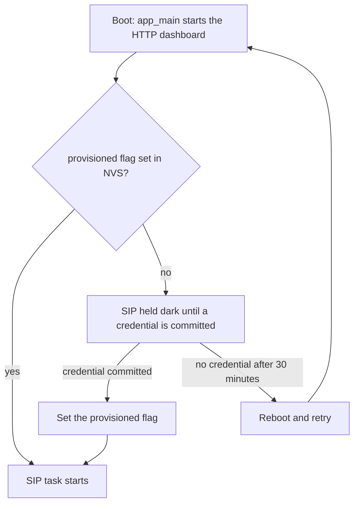
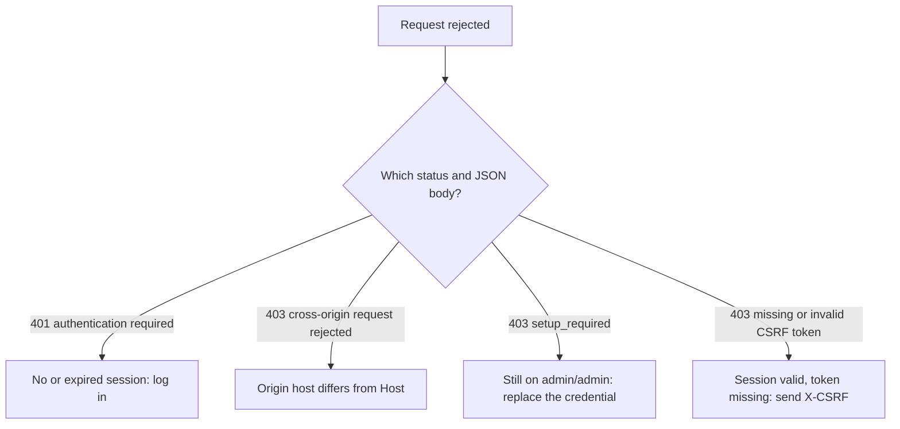

# Troubleshooting Runbook

Symptom → likely cause → fix. Work top-down within each section. Where a fact comes from
the firmware or another doc, it is cited so you can verify.

Quick references: [SETUP_GUIDE.md](SETUP_GUIDE.md) ·
[PHONE_COMPATIBILITY.md](PHONE_COMPATIBILITY.md) · [HARDWARE_SELECTION.md](HARDWARE_SELECTION.md) ·
[API.md](API.md) · [OTA.md](OTA.md) · [LEARN_MODE.md](LEARN_MODE.md) ·
[THREAT_MODEL.md](THREAT_MODEL.md)

## Check this first: the out-of-the-box state

Read this before triaging anything.

* **The dashboard is always reachable on port 80.** The HTTP listener accepts unconditionally, on every build and in every provisioning state. There is no dark-by-default management plane and no DTMF star-code to reopen one. *Connection refused* on port 80 is always a genuine fault ([API.md §0](API.md); pinned as a regression by `tests/AdminHttpGate_test.cpp`, `AdminHttpGate.Boot_Provisioned_StillListensImmediately`).
* **The admin credential is a username and password**, not a PIN. The device **ships with `admin`/`admin`** (`AdminAuth::kDefaultUsername`/`kDefaultPassword`). Until you replace it via `POST /api/admin/set-credential`, every admin-gated route, gated `GET`s included, answers `403 {"error":"setup_required"}` (`HttpServer::requireAdmin()` in `src/Helpers/HttpServer.cpp`). See [Everything returns 403 setup_required](#everything-returns-403-setup_required).
* **A separate numeric DTMF PIN** exists for the phone-keypad admin menu (`*PIN#code`). It has **no** default, so that menu is unreachable until one is explicitly set. It is unrelated to the web session.
* **On a `wifi`, `eth` or `lan8720` board that has never been set up, or has been factory-reset, SIP does not start** until a credential is committed. The gate is in `app_main()` in `main/esp_main.cpp`, `main/esp_main_eth.cpp` and `main/esp_main_eth_lan8720.cpp`. A dead port 5060 with a live port 80 is that gate, not a fault. See [Phone won't register](#phone-wont-register-timeout-or-401). The **`display`** build has no such gate. It starts SIP once it joins a network, and not while the onboarding captive portal is up (`main/esp_main_display.cpp`).
* The registrar ships in `learn` mode (#441). The `open` mode is retired (#502). A new phone is adopted on its first REGISTER with no SIP authentication, and its INVITEs are admitted unchallenged. A later REGISTER, at least 30 s after the first, locks the extension to its resolved MAC if no other device has claimed it (#440, #515). Digest auth (RFC 2617) applies once an admin promotes the device to Secured, or to every extension in `secure` mode.
* The SoftAP is **open** by default, the dashboard is **plain HTTP**, and OTA images are **unsigned**. All three are deliberate defaults, not oversights.

## Access-point not visible

Symptom: The `esp32-sipserver` Wi-Fi network does not appear in your client's Wi-Fi list.

| Cause | Fix |
| :--- | :--- |
| Device not powered / still booting | Confirm power (USB-C or PoE). Watch the serial monitor (`idf.py monitor`) for `INFRA: SoftAP SSID:esp32-sipserver channel:1 auth:OPEN  DHCP server active` (`main/esp_main.cpp`; `auth:` reads `WPA2-PSK` when AP security is on). |
| This is a **wired Ethernet** build | `SIP_TRANSPORT=eth` boards have **no SoftAP**; they join your wired LAN. Reach the dashboard at the device's LAN IP / `pocketdial.local` (see [HARDWARE_SELECTION.md](HARDWARE_SELECTION.md)). |
| Device is in **Station mode** | If Wi-Fi was configured to join an existing network (`/api/wifi/connect`), it is a client, not an AP. Factory-reset to return to AP/onboarding (see [Forgot the admin password](#forgot-the-admin-password)). |
| Display build sitting in onboarding | The display variant's onboarding AP is **`My-Ap`**, not `esp32-sipserver` (`ONBOARDING_SSID`, `main/esp_main_display.cpp`). Look for `My-Ap`. |
| 2.4 GHz only | The ESP32 SoftAP is 2.4 GHz, channel 1. Ensure your client shows 2.4 GHz networks. |

The network being *visible but locked* is a different problem; see the next section.

## Can't join the Wi-Fi network any more

Symptom: `esp32-sipserver` (or `My-Ap`) is in the list but your client asks for a
password, or rejects the one you have.

The SoftAP can be **WPA2-PSK** instead of open. It is **off by default** and stays off
across a firmware update. Someone turned it on, or it was set at flash time.

| Cause | Fix |
| :--- | :--- |
| AP security was enabled | Read the passphrase off the device (table below) and join with it. Confirm the setting with `GET /api/ap-security` → `{"secure":true,"psk":"…"}` ([API.md](API.md#get-apiap-security)), or the boot log line `SoftAP SSID:esp32-sipserver … auth:WPA2-PSK` (`main/esp_main.cpp`). |
| The passphrase was rotated | Rotating drops every associated client. Read the current value again; the old one is gone and is not recoverable. |
| It was set by the browser flasher | The flash-time `cfgseed` record can carry the passphrase. Whoever flashed the board has it. |
| Wrong/ambiguous characters typed | The generated passphrase is 20 chars from an alphabet with **no** `0`, `O`, `1`, `I`, `L` or `U` (`DeviceConfig.hpp`). A `0` you read off a screen is probably an `O`, and a `1` is probably an `I` or `L`; recheck. |
| Display build's onboarding AP | **`My-Ap` is WPA2 too**, using the same per-device passphrase (`wifi_init_softap(ONBOARDING_SSID, g_apPsk, false)`, `main/esp_main_display.cpp`). It is shown on the LVGL onboarding screen next to the SSID. |

Where the passphrase is: the device generates its own, per unit; there is no factory
default and nothing is baked into the image ([SETUP_GUIDE.md](SETUP_GUIDE.md#turning-on-access-point-security-wpa2)):

| Build | Where it appears |
|-------|------------------|
| `display` | On the LVGL screen during captive-portal onboarding |
| `wifi` (headless) | Serial boot log: `INFRA: SoftAP passphrase (WPA2): …` (`idf.py monitor`) |
| Any | `GET /api/ap-security` / the dashboard's *Security* → *Wi-Fi access point security* section, once logged in as admin |
| Any | The browser flasher, if it was set at flash time |

**Warning:** On a headless `wifi` board with AP security on, with no admin password you remember and nobody on the AP, the only ways back are a **serial console** (the passphrase is logged at every boot) or a **re-flash**. Read the passphrase before you need it.

The `eth` build has no SoftAP at all, so none of this applies to it.

## Captive portal won't open

Symptom: You joined `My-Ap` (display build) but no setup page appears.

| Cause | Fix |
| :--- | :--- |
| Never actually associated | `My-Ap` is **WPA2**, keyed with the device's own generated passphrase shown on the onboarding screen (`main/esp_main_display.cpp`). If your client silently failed to join, there is no portal to open; see [Can't join the Wi-Fi network](#cant-join-the-wi-fi-network-any-more). |
| OS captive-portal prompt missed | Manually browse to `http://192.168.4.1/`. The device returns a `302` redirect to the portal for any off-host request ([API.md §3](API.md)). |
| The 5-minute decay window elapsed | The portal has a **300 s decay watchdog** (`CAPTIVE_DECAY_SECONDS`, `main/esp_main_display.cpp`): with no confirmed config it reboots into Standalone AP. Re-join **`esp32-sipserver`** and use `http://192.168.4.1`. |
| `401`/`403` from `POST /api/configuring` | That route is gated like every other mutating route (`requireAdmin()`). The portal's "I'm still configuring" hold needs a logged-in session; log in with `admin`/`admin` and complete setup first. |
| Browser cached HTTPS / HSTS | Use a fresh `http://` URL (not `https://`), or try a private window. The dashboard is HTTP only. |
| DNS not redirecting | The onboarding DNS responder answers all names with the device IP (port 53). If your client uses DNS-over-HTTPS, type the IP `192.168.4.1` directly. |

## Phone won't register (timeout or 401)

Symptom: The SIP client never reaches "registered", times out, or shows an error.

| Cause | Fix |
| :--- | :--- |
| **Nothing at all on port 5060, on a `wifi`/`eth`/`lan8720` board that has never been set up or has been factory-reset** | **The boot provisioning gate.** `app_main()` starts the HTTP dashboard immediately but holds the SIP task down until an admin credential is committed. Serial log: `[boot] device unprovisioned — SIP stack held dark until credential committed` (`main/esp_main.cpp`, `main/esp_main_eth.cpp`, `main/esp_main_eth_lan8720.cpp`). Log in at `http://<device>/` with `admin`/`admin`, complete setup, and watch for `[boot] credential set — unblocking SIP stack`. The wait is bounded: 30 minutes with no credential and the board reboots to retry. The diagram below shows the gate. **The `display` build has no such gate.** It is deliberately "up usable, secure later". It starts SIP once it joins a network, so on a display board past onboarding a dead 5060 is a real fault. |
| Wrong server/port/transport | Server `192.168.4.1`, port `5060`, transport **UDP** (the engine is UDP-only). See [PHONE_COMPATIBILITY.md](PHONE_COMPATIBILITY.md). |
| Not on the device's network | Confirm the phone has a `192.168.4.x` lease (SoftAP) or can reach the device's LAN IP (wired). |
| TCP/TLS selected | Switch the client to **UDP**. There is no TCP/TLS listener, and no SIPS/TLS signalling of any kind. |
| Using a reserved extension | A REGISTER for a reserved code gets `403 Reserved or PSTN-shaped extension`. The reserved codes are `777` (echo), `440` (tone), `555` (anchor bridge), `888` (conference), `999` (all-page), `796` (voicemail retrieval), `997` (multicast paging), `911` and `933` (emergency), and the trunk-prefixed `9911` and `9933`. E.164 numbers (leading `+`) and all-digit numbers of at least `POCKETDIAL_MIN_PSTN_AOR_DIGITS` digits (7 by default) get the same `403`. Park orbits `700`–`709` and paging zones `980`–`989` are accepted at REGISTER, and the PBX intercepts calls to them before an INVITE reaches a registered client. A phone on one of those extensions can look "registered" while being uncallable. Pick another extension (e.g. `1001`). |
| `503 Service Unavailable` on REGISTER | The client pool is full. `allocateClient()` evicts the oldest *expired* binding, else returns `503`; the phone retries on its refresh timer. Raise the tier ([SCALING.md §4](SCALING.md)). |
| Client pruned after registering | The registrar prunes a client after ~15 s of silence if it ignores the `OPTIONS` keepalive sent every 5 s (`RequestsHandler.cpp`). Enable the phone's keep-alive / answer-OPTIONS option. |
| Rate-limited (packets dropped) | The SIP UDP path uses a per-source-IP token bucket (burst 40, 20 pkt/s sustained). A flooding or misconfigured client gets packets dropped; watch `packetsDropped` on `/api/status` ([ARCHITECTURE.md §5](ARCHITECTURE.md)). |
| Registrar is in `secure` mode | Every `REGISTER` is digest-challenged and this phone has no secret, or its MAC does not match the one the extension is locked to. See [All phones stopped registering at once](#all-phones-stopped-registering-at-once). |
| Registrar is in `learn` mode and the extension is locked or secured to another phone | Learn mode adopts a new MAC, and that phone's next registration at least 30 s after its first locks its extension to the MAC (#440, #515); an admin can also secure a device (`POST /api/registrar/device` with `action=secure`). Either way a different phone on the same extension is refused (`Extension Locked To Another Device`). `action=forget` releases the device so the new hardware can claim it ([API.md](API.md#post-apiregistrardevice)). |
| `503` with `Retry-After: 5` in `learn` mode | The extension is locked (#440), this REGISTER's source is not on the board's subnet, and it is not the extension's registered IP and port (the owner's refresh from there is accepted). An on-link phone never sees it: the board ARPs it without answering and admits its retransmission (#864). A phone that keeps getting it reaches the board through a router, so `forget` its device ([LEARN_MODE.md](LEARN_MODE.md) §8). |

The provisioning gate on `wifi`, `eth` and `lan8720` builds works like this. Boot always starts the HTTP dashboard. If the `provisioned` flag is set in NVS, SIP starts. If it is not set, SIP stays dark until a credential is committed. Committing a credential sets the flag, and SIP starts. If no credential arrives within 30 minutes, the board reboots and the gate runs again.



**A `401` on REGISTER depends on the registrar mode.** Check the mode first. `GET /api/registrar` returns `{"mode":"learn"|"secure", …}` ([API.md](API.md#get-apiregistrar)). There is no `open` mode (#500). That `GET` needs a session (and completed setup), but no `X-CSRF`.

* In `learn` (the default, #441), already-secured devices are digest-challenged. Unknown MACs are adopted on first contact without a credential. A `401` for an extension that isn't Secured is *not* from pocket-dial. It is almost always the phone's own account dialog or, separately, the **HTTP admin** gate (`/api/admin/*`), which is a different subsystem.
* In `secure`, a `401` with `WWW-Authenticate: Digest …` is real SIP digest auth (RFC 2617, MD5). The phone needs the extension's secret set on the handset.

In `secure` mode **INVITE is digest-challenged too**, not just REGISTER (`RequestsHandler::onInvite()` calls `Registrar::admitSecure()`). In-dialog requests (BYE, re-INVITE, REFER) are not independently challenged. They are instead checked against the dialog's known leg addresses. See [Calls drop unexpectedly](#calls-drop-unexpectedly).

## All phones stopped registering at once

Symptom: Every handset drops to "not registered" simultaneously, with no power, cabling
or Wi-Fi change. New registrations are refused.

Almost always: someone switched the SIP registrar to **`secure`** before any extension
had been adopted and secured. In `secure` mode every `REGISTER` is digest-challenged, and a
fleet that has never been through `learn` mode has no secrets to answer with, so all of
them fail at once ([LEARN_MODE.md](LEARN_MODE.md) §1).

**Confirm it** (a `GET`, so no `X-CSRF`, but it *is* session-gated, so log in first and
reuse the cookie jar; the recipe is in
[403 on an API call that used to work](#403-on-an-api-call-that-used-to-work)):

```bash
curl -s -b "$JAR" http://192.168.4.1/api/registrar
# -> {"attached":true,"mode":"secure","devices":[]}
```

An empty (or all-`learned`) `devices` array with `"mode":"secure"` is the diagnosis. A bare
`curl` with no cookie returns `401` here; that is the admin gate, not a clue about the
registrar.

**Recover.** The dashboard is always reachable, so there is no time pressure. Take as long as you need.

1. **Put the registrar back.** Log in, then:
   ```bash
   curl -s -b "$JAR" -H "Origin: $DEVICE" -H "X-CSRF: $CSRF" \
        -X POST --data "mode=learn" "$DEVICE/api/registrar"
   ```
   Let the phones re-adopt, verify the roster, secure them individually
   (`POST /api/registrar/device`, `action=secure`), *then* go back to `secure`.
2. **If you cannot log in either** (lost password on top of the lockout), see
   [Forgot the admin password](#forgot-the-admin-password); that path is a re-flash.

A factory reset (`POST /api/factory-reset`) returns the registrar mode to `learn`. `DeviceConfig::clearAll()` writes it through `writeRegistrarMode()`. On ESP builds the reset also erases the whole NVS partition, which the [Forgot the admin password](#forgot-the-admin-password) section covers. The reset path has been checked against the source but not run on hardware.

`POST /api/registrar mode=learn` is the lighter-touch fix and the first thing to try. It changes one setting instead of wiping the device. `mode=open` is refused with `400`, because the open registrar is retired (#500). A phone whose device was **Secured** stays digest-enforced in Learn, so also `forget` it (`POST /api/registrar/device action=forget`) if its secret is lost.

Factory reset also **re-arms the flash-time seed.** Dropping `cfgseed_gen` means the next boot re-applies whatever the browser flasher wrote, which can include `regMode` (`DeviceConfig::applyFlashSeed()`). A board *seeded* `secure` comes back `secure` after both a factory reset and a bare NVS erase. To clear the seed you must re-flash it, or erase its sector (`erase_region 0xFFF000 0x1000` on the 16 MB layout). On an unseeded board, a bare NVS erase (`erase_region 0x9000 0x6000`) clears *every* namespace, `pbxcfg` included, and returns the registrar to the default, `learn` (#441; `open` is retired, #502).

The `409` guard stops this mistake. `POST /api/registrar` with `mode=secure` is refused while no extension is yet `secured`: `{"error":"no extensions are secured yet; switching to secure now would reject every phone…"}`. That is the firmware stopping you from doing exactly this, not a bug. Override it with `confirm=LOCKOUT` only when you know a secured handset already exists.

## One-way or no audio

Symptom: The call connects (rings, answers) but you hear nothing, or only one side
hears audio.

**A codec mismatch is not a silent-audio symptom.** An INVITE whose SDP offers nothing this PBX will carry is refused up front with `488 Not Acceptable Here` and `Warning: 304 <ip> "No compatible audio codec (PCMU/PCMA/G722)"` (`RequestsHandler::onInvite()`). If signalling *completed* and audio is dead, look past the codec.

What the media path actually is, because it decides where to look:

* An **ordinary extension-to-extension call is peer-to-peer**. The board relays the SDP but
  never touches the RTP; the phones stream directly to each other. Hold and transfer keep
  that property: only the codec list is narrowed, the `c=` connection line is never
  rewritten.
* **A call parked on an orbit is the exception.** With a music-on-hold clip loaded the board
  answers the parked leg `sendonly` from its own port and streams the clip to it, so board-side
  capture *will* show RTP for a parked call. With no clip loaded (the default) park answers
  `a=inactive` and the board sends nothing, which is also what you will see if the clip
  failed to load, so "parked caller hears silence" is a MoH-configuration symptom, not a
  media-path fault.
* `777` (echo) also touches no RTP: it is an SDP loopback, so the phone streams to
  itself. That makes it a test of *that one phone's* media path, not of the board's.
* **`440` (tone), `555` (anchor bridge) and `888` (conference) are server-terminated**; the
  board really does send and/or receive RTP for those.

| Cause | Fix |
| :--- | :--- |
| NAT/STUN/ICE enabled on the phone | For a peer-to-peer leg, media is **phone-to-phone on one L2 segment**. NAT traversal rewrites the SDP connection address and breaks direct RTP. Turn STUN/ICE/rport **off**. |
| Client isolation on the AP | RTP is phone-to-phone; if SoftAP client isolation were enabled, stations couldn't reach each other and audio would fail (see the caveat in [PROVISIONING.md §6.3](PROVISIONING.md)). |
| Firewall between phones (wired) | On a wired LAN, ensure the segment allows station-to-station UDP for the RTP port range. |
| Codec narrowing on a relayed leg | Relayed peer-to-peer legs keep the endpoint's own payload list and order, dropping only what the PBX won't carry: **PCMU, PCMA and G.722** survive, plus `telephone-event` (`SipMessage::filterAudioCodecs()` in `src/SIP/SipMessage.hpp`). A G.722-capable pair negotiates wideband on their own. |
| Wideband offered to a server-terminated leg | The server-terminated extensions are **PCMU-only**. A caller offering nothing but G.722 gets `488` from those specifically, even though the same offer is fine for a two-phone call; the `777` branch of `RequestsHandler::onInvite()` spells the reasoning out. |
| A doc or script telling you to force "G.711 only" | Stale advice. `enforceG711()` still exists in `SipMessage.cpp` but has **no production callers**; it is deprecated, and its old blanket `0 8 101` rewrite is exactly the malformed-answer bug the current code avoids. Do not restrict handsets to µ-law/a-law on its account. |
| Verify with `777` | Dial `777`: if echo works but a two-party call does not, the problem is between the two phones (NAT/isolation/firewall). If `777` itself is silent, it is that phone's own RTP path; the board is not in it. |

## Calls drop unexpectedly

Symptom: Established calls hang up on their own.

| Cause | Fix |
| :--- | :--- |
| Keepalive prune | A phone that stops answering `OPTIONS` is pruned after ~15 s (`RequestsHandler.cpp`); its calls end. Keep the phone's keep-alive on and Wi-Fi signal adequate. |
| Wi-Fi association lost | On a SoftAP node, a weak link drops the station. Check RSSI / reduce range. |
| Session pool exhausted | New INVITEs get `503` when the session pool is full; existing calls are untouched. Raise the tier ([SCALING.md §4](SCALING.md)). |
| Outbound trunk call ended at ~60 s of ringing with `480` | Not a fault. An outbound call through the anchor client gets its own no-answer window (`ANCHOR_NO_ANSWER_TIMEOUT`, 60 s) rather than the 20 s internal-extension constant, and the teardown answers **`480 Temporarily Unavailable`**, not `503`. |
| Admin force-disconnect | `POST /api/kill` de-registers an extension and tears down its calls ([API.md](API.md)). Check whether someone used the dashboard's kill control. |
| Spoofed BYE | A forged teardown from **off the call path** is rejected `403`: a BYE for an established dialog must arrive from one of the call's leg IPs (`RequestsHandler::onBye()`'s `isDialogSourceAuthorized()` guard in `src/SIP/RequestsHandler.cpp`). What that does *not* stop is a peer who can source packets from a leg's address; on an open AP that is still reachable, so WPA2 on the SoftAP remains the real fix. In-dialog requests are not digest-challenged even in `secure` mode. |

## Dashboard unreachable

Symptom: `http://192.168.4.1` (or `pocketdial.local`) does not load.

| Cause | Fix |
| :--- | :--- |
| **Connection refused** | **A real fault.** The listener accepts unconditionally in every provisioning state; there is no dark/open gate and nothing to "reopen". Check you are at the right IP and that nothing on your machine is filtering port 80. (`http_dashboard` is a FreeRTOS **task name**, on `eth`/`lan8720` only; the `wifi` build calls it `http_server_task`. Neither is printed at boot, so do not wait for a log line.) |
| Wrong scheme | Use **`http://`**, not `https://`; the dashboard is plain HTTP ([API.md §1](API.md)). There is deliberately **no** HSTS header, so a browser that once cached HTTPS for this host will not have been pinned by us ([API.md §2.2](API.md)). |
| mDNS not resolving | Browse to the raw IP `192.168.4.1` (SoftAP) or the device's LAN IP (wired). |
| Not joined to the device network | Re-check Wi-Fi association / DHCP lease. If the AP is now WPA2, see [Can't join the Wi-Fi network](#cant-join-the-wi-fi-network-any-more). |
| Slow-client / Slowloris timeout | The HTTP worker enforces a 5 s `SO_RCVTIMEO` and closes idle sockets ([ARCHITECTURE.md §4](ARCHITECTURE.md)); reload the page. |
| `413 Payload Too Large` | A request body over **16 KB** is rejected ([API.md §1](API.md)). Don't paste oversized Wi-Fi passwords. |
| `403 cross-origin request rejected` | A state-changing POST whose `Origin` host ≠ `Host` is blocked. Use the dashboard directly, or send a matching `Origin` from CLI ([API.md §2](API.md)). |
| `403 setup_required` | The board is still on `admin`/`admin`. See [the next section](#everything-returns-403-setup_required). |
| `403 missing or invalid CSRF token` | A **third** distinct 403; see [403 on an API call that used to work](#403-on-an-api-call-that-used-to-work). |
| `401 authentication required` on a control action | You have no valid `pd_session`. Log in via `POST /api/admin/login` first ([SETUP_GUIDE.md §3](SETUP_GUIDE.md)). |
| `429` on login | Brute-force lockout, and it escalates. See [429 on login](#429-on-login) below. |
| Page renders but panels are blank | `GET /` and `/api/status` are ungated, as are `/metrics`, `/api/wifi/scan`, `/api/admin/status`, `/api/ota/status` and `GET /config/<mac>.cfg`. `/api/pcap`, `/api/trace`, `/api/registrar`, `/api/telephony-config`, `/api/did-mapping` and `/api/moh` all need a session. A logged-out browser gets a rendered shell with `401`s underneath; the **PBX Settings** panel (`F6`) is one of them, since `/api/moh` is gated. |

## Everything returns `403 setup_required`

Symptom: You can load the page and you are logged in, but every action, including
read-only ones like `GET /api/registrar`, comes back:

```json
{ "error": "setup_required", "message": "Change the default admin credential before continuing." }
```

**This is forced first-use setup, working as designed.** The device ships with a well-known
default login so the dashboard is usable out of the box, and `HttpServer::requireAdmin()`
refuses everything except the one route that fixes that, until it is fixed. `GET /api/admin/status` tells you where you stand without a session at all:

```bash
curl -s http://192.168.4.1/api/admin/status
# -> {"provisioned":false,"needsSetup":true,"authenticated":false,"sessionRemainingSec":0}
```

To fix it, log in with the default, then replace it:

```bash
DEVICE=http://192.168.4.1
JAR=cookies.txt

LOGIN=$(curl -s -c "$JAR" -H "Origin: $DEVICE" \
     -X POST --data "username=admin&password=admin" "$DEVICE/api/admin/login")
CSRF=$(printf '%s' "$LOGIN" | sed -n 's/.*"csrf":"\([0-9a-f]*\)".*/\1/p')
[ -n "$CSRF" ] || { echo "login failed: $LOGIN" >&2; exit 1; }

curl -s -b "$JAR" -H "Origin: $DEVICE" -H "X-CSRF: $CSRF" \
     -X POST --data "username=admin&password=CHANGE-THIS-PASSWORD" \
     "$DEVICE/api/admin/set-credential"
# -> {"status":"ok","provisioned":true,"needsSetup":false}
```

- The password must be **≥ 8 characters** (`AdminAuth::kMinPasswordLength`); the username
  is 1–32 characters with no whitespace or control characters. A rejected pair returns
  `400 {"error":"invalid username or password"}` and changes nothing.
- `username` and `password` must be sent **together**; sending one alone is
  `400 {"error":"username and password must both be provided together"}`.
- The **session survives the credential change**; the same `$JAR`/`$CSRF` keep working,
  no second login needed.
- The optional `dtmfPin=` field (4–16 digits) sets the *separate* phone-keypad admin PIN.
  It has no default and the `*PIN#code` menu stays disabled until you set one. Sending
  `dtmfPin=` alone changes only that.

## `403` on an API call that used to work

Symptom: A `curl` recipe or script returns:

```json
{ "error": "missing or invalid CSRF token" }
```

with status `403`. The session cookie is fine; the request is missing the second half of
the gate.

**Cause.** Every **mutating** request has to echo a per-session **CSRF token** in an
`X-CSRF` header, checked centrally in `HttpServer::requireAdmin()` so no endpoint can skip
it ([API.md §0](API.md), [THREAT_MODEL.md](THREAT_MODEL.md) T-2). The `Origin` check
deliberately still admits requests with **no** `Origin` header at all (that is what keeps
`curl` and CI working), so the token is what actually proves the request came from
something that was *told* the token, rather than from a page that merely rode your cookie.

**Fix.** Capture the token from the login response and send it on every mutating call. The
login response body carries it as `"csrf"`:

```bash
DEVICE=http://192.168.4.1          # or http://pocketdial.local
JAR=cookies.txt

# 1) Log in: this returns BOTH the pd_session cookie and the session's CSRF token.
LOGIN=$(curl -s -c "$JAR" \
     -H "Origin: $DEVICE" \
     -X POST --data "username=admin&password=YOUR_PASSWORD" \
     "$DEVICE/api/admin/login")
# -> {"status":"ok","authenticated":true,"needsSetup":false,"csrf":"3f2a...e91c"}

CSRF=$(printf '%s' "$LOGIN" | sed -n 's/.*"csrf":"\([0-9a-f]*\)".*/\1/p')
[ -n "$CSRF" ] || { echo "login failed: $LOGIN" >&2; exit 1; }

# 2) Any mutating call now carries cookie + Origin + token.
curl -s -b "$JAR" -H "Origin: $DEVICE" -H "X-CSRF: $CSRF" \
     -X POST --data "extension=1001" "$DEVICE/api/kill"
```

The same three headers apply to `/api/dnd`, `/api/forward`, `/api/group`, `/api/dialplan`,
`/api/configuring`, `/api/wifi/connect`, `/api/wifi/mode_ap`, `/api/factory-reset`,
`/api/ap-security`, `/api/registrar`, `/api/registrar/device`, `/api/admin/set-credential`,
the `/api/telephony-config` and `/api/did-mapping` writes, and the OTA endpoints
([OTA.md §3.2](OTA.md) has the OTA-specific walk-through).

**When you do *not* need it:**

| Case | Why |
| :--- | :--- |
| `POST /api/admin/login` | No session exists yet to bind a token to. Same-origin checked only. |
| `POST /api/admin/logout` | Requiring one would strand a user on a stale page. Same-origin checked only. |
| Every `GET` | Reads are not state changes. The gated ones still need a session. |

There is no "unprovisioned device needs no headers" exemption. The session gate applies from the first boot, and the shipped default credential exists for that reason (`HttpServer::requireAdmin()`).

Four rejections, four different problems. The JSON body is what tells them apart:

* `401 {"error":"authentication required"}`: no or expired session. Log in.
* `403 {"error":"cross-origin request rejected"}`: the `Origin` host differs from the `Host`.
* `403 {"error":"setup_required"}`: still on `admin`/`admin`. Replace the credential.
* `403 {"error":"missing or invalid CSRF token"}`: session valid, token missing. Send the `X-CSRF` token.

Asserting on the status code alone cannot distinguish the three `403`s.



## `429` on login

Symptom: `POST /api/admin/login` returns `429 {"error":"too many failed attempts; try
again later"}`, sometimes even with the correct password, and sometimes for someone who
has not typed a wrong one at all.

Two counters can produce it (`AdminAuth.hpp`, [THREAT_MODEL.md §5.2](THREAT_MODEL.md)):

| Counter | Threshold | Cooldown |
| :--- | :--- | :--- |
| **Per-client** (since #530), keyed on the HTTP peer address and principal, 8 LRU buckets | **5** consecutive failures (`kMaxFailedAttempts`) | 60 s (`kLockoutMs`), **doubling on each successive lockout**, capped at ~16 min (`kMaxLockoutShift = 4`) |
| **Aggregate backstop**, per principal (username), across *all* clients | **20** consecutive failures (`kMaxFailedAttemptsGlobal`) | Same doubling ladder, also up to ~16 min; locks out that principal from **every** client (the other principal is unaffected) |

What will surprise you:

- **The per-client bucket is per client since #530** (`req.clientIp` is set on every
  request), so five wrong passwords lock out only that address. **But one address can still
  lock you out:** the aggregate backstop counts across that address's own cooldowns and
  trips at 20 failures, about 7 minutes of persistent guessing. Plan recovery around that
  (power-cycle clears it; see below), and see [THREAT_MODEL.md](THREAT_MODEL.md) D-3.
- **The cooldown does not reset the failure budget.** The trip count survives it, so a
  second lockout is 2 min, a third 4 min, and so on. Repeatedly retrying while locked out
  does not extend it, but each fresh set of 5 wrong passwords does.
- Only a correct login clears it, and it clears both counters.
- **The phone-keypad DTMF PIN has its own bucket in the same table.** `verifyDtmfPin()` uses
  the unkeyed `""` bucket, so PIN and web-login failures do not lock each other out, but
  eight failed web logins from fresh addresses can evict the PIN's bucket and clear a PIN
  lockout (#561).
- **You can be locked out by someone else.** The aggregate counter sits far above ordinary
  fat-fingering, so hitting it without guessing means something on the link is hammering
  `/api/admin/login`.

**Fix:** wait it out. It always auto-clears and never permanently locks the device.
Existing sessions keep working throughout; only `login` is throttled, so another browser
still logged in is your fastest route back in. Failing that, power-cycle: the attempt
buckets live in a process-local static, not NVS, so a reboot clears every lockout without
touching the credential.

## Forgot the admin password

There is **no password recovery**; the password is stored only as a salted, iterated
SHA-256 hash (`AdminAuth.cpp`; NVS keys `admin_user` / `admin_pw_salt` / `admin_pw_hash`,
with the DTMF PIN separately in `admin_pin_salt` / `admin_pin_hash`). The path back to a
usable device is a **factory reset**, which clears the login credential *and* the DTMF PIN
and returns the board to the `admin`/`admin` default with `needsSetup` true again.

**If you still hold a valid session** (a browser somewhere is still logged in), use the
dashboard's **Factory Reset** button. That page already has the session's CSRF token
rendered into it; from the CLI you would have to log in again to obtain one, and logging in
needs the password you have lost.

Once an owner account exists, factory reset needs an owner session. A plain admin login gets `403 {"error":"owner privilege required"}`, so log in with the owner account instead. The equivalent call, for when you *do* have the password and just want it scripted:

```bash
DEVICE=http://192.168.4.1
JAR=cookies.txt

LOGIN=$(curl -s -c "$JAR" -H "Origin: $DEVICE" \
     -X POST --data "username=admin&password=YOUR_PASSWORD" "$DEVICE/api/admin/login")
CSRF=$(printf '%s' "$LOGIN" | sed -n 's/.*"csrf":"\([0-9a-f]*\)".*/\1/p')

curl -s -b "$JAR" -H "Origin: $DEVICE" -H "X-CSRF: $CSRF" \
     -X POST --data "confirm=ERASE" \
     "$DEVICE/api/factory-reset"
# -> {"status":"ok","message":"Factory reset. Rebooting to captive-portal setup..."}
```

What a factory reset clears (`HttpServer::sendApiFactoryReset()` in `src/Helpers/HttpServer.cpp`):

- The `confirm=ERASE` token is **required**; without it the endpoint returns
  `400 {"error":"factory reset requires confirm=ERASE"}`.
- `AdminAuth::clearCredential()`: the login credential, the DTMF PIN, and all live
  sessions.
- `DeviceConfig::clearAll()`: erases `ap_secure`, `ap_psk` and `cfgseed_gen`. It writes
  `reg_mode` to `learn` through `writeRegistrarMode()` (`src/Helpers/DeviceConfig.cpp`) rather
  than erasing it, so a reset board comes back in Learn like a fresh install and a board left
  in `secure` can be rescued without USB.
  On its own, `clearAll()` does not clear `schema_ver` (#181), and it leaves
  `pbxcfg`/`sipauth`/`didmap`/`tapicfg` alone. The stamp describes the key layout, not the
  contents. Dropping it would make the next boot read existing data as v1 and re-run
  migrations over data that was already converted.
- Via the handler: the Telephony-API credential slots (`tapicfg`), the DID→extension table
  (`didmap`) and the CDR call-history ring (`cdrlog`). These live in their own NVS
  namespaces and would otherwise survive.
- The Wi-Fi keys `wifi_mode` / `wifi_ssid` / `wifi_pass` / `decayed`, but **only on a build
  that has Wi-Fi**, since `eth` / `lan8720` deliberately do not define
  `POCKETDIAL_HAS_WIFI` (`main/CMakeLists.txt`) and have no radio settings to
  erase. This is the only transport-specific part of the route.
- **A whole-partition erase on every ESP build.** About one second after the reply, a restart
  task erases the whole `nvs` partition with `nvs_flash_erase()`, then restarts. This removes
  every namespace, including `storage/schema_ver`, `pbxcfg`, `sipauth`, `didmap` and `tapicfg`,
  so the next boot finds no stored config. The host build has no NVS and clears its state in
  memory instead.
- **Then a reboot, on every ESP build.** The restart is guarded on `ESP_PLATFORM`, not on
  the transport, so wired boards reboot too. A wired board has no captive portal, so it
  reboots to the dashboard, which asks for a new admin login.
- **The boot provisioning gate re-engages on `wifi`, `eth` and `lan8720` builds.** The gate
  reads the `storage`/`provisioned` **u8** key at boot and writes it once a credential is
  committed (see [Phone won't register](#phone-wont-register-timeout-or-401)). The
  whole-partition erase removes that key. A reset board therefore comes back on the default
  `admin`/`admin` credential with SIP held dark until a new credential is committed. Set one
  straight after a reset. A bare NVS erase (`erase_region 0x9000 0x6000`) has the same effect.
  The `display` build has no gate and starts SIP as soon as it joins a network.
- It re-applies the flash-time seed. Dropping `cfgseed_gen` is deliberate: "factory"
  means *as flashed*, not *as hardcoded* (`DeviceConfig.hpp`). If the browser flasher wrote
  an AP passphrase, a Wi-Fi mode or a registrar mode into `cfgseed`, the next boot applies
  them again.

There is one non-network path back: if a **DTMF admin PIN** was set, dialling
`*<PIN>#9991` from the admin extension performs `nvs_flash_erase()` and a restart
(`DtmfFeatureCodes::runAdminCode()` in `src/SIP/DtmfFeatureCodes.cpp`). That erases the whole
NVS partition, so the provisioning gate re-engages as described above. It needs the admin
extension registered and the DTMF PIN known. Neither is true by default, since there is no
default DTMF PIN.

Otherwise, recover physically: re-flash over USB/JTAG, or erase NVS
(`esptool.py -p COM3 erase_region 0x9000 0x6000`). A full reflash returns the device to the
default-credential state; note that `idf.py erase-flash` wipes NVS entirely, and even a
plain `idf.py flash` may leave NVS in an inconsistent state across a partition migration,
so **treat it as a clean slate and re-onboard** ([OTA.md §5.1](OTA.md)). After reflashing,
completing the forced setup is the first step ([SETUP_GUIDE.md §3](SETUP_GUIDE.md)).

Choose a password you will remember that is still ≥8 characters ([THREAT_MODEL.md §5.2](THREAT_MODEL.md)). There is no "reset link."

## OTA update fails or rolls back

Symptom: A firmware push via `/api/ota/upload` errors, or the device reverts to the
previous firmware after rebooting. Full reference: [OTA.md](OTA.md).

OTA has never been run on hardware, on the bench or in CI. The failure modes below come from the implementation and the ESP-IDF contract, not from a run. Treat a first OTA as an experiment, with serial attached.

| Code / behavior | Cause | Fix |
| :--- | :--- | :--- |
| `401` | The request has no/invalid `pd_session`. | Log in first (`/api/admin/login`), reuse the cookie jar ([OTA.md §3.2](OTA.md)). |
| `403 setup_required` | The board is still on the `admin`/`admin` default. | Complete setup first; see [Everything returns 403 setup_required](#everything-returns-403-setup_required). |
| `403 cross-origin request rejected` | `Origin` host ≠ `Host`. | Send a matching `Origin` header, or omit it. |
| `403 missing or invalid CSRF token` | The request has a session but no `X-CSRF` header. A pre-existing OTA script hits this. | Capture `"csrf"` from the login response and send it ([OTA.md §3.2](OTA.md), and [403 on an API call that used to work](#403-on-an-api-call-that-used-to-work)). |
| `403 owner privilege required` | Firmware upload needs an owner session. A sysop session passes only while no owner account has been set. | Log in with the owner account, then retry. |
| `411` | Missing/zero `Content-Length`. | Use `--data-binary @build/SipServer.bin` so curl sets the length. |
| `400` | Upload truncated / socket closed mid-stream / flash write failed. | Re-upload on a stable link; the boot partition is unchanged, the device keeps running the current image ([OTA.md §4.2](OTA.md)). |
| `422` | `esp_ota_end()` rejected the image (bad magic / corrupt / not a valid app). | Verify you uploaded the correct `build/SipServer.bin`; rebuild. |
| `500` | `esp_ota_begin` / `set_boot_partition` failed. | Check device logs; retry. |
| `501` | This is the **host/desktop** build; OTA is device-only. | Run OTA against real hardware ([OTA.md §3.4](OTA.md)). |
| **Boots the OLD image after reboot** | **Rollback** restored the previous slot because the new image did not reach `markValid()` (it crashed/boot-looped during startup). This is the safety net working, no bricking. | Inspect serial logs for the boot-loop cause, fix the image, re-upload. The device confirms a healthy image only after a few seconds of stable operation ([OTA.md §4](OTA.md), `CONFIG_BOOTLOADER_APP_ROLLBACK_ENABLE=y`). |
| Power lost during write | The slot is partially written but never activated; `otadata` still points at the running slot, so the next boot is the old image. | Simply re-upload to retry ([OTA.md §4.2](OTA.md)). |

**Warning:** OTA images are **unsigned**. Upload needs an owner session (a sysop session passes only while no owner account exists), plus the CSRF token and a same-origin check. **Replace the default credential** and **restrict OTA to the local link** ([OTA.md §6](OTA.md), [THREAT_MODEL.md](THREAT_MODEL.md) T-5).

## Display blank or garbled (Guition JC3248W535 variant)

Symptom: The 3.5" touch panel is dark, shows noise, or never renders the UI.

| Cause | Fix |
| :--- | :--- |
| Missing I2C pull-ups on the touch bus | Many JC3248W535 clones omit them; add **4.7 kΩ pull-ups** on `TOUCH_SDA` (GPIO 4) and `TOUCH_SCL` (GPIO 8) to 3.3 V, or the panel/touch init can time out and crash ([HARDWARE.md §9A](HARDWARE.md)). |
| Wrong build / not the display target | Build with `idf.py -D SIP_TRANSPORT=display build` ([README.md](../README.md)). A Wi-Fi-only build does not drive the panel. |
| PSRAM not in Octal mode | The two 307.2 KB LVGL frame buffers need **8 MB Octal PSRAM @ 80 MHz** (`MALLOC_CAP_SPIRAM`). Octal PSRAM and `qio` flash mode are set via `sdkconfig.defaults`; a mismatched config exhausts internal SRAM ([HARDWARE.md §2](HARDWARE.md)). |
| Backlight off | `TFT_BL` is GPIO 1, **active-high** (high = on). A dark-but-alive panel can be a backlight wiring issue ([HARDWARE.md §2](HARDWARE.md)). |
| Panel or touch init fails at boot | The panel and touch init calls use `ESP_ERROR_CHECK`, so a failure aborts boot before SIP starts. The display build has no headless fallback. Check the wiring and pull-ups above, then the serial log. For a headless board, use a `wifi` or `eth` build ([HARDWARE_SELECTION.md §3](HARDWARE_SELECTION.md)). |

A display build with a dead panel does not run SIP, so it cannot serve as a headless board. For a headless board, choose a `wifi` or `eth` build ([HARDWARE_SELECTION.md §3](HARDWARE_SELECTION.md)).

## Still stuck? Collect this before asking for help

- `GET /api/status` output (uptime, `packetsProcessed`, `packetsDropped`, `clients`,
  `sessions`). Ungated; see [API.md](API.md).
- `GET /api/admin/status`, which returns `{provisioned, needsSetup, authenticated, sessionRemainingSec}`.
  Ungated, and `needsSetup` is usually the answer.
- `GET /api/registrar` (`mode` and the adopted-device roster) and `GET /api/ap-security`
  (`secure`, and whether a passphrase is set). Both need a session **and** completed setup.
  **Redact the `psk` before pasting it anywhere.**
- The exact status code **and JSON body** of the failing request: `401`,
  `403 cross-origin`, `403 setup_required` and `403 missing or invalid CSRF token` are four
  different problems.
- Serial monitor log around the failure (`idf.py monitor`), in particular the
  `[boot] device unprovisioned …` / `[boot] credential set …` lines.
- Board model and `SIP_TRANSPORT` build used ([HARDWARE_SELECTION.md](HARDWARE_SELECTION.md)).
- The exact phone model/firmware and its codec/transport settings
  ([PHONE_COMPATIBILITY.md](PHONE_COMPATIBILITY.md)).
