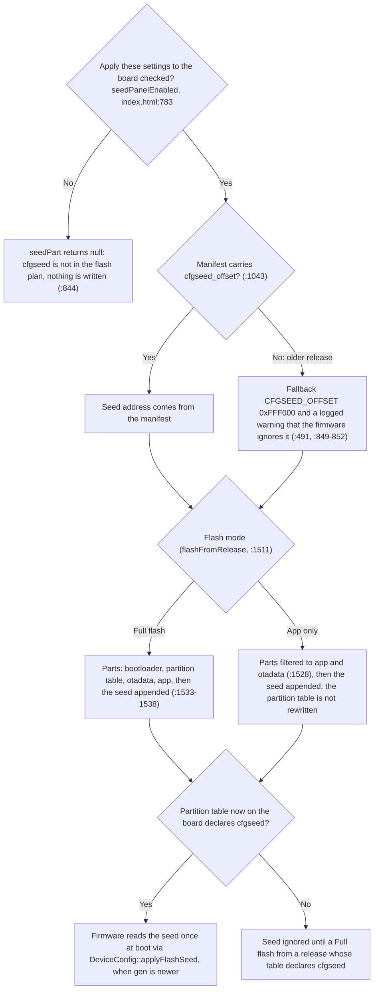

# Browser flasher

`index.html` installs pocket-dial onto an ESP32-S3 board over USB, entirely inside the browser, with no build step.

## Hosting and data flow

The page is served from GitHub Pages at:

**<https://glomargadaffi.github.io/pocket-dial/flasher/>**

It uses the [Web Serial API][webserial] to drive [esptool-js][esptool-js]. The
esptool-js bundle is the only external script the page loads. It comes from
jsDelivr at a pinned version.

Nothing is uploaded anywhere. The page fetches firmware images from the same
GitHub Pages site, under `docs/firmware/<tag>/`, and writes them to the board
from the user's own machine. The `release.yml` workflow copies those images
from this repository's GitHub Releases.

```mermaid
flowchart LR
    T["Push of a v* tag"] --> W["release.yml builds each variant, writes manifest.json (with cfgseed_offset read from the partition table binary)"]
    W --> R["softprops/action-gh-release publishes the GitHub Release: all assets"]
    R --> PP["Step Publish firmware to Pages runs tools/publish_pages_firmware.py"]
    PP --> F["docs/firmware/tag/: .bin, manifest.json and flasher_args-*.json only, plus docs/firmware/index.json"]
    F -->|"commit and push to main by github-actions[bot]"| P["GitHub Pages serves docs/"]
    P -->|"same-origin fetch: index.json with no-cache, then manifest.json, then the images"| B["Browser page: docs/flasher/index.html"]
    B -->|"dynamic import of esptool-js 0.6.1 from jsDelivr on Connect, then Web Serial at 921600 baud"| D["ESP32-S3 board"]
```



The host binary, `partitions.csv` and `SHA256SUMS` stay on the Release only. Pages carries the
files matched by `KEEP` in `tools/publish_pages_firmware.py:39`, because the page never fetches
anything else. `index.json` lists each tag with its date, a `prerelease` flag (set when the tag
contains `-`) and an explicit `files` array, because Pages offers no directory listing.

## Requirements

* **Chrome, Edge, or Opera on desktop.** Web Serial exists nowhere else, not
  Firefox, not Safari, not any mobile browser. The page detects this and shows
  an explanation instead of a broken UI.
* **HTTPS or `localhost`.** Web Serial requires a secure context. GitHub Pages
  is HTTPS; for local testing serve over `http://localhost`.
* **No other program holding the serial port.** `idf.py monitor`, PuTTY, the
  Arduino IDE, and VS Code serial terminals all take exclusive ownership of a
  COM port on Windows. The page says so up front and translates the resulting
  error into that advice.

## How it works

1. **Connect.** `navigator.serial.requestPort()`, then a `Transport`, then an `ESPLoader`.
   `loader.main()` syncs with the ROM bootloader, identifies the chip, uploads
   the flasher stub, and raises the baud rate to 921600. Everything afterwards
   runs on that one connection.

2. **Report what's installed.** The page reads `esp_app_desc_t` back out of
   both OTA slots (app partition + `0x20`, i.e. `0x20020` for `ota_0` and
   `0x620020` for `ota_1`) and `otadata` at `0xf000` to say which slot is
   live. That yields the project name (`SipServer`) and version of whatever is
   on the board. It does **not** identify the variant (the firmware doesn't
   stamp its transport into the descriptor), so the user always picks the
   board. Every published build is ESP32-S3, so a non-S3 chip gets a warning
   pointing at the from-source `lan8720` build.

3. **Fetch releases from this site, not from the GitHub API.** One call to
   `../firmware/index.json` populates the picker; the newest non-pre-release is
   selected by default. An empty list and network errors are explained states
   that steer the user to the local-file panel.

   The page does not call the GitHub API (`api.github.com/.../releases`) or
   download assets from their `browser_download_url`. Those URLs redirect to
   `release-assets.githubusercontent.com`, and neither the redirect nor the
   final response sets `Access-Control-Allow-Origin`, so the browser blocks
   every download (#138).

   `release.yml` copies each release's images into `docs/firmware/<tag>/` and
   regenerates `docs/firmware/index.json`. Everything the page fetches is
   same-origin, so CORS never applies. Nothing on the flash path touches
   github.com. The one GitHub URL the page builds is the "view release" link,
   which comes from the tag and is for display only.

   The GitHub Release is still the source of truth and still carries every
   asset, including the host binary, `partitions.csv` and `SHA256SUMS`. Pages
   holds only the subset the page downloads. See
   [`docs/firmware/README.md`](../firmware/README.md).

4. **Resolve the images.** Two release layouts are understood:

   * **`manifest.json`** (preferred; written by `.github/workflows/release.yml`):

     ```json
     {
       "version": "v1.4.0",
       "variants": {
         "esp32s3-eth": {
           "name": "esp32s3-eth",
           "flash": { "size": "16MB", "mode": "dio", "freq": "80m" },
           "parts": [
             { "offset": 0,      "file": "bootloader-esp32s3-eth.bin",       "role": "bootloader",      "size": 20000 },
             { "offset": 32768,  "file": "partition-table-esp32s3-eth.bin",  "role": "partition-table", "size": 3072 },
             { "offset": 61440,  "file": "ota_data_initial-esp32s3-eth.bin", "role": "ota-data",        "size": 8192 },
             { "offset": 131072, "file": "SipServer-esp32s3-eth.bin",        "role": "app",             "size": 950000 }
           ],
           "cfgseed_offset": 16773120
         }
       }
     }
     ```

     Offsets are decimal. `role` is what lets *App only* mode pick its two
     parts without hardcoding `0xf000`/`0x20000` in the page.

     `cfgseed_offset` (`0xFFF000`) is the address of the settings-seed
     partition. It is deliberately *not* in `parts`: that blob is generated in
     the browser, not published in the release. Only its address comes from the
     manifest, read by `release.yml` out of the published
     `partition-table-<variant>.bin` so a partition move follows automatically.
     A manifest without the key, or a convention-layout release, means the
     build predates the feature; the page falls back to the `CFGSEED_OFFSET`
     constant and logs a warning that the firmware will ignore the seed.

   * **Bare naming convention** (v1.2.0 and earlier): `bootloader-<id>.bin`,
     `partition-table-<id>.bin`, `SipServer-<id>.bin`, with offsets and flash
     mode taken from `flasher_args-<id>.json` when it's attached. Those
     releases ship no `ota_data_initial.bin`; the page synthesises it (8 KB of
     `0xFF`, which tells the bootloader to boot `ota_0`). The hand-cut
     `v1.3.0-pre-alpha` names are matched too.

   Variant ids (`esp32s3-eth`, `esp32s3-display`, `esp32s3-wifi`) are the
   `<chip>-<transport>` tag the release workflow uses; `VARIANTS` in
   `index.html` and the matrix in `release.yml` must stay in sync.

5. **Flash.** Every image is downloaded *before* the first byte is written.
   `writeFlash` runs with `eraseAll: false` by default, which is what preserves
   NVS (saved Wi-Fi, admin PIN, extensions), and with `compress: true`. An
   *Erase the whole chip first* checkbox flips `eraseAll` on for the
   single-`factory` → dual-OTA migration described in `FLASHING.md`.

6. **Reset.** `loader.after("hard_reset", usingUsbOtg)`, choosing the USB-OTG
   reset path when `transport.getPid()` matches `loader.USB_JTAG_SERIAL_PID`
   (native USB-Serial-JTAG) and DTR/RTS otherwise (USB-UART bridge).

## Flash modes

| Mode | Writes | When |
| ---- | ------ | ---- |
| **Full flash** | bootloader `0x0`, partition table `0x8000`, otadata `0xf000`, app `0x20000` | First install, and after any partition-table or bootloader change |
| **App only** | otadata `0xf000`, app `0x20000` | Upgrading firmware already on the board, the same regions the OTA path touches |

Both modes additionally write `cfgseed` at `0xFFF000` **only** when the
flash-time configuration panel is opted into; see below.

There is also a **Flash your own build** panel: a file input per region with
an editable offset, for people building locally who don't want to install a
toolchain's flasher.

## Flash-time configuration (the `cfgseed` seed)

*Set Wi-Fi, AP security and SIP registrar mode while flashing* is a collapsed panel in step 3 that
writes a 256-byte settings record to the `cfgseed` partition at `0xFFF000`. The
firmware reads it once at boot, copies the flagged fields into NVS, records the
record's `gen` counter, and ignores the partition until a newer `gen` appears
(`src/Helpers/DeviceConfig.hpp`, which holds the authoritative wire format;
keep the two in lockstep).

It exists mainly for the headless `esp32s3-eth` and `esp32s3-wifi` builds: they
have no screen, so this page is the only place a human ever sees a generated AP
passphrase.

### Opt-in

The settings are off by default. They are governed by *Apply these settings
to the board*, which is unchecked on load. While it is unchecked the flasher
writes **nothing** to `cfgseed`, because the partition is not in the flash plan
at all. Reflashing a board you already configured therefore never clobbers its
passphrase, Wi-Fi mode, or upstream credentials. This is the property most worth
keeping.

### Leave as is

Every control has a "Leave as is" position, and only controls moved off it set
their `has-*` flag in the record. The reason is a plain on/off checkbox for AP
security. Someone who opts in only to set STATION mode would also write
`has-ap-secure` with the value `0`. That silently reopens a board that had WPA2
on, and the fresh `gen` makes the firmware apply it.

### Wi-Fi and AP security

**Warning:** turning WPA2 on breaks existing clients. Every phone, ATA, and
laptop already associated with the open access point has to be re-paired with
the new passphrase. The page shows this warning next to the toggle.

*Generate* produces 20 characters from `23456789ABCDEFGHJKMNPQRSTVWXYZ` (no
`0`/`O`, `1`/`I`/`L`, `U`) by rejection-sampled `crypto.getRandomValues`,
matching `DeviceConfig::kPskAlphabet`. Passphrases are validated to 8–63
printable ASCII characters, the bounds the firmware enforces for WPA2. Selecting
*WPA2* with an empty box generates one rather than letting the firmware pick a
value that only ever reaches the serial log. After a successful flash the
passphrase is shown in the result notice with a **Copy** button and echoed into
the log.

### SIP registrar mode

**SIP registrar mode** is the one setting here that is not about Wi-Fi. It is in
this panel because a headless board has no screen and no dashboard until it
joins a network. Digest auth is implemented in the firmware. The mode is stored
in NVS as `reg_mode`. The dashboard sets it through `POST /api/registrar`, and
this panel sets it before the board first boots. A board that has never been
configured runs in learn, so *Leave as is* means learn.

- learn (`1`): trust-on-first-use. Unknown devices are adopted and locked
  to their extension by MAC, while already-secured ones are digest-enforced. A
  deliberate, *temporary* weakening for adopting an existing phone fleet: it
  must not be left on as a steady state and should be run on a trusted or WPA2
  link. Selecting it reveals a warning that says so, and the flash log records
  it.
- secure (`2`): every REGISTER is digest-challenged; an extension is
  registrable only by a party that knows its secret. An extension with no
  stored secret is rejected outright with *Extension Not Provisioned*
  (`Registrar::admitSecure`), so provision before switching a live system over.

Open is retired (#500). The page offers only learn and secure, and a seed that
still carries byte `0` installs learn.

### Record version

The record version is deliberately not bumped to add a field. `regMode` sits at
byte 13 behind `kSeedHasRegMode` (bit 5). Each field is gated by its own flag,
and every reader ignores flags it does not recognise. Old firmware skips bit 5
and applies the rest. New firmware reading an older record leaves `reg_mode`
alone. Bumping the version would make older firmware reject the whole record.
Future fields go in the reserved space behind a new flag bit, the same way.

### Older boards

A board flashed from a release whose partition table predates `cfgseed` has no
such partition; the firmware skips the seed silently, which is the designed
behaviour and not an error. A **Full flash** self-heals it in one go: the new
partition table and the seed are written in the same operation, so the board
comes up already knowing about `cfgseed` and reads the seed on that first boot.
*App only* does not rewrite the partition table, so a seed written in that mode
lands on a layout that does not declare the partition and is ignored until a
full flash. The panel says this too.



## Local development

```powershell
python -m http.server 8000
# then open http://localhost:8000/docs/flasher/
```

esptool-js is imported as an ES module from jsDelivr at a **pinned exact
version** (`0.6.1`). Bump it deliberately: `FlashOptions.fileArray[].data` is
a `Uint8Array` in 0.6.x, and the API has changed shape across releases.

`docs/.nojekyll` disables Jekyll for the Pages build so nothing in the
JavaScript is mistaken for Liquid templating.

[webserial]: https://developer.mozilla.org/docs/Web/API/Web_Serial_API
[esptool-js]: https://github.com/espressif/esptool-js
